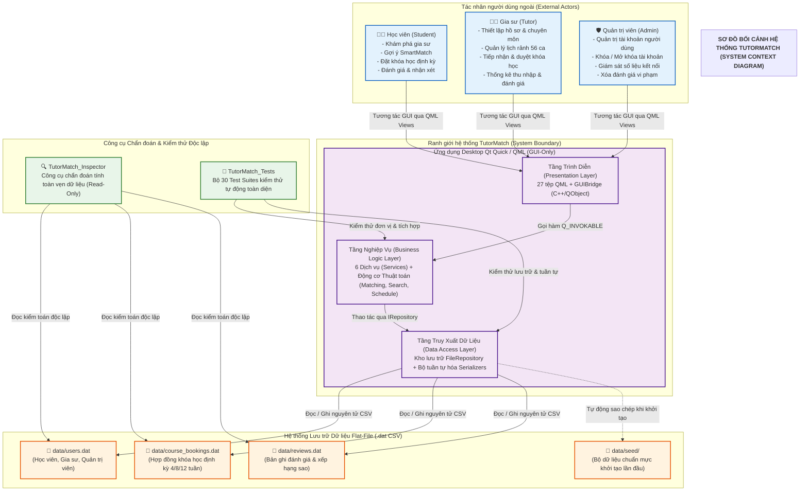

# TỔNG QUAN SẢN PHẨM TUTORMATCH (PRODUCT OVERVIEW)
## Khảo sát Toàn diện: Mục đích, Đối tượng, Ranh giới Hệ thống và Khả năng Thực tế

---

## 1. MỤC ĐÍCH VÀ BỐI CẢNH DỰ ÁN

**TutorMatch** là nền tảng phần mềm kỹ thuật học thuật được xây dựng trong khuôn khổ **Dự án Cơ sở Ngành Công nghệ Thông tin (PBL2 - Project Based Learning 2)** tại **Trường Đại học Bách Khoa – Đại học Đà Nẵng (DUT)**.

Hệ thống giải quyết bài toán cốt lõi: **Kết nối thông minh giữa Học viên (Student) và Gia sư (Tutor)** dựa trên nhu cầu học tập, môn học chuyên môn, ngân sách tài chính và sự tương thích về thời khóa biểu tuần 56 ca học. Nền tảng đảm bảo tính cam kết hai chiều giữa các bên khi tham gia khóa học định kỳ.

### 1.1. Sơ đồ Bối cảnh Hệ thống (System Context Diagram)

Sơ đồ bối cảnh dưới đây mô tả bức tranh toàn cảnh về ranh giới hệ thống TutorMatch, các tác nhân bên ngoài (Học viên, Gia sư, Quản trị viên), kiến trúc 3 tầng nội bộ của ứng dụng GUI-Only, hệ thống lưu trữ tệp phẳng phân tán và các công cụ chẩn đoán độc lập:

#### Diễn giải Sơ đồ Bối cảnh:
1. **Các tác nhân bên ngoài (External Actors):** Học viên, Gia sư và Quản trị viên tương tác với hệ thống thông qua giao diện đồ họa Qt Quick/QML (27 tệp QML). Mọi thao tác người dùng đều được xử lý tập trung, không còn giao diện dòng lệnh CLI.
2. **Ranh giới ứng dụng (System Boundary):** Ứng dụng Desktop TutorMatch vận hành theo kiến trúc 3 tầng nghiêm ngặt (Presentation $\to$ Business Logic $\to$ Data Access) được kết nối thông qua bộ điều hợp `GUIBridge`.
3. **Hệ thống lưu trữ (Storage Boundary):** Gồm 3 tệp dữ liệu phẳng phân tán (`users.dat`, `course_bookings.dat`, `reviews.dat`) và thư mục dữ liệu hạt giống (`data/seed/`) phục vụ tự động gieo dữ liệu chuẩn mực khi khởi động lần đầu.
4. **Công cụ chẩn đoán & kiểm định:** Mục tiêu thực thi `TutorMatch_Inspector` thanh tra pháp chứng dữ liệu độc lập (chế độ đọc chỉ) và `TutorMatch_Tests` với 30 Test Suites kiểm thử tự động toàn diện.

> [!IMPORTANT]
> **Định vị Sản phẩm Cốt lõi (Core Product Positioning):**
> **TutorMatch là nền tảng Kết nối & Quản lý Thời khóa biểu, KHÔNG PHẢI là một Hệ thống Quản trị Học tập (LMS - Learning Management System).**
> Hệ thống tập trung tối đa vào:
> - Tìm kiếm ngữ nghĩa đa token tiếng Việt.
> - Thuật toán gợi ý SmartMatch tính điểm tương thích 100 điểm (`WeightedScoreMatchingStrategy`).
> - Quản lý va chạm thời khóa biểu 56 ô tuần bằng mặt nạ nhị phân 64-bit (`ScheduleGuard`).
> - Vòng đời khóa học định kỳ (4, 8, 12 tuần) với cơ chế cam kết hai chiều (`COMMITMENT_V1`) và đồng thuận kết thúc sớm.

---

## 2. NHỮNG GÌ HỆ THỐNG CÓ VÀ KHÔNG CÓ (SYSTEM BOUNDARIES)

Để đảm bảo tính trung thực kỹ thuật và ranh giới rõ ràng, bảng dưới đây phân định rạch ròi giữa các tính năng **Đã triển khai thực tế** và những tính năng **Cố ý không hỗ trợ**:

| Phân hệ | Tính năng ĐÃ TRIỂN KHAI THỰC TẾ `[VERIFIED]` | Tính năng CỐ Ý KHÔNG HỖ TRỢ / NGOÀI PHẠM VI |
| :--- | :--- | :--- |
| **Xác thực** | • Đăng ký tài khoản Học viên / Gia sư độc lập. • Đăng nhập & băm mật khẩu SHA-256 an toàn. • Phân quyền và điều hướng vai trò tự động. | • KHÔNG hỗ trợ đăng nhập mạng xã hội (OAuth/Google/Facebook). • KHÔNG gửi email xác thực qua SMTP thực tế (mô phỏng nội bộ). |
| **Tìm kiếm** | • Chuẩn hóa tiếng Việt có dấu và không dấu. • Nhận diện tổ hợp môn học (ví dụ: `Toán Lý Hóa 12`). • Phân loại mức độ liên quan theo 3 Tiers. | • KHÔNG sử dụng Elasticsearch hay máy chủ tìm kiếm ngoài. Toàn bộ logic chạy bằng C++ in-memory tối ưu. |
| **SmartMatch** | • Lọc cứng môn học bắt buộc (Mandatory Subject Filter). • Đánh giá tương thích theo 5 tiêu chí (Lịch, Giá, Rating, Review, Thâm niên). • Xếp hạng ứng viên bằng hàng đợi ưu tiên Max-Heap. | • KHÔNG sử dụng AI Black-box khó giải thích. Toàn bộ công thức tính điểm minh bạch, có thể giải trình số học. |
| **Khóa học** | • Đặt khóa học định kỳ 4, 8, 12 tuần. • Hỗ trợ nhiều ca học trong tuần (`weeklySchedule`). • Cam kết chính sách hai phía (`COMMITMENT_V1`). • Kết thúc sớm có đồng thuận (Consensual Early Termination). | • KHÔNG điểm danh học viên từng buổi học. • KHÔNG tải lên bài tập, nộp bài hay chấm điểm. • KHÔNG phòng học trực tuyến (Video call / Zoom). |
| **Tài chính** | • Đề xuất học phí mỗi buổi. • Tính toán tổng thu nhập dự kiến của gia sư tích lũy. | • KHÔNG cổng thanh toán trực tuyến (VNPAY / Momo). • KHÔNG giữ tiền hộ hay trừ tiền hoa hồng nền tảng (Tính năng Commission đã bị bãi bỏ). |
| **Đánh giá** | • Đánh giá 1-5 sao và nhận xét phản hồi. • Chỉ cho phép đánh giá đơn `COMPLETED` hoặc `EARLY_TERMINATED`. • Tự động tính toán lại điểm trung bình gia sư. • Cơ chế bồi hoàn giao dịch ADR-007 chống sai lệch dữ liệu. | • KHÔNG hỗ trợ bình luận trả lời đa cấp (Nested comments). |
| **Giao diện** | • Giao diện đồ họa tương tác cao Qt Quick / QML. • Bảng thời khóa biểu tương tác 7x8 ô trực quan. • Modal phản hồi trạng thái tức thì qua Signals/Slots. | • KHÔNG còn giao diện dòng lệnh CLI (Đã hoàn thành chuyển đổi sang GUI-Only). |

---

## 3. ĐỐI TƯỢNG NGƯỜI DÙNG (TARGET ACTORS)

Hệ thống được thiết kế phục vụ 3 nhóm đối tượng người dùng riêng biệt:

### 3.1. Học viên (Student)
- Học sinh phổ thông (Lớp 1 đến Lớp 12) hoặc phụ huynh học sinh tìm kiếm gia sư phù hợp.
- Có nhu cầu lọc gia sư theo môn học, khu vực giá học phí, điểm đánh giá uy tín và ca học rảnh trong tuần.
- Theo dõi thời khóa biểu học tập cố định và lịch sử các khóa học đã tham gia.

### 3.2. Gia sư (Tutor)
- Giáo viên, sinh viên giỏi hoặc chuyên gia học thuật cung cấp dịch vụ giảng dạy.
- Quản lý hồ sơ giảng dạy, học phí đề xuất, môn chuyên môn và cập nhật thời khóa biểu rảnh 56 ca/tuần.
- Tiếp nhận, xem xét điều khoản cam kết và đưa ra quyết định Chấp nhận / Từ chối yêu cầu đăng ký khóa học.
- Quản trị danh sách học viên đang theo học và theo dõi tổng thu nhập tích lũy.

### 3.3. Quản trị viên (Admin)
- Người vận hành nền tảng chịu trách nhiệm giám sát toàn bộ hoạt động kết nối.
- Quản lý danh sách người dùng, thực hiện khóa / mở khóa tài khoản vi phạm.
- Kiểm duyệt và xóa các bài nhận xét đánh giá có nội dung không phù hợp tiêu chuẩn cộng đồng.
- Cưỡng chế hủy các kết nối khóa học nếu phát sinh tranh chấp nghiêm trọng.

---

## 4. NGĂN XẾP CÔNG NGHỆ CHÍNH YẾU (CORE TECH STACK)

- **Ngôn ngữ cốt lõi:** C++17 (ISO/IEC 14882:2017) với quản lý bộ nhớ an toàn (`std::shared_ptr`, `std::unique_ptr`), RAII và đa luồng bảo vệ (`std::recursive_mutex`).
- **Khung giao diện (UI Framework):** Qt 6.11.2 (Qt Quick, QML Engine, Qt Core, Qt Gui).
- **Hệ thống xây dựng (Build System):** CMake 3.16+ đi kèm `CMakePresets.json` tiêu chuẩn hóa.
- **Trình biên dịch mục tiêu:** MinGW-w64 GCC 13.1.0+ (64-bit Windows).
- **Cơ chế lưu trữ (Persistence):** Flat-File CSV kết hợp bộ đệm chỉ mục Cây AVL (`AVLTree`), đảm bảo nguyên tử hóa thao tác ghi qua tệp tạm `.tmp` và đổi tên hệ điều hành.

---

## 5. CÁC MỤC ĐÃ ĐƯỢC BÃI BỎ HOÀN TOÀN (DECOMMISSIONED FEATURES)

Nhằm phản ánh chính xác 100% hiện trạng mã nguồn thực tế, các tính năng sau đây đã được bãi bỏ hoàn toàn trong các giai đoạn tái cấu trúc trước và **tuyệt đối không còn xuất hiện trong hệ thống**:
1. **Giao diện Dòng lệnh (TutorMatch_CLI):** Toàn bộ `ConsoleApp` và `cli_main.cpp` đã bị loại bỏ. Ứng dụng hiện tại là **GUI-Only**.
2. **Xác minh Gia sư bởi Admin (Tutor Verification):** Thuộc tính `isVerified`, huy hiệu xác minh và logic lọc xác minh đã bị xóa bỏ hoàn toàn khỏi Domain, UI và Storage (`users.dat` hiện chỉ còn 14 trường đối với Tutor).
3. **Thu phí hoa hồng (Platform Commission):** Mô hình TutorMatch tập trung hoàn toàn vào kết nối và thời khóa biểu, không can thiệp giữ tiền hay trừ hoa hồng học phí.
