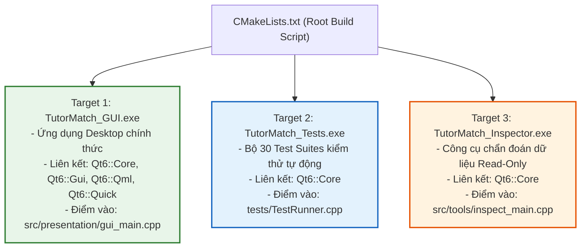

# NGĂN XẾP CÔNG NGHỆ VÀ MÔI TRƯỜNG THỰC THI (TECHNOLOGY STACK)
## Chi tiết Công nghệ, Thư viện, Trình biên dịch và Hạ tầng Dự án

---

## 1. BẢNG TỔNG HỢP CÔNG NGHỆ CỐT LÕI

Dưới đây là chi tiết ngăn xếp công nghệ được xác minh trực tiếp (`[VERIFIED]`) từ cấu hình `CMakeLists.txt`, `CMakePresets.json` và mã nguồn thực tế:

| Thành phần | Công nghệ / Thư viện | Phiên bản | Vai trò & Mục đích sử dụng |
| :--- | :--- | :---: | :--- |
| **Ngôn ngữ lập trình** | C++ | C++17 | Toàn bộ mã nguồn nghiệp vụ, thuật toán, điều phối giao diện và lưu trữ. Sử dụng smart pointers, move semantics, std::string_view và filesystem. |
| **Giao diện Người dùng** | Qt Quick / QML | Qt 6.11.2 | Xây dựng giao diện tương tác đồ họa hiện đại, mượt mà, hỗ trợ animations, binding dữ liệu hai chiều và hiển thị lưới thời khóa biểu. |
| **Khung ứng dụng C++** | Qt Core & Qt Gui | Qt 6.11.2 | Quản lý vòng đời ứng dụng (`QGuiApplication`), chuyển đổi meta-type, điều phối luồng sự kiện và cơ chế QObject Signals/Slots. |
| **Hệ thống Build** | CMake | >= 3.16 | Quản lý quy trình biên dịch đa nền tảng, nạp QML modules (`qt_add_qml_module`) và liên kết thư viện. |
| **Bộ cấu hình Build** | CMake Presets | Schema v3 | Định nghĩa sẵn các profile biên dịch chuẩn (`default` cho Debug và `release` cho Optimized Release). |
| **Trình biên dịch** | MinGW-w64 GCC | 13.1.0 (64-bit) | Trình biên dịch C++ chuẩn trên nền tảng Windows. |
| **Hệ điều hành mục tiêu** | Microsoft Windows | Windows 10/11 | Nền tảng thực thi chính thức của sản phẩm đồ họa. |
| **Cơ chế lưu trữ** | Flat-File CSV + AVL Tree | Custom Engine | Lưu trữ dữ liệu dạng văn bản phân tách bằng dấu phẩy, kết hợp cây nhị phân cân bằng AVL tự cài đặt để lập chỉ mục tìm kiếm khoảng giá nhanh chóng. |
| **Hạ tầng kiểm thử** | Zero-Dependency C++ Runner | Custom Harness | Bộ kiểm thử tự động độc lập 30 test suites, sử dụng macro `assert` và kỹ thuật Test Double / Fake Repositories không cần framework ngoài (như GTest). |

---

## 2. KIẾN TRÚC BIÊN DỊCH VÀ CÁC TARGET CHÍNH

Hệ thống quản lý mã nguồn thông qua một tệp [`CMakeLists.txt`](file:///C:/Users/DELL/.gemini/antigravity/scratch/TutorMatch/CMakeLists.txt) duy nhất tại thư mục gốc, định nghĩa đúng 3 target thực thi độc lập:

### 2.1. Target `TutorMatch_GUI`
- **Mục đích:** Ứng dụng chính cho người dùng cuối.
- **Tệp nguồn chính:** 
  - `src/presentation/gui_main.cpp`
  - `src/presentation/bridges/GUIBridge.cpp`
  - Toàn bộ các dịch vụ nghiệp vụ trong `src/business/`
  - Toàn bộ kho lưu trữ và serializer trong `src/data_access/`
  - 27 tệp QML trong `ui/qml/` được đóng gói thông qua macro `qt_add_qml_module`.
- **Thư viện liên kết:** `Qt6::Core`, `Qt6::Gui`, `Qt6::Qml`, `Qt6::Quick`, `Qt6::QuickControls2`.

### 2.2. Target `TutorMatch_Tests`
- **Mục đích:** Bộ kiểm thử đơn vị, kiểm thử tích hợp và kiểm toán các nguyên lý thiết kế SOLID.
- **Tệp nguồn:** `tests/TestRunner.cpp`, `src/business/algorithms/ScheduleGuard.cpp`, `src/business/matching/SubjectTaxonomy.cpp`, `src/business/matching/TutorSearchMatcher.cpp`, `src/business/matching/MatchingEngine.cpp`, `src/business/domain/User.cpp`, `src/business/domain/DateUtils.cpp`, và toàn bộ Services/Repositories.
- **Thư viện liên kết:** `Qt6::Core`.

### 2.3. Target `TutorMatch_Inspector`
- **Mục đích:** Công cụ dòng lệnh dành cho kỹ sư hệ thống kiểm tra cấu trúc từng trường dữ liệu trong các file `.dat` mà không khởi động giao diện đồ họa.
- **Tệp nguồn:** `src/tools/inspect_main.cpp`, `src/data_access/storage/DataFileInspector.cpp`, `src/data_access/storage/ApplicationPaths.cpp`, `src/business/algorithms/ScheduleGuard.cpp`.
- **Thư viện liên kết:** `Qt6::Core`.

---

## 3. CƠ CHẾ QUẢN LÝ DỮ LIỆU ĐỘC LẬP VỚI HỆ QUẢN TRỊ CSDL NGOÀI

Một trong những quyết định kỹ thuật quan trọng nhất của TutorMatch là **không phụ thuộc vào bất kỳ hệ quản trị cơ sở dữ liệu quan hệ (RDBMS) bên ngoài nào** (như MySQL, PostgreSQL, SQLite).

Lý do thiết kế:
1. **Tính độc lập và di động (Zero-Configuration Portability):** Dự án có thể được clone về bất kỳ máy tính nào có cài đặt Qt Creator và chạy được ngay lập tức mà không cần cài đặt database daemon hay cấu hình cổng kết nối.
2. **Minh họa cấu trúc dữ liệu tự cài đặt:** Dự án tận dụng trực tiếp các cấu trúc dữ liệu kinh điển được viết tay bằng C++ template:
   - `AVLTree<double, int>`: Lập chỉ mục giá gia sư, hỗ trợ truy vấn khoảng giá $O(\log N + K)$ cực nhanh.
   - `MaxHeap<TutorMatchResult>`: Hàng đợi ưu tiên lọc Top-K gợi ý thông minh trong $O(N \log K)$.
   - `ScheduleGuard`: Sử dụng toán tử nhị phân trên số nguyên 64-bit không dấu (`uint64_t`) để biểu diễn toàn bộ lịch tuần và phát hiện va chạm lịch trong thời gian $O(1)$.
   - `HashTable<Key, Value>` & `LRUCache<Key, Value>`: Bộ đệm truy xuất bộ nhớ tạm thời $O(1)$.
