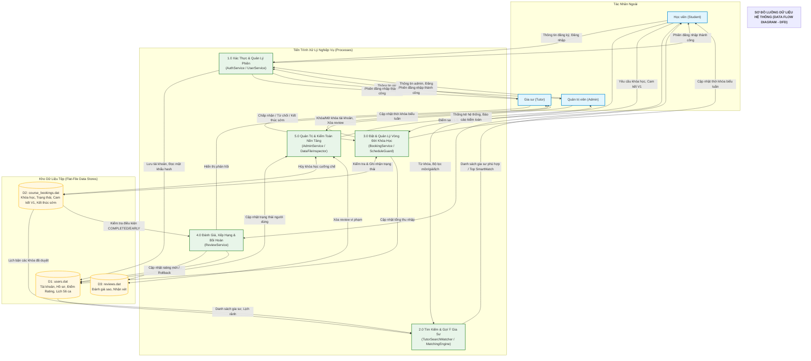

# KIẾN TRÚC TỔNG THỂ HỆ THỐNG TUTORMATCH (OVERALL SYSTEM ARCHITECTURE)
## Phân tích Kiến trúc Ba Tầng, Luồng Điều Khiển và Ranh Giới Module

---

## 1. MÔ HÌNH KIẾN TRÚC BA TẦNG NGHIÊM NGẶT (THREE-LAYER ARCHITECTURE)

TutorMatch được thiết kế theo chuẩn mực kiến trúc phần mềm ba tầng cổ điển (**Strict Three-Layer Architecture**), phân tách rạch ròi trách nhiệm giữa các phân hệ:

### 1.1. Sơ đồ Kiến trúc Ba Tầng Chi Tiết (Three-Layer Architecture Diagram)

Sơ đồ kiến trúc dưới đây trực quan hóa chi tiết các khối thành phần trong 3 tầng của hệ thống TutorMatch, làm rõ ranh giới giữa giao diện đồ họa QML, bộ điều hợp C++ GUIBridge, các dịch vụ nghiệp vụ, động cơ thuật toán tùy biến và hệ thống kho lưu trữ tệp phẳng trừu tượng:

```mermaid
graph TD
    %% =========================================================================
    %% DIAGRAM 02: STRICT THREE-LAYER ARCHITECTURE
    %% =========================================================================
    title["<b>KIẾN TRÚC BA TẦNG NGHIÊM NGẶT (STRICT THREE-LAYER ARCHITECTURE)</b>"]

    subgraph Layer1 ["TẦNG 1: TẦNG TRÌNH DIỄN (PRESENTATION LAYER)"]
        direction TB
        subgraph QML_UI ["Giao diện Người dùng Qt Quick / QML"]
            Views["Views (27 tệp QML):<br/>LoginView, StudentOverviewView, StudentTutorSearchView,<br/>StudentSmartMatchView, StudentBookingsView, TutorOverview,<br/>TutorBookings, TutorStudents, TutorStatistics, AdminViews..."]
            Components["Components & Modals:<br/>BookingModal, ReviewModal, TutorDetailModal, UserDetailModal,<br/>ProfileEditModal, TimetableGrid, TimetableCell, Theme.qml"]
        end
        subgraph Presenter ["Bộ Điều Hợp C++ (Bridge Controller)"]
            Bridge["<b>GUIBridge (C++ / QObject)</b><br/>- Quản lý trạng thái phiên làm việc (Session State)<br/>- Xuất các thuộc tính Q_PROPERTY cho QML<br/>- Cung cấp hơn 45 phương thức Q_INVOKABLE<br/>- Phát các tín hiệu Q_SIGNALS cập nhật phản ứng"]
        end
        QML_UI -->|Data Binding & Q_INVOKABLE Calls| Bridge
        Bridge -->|Signals: stateChanged, dataChanged...| QML_UI
    end

    subgraph Layer2 ["TẦNG 2: TẦNG NGHIỆP VỤ (BUSINESS LOGIC LAYER)"]
        direction TB
        subgraph Services ["Các Lớp Dịch Vụ Nghiệp Vụ (Application Services)"]
            AuthSvc["<b>AuthService</b><br/>Đăng ký, Đăng nhập, Băm SHA-256"]
            UserSvc["<b>UserService</b><br/>Quản lý hồ sơ, Cập nhật thông tin"]
            BookSvc["<b>BookingService</b><br/>Vòng đời khóa học, Xung đột lịch, Cam kết V1"]
            RevSvc["<b>ReviewService</b><br/>Đánh giá, Tính rating, Rollback ADR-007"]
            MatchSvc["<b>MatchingService</b><br/>Điều phối gợi ý SmartMatch"]
            AdminSvc["<b>AdminService</b><br/>Khóa tài khoản, Thống kê nền tảng"]
        end

        subgraph Core_Algorithms ["Động Cơ Thuật Toán & Cấu Trúc Dữ Liệu"]
            MatchEng["<b>MatchingEngine & IMatchingStrategy</b><br/>100-Point Weighted Scoring & MaxHeap"]
            SearchMatcher["<b>TutorSearchMatcher & SubjectTaxonomy</b><br/>Tìm kiếm ngữ nghĩa đa token, Chuẩn hóa dấu tiếng Việt"]
            SchedGuard["<b>ScheduleGuard</b><br/>Mặt nạ nhị phân 56 ca tuần (uint64_t), Kiểm tra va chạm O(1)"]
            DS["<b>Generic Data Structures</b><br/>AVLTree, HashTable, LRUCache, MaxHeap, DoublyLinkedList"]
        end

        subgraph Domain_Entities ["Thực Thể Miền (Domain Entities)"]
            Users["<b>User (Abstract)</b><br/>├── Student (gradeLevel, scheduleBitmask)<br/>├── Tutor (bio, hourlyRate, rating, scheduleBitmask)<br/>└── Admin (Unified Root Authorization)"]
            Bookings["<b>CourseBooking</b><br/>Hợp đồng định kỳ 4/8/12 tuần, multi-slot, cam kết hai phía"]
            Reviews["<b>Review</b><br/>Điểm sao (1-5), nhận xét, thời gian"]
            DTOs["<b>BookingDTOs & DateUtils</b><br/>TimetableSessionDTO, SmartMatchCriteria, Định dạng ngày"]
        end

        Services --> Core_Algorithms
        Services --> Domain_Entities
    end

    subgraph Layer3 ["TẦNG 3: TẦNG TRUY XUẤT DỮ LIỆU (DATA ACCESS LAYER)"]
        direction TB
        subgraph Repo_Interfaces ["Giao Diện Kho Lưu Trữ (DIP Abstractions)"]
            IUserRepo["<b>IUserRepository</b>"]
            IBookingRepo["<b>ICourseBookingRepository</b>"]
            IRevRepo["<b>IReviewRepository</b>"]
        end

        subgraph Concrete_Repos ["Triển Khai Lưu Trữ Tệp Cụ Thể (Concrete Repositories)"]
            FileUserRepo["<b>FileUserRepository</b><br/>Quản lý bộ đệm AVL Tree và danh sách User"]
            FileBookingRepo["<b>FileCourseBookingRepository</b><br/>Quản lý danh sách CourseBooking"]
            FileRevRepo["<b>FileReviewRepository</b><br/>Quản lý danh sách Review"]
        end

        subgraph Serializers ["Bộ Tuần Tự Hóa Dòng CSV (Serializers)"]
            UserSer["UserSerializer (Đa hình Student/Tutor/Admin)"]
            BookingSer["CourseBookingSerializer (21 trường mở rộng)"]
            RevSer["ReviewSerializer (8 trường chuẩn)"]
            SerUtils["SerializerUtils (escapeCsv, splitCsvLine, safeParse)"]
        end

        subgraph Storage_Engine ["Công Cụ Lưu Trữ & Đường Dẫn"]
            MockDB["<b>MockDatabaseEngine</b><br/>Mặt tiền lưu trữ (Facade), Tự động sao chép Seed"]
            AppPaths["<b>ApplicationPaths</b><br/>Phân giải đường dẫn dữ liệu runtime"]
            InspectorCore["<b>DataFileInspector</b><br/>Kiểm toán toàn vẹn file Read-Only"]
        end

        Repo_Interfaces <|.. Concrete_Repos
        Concrete_Repos --> Serializers
        Concrete_Repos --> AppPaths
        MockDB --> Concrete_Repos
    end

    %% Luồng giao tiếp giữa các tầng
    Bridge ==>|Ủy quyền nghiệp vụ duy nhất| Services
    Services ==>|Thao tác qua Interfaces| Repo_Interfaces

    %% Phân cách tầng
    style Layer1 fill:#e8eaf6,stroke:#283593,stroke-width:2px;
    style Layer2 fill:#e0f2f1,stroke:#004d40,stroke-width:2px;
    style Layer3 fill:#fff8e1,stroke:#ff6f00,stroke-width:2px;
```

#### Diễn giải Sơ đồ Kiến trúc 3 Tầng:
1. **Tầng Trình diễn (Presentation Layer):** Gồm 27 tệp QML tương tác hai chiều với duy nhất `GUIBridge`. Không có bất kỳ lệnh gọi trực tiếp nào từ QML xuống Tầng Nghiệp vụ hay Tầng Dữ liệu.
2. **Tầng Nghiệp vụ (Business Logic Layer):** Chứa 6 Dịch vụ ứng dụng (`AuthService`, `UserService`, `BookingService`, `ReviewService`, `MatchingService`, `AdminService`), các động cơ giải thuật (`MatchingEngine`, `TutorSearchMatcher`, `ScheduleGuard`) và các cấu trúc dữ liệu tự cân bằng (`AVLTree`, `MaxHeap`). Tầng này độc lập hoàn toàn với framework đồ họa Qt Quick.
3. **Tầng Truy xuất Dữ liệu (Data Access Layer):** Tách biệt rạch ròi giữa hợp đồng trừu tượng (`IRepository.h`), lớp thực thi I/O (`File...Repository`), và các bộ tuần tự hóa CSV độc lập (`UserSerializer`, `CourseBookingSerializer`, `ReviewSerializer`). Ranh giới này được đảm bảo qua nguyên lý Đảo ngược Phụ thuộc (DIP).

---

## 2. NGUYÊN TẮC GIAO TIẾP VÀ RANH GIỚI KIẾN TRÚC (ARCHITECTURAL BOUNDARIES)

Hệ thống tuân thủ nghiêm ngặt các quy tắc ranh giới:

1. **Chiều phụ thuộc từ trên xuống dưới (Top-Down Dependency):**
   - Tầng Trình diễn (`Presentation Layer`) chỉ biết đến và gọi các phương thức của Tầng Nghiệp vụ (`Business Logic Layer`).
   - Tầng Nghiệp vụ không biết đến giao diện người dùng (không phụ thuộc vào bất kỳ lớp Qt Quick / QML nào).
   - Tầng Nghiệp vụ chỉ giao tiếp với Tầng Dữ liệu thông qua các giao diện trừu tượng (`IRepository`), tuân thủ nguyên lý Đảo ngược Phụ thuộc (**Dependency Inversion Principle - DIP**).
2. **Loại bỏ hoàn toàn hiện tượng gọi vòng qua tầng (Layer Bypass Elimination):**
   - Trước đợt chuyển đổi GUI-only, phân hệ dòng lệnh cũ (`ConsoleApp`) từng có các nhánh gọi trực tiếp vào `MockDatabaseEngine`. Hiện tượng này đã bị **loại bỏ 100%**.
   - `GUIBridge` tuyệt đối không gọi trực tiếp các phương thức lưu trữ tệp của DAL; mọi yêu cầu đều phải đi qua các lớp Service tương ứng (`AuthService`, `BookingService`, `ReviewService`, `UserService`, `MatchingService`, `AdminService`).
3. **Bộ điều hợp duy nhất (Single Presentation Adapter):**
   - `GUIBridge` đóng vai trò là Controller / Adapter duy nhất kết nối thế giới QML (JavaScript/QML Engine) với thế giới C++ Native. Toàn bộ dữ liệu hiển thị lên QML đều được chuẩn hóa thành `QVariantMap` hoặc `QVariantList`.

---

## 3. DANH MỤC CÁC QUYẾT ĐỊNH KIẾN TRÚC (ARCHITECTURE DECISION RECORDS - ADRs)

Kiến trúc hiện tại của TutorMatch là kết quả của một chuỗi quyết định thiết kế đã được thẩm định và ghi nhận trong hệ thống ADR:

| Mã ADR | Tiêu đề quyết định kiến trúc | Tác động cốt lõi đến hệ thống |
| :---: | :--- | :--- |
| **ADR-001** | Tổ chức phân tầng logic tại chỗ (Logical In-Place Layering) | Định hình 3 tầng Presentation - Business - Data Access rõ ràng trong mã nguồn C++. |
| **ADR-002** | Phân tách Interface Repository và Implementation | Định nghĩa `IUserRepository`, `ICourseBookingRepository`, `IReviewRepository` độc lập với cơ chế đọc ghi tệp. |
| **ADR-003** | Tách nhỏ Dịch vụ (Service Extraction: Review & Matching) | Rút nghiệp vụ Đánh giá sang `ReviewService` và nghiệp vụ Gợi ý sang `MatchingService`, giảm tải cho `BookingService`. |
| **ADR-004** | Tách riêng các bộ tuần tự hóa thực thể (Domain Model Serializers) | Xây dựng các lớp `UserSerializer`, `CourseBookingSerializer`, `ReviewSerializer` riêng biệt, giải phóng logic CSV khỏi Domain. |
| **ADR-006** | Chuẩn hóa GUIBridge đóng vai trò Adapter trung gian | Bắt buộc GUIBridge chỉ điều phối dữ liệu giữa QML và Service, không tự xử lý nghiệp vụ hay lưu trữ. |
| **ADR-007** | Nhất quán dữ liệu đa tệp & Tự phục hồi khi khởi động (Self-Healing) | Đưa vào cơ chế Bồi hoàn giao dịch (Compensating Rollback) và hàm `reconcileRatingsOnStartup()` bảo vệ rating của gia sư. |
| **ADR-008** | Cấu hình CMake tối giản và an toàn (Minimal Safe CMake Build) | Chuẩn hóa CMake chỉ còn các target thực sự cần thiết, hỗ trợ đầy đủ `CMakePresets.json`. |
| **ADR-009** | Khóa học định kỳ nhiều tuần và Cam kết đồng thuận (Commitment V1) | Chuyển đổi mô hình đặt lịch lẻ sang khóa học định kỳ 4/8/12 tuần với chính sách cam kết hai bên và kết thúc sớm. |

---

## 4. TÍNH CHẤT ĐA LUỒNG VÀ ĐỒNG BỘ HÓA (THREADING & CONCURRENCY)

Trong môi trường Qt Quick, giao diện đồ họa chạy trên luồng chính (Main GUI Thread). Để ngăn ngừa xung đột dữ liệu khi nhiều thao tác diễn ra đồng thời:
- Tất cả các lớp Service (`BookingService`, `ReviewService`, `MatchingService`) đều được bảo vệ bởi **mutex đệ quy (`std::recursive_mutex`)** hoặc mutex tiêu chuẩn (`std::mutex`).
- Mọi phương thức ghi hoặc tính toán lại trạng thái đều sử dụng khối khóa phạm vi `std::lock_guard<std::recursive_mutex>` để bảo đảm an toàn luồng (thread-safety) tuyệt đối, chống tình trạng tranh chấp (race conditions).
- Quá trình ghi tệp trong các repository cụ thể (`FileUserRepository`, `FileCourseBookingRepository`, `FileReviewRepository`) được thực hiện tuần tự và áp dụng cơ chế ghi tệp tạm `.tmp` trước khi thay thế nguyên tử, tránh làm hỏng tệp khi có sự cố hệ thống đột ngột.

---

## 5. SƠ ĐỒ LUỒNG DỮ LIỆU HỆ THỐNG (DATA FLOW DIAGRAM - DFD)

Sơ đồ luồng dữ liệu (Data Flow Diagram - DFD) dưới đây mô tả sự tương tác giữa 3 tác nhân bên ngoài (Học viên, Gia sư, Quản trị viên), 5 cụm tiến trình nghiệp vụ chính của hệ thống và 3 kho lưu trữ tệp tin vật lý (`users.dat`, `course_bookings.dat`, `reviews.dat`):



#### Diễn giải Luồng Dữ Liệu Chi Tiết:

1. **Tiến trình 1.0 (Xác thực & Quản lý Phiên):**
   - Nhận thông tin đăng ký / đăng nhập từ cả 3 tác nhân ngoài (Học viên, Gia sư, Quản trị viên).
   - Truy vấn và đối soát mật khẩu băm SHA-256 từ kho `users.dat` (D1). Khi đăng ký mới, thông tin người dùng được tuần tự hóa và lưu bền vững vào D1.
   - Khi xác thực thành công, trả về trạng thái phiên làm việc cho `GUIBridge` để kích hoạt giao diện tương ứng theo vai trò (`STUDENT`, `TUTOR`, `ADMIN`).

2. **Tiến trình 2.0 (Tìm kiếm & Gợi ý Gia sư):**
   - Học viên nhập từ khóa tìm kiếm (tên, môn học) và các bộ lọc (mức học phí, ca học rảnh).
   - Tiến trình đọc toàn bộ danh sách gia sư và cấu hình lịch rảnh gốc từ D1, đồng thời nạp danh sách các khóa học đã được duyệt (`APPROVED`) từ D2 để trừ các ca bận thực tế qua `ScheduleGuard`.
   - Kết quả sau khi chấm điểm lọc (qua `TutorSearchMatcher`) hoặc thuật toán thang điểm 100 kết hợp hàng đợi ưu tiên `MaxHeap` (qua `MatchingEngine`) được trả về cho Học viên.

3. **Tiến trình 3.0 (Đặt & Quản lý Vòng đời Khóa học):**
   - Học viên khởi tạo yêu cầu khóa học kèm lựa chọn chính sách Cam kết V1 (`Commitment V1`).
   - `BookingService` đọc D2 để kiểm tra xung đột thời gian với các khóa học hiện hữu của cả học viên và gia sư.
   - Gia sư tiếp nhận và thực hiện hành động Duyệt (`APPROVED`), Từ chối (`REJECTED`) hoặc Kết thúc sớm (`EARLY_COMPLETED`).
   - Khi hoàn thành hoặc kết thúc sớm, tổng thu nhập của gia sư được tính toán và cập nhật ngược lại vào D1 (`users.dat`), đồng thời thời khóa biểu tuần của cả 2 bên được đồng bộ tức thời.

4. **Tiến trình 4.0 (Đánh giá, Xếp hạng & Bồi hoàn ADR-007):**
   - Học viên gửi đánh giá sao (1–5 sao) và nhận xét cho một khóa học đã hoàn tất.
   - `ReviewService` kiểm tra trạng thái khóa học trong D2 (chỉ cho phép đánh giá khi trạng thái là `COMPLETED` hoặc `EARLY_COMPLETED`).
   - Bản ghi đánh giá mới được lưu bền vững vào `reviews.dat` (D3).
   - Điểm trung bình rating và tổng số lượt đánh giá của gia sư được tính toán lại và cập nhật vào `users.dat` (D1). Trong trường hợp ghi tệp D1 thất bại, cơ chế bồi hoàn ADR-007 sẽ tự động xóa bản ghi trong D3 để khôi phục tính nhất quán dữ liệu.

5. **Tiến trình 5.0 (Quản trị & Kiểm toán Nền tảng):**
   - Quản trị viên thực hiện các thao tác quản trị: khóa/mở khóa tài khoản người dùng (cập nhật trường trạng thái trong D1), hủy khóa học bất thường (cập nhật D2), hoặc xóa đánh giá vi phạm tiêu chuẩn cộng đồng (xóa trong D3 và cập nhật lại điểm trung bình trong D1).
   - `AdminService` tổng hợp số liệu từ cả 3 kho dữ liệu để lập báo cáo kiểm toán và thống kê tổng quan toàn hệ thống.
