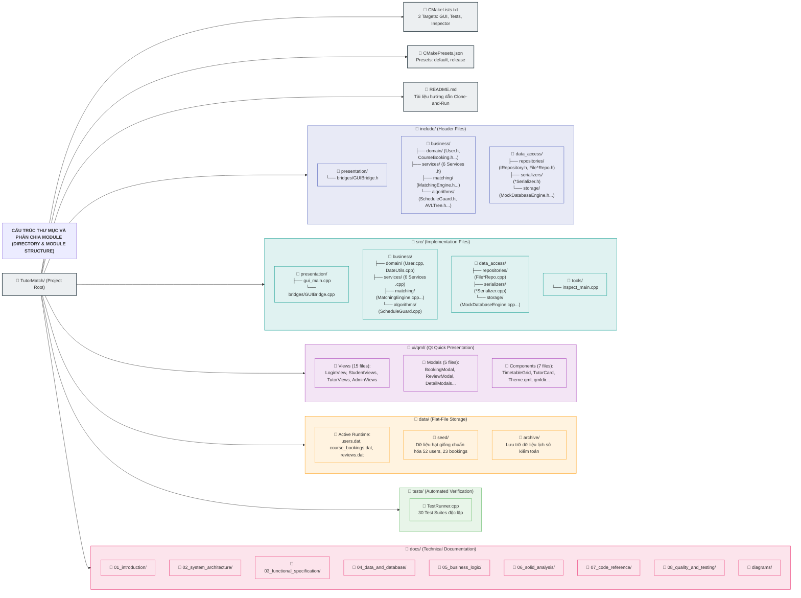

# CẤU TRÚC THÀNH PHẦN VÀ BẢN ĐỒ THƯ MỤC (COMPONENT & DIRECTORY STRUCTURE)
## Bản đồ Phân bổ Mã nguồn, Trách nhiệm Tệp và Quy ước Đặt tên

---

## 1. BẢN ĐỒ THƯ MỤC MÃ NGUỒN CỐT LÕI

Mã nguồn dự án TutorMatch được tổ chức thành cấu trúc đối xứng hoàn hảo giữa thư mục chứa tệp tiêu đề ([`include/`](file:///C:/Users/DELL/.gemini/antigravity/scratch/TutorMatch/include/)) và thư mục chứa tệp triển khai ([`src/`](file:///C:/Users/DELL/.gemini/antigravity/scratch/TutorMatch/src/)):

### 1.1. Sơ đồ Phân cấp Thư mục và Phân chia Module (Directory and Module Structure Diagram)

Biểu đồ dưới đây trực quan hóa cấu trúc tổ chức thư mục của toàn bộ dự án TutorMatch từ gốc đến các nhánh chức năng, thể hiện sự đối xứng giữa `include/` và `src/`, các module giao diện người dùng `ui/qml/`, kho lưu trữ tệp tin phẳng `data/`, kịch bản kiểm thử `tests/` và tài liệu kỹ thuật `docs/`:



#### Diễn giải Cấu trúc Module và Tổ chức Mã Nguồn:

1. **Tính đối xứng nghiêm ngặt (Header-Source Symmetry):** Toàn bộ các định nghĩa trong `include/presentation/`, `include/business/`, và `include/data_access/` đều có tệp hiện thực hóa tương ứng trong `src/presentation/`, `src/business/`, và `src/data_access/`. Điều này giúp lập trình viên và người đánh giá mã dễ dàng định vị vị trí mã nguồn mà không bị lẫn lộn giữa khai báo và triển khai.
2. **Độc lập tầng giao diện (`ui/qml/`):** Tầng giao diện QML được đóng gói độc lập trong `ui/qml/`, chia thành 3 phân nhóm chức năng:
   - `views/`: Các màn hình hoàn chỉnh theo từng vai trò (Học viên, Gia sư, Quản trị viên, Đăng nhập).
   - `modals/`: Các hộp thoại tương tác như Đặt lịch, Viết đánh giá, Xem chi tiết gia sư/học viên.
   - `components/`: Các thành phần tái sử dụng như Lưới thời khóa biểu (`TimetableGrid`), Thẻ gia sư (`TutorCard`), bảng màu hệ thống (`Theme.qml`).
3. **Phân vùng dữ liệu an toàn (`data/`):** Tách bạch rõ giữa tệp đang chạy trong phiên (`data/*.dat`), tệp mẫu chuẩn ban đầu (`data/seed/*.dat`) và thư mục sao lưu lưu trữ (`data/archive/`). Khi cần thiết lập lại môi trường (reset/clean state), chỉ cần sao chép đè từ `seed/` sang thư mục hoạt động.
4. **Hệ thống kiểm thử và công cụ (`tests/`, `src/tools/`):** Bao gồm `TestRunner.cpp` chứa 30 Test Suites kiểm thử tự động không cần GUI, và `inspect_main.cpp` phục vụ chẩn đoán tính toàn vẹn của các tệp cơ sở dữ liệu phẳng độc lập.

```
PBL2-TutorMatch/
├── CMakeLists.txt              # Kịch bản xây dựng CMake chính quy (3 Targets)
├── CMakePresets.json           # Cấu hình preset chuẩn cho Debug và Release
├── README.md                   # Hướng dẫn Clone-and-Run và tổng quan dự án
│
├── include/                    # HEADER FILES (Định nghĩa lớp & Interface)
│   ├── presentation/           # 1. Tầng Trình Diễn
│   │   └── bridges/GUIBridge.h # Bộ điều hợp QObject trung gian
│   ├── business/               # 2. Tầng Nghiệp Vụ
│   │   ├── domain/             # User.h, CourseBooking.h, Review.h, BookingDTOs.h, DateUtils.h
│   │   ├── services/           # AuthService.h, UserService.h, BookingService.h,
│   │   │                       # ReviewService.h, MatchingService.h, AdminService.h
│   │   ├── matching/           # MatchingEngine.h, IMatchingStrategy.h, SubjectTaxonomy.h, TutorSearchMatcher.h
│   │   └── algorithms/         # ScheduleGuard.h, AVLTree.h, HashTable.h, LRUCache.h, MaxHeap.h, DoublyLinkedList.h
│   └── data_access/            # 3. Tầng Truy Xuất Dữ Liệu
│       ├── repositories/       # IRepository.h, FileUserRepository.h, FileCourseBookingRepository.h, FileReviewRepository.h
│       ├── serializers/        # SerializerUtils.h, UserSerializer.h, CourseBookingSerializer.h, ReviewSerializer.h
│       └── storage/            # MockDatabaseEngine.h, ApplicationPaths.h, DataFileInspector.h
│
├── src/                        # IMPLEMENTATION FILES (Triển khai mã nguồn C++)
│   ├── presentation/           # gui_main.cpp, bridges/GUIBridge.cpp
│   ├── business/               # domain/, services/, matching/, algorithms/
│   ├── data_access/            # repositories/, serializers/, storage/
│   └── tools/                  # inspect_main.cpp (Entry point công cụ chẩn đoán Inspector)
│
├── ui/
│   └── qml/                    # 27 tệp Qt Quick / QML (Views, Modals, Components, Theme.qml)
│
├── data/                       # CƠ SỞ DỮ LIỆU TỆP (Flat-File Storage)
│   ├── users.dat               # Dữ liệu tài khoản người dùng đang hoạt động
│   ├── course_bookings.dat     # Dữ liệu các khóa học định kỳ đang hoạt động
│   ├── reviews.dat             # Dữ liệu các bài đánh giá đang hoạt động
│   ├── seed/                   # Dữ liệu mẫu chuẩn hóa (52 users, 23 bookings, 15 reviews)
│   └── archive/                # Lưu trữ lịch sử kiểm toán dữ liệu cũ
│
├── tests/                      # KIỂM THỬ TỰ ĐỘNG
│   └── TestRunner.cpp          # 30 Test Suites kiểm thử đơn vị & tích hợp
│
└── docs/                       # TÀI LIỆU KỸ THUẬT HỆ THỐNG TOÀN DIỆN
```

---

## 2. MA TRẬN PHÂN BỔ TRÁCH NHIỆM THEO TỆP TIN

### 2.1. Tầng Trình Diễn (Presentation Layer)
| Tệp tiêu đề (.h) | Tệp triển khai (.cpp) | Lớp chính | Trách nhiệm kiến trúc |
| :--- | :--- | :--- | :--- |
| `include/presentation/bridges/GUIBridge.h` | `src/presentation/bridges/GUIBridge.cpp` | `TutorMatch::GUIBridge` | Quản lý trạng thái phiên, cung cấp thuộc tính `Q_PROPERTY`, hơn 45 hàm `Q_INVOKABLE` kết nối QML với các Service. |
| *(N/A - Entry Point)* | `src/presentation/gui_main.cpp` | `main(int, char**)` | Điểm vào duy nhất của ứng dụng GUI: khởi tạo Composition Root, nạp QML Engine và thực thi vòng lặp sự kiện. |

### 2.2. Tầng Nghiệp Vụ (Business Logic Layer)
| Phân nhóm | Tệp tiêu đề (.h) | Tệp triển khai (.cpp) | Lớp chính | Trách nhiệm |
| :--- | :--- | :--- | :--- | :--- |
| **Services** | `AuthService.h` | `AuthService.cpp` | `AuthService` | Đăng ký, đăng nhập, băm mật khẩu SHA-256, kiểm tra định dạng email và mật khẩu hợp lệ. |
| | `UserService.h` | `UserService.cpp` | `UserService` | Cập nhật hồ sơ học viên, hồ sơ gia sư, đổi mật khẩu và truy vấn tài khoản. |
| | `BookingService.h` | `BookingService.cpp` | `BookingService` | Quản lý vòng đời khóa học, tạo khóa học nhiều ca, kiểm tra trùng lịch, cam kết V1 và đồng thuận kết thúc sớm. |
| | `ReviewService.h` | `ReviewService.cpp` | `ReviewService` | Quản lý điều kiện đánh giá (`isEligibleForReview`), tính điểm trung bình, tự phục hồi và bồi hoàn ADR-007. |
| | `MatchingService.h` | `MatchingService.cpp` | `MatchingService` | Điều phối tiêu chí SmartMatch, kết hợp thông tin lịch và lọc ứng viên phù hợp. |
| | `AdminService.h` | `AdminService.cpp` | `AdminService` | Khóa / mở khóa tài khoản người dùng, tính toán số liệu nền tảng, xóa đánh giá vi phạm và cưỡng chế dừng khóa học. |
| **Domain** | `User.h` | `User.cpp` | `User`, `Student`, `Tutor`, `Admin` | Mô hình phân cấp người dùng đa hình với các trường dữ liệu đóng gói và phương thức ảo thuần túy. |
| | `CourseBooking.h` | *(Header-only struct)* | `CourseBooking` | Thực thể khóa học định kỳ, hỗ trợ multi-slot, cam kết hai chiều V1 và kết thúc sớm có đồng thuận. |
| | `Review.h` | *(Header-only struct)* | `Review` | Thực thể đánh giá chất lượng khóa học (1-5 sao) kèm nhận xét. |
| | `BookingDTOs.h` | *(Header-only struct)* | `TimetableSessionDTO`, `SmartMatchCriteria` | Đối tượng truyền dữ liệu (DTO) phục vụ hiển thị thời khóa biểu tuần và tiêu chí lọc SmartMatch. |
| | `DateUtils.h` | `DateUtils.cpp` | `DateUtils` | Thư viện tiện ích xử lý định dạng ngày YYYY-MM-DD, tính toán thứ trong tuần và băm chuỗi SHA-256. |
| **Matching & Algorithms** | `MatchingEngine.h` | `MatchingEngine.cpp` | `MatchingEngine`, `WeightedScoreMatchingStrategy` | Động cơ gợi ý gia sư theo thang điểm 100 minh bạch, kết hợp hàng đợi ưu tiên MaxHeap. |
| | `SubjectTaxonomy.h` | `SubjectTaxonomy.cpp` | `SubjectTaxonomy` | Phân loại phân cấp môn học, chuẩn hóa tiếng Việt có dấu/không dấu và kiểm tra quan hệ môn học. |
| | `TutorSearchMatcher.h` | `TutorSearchMatcher.cpp` | `TutorSearchMatcher` | Công cụ tìm kiếm gia sư đa token ngữ nghĩa, phân loại mức độ liên quan thành 3 Tiers. |
| | `ScheduleGuard.h` | `ScheduleGuard.cpp` | `ScheduleGuard` | Động cơ thời khóa biểu 56 ca học sử dụng toán tử bitmask 64-bit (`uint64_t`) cho tốc độ $O(1)$. |
| | `AVLTree.h` | *(Header-only template)* | `AVLTree<Key, Value>` | Cây nhị phân tìm kiếm tự cân bằng AVL hỗ trợ đa giá trị và truy vấn khoảng giá $O(\log N + K)$. |
| | `HashTable.h` | *(Header-only template)* | `HashTable<Key, Value>` | Bảng băm đóng gói với xử lý va chạm chaining cho truy xuất $O(1)$. |
| | `LRUCache.h` | *(Header-only template)* | `LRUCache<Key, Value>` | Bộ nhớ đệm Least-Recently-Used dung lượng giới hạn với eviction $O(1)$. |
| | `MaxHeap.h` | *(Header-only template)* | `MaxHeap<T>` | Cấu trúc dữ liệu đống nhị phân cực đại trích xuất Top-K ứng viên xếp hạng cao nhất. |
| | `DoublyLinkedList.h` | *(Header-only template)* | `DoublyLinkedList<T>` | Danh sách liên kết đôi hỗ trợ chèn và xóa nút hai đầu trong thời gian $O(1)$. |

### 2.3. Tầng Truy Xuất Dữ Liệu (Data Access Layer)
| Phân nhóm | Tệp tiêu đề (.h) | Tệp triển khai (.cpp) | Lớp chính | Trách nhiệm |
| :--- | :--- | :--- | :--- | :--- |
| **Repositories** | `IRepository.h` | *(Interfaces)* | `IUserRepository`, `ICourseBookingRepository`, `IReviewRepository` | Giao diện trừu tượng hóa các thao tác CRUD và truy vấn nghiệp vụ đối với thực thể. |
| | `FileUserRepository.h` | `FileUserRepository.cpp` | `FileUserRepository` | Quản lý danh sách người dùng trong `users.dat`, tự động đồng bộ Cây AVL chỉ mục giá gia sư. |
| | `FileCourseBookingRepository.h` | `FileCourseBookingRepository.cpp` | `FileCourseBookingRepository` | Quản lý đọc/ghi các hợp đồng khóa học trong `course_bookings.dat`. |
| | `FileReviewRepository.h` | `FileReviewRepository.cpp` | `FileReviewRepository` | Quản lý đọc/ghi các bản ghi đánh giá trong `reviews.dat`. |
| **Serializers** | `SerializerUtils.h` | `SerializerUtils.cpp` | `SerializerUtils` | Các hàm tiện ích hỗ trợ phân tách CSV an toàn (`splitCsvLine`), thoát ký tự (`escapeCsv`) và chuyển đổi kiểu an toàn. |
| | `UserSerializer.h` | `UserSerializer.cpp` | `UserSerializer` | Đóng gói logic chuyển đổi dòng CSV đa hình cho Student (9 trường), Tutor (14 trường), Admin (7 trường). |
| | `CourseBookingSerializer.h` | `CourseBookingSerializer.cpp` | `CourseBookingSerializer` | Đóng gói logic chuyển đổi dòng CSV cho CourseBooking (12 trường cơ sở + 9 trường mở rộng cam kết V1, weeklySchedule là nguồn chân lý duy nhất). |
| | `ReviewSerializer.h` | `ReviewSerializer.cpp` | `ReviewSerializer` | Đóng gói logic chuyển đổi dòng CSV cho Review (8 trường chuẩn). |
| **Storage & Paths** | `ApplicationPaths.h` | `ApplicationPaths.cpp` | `ApplicationPaths` | Tự động phân giải đường dẫn thư mục `data/` chính xác trong môi trường build của Qt Creator hoặc chạy độc lập. |
| | `MockDatabaseEngine.h` | `MockDatabaseEngine.cpp` | `MockDatabaseEngine` | Bộ máy điều phối lưu trữ trung tâm (Facade), chịu trách nhiệm nạp dữ liệu mẫu ban đầu từ `data/seed/` nếu tệp runtime trống. |
| | `DataFileInspector.h` | `DataFileInspector.cpp` | `DataFileInspector` | Công cụ phân tích chi tiết từng trường dữ liệu, kiểm toán lỗi cú pháp và kiểm tra toàn vẹn tệp ở chế độ Read-Only. |
