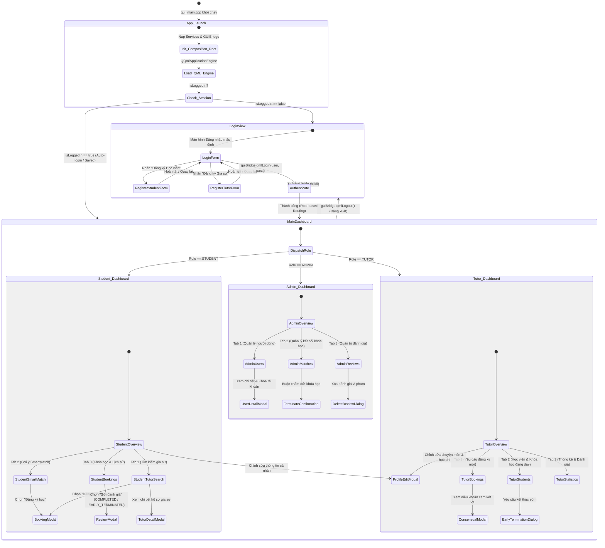
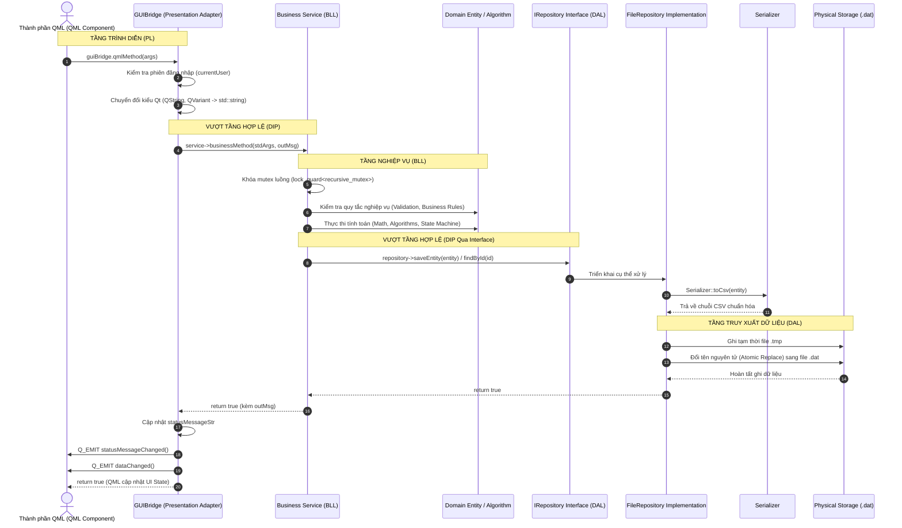

# KIẾN TRÚC TẦNG TRÌNH DIỄN (PRESENTATION LAYER ARCHITECTURE)
## Phân tích Chi tiết Giao diện Đồ họa Qt Quick/QML, Bộ Điều Hợp GUIBridge và Chuyển đổi GUI-Only

---

## 1. TỔNG QUAN TẦNG TRÌNH DIỄN THUẦN ĐỒ HỌA (GUI-ONLY ARCHITECTURE)

Sau khi hoàn thành việc decommission phân hệ dòng lệnh (`TutorMatch_CLI`), tầng Trình diễn của TutorMatch hiện tại được vận hành **100% bằng giao diện đồ họa trực quan Qt Quick (QML) kết hợp C++ Backend Bridge**.

```
┌────────────────────────────────────────────────────────┐
│                   QML ENGINE RUNTIME                   │
│   main.qml  ──►  MainDashboard.qml  ──►  Theme.qml      │
│   ├── Student Views: StudentOverview, Search, Match... │
│   ├── Tutor Views: TutorOverview, Bookings, Stats...   │
│   ├── Admin Views: Overview, Users, Matches, Reviews   │
│   └── Reusable Modals: BookingModal, ReviewModal...    │
└───────────────────────────┬────────────────────────────┘
                            │ Q_PROPERTY Bindings &
                            │ Q_INVOKABLE Function Calls
                            ▼
┌────────────────────────────────────────────────────────┐
│                GUIBRIDGE ADAPTER (C++)                 │
│   include/presentation/bridges/GUIBridge.h             │
│   src/presentation/bridges/GUIBridge.cpp               │
│   - Quản lý phiên đăng nhập (currentUser)              │
│   - Chuyển đổi kiểu dữ liệu Qt <-> C++ STL             │
│   - Phát tín hiệu phản ứng (Q_SIGNALS)                 │
└───────────────────────────┬────────────────────────────┘
                            │ Calls Business Service APIs
                            ▼
               TẦNG NGHIỆP VỤ (BUSINESS LAYER)
```

> [!NOTE]
> Sơ đồ chuyển đổi trạng thái giao diện đã được mô hình hóa chi tiết tại:
> 📄 [`docs/diagrams/04_gui_navigation_state_machine.mmd`](file:///C:/Users/DELL/.gemini/antigravity/scratch/TutorMatch/docs/diagrams/04_gui_navigation_state_machine.mmd)

### 1.1. Sơ đồ Điều hướng và Máy trạng thái Giao diện (GUI Navigation and State Machine Diagram)

Biểu đồ máy trạng thái dưới đây mô tả chi tiết toàn bộ chu trình sống và luồng điều hướng của giao diện người dùng TutorMatch, từ điểm khởi động ứng dụng trong `gui_main.cpp`, rẽ nhánh xác thực tại `LoginView`, cho đến các không gian làm việc chuyên biệt theo từng vai trò (`Student_Dashboard`, `Tutor_Dashboard`, `Admin_Dashboard`) và các hộp thoại chức năng (Modals):



#### Diễn giải Luồng Điều hướng Giao diện:

1. **Khởi động và Kiểm tra Phiên (`App_Launch`):** Khi `gui_main.cpp` nạp `QQmlApplicationEngine`, ứng dụng kiểm tra trạng thái phiên `isLoggedIn`. Nếu chưa đăng nhập, giao diện chuyển về `LoginView`.
2. **Cơ chế Xác thực Phân quyền (`LoginView` $\rightarrow$ `MainDashboard`):** Người dùng có thể đăng nhập hoặc chuyển sang biểu mẫu đăng ký dành cho Học viên hoặc Gia sư. Khi xác thực thành công qua `guiBridge.qmlLogin()`, hệ thống kích hoạt bộ điều hướng phân quyền theo vai trò (`DispatchRole` choice node):
   - Vai trò `STUDENT`: Mở không gian làm việc `Student_Dashboard` với 3 tab: Tổng quan, Tìm kiếm gia sư, và Gợi ý SmartMatch.
   - Vai trò `TUTOR`: Mở không gian làm việc `Tutor_Dashboard` với các tab quản lý yêu cầu đăng ký, danh sách lớp học và thống kê thu nhập.
   - Vai trò `ADMIN`: Mở bảng điều khiển quản trị `Admin_Dashboard` cho phép quản trị người dùng, khóa học và kiểm duyệt đánh giá.
3. **Các Hộp thoại Tương tác (Modals):** Các thao tác quan trọng như Đặt lịch (`BookingModal`), Đánh giá (`ReviewModal`), Xem chi tiết (`TutorDetailModal`, `UserDetailModal`) đều được thiết kế dưới dạng modal popups đè lên view chính, giúp người dùng giữ nguyên ngữ cảnh làm việc hiện tại.
4. **Đăng xuất (`MainDashboard` $\rightarrow$ `LoginView`):** Lệnh `guiBridge.qmlLogout()` giải phóng phiên làm việc, xóa các thông tin bộ nhớ tạm và đưa giao diện trở lại trạng thái `LoginView` an toàn.

---

## 2. PHÂN TÍCH BỘ ĐIỀU HỢP `GUIBridge` (C++ / QObject CONTROLLER)

[`GUIBridge`](file:///C:/Users/DELL/.gemini/antigravity/scratch/TutorMatch/include/presentation/bridges/GUIBridge.h) kế thừa từ `QObject`, là thành phần sống tại ranh giới giữa QML và C++. Lớp này đóng vai trò là một **Mediator / Adapter** thuần túy:

### 2.1. Quản lý trạng thái phiên làm việc (Session State)
`GUIBridge` duy trì con trỏ người dùng đang đăng nhập:
```cpp
std::shared_ptr<TutorMatch::User> currentUser;
bool isLoggedIn;
std::string statusMessageStr;
```
Và xuất các thuộc tính phản ứng qua macro `Q_PROPERTY`:
- `isLoggedIn`: Thông báo trạng thái người dùng đã xác thực thành công.
- `currentUserFullName`: Tên hiển thị của người dùng trên thanh tiêu đề.
- `currentUserRole`: Chuỗi vai trò (`"STUDENT"`, `"TUTOR"`, `"ADMIN"`) phục vụ điều hướng menu.
- `statusMessage`: Chuỗi thông báo trạng thái hoặc lỗi hiển thị trên thanh thông báo.
- `currentStudentProfile`: `QVariantMap` chứa hồ sơ học viên.
- `currentTutorProfile`: `QVariantMap` chứa hồ sơ gia sư.

### 2.2. Chuyển đổi dữ liệu hai chiều (Type Marshaling)
QML hoạt động dựa trên JavaScript runtime, trong khi Tầng Nghiệp vụ sử dụng các kiểu dữ liệu C++ chuẩn (`std::string`, `std::vector`, struct, smart pointer). `GUIBridge` đảm nhận 100% việc chuyển đổi:
- `QString` $\leftrightarrow$ `std::string`
- `std::vector<CourseBooking>` $\rightarrow$ `QVariantList` chứa các `QVariantMap`
- `std::vector<TutorMatchResult>` $\rightarrow$ `QVariantList` kèm điểm số và giải trình tương thích
- `uint64_t` schedule bitmask $\rightarrow$ Mảng 56 phần tử boolean phục vụ render bảng thời khóa biểu.

### 2.3. Hệ thống Tín hiệu Phản ứng (Reactive Signals)
Khi có bất kỳ thay đổi nào từ tầng nghiệp vụ, `GUIBridge` phát tín hiệu để QML tự động cập nhật lại giao diện (Reactive UI) mà không cần reload trang:
```cpp
Q_SIGNALS:
    void stateChanged();
    void statusMessageChanged();
    void dataChanged();
    void studentProfileChanged();
    void studentWeeklyScheduleChanged();
    void tutorProfileChanged();
    void tutorScheduleChanged();
```

### 2.4. Sơ đồ Tuần tự Gọi Xuyên Tầng Chuẩn (Standard Cross-Layer Call Sequence Diagram)

Sơ đồ tuần tự dưới đây trực quan hóa chu trình xử lý hoàn chỉnh của một thao tác từ người dùng trên giao diện QML, xuyên qua bộ điều hợp `GUIBridge`, được kiểm tra và thực thi tại Tầng Nghiệp vụ (kèm cơ chế khóa mutex), bền vững hóa dữ liệu qua các Interface của Tầng DAL bằng cơ chế ghi tệp nguyên tử (Atomic Replace), và cuối cùng thông báo phản ứng ngược lại QML qua các tín hiệu Qt:



#### Diễn giải Tuần tự Lệnh gọi Xuyên tầng:

1. **Khởi tạo và Điều hợp (Bước 1–3):** Thành phần QML gọi hàm `Q_INVOKABLE` trên `guiBridge`. `GUIBridge` kiểm tra quyền của phiên đăng nhập (`currentUser`), sau đó chuyển đổi các đối số giao diện (`QString`, `QVariant`) sang kiểu C++ chuẩn (`std::string`, `uint64_t`).
2. **Chuyển giao sang Tầng Nghiệp vụ (Bước 4):** `GUIBridge` chuyển giao yêu cầu sang Service tương ứng theo nguyên lý ranh giới kiến trúc (không tự ý xử lý logic nghiệp vụ hay truy cập kho dữ liệu).
3. **Thực thi Nghiệp vụ & Khóa An toàn (Bước 5–7):** Service sử dụng khóa bảo vệ `std::lock_guard<std::recursive_mutex>` để bảo đảm tính thread-safe. Tiếp đó, đối tượng Domain và các thuật toán chuyên biệt (như `ScheduleGuard`, `MatchingEngine`) thẩm định quy tắc ràng buộc và chuyển đổi trạng thái thực thể.
4. **Bền vững hóa Dữ liệu theo DIP (Bước 8–13):** Service gọi phương thức của hợp đồng trừu tượng `IRepository`. Lớp triển khai cụ thể (`FileRepository`) sử dụng Serializer chuyên trách (`UserSerializer`, `CourseBookingSerializer`, `ReviewSerializer`) để chuyển đổi thực thể sang bản ghi CSV.
5. **Ghi tệp Vật lý An toàn (Bước 14–17):** Tầng DAL ghi trước dữ liệu ra tệp tạm thời `.tmp`, sau đó thực hiện đổi tên nguyên tử (`atomic replace`) sang `.dat`, ngăn chặn hoàn toàn nguy cơ hỏng tệp khi mất điện hoặc dừng chương trình đột ngột.
6. **Phản hồi và Cập nhật Giao diện Phản ứng (Bước 18–22):** Kết quả được trả ngược về `GUIBridge`. Bridge cập nhật thông điệp trạng thái và phát các tín hiệu Qt (`statusMessageChanged()`, `dataChanged()`). Phía QML nhận tín hiệu và tự động cập nhật lại các thành phần hiển thị trên giao diện người dùng.

---

## 3. CƠ CHẾ NẠP VÀ KHỞI TẠO TẠI `gui_main.cpp`

Điểm vào duy nhất của ứng dụng GUI là [`src/presentation/gui_main.cpp`](file:///C:/Users/DELL/.gemini/antigravity/scratch/TutorMatch/src/presentation/gui_main.cpp):
1. **Thiết lập phong cách Quick Controls:** `qputenv("QT_QUICK_CONTROLS_STYLE", "Basic");`
2. **Khởi tạo QGuiApplication:** Đặt tên ứng dụng `TutorMatch_GUI`.
3. **Thực thi Composition Root:**
   - Phân giải đường dẫn dữ liệu qua `ApplicationPaths::resolveDataDirectory()`.
   - Khởi tạo `MockDatabaseEngine`, nạp dữ liệu mẫu nếu cần.
   - Khởi tạo 6 lớp Service nghiệp vụ.
   - Chạy quy trình tự phục hồi rating: `reviewService->reconcileRatingsOnStartup()`.
   - Khởi tạo đối tượng `GUIBridge` và tiêm toàn bộ 6 Service vào `GUIBridge::initialize(...)`.
4. **Đăng ký Context Property:**
   ```cpp
   engine.rootContext()->setContextProperty("guiBridge", bridge.get());
   ```
   Lệnh này cho phép mọi tệp QML trong toàn bộ cây phân cấp đều có thể truy cập trực tiếp vào đối tượng `guiBridge` toàn cục.
5. **Nạp giao diện gốc:**
   ```cpp
   const QUrl mainUrl(QStringLiteral("qrc:/TutorMatch/ui/qml/main.qml"));
   engine.load(mainUrl);
   ```

---

## 4. DANH MỤC 27 TỆP QML VÀ TRÁCH NHIỆM

Toàn bộ 27 tệp trong thư mục [`ui/qml/`](file:///C:/Users/DELL/.gemini/antigravity/scratch/TutorMatch/ui/qml/) được phân loại theo chức năng:

| STT | Tên tệp QML | Phân loại | Trách nhiệm hiển thị |
| :---: | :--- | :---: | :--- |
| 1 | `main.qml` | Cửa sổ gốc | `ApplicationWindow` gốc của ứng dụng (kích thước 1280x800), điều phối giữa `LoginView` và `MainDashboard`. |
| 2 | `LoginView.qml` | View | Màn hình đăng nhập và biểu mẫu đăng ký dành cho Học viên / Gia sư. |
| 3 | `MainDashboard.qml` | View Điều phối | Thanh bên (Sidebar) điều hướng theo vai trò người dùng, vùng nội dung trung tâm và thanh tiêu đề. |
| 4 | `Theme.qml` | Thiết kế hệ thống | Hằng số giao diện: màu sắc (Primary, Secondary, Background), phông chữ, bán kính bo góc và bóng đổ. |
| 5 | `StudentOverviewView.qml` | View Học viên | Bảng điều khiển học viên: tổng quan lịch học tuần, thẻ hồ sơ cá nhân và các phím tắt nhanh. |
| 6 | `StudentTutorSearchView.qml` | View Học viên | Màn hình tìm kiếm gia sư ngữ nghĩa, bộ lọc khoảng giá, bộ lọc điểm đánh giá và danh sách thẻ gia sư. |
| 7 | `StudentSmartMatchView.qml` | View Học viên | Giao diện SmartMatch: thiết lập môn học, ngân sách, chọn ca rảnh trên lưới và xem kết quả Top-K kèm điểm số. |
| 8 | `StudentBookingsView.qml` | View Học viên | Lịch sử khóa học của học viên, theo dõi trạng thái cam kết V1, nút yêu cầu kết thúc sớm và nút mở modal đánh giá. |
| 9 | `TutorOverview.qml` | View Gia sư | Bảng điều khiển gia sư: hiển thị thời khóa biểu giảng dạy tuần và tóm tắt các yêu cầu đăng ký mới. |
| 10 | `TutorBookings.qml` | View Gia sư | Màn hình duyệt khóa học: xem thông tin học viên, ca học yêu cầu, điều khoản cam kết và nút Chấp nhận/Từ chối. |
| 11 | `TutorStudents.qml` | View Gia sư | Danh sách học viên đang theo học, quản lý các khóa học đang diễn ra và gửi yêu cầu kết thúc sớm. |
| 12 | `TutorStatistics.qml` | View Gia sư | Thống kê thu nhập tích lũy, điểm đánh giá trung bình và toàn bộ lịch sử nhận xét từ học viên. |
| 13 | `AdminOverviewView.qml` | View Admin | Bảng điều khiển hệ thống: tổng số người dùng, tổng số khóa học, tỷ lệ kết nối thành công và biểu đồ kết nối gần đây. |
| 14 | `AdminUsersView.qml` | View Admin | Danh sách toàn bộ người dùng trong hệ thống, bộ lọc vai trò, tìm kiếm và nút Khóa / Mở khóa tài khoản. |
| 15 | `AdminMatchesView.qml` | View Admin | Danh sách toàn bộ các kết nối khóa học trên nền tảng, nút cưỡng chế dừng khóa học khi có vi phạm. |
| 16 | `AdminReviewsView.qml` | View Admin | Danh sách toàn bộ các bài đánh giá, xem nội dung phản hồi và nút xóa các bài đánh giá vi phạm tiêu chuẩn. |
| 17 | `BookingModal.qml` | Modal | Hộp thoại đăng ký khóa học: chọn môn, số tuần (4, 8, 12), chọn ngày bắt đầu, lưới chọn ca và tick cam kết V1. |
| 18 | `ReviewModal.qml` | Modal | Hộp thoại gửi đánh giá: giao diện chọn 1-5 sao trực quan, ô nhập nhận xét và nút gửi phản hồi. |
| 19 | `TutorDetailModal.qml` | Modal | Hộp thoại xem chi tiết gia sư: tiểu sử, môn chuyên môn, biểu đồ đánh giá và lưới thời khóa biểu rảnh. |
| 20 | `UserDetailModal.qml` | Modal | Hộp thoại thông tin chi tiết người dùng dành cho Quản trị viên, kèm nút thay đổi trạng thái kích hoạt. |
| 21 | `ProfileEditModal.qml` | Modal | Hộp thoại chỉnh sửa thông tin hồ sơ (học phí, môn học, khối lớp, tiểu sử). |
| 22 | `TimetableGrid.qml` | Component | Thành phần lưới thời khóa biểu tương tác 7 ngày x 8 ca = 56 ô, hỗ trợ chế độ xem lịch hoặc chỉnh sửa lịch rảnh. |
| 23 | `TimetableCell.qml` | Component | Thành phần ô thời khóa biểu đơn lẻ, hiển thị màu sắc theo trạng thái (Rảnh, Bận, Có lớp học) và huy hiệu môn học. |
| 24 | `TutorCard.qml` | Component | Thẻ hiển thị tóm tắt thông tin gia sư trong kết quả tìm kiếm và danh sách SmartMatch. |
| 25 | `StudentProfileCard.qml` | Component | Thẻ hiển thị tóm tắt thông tin học viên trên đầu trang bảng điều khiển. |
| 26 | `SegmentedFilterButton.qml` | Component | Nút bấm chuyển tab lọc trạng thái phân đoạn (ví dụ: Tất cả / Chờ duyệt / Đã nhận). |
| 27 | `qmldir` | Module Meta | Tệp khai báo module QML chính quy cho Qt CMake Engine. |
