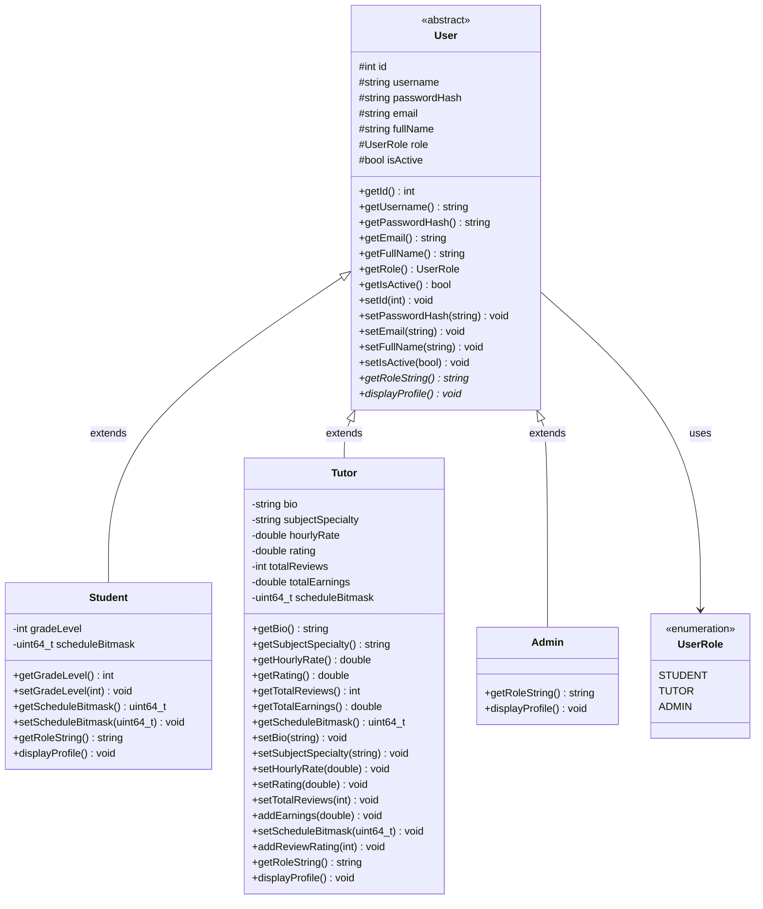

# KIẾN TRÚC TẦNG NGHIỆP VỤ (BUSINESS LOGIC LAYER ARCHITECTURE)
## Phân tích Chi tiết Lớp Dịch vụ, Thực thể Miền, Động cơ Thuật toán và Cấu trúc Dữ liệu

---

## 1. TỔNG QUAN TẦNG NGHIỆP VỤ (BUSINESS LOGIC LAYER)

Tầng Nghiệp vụ ([`include/business/`](file:///C:/Users/DELL/.gemini/antigravity/scratch/TutorMatch/include/business/) và [`src/business/`](file:///C:/Users/DELL/.gemini/antigravity/scratch/TutorMatch/src/business/)) là trái tim xử lý của TutorMatch. Tầng này hoàn toàn độc lập với khung giao diện Qt Quick/QML và độc lập với cơ chế đọc ghi tệp cụ thể, bao gồm 4 nhóm thành phần cốt lõi:

```
┌────────────────────────────────────────────────────────┐
│         CÁC LỚP DỊCH VỤ NGHIỆP VỤ (SERVICES)           │
│   AuthService, UserService, BookingService,            │
│   ReviewService, MatchingService, AdminService         │
└───────────────┬────────────────────────┬───────────────┘
                │                        │
                ▼                        ▼
┌─────────────────────────┐    ┌─────────────────────────┐
│  THỰC THỂ MIỀN (DOMAIN) │    │  ĐỘNG CƠ & THUẬT TOÁN   │
│  User, Student, Tutor,  │    │  MatchingEngine (MaxHeap│
│  Admin, CourseBooking,  │    │  TutorSearchMatcher     │
│  Review, BookingDTOs    │    │  ScheduleGuard (Bitmask)│
│  DateUtils              │    │  SubjectTaxonomy        │
└─────────────────────────┘    │  AVLTree, LRUCache...   │
                               └─────────────────────────┘
```

---

## 2. PHÂN TÍCH CHI TIẾT CÁC LỚP DỊCH VỤ (APPLICATION SERVICES)

### 2.1. `AuthService` ([`AuthService.h`](file:///C:/Users/DELL/.gemini/antigravity/scratch/TutorMatch/include/business/services/AuthService.h) / [`.cpp`](file:///C:/Users/DELL/.gemini/antigravity/scratch/TutorMatch/src/business/services/AuthService.cpp))
- **Trách nhiệm:** Đóng gói toàn bộ quy trình xác thực, đăng nhập và đăng ký người dùng mới.
- **Phụ thuộc:** `std::shared_ptr<IUserRepository> userRepo`.
- **Phương thức quan trọng:**
  - `login(username, password, outError, outUser)`: Xác thực tài khoản, kiểm tra mật khẩu qua băm SHA-256, kiểm tra trạng thái kích hoạt tài khoản (`isActive`).
  - `registerStudent(...)` & `registerTutor(...)`: Kiểm tra trùng lặp tên đăng nhập/email, kiểm tra mật khẩu đủ 6 ký tự, băm SHA-256 trước khi lưu.
  - `isValidEmail(email)` & `isValidPassword(pass)`: Kiểm tra cú pháp định dạng.

### 2.2. `UserService` ([`UserService.h`](file:///C:/Users/DELL/.gemini/antigravity/scratch/TutorMatch/include/business/services/UserService.h) / [`.cpp`](file:///C:/Users/DELL/.gemini/antigravity/scratch/TutorMatch/src/business/services/UserService.cpp))
- **Trách nhiệm:** Quản lý vòng đời hồ sơ thông tin của các loại người dùng.
- **Phụ thuộc:** `std::shared_ptr<IUserRepository> userRepo`.
- **Phương thức quan trọng:**
  - `findUserById(id)`, `findUserByUsername(uName)`: Tìm kiếm tài khoản.
  - `updateUser(user)`: Lưu đè thông tin hồ sơ đã chỉnh sửa vào repository.
  - `changePassword(userId, oldPass, newPass, outMsg)`: Đổi mật khẩu an toàn với xác minh mật khẩu cũ và băm SHA-256 cho mật khẩu mới.

### 2.3. `BookingService` ([`BookingService.h`](file:///C:/Users/DELL/.gemini/antigravity/scratch/TutorMatch/include/business/services/BookingService.h) / [`.cpp`](file:///C:/Users/DELL/.gemini/antigravity/scratch/TutorMatch/src/business/services/BookingService.cpp))
- **Trách nhiệm:** Quản lý vòng đời khóa học định kỳ (4, 8, 12 tuần), kiểm tra xung đột thời khóa biểu, điều phối chính sách cam kết V1 và đồng thuận kết thúc sớm.
- **Phụ thuộc:** `std::shared_ptr<IUserRepository>`, `std::shared_ptr<IReviewRepository>`, `std::shared_ptr<ICourseBookingRepository>`.
- **Đồng bộ luồng:** Sử dụng `mutable std::recursive_mutex serviceMutex`.
- **Phương thức quan trọng:**
  - `createRecurringCourseBooking(...)`: Tạo yêu cầu khóa học với nhiều ca học tuần (`weeklySchedule`), kiểm tra va chạm lịch gia sư.
  - `acceptCourseBooking(tutorId, bookingId, outMsg, ackCommitment)`: Gia sư chấp nhận khóa học, kiểm tra điều kiện cam kết `COMMITMENT_V1` và cộng dồn tổng thu nhập dự kiến.
  - `rejectCourseBooking(...)`: Từ chối yêu cầu đăng ký.
  - `cancelCourseBooking(...)`: Học viên hủy đơn đang chờ duyệt.
  - `requestEarlyTermination(...)` & `respondEarlyTermination(...)`: Quy trình đồng thuận hai phía kết thúc sớm khóa học.
  - `autoCompleteExpiredCourses()`: Tự động chuyển các khóa học đã hết số tuần sang trạng thái `COMPLETED`.
  - `getAcceptedSessionsForWeek(...)`: Tạo danh sách các buổi học cụ thể trong một tuần dương lịch phục vụ hiển thị thời khóa biểu.

### 2.4. `ReviewService` ([`ReviewService.h`](file:///C:/Users/DELL/.gemini/antigravity/scratch/TutorMatch/include/business/services/ReviewService.h) / [`.cpp`](file:///C:/Users/DELL/.gemini/antigravity/scratch/TutorMatch/src/business/services/ReviewService.cpp))
- **Trách nhiệm:** Quản lý toàn bộ vòng đời đánh giá chất lượng gia sư, bảo đảm tính nhất quán điểm số tích lũy giữa các tệp dữ liệu.
- **Phụ thuộc:** `std::shared_ptr<IReviewRepository>`, `std::shared_ptr<IUserRepository>`, `std::shared_ptr<ICourseBookingRepository>`.
- **Đồng bộ luồng:** Sử dụng `mutable std::recursive_mutex reviewMutex`.
- **Phương thức quan trọng:**
  - `isEligibleForReview(studentId, bookingId, outReason)`: Kiểm tra điều kiện nghiêm ngặt (chỉ cho phép đánh giá đơn `COMPLETED` hoặc `EARLY_TERMINATED`, mỗi khóa học chỉ được đánh giá tối đa 1 lần).
  - `submitReview(...)`: Kiểm tra điểm sao trong `[1..5]`, nhận xét không rỗng, lưu review mới, tính toán lại rating trung bình và áp dụng **Cơ chế bồi hoàn giao dịch ADR-007 (Compensating Rollback)** nếu cập nhật User thất bại.
  - `deleteReview(...)`: Xóa đánh giá vi phạm và tính lại rating trung bình cho gia sư.
  - `reconcileRatingsOnStartup()`: Quét toàn bộ dữ liệu lúc khởi động ứng dụng để tự chữa lành sai lệch rating (Self-Healing).

### 2.5. `MatchingService` ([`MatchingService.h`](file:///C:/Users/DELL/.gemini/antigravity/scratch/TutorMatch/include/business/services/MatchingService.h) / [`.cpp`](file:///C:/Users/DELL/.gemini/antigravity/scratch/TutorMatch/src/business/services/MatchingService.cpp))
- **Trách nhiệm:** Tách biệt tầng Trình diễn khỏi thuật toán ghép nối gia sư thông minh (SmartMatch).
- **Phụ thuộc:** `std::shared_ptr<IUserRepository>`, `std::shared_ptr<ICourseBookingRepository>`, `std::unique_ptr<MatchingEngine>`.
- **Phương thức quan trọng:**
  - `findMatchesWithCriteria(criteria, topK)`: Thu thập danh sách gia sư đang hoạt động và danh sách các khóa học đã duyệt, ủy quyền cho `MatchingEngine` thực hiện lọc cứng môn học và tính điểm 100 điểm.

### 2.6. `AdminService` ([`AdminService.h`](file:///C:/Users/DELL/.gemini/antigravity/scratch/TutorMatch/include/business/services/AdminService.h) / [`.cpp`](file:///C:/Users/DELL/.gemini/antigravity/scratch/TutorMatch/src/business/services/AdminService.cpp))
- **Trách nhiệm:** Các nghiệp vụ giám sát và điều hành nền tảng dành cho Quản trị viên.
- **Phụ thuộc:** `std::shared_ptr<IUserRepository>`, `std::shared_ptr<IReviewRepository>`, `std::shared_ptr<BookingService>`.
- **Phương thức quan trọng:**
  - `getSystemMetrics()`: Thống kê số lượng người dùng, số khóa học, tổng đánh giá và tỷ lệ kết nối.
  - `setUserActiveStatus(userId, active, outMsg)`: Khóa hoặc mở khóa quyền truy cập của người dùng.
  - `deleteViolatingReview(reviewId, outMsg)`: Xóa đánh giá vi phạm và cập nhật lại điểm gia sư.
  - `terminateMatch(bookingId, outMsg)`: Cưỡng chế chấm dứt một khóa học tranh chấp.

---

## 3. THỰC THỂ MIỀN (DOMAIN ENTITIES)

1. **`User` (Abstract Base Class):** Định nghĩa thuộc tính dùng chung (`id`, `username`, `passwordHash`, `email`, `fullName`, `role`, `isActive`) và hai phương thức ảo thuần túy: `getRoleString()`, `displayProfile()`.
2. **`Student`:** Kế thừa `User`, bổ sung `gradeLevel` (1-12) và `scheduleBitmask` (56 ca bận).
3. **`Tutor`:** Kế thừa `User`, bổ sung `bio`, `subjectSpecialty`, `hourlyRate`, `rating`, `totalReviews`, `totalEarnings`, `scheduleBitmask` (56 ca rảnh).
4. **`Admin`:** Kế thừa `User`, sử dụng 7 trường cơ sở, toàn quyền quản trị hệ thống (Root Admin).
5. **`CourseBooking`:** Cấu trúc dữ liệu hợp đồng đào tạo đa ca (`weeklySchedule`), đa tuần (4/8/12), thông tin cam kết V1 và đồng thuận kết thúc sớm.
6. **`Review`:** Bản ghi phản hồi chất lượng đào tạo (1-5 sao kèm nhận xét).

### 3.1. Sơ đồ Phân cấp Kế thừa Lớp Người dùng (User Class Hierarchy and Polymorphism Diagram)

Sơ đồ lớp dưới đây mô tả chi tiết quan hệ kế thừa và tính đa hình giữa lớp trừu tượng cơ sở `User` và 3 lớp dẫn xuất cụ thể (`Student`, `Tutor`, `Admin`), cùng các thuộc tính đóng gói và giao diện phương thức tương ứng:



#### Diễn giải Mô hình Phân cấp Người dùng:

1. **Lớp Trừu tượng Cơ sở `User`:**
   - Chứa toàn bộ các trường nhận diện và bảo mật chung: `id`, `username`, `passwordHash` (chuỗi hex SHA-256 64 ký tự), `email`, `fullName`, `role` (enum `UserRole`), và cờ kích hoạt `isActive`.
   - Khai báo 2 phương thức ảo thuần túy (`virtual = 0`): `getRoleString()` (trả về chuỗi định danh vai trò `"STUDENT"`, `"TUTOR"`, `"ADMIN"`) và `displayProfile()`.
2. **Lớp Dẫn xuất `Student`:**
   - Bổ sung `gradeLevel` (khối lớp 1–12) và `scheduleBitmask` (mặt nạ bit 64-bit biểu diễn 56 ca trong tuần mà học viên bận hoặc rảnh).
3. **Lớp Dẫn xuất `Tutor`:**
   - Bổ sung các thuộc tính nghề nghiệp: `bio` (tiểu sử), `subjectSpecialty` (chuyên môn giảng dạy), `hourlyRate` (học phí theo giờ), `rating` (điểm đánh giá trung bình từ 1.0 đến 5.0), `totalReviews` (số lượng đánh giá tích lũy), `totalEarnings` (tổng thu nhập đã thanh toán/cam kết), và `scheduleBitmask` (lịch rảnh dạy hàng tuần).
   - Đáng chú ý: Trường cũ `isVerified` đã được **loại bỏ triệt để** khỏi cấu trúc lớp `Tutor` và quy trình đăng ký/hiển thị, giúp đơn giản hóa mô hình theo đúng thiết kế mới.
4. **Lớp Dẫn xuất `Admin`:**
   - Kế thừa trực tiếp từ `User`, sử dụng trọn vẹn 7 trường cơ sở (`id`, `username`, `passwordHash`, `email`, `fullName`, `role`, `isActive`) mà không có thuộc tính bổ sung. Mọi tài khoản `ADMIN` đều là Root Admin với toàn quyền điều hành nền tảng (khóa/mở khóa tài khoản, duyệt và xóa đánh giá vi phạm, thống kê toàn bộ hệ thống).
5. **Tính Đa hình Thực tế (Polymorphism in Action):**
   - Các kho lưu trữ (`FileUserRepository`) và Dịch vụ (`UserService`, `AuthService`) quản lý người dùng thông qua con trỏ chia sẻ `std::shared_ptr<User>`, cho phép xử lý thống nhất danh sách người dùng nhưng vẫn đảm bảo hành vi riêng biệt khi chuyển đổi kiểu (`dynamic_pointer_cast<Tutor>`) để cập nhật thu nhập hoặc lịch học.

---

## 4. ĐỘNG CƠ THUẬT TOÁN VÀ CẤU TRÚC DỮ LIỆU TỰ PHÁT TRIỂN

1. **`ScheduleGuard`:** Thuật toán quản lý thời khóa biểu 56 ca học sử dụng số nguyên không dấu 64-bit (`uint64_t`). Toàn bộ các phép kiểm tra rảnh (`isSlotAvailable`), kiểm tra trùng (`hasConflict`), bật/tắt ca (`setSlot`) đều chạy trong thời gian hằng số $O(1)$.
2. **`MatchingEngine & IMatchingStrategy`:** Động cơ ghép nối thiết kế theo mẫu **Strategy Pattern**. Chiến lược mặc định `WeightedScoreMatchingStrategy` chia thang điểm 100 rõ ràng: Lịch (35đ), Giá (25đ), Rating (15đ), Thâm niên (15đ), Độ tin cậy (10đ).
3. **`TutorSearchMatcher & SubjectTaxonomy`:** Động cơ tìm kiếm gia sư ngữ nghĩa đa token tiếng Việt, tự động bóc tách dấu, nhận diện môn chính, lớp học (10, 11, 12) và xếp hạng theo 3 tầng liên quan (`FULL_SUBJECT_MATCH`, `PARTIAL_SUBJECT_MATCH`, `GENERAL_TEXT_MATCH`).
4. **`MaxHeap<T>`:** Đống nhị phân cực đại tự cài đặt, trích xuất Top-K ứng viên có điểm số cao nhất trong thời gian $O(N \log K)$.
5. **`AVLTree<Key, Value>`:** Cây nhị phân tự cân bằng AVL, hỗ trợ lưu trữ nhiều giá trị cùng khóa, sử dụng cho truy vấn khoảng học phí $O(\log N + K)$ trong `FileUserRepository`.
