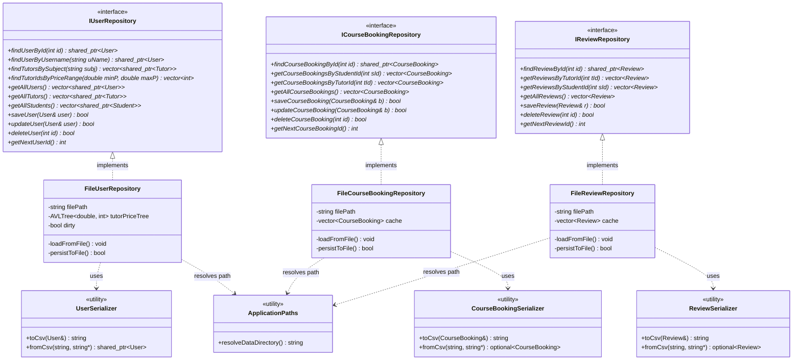

# KIẾN TRÚC TẦNG TRUY XUẤT DỮ LIỆU (DATA ACCESS LAYER ARCHITECTURE)
## Phân tích Chi tiết Giao diện Kho Lưu Trữ, Serializers, Cơ chế Ghi Nguyên Tử và Tự Động Khởi Tạo Dữ Liệu

---

## 1. TỔNG QUAN TẦNG TRUY XUẤT DỮ LIỆU (DATA ACCESS LAYER)

Tầng Truy Xuất Dữ Liệu ([`include/data_access/`](file:///C:/Users/DELL/.gemini/antigravity/scratch/TutorMatch/include/data_access/) và [`src/data_access/`](file:///C:/Users/DELL/.gemini/antigravity/scratch/TutorMatch/src/data_access/)) chịu trách nhiệm hoàn toàn về việc ánh xạ giữa các thực thể miền C++ trong bộ nhớ và định dạng tệp phẳng (Flat-File CSV) trên ổ đĩa.

```
┌────────────────────────────────────────────────────────┐
│             GIAO DIỆN KHO LƯU TRỮ (INTERFACES)         │
│   IUserRepository, ICourseBookingRepository,           │
│   IReviewRepository (DIP Abstractions)                 │
└───────────────────────────┬────────────────────────────┘
                            │ Implements
                            ▼
┌────────────────────────────────────────────────────────┐
│           TRIỂN KHAI LƯU TRỮ TỆP CỤ THỂ (CONCRETE)     │
│   FileUserRepository, FileCourseBookingRepository,     │
│   FileReviewRepository                                 │
└─────────────┬────────────────────────────┬─────────────┘
              │ Uses                       │ Uses
              ▼                            ▼
┌───────────────────────────┐    ┌───────────────────────────┐
│  BỘ TUẦN TỰ HÓA CSV       │    │  QUẢN LÝ ĐƯỜNG DẪN & TỰ ĐỘNG│
│  UserSerializer           │    │  ApplicationPaths         │
│  CourseBookingSerializer  │    │  MockDatabaseEngine Facade│
│  ReviewSerializer         │    │  DataFileInspector        │
│  SerializerUtils          │    └───────────────────────────┘
└─────────────┬─────────────┘
              │ Atomic Write (.tmp -> .dat)
              ▼
┌────────────────────────────────────────────────────────┐
│         CƠ SỞ DỮ LIỆU TỆP PHẲNG (PHYSICAL STORAGE)     │
│   data/users.dat, data/course_bookings.dat,            │
│   data/reviews.dat, data/seed/                         │
└────────────────────────────────────────────────────────┘
```

> [!NOTE]
> Sơ đồ quan hệ kiến trúc kho lưu trữ đã được mô hình hóa tại:
> 📄 [`docs/diagrams/09_repository_architecture.mmd`](file:///C:/Users/DELL/.gemini/antigravity/scratch/TutorMatch/docs/diagrams/09_repository_architecture.mmd)

### 1.1. Sơ đồ Cấu trúc Kho Lưu trữ và Tuần tự hóa (Repository Architecture and Serialization Diagram)

Sơ đồ lớp dưới đây minh họa sự phân tách rạch ròi giữa các giao diện trừu tượng (`IRepository`), các lớp triển khai thao tác tệp (`FileRepository`), các tiện ích tuần tự hóa CSV độc lập (`Serializer`) và cơ chế phân giải đường dẫn dữ liệu tự động (`ApplicationPaths`):



#### Diễn giải Kiến trúc Kho Lưu trữ và Tuần tự hóa:

1. **Hợp đồng Trừu tượng (Abstract Repository Interfaces):**
   - Ba giao diện `IUserRepository`, `ICourseBookingRepository`, `IReviewRepository` định nghĩa đầy đủ các hợp đồng dữ liệu mà Tầng Nghiệp vụ (BLL) yêu cầu. BLL không cần biết dữ liệu được lưu dưới dạng tệp CSV, SQLite hay cơ sở dữ liệu quan hệ từ xa.
2. **Triển khai Thực tế Độc lập (`File*Repository`):**
   - Mỗi lớp triển khai cụ thể (`FileUserRepository`, `FileCourseBookingRepository`, `FileReviewRepository`) chịu trách nhiệm nạp dữ liệu vào bộ nhớ đệm (RAM cache), duy trì cấu trúc tìm kiếm nhanh (như cây `AVLTree<double, int>` trong `FileUserRepository`), và ghi đĩa khi trạng thái thay đổi (`dirty`).
3. **Phân tách Trách nhiệm Tuần tự hóa (Single Responsibility Serializers):**
   - Logic phân tích cú pháp chuỗi CSV và định dạng dữ liệu được bóc tách hoàn toàn sang các lớp tiện ích chuyên trách: `UserSerializer`, `CourseBookingSerializer`, `ReviewSerializer`. Điều này giải phóng cả Domain Models lẫn Repositories khỏi mã nguồn xử lý chuỗi phức tạp.
4. **Phân giải Đường dẫn Khả chuyển (`ApplicationPaths`):**
   - Thay vì hard-code đường dẫn tuyệt đối hoặc phụ thuộc vào thư mục làm việc hiện tại (CWD), các repository sử dụng `ApplicationPaths::resolveDataDirectory()` để tự động dò tìm vị trí thư mục dữ liệu chuẩn của ứng dụng trong mọi môi trường (Qt Creator, CMake command-line, portable clone).

---

## 2. PHÂN TÁCH GIAO DIỆN VÀ TRIỂN KHAI (REPOSITORY DIP & ISP)

Tuân thủ chặt chẽ nguyên lý **Dependency Inversion Principle (DIP)** (ADR-002), Tầng Nghiệp vụ chỉ phụ thuộc vào các interface trừu tượng nằm trong [`IRepository.h`](file:///C:/Users/DELL/.gemini/antigravity/scratch/TutorMatch/include/data_access/repositories/IRepository.h):

### 2.1. `IUserRepository` & `FileUserRepository`
- **Giao diện trừu tượng:** Cung cấp các thao tác tìm kiếm (`findUserById`, `findUserByUsername`, `findTutorsBySubject`), truy vấn khoảng giá qua AVL (`findTutorIdsByPriceRange`), truy vấn danh sách (`getAllUsers`, `getAllTutors`, `getAllStudents`) và CRUD (`saveUser`, `updateUser`, `deleteUser`).
- **Triển khai cụ thể (`FileUserRepository`):**
  - Quản lý tệp `data/users.dat`.
  - Nạp toàn bộ dữ liệu vào bộ nhớ đệm khi khởi tạo.
  - Tích hợp một cây nhị phân tìm kiếm tự cân bằng `AVLTree<double, int> tutorPriceTree` để lập chỉ mục học phí của toàn bộ gia sư, cho phép tìm kiếm trong khoảng giá với độ phức tạp $O(\log N + K)$.

### 2.2. `ICourseBookingRepository` & `FileCourseBookingRepository`
- **Giao diện trừu tượng:** Thao tác tìm khóa học theo ID (`findCourseBookingById`), theo học viên (`getCourseBookingsByStudentId`), theo gia sư (`getCourseBookingsByTutorId`), lấy toàn bộ (`getAllCourseBookings`) và lưu/cập nhật (`saveCourseBooking`, `updateCourseBooking`).
- **Triển khai cụ thể (`FileCourseBookingRepository`):**
  - Quản lý tệp `data/course_bookings.dat`.
  - Lưu trữ danh sách `std::vector<CourseBooking>` trong RAM để phục vụ truy vấn tức thì.
  - Áp dụng cơ chế cập nhật tại chỗ trong bộ đệm và đồng bộ xuống đĩa.

### 2.3. `IReviewRepository` & `FileReviewRepository`
- **Giao diện trừu tượng:** Thao tác tìm review theo ID (`findReviewById`), theo gia sư (`getReviewsByTutorId`), theo học viên (`getReviewsByStudentId`), lấy toàn bộ (`getAllReviews`), lưu (`saveReview`) và xóa (`deleteReview`).
- **Triển khai cụ thể (`FileReviewRepository`):**
  - Quản lý tệp `data/reviews.dat`.
  - Hỗ trợ thao tác xóa bản ghi theo ID (`deleteReview`) phục vụ cả nghiệp vụ kiểm duyệt của Admin lẫn cơ chế bồi hoàn giao dịch ADR-007 của `ReviewService`.

---

## 3. CÁC BỘ TUẦN TỰ HÓA THỰC THỂ (DOMAIN SERIALIZERS)

Nhằm tuân thủ nguyên lý **Single Responsibility Principle (SRP)** (ADR-004), toàn bộ logic chuyển đổi giữa đối tượng C++ và chuỗi CSV được tách riêng khỏi các thực thể domain:

1. **`SerializerUtils`:**
   - `escapeCsv(val)`: Bao bọc chuỗi bằng dấu ngoặc kép `"` nếu chuỗi có chứa dấu phẩy `,` hoặc chính dấu ngoặc kép `""`.
   - `splitCsvLine(line)`: Tách dòng CSV thành danh sách các token, tôn trọng các chuỗi nằm trong dấu ngoặc kép.
   - `safeStringToInt`, `safeStringToDouble`, `safeStringToUInt64`: Chuyển đổi chuỗi sang số an toàn với khối `try-catch`, chống crash ứng dụng khi tệp dữ liệu có ký tự lạ.
2. **`UserSerializer`:**
   - Xử lý tính **đa hình (Polymorphism)** của User. Khi ghi: tự động nhận diện kiểu con (`Student`, `Tutor`, `Admin`) để xuất đúng số trường tương ứng (Student: 9 trường, Tutor: 14 trường, Admin: 7 trường). Khi đọc: dựa vào trường thứ 6 (`role`) để khởi tạo đúng con trỏ `std::make_shared<Student>`, `std::make_shared<Tutor>` hoặc `std::make_shared<Admin>`.
3. **`CourseBookingSerializer`:**
   - Xuất 13 trường cơ sở cho các khóa học thông thường, và tự động mở rộng thêm 10 trường bổ sung (từ trường 14 đến trường 23) khi khóa học có lịch nhiều ca (`weeklySchedule`), có yêu cầu kết thúc sớm hoặc có dấu thời gian cam kết V1.
4. **`ReviewSerializer`:**
   - Xuất đúng 8 trường chuẩn mực cho mỗi bản ghi đánh giá, có kiểm tra biên điểm sao `ratingScore` trong khoảng 1 đến 5.

---

## 4. TÍNH NGUYÊN TỬ CỦA THAO TÁC GHI TỆP (ATOMIC FILE PERSISTENCE)

Do TutorMatch không sử dụng hệ quản trị CSDL có tính năng ACID transaction, hệ thống bảo vệ tính toàn vẹn dữ liệu bằng **kỹ thuật ghi tệp tạm thời và đổi tên nguyên tử (Atomic File Replacement)**:

```
┌─────────────────┐       ┌─────────────────┐       ┌─────────────────┐
│ Dữ liệu C++     │ ────► │ Ghi tệp tạm     │ ────► │ Thay thế nguyên │
│ trong Bộ nhớ RAM│       │ path + ".tmp"   │       │ tử sang file gốc│
└─────────────────┘       └─────────────────┘       └────────┬────────┘
                                                             │ MoveFileExW
                                                             ▼
                                                    ┌─────────────────┐
                                                    │ data/*.dat      │
                                                    │ (An toàn 100%)  │
                                                    └─────────────────┘
```

Quy trình kỹ thuật:
1. Khi có yêu cầu lưu (`persistToFile()`), repository ghi toàn bộ dữ liệu ra một tệp tạm thời có hậu tố `.tmp` (ví dụ: `data/users.dat.tmp`).
2. Tệp tạm được đóng và xả bộ đệm đĩa (`flush()`).
3. Trên Windows, hệ thống sử dụng API hệ điều hành `MoveFileExW` với cờ `MOVEFILE_REPLACE_EXISTING | MOVEFILE_WRITE_THROUGH` (hoặc `std::filesystem::rename` trên POSIX) để thay thế tức thì tệp `.tmp` thành tệp `.dat` chính thức.
4. **Lợi ích:** Nếu máy tính bị mất điện hoặc ứng dụng bị tắt đột ngột trong lúc đang ghi, tệp `.dat` cũ vẫn còn nguyên vẹn, tệp `.tmp` dở dang sẽ bị bỏ qua, triệt tiêu hoàn toàn nguy cơ file bị rỗng (0 bytes) hoặc bị hỏng dở dang.

---

## 5. PHÂN GIẢI ĐƯỜNG DẪN VÀ TỰ ĐỘNG KHỞI TẠO DỮ LIỆU SEED

### 5.1. Phân giải đường dẫn thông minh (`ApplicationPaths`)
[`ApplicationPaths::resolveDataDirectory()`](file:///C:/Users/DELL/.gemini/antigravity/scratch/TutorMatch/src/data_access/storage/ApplicationPaths.cpp) giải quyết triệt để vấn đề tìm kiếm thư mục dữ liệu trong môi trường phát triển:
- Khi chạy từ Qt Creator trong thư mục build (ví dụ: `build/Desktop_Qt_6_11_2_MinGW_64_bit_Debug`), hàm tự động dò ngược lên các thư mục cha hoặc sử dụng macro `PROJECT_SOURCE_DIR` để trỏ chính xác về thư mục `data/` trong mã nguồn.
- Đảm bảo ứng dụng luôn đọc và ghi đúng vào tập dữ liệu dùng chung của dự án, không sinh ra các bản sao dữ liệu rác phân tán.

### 5.2. Tự động khởi tạo dữ liệu mẫu ban đầu (`MockDatabaseEngine`)
Khi ứng dụng khởi động lần đầu tiên trên một máy tính vừa clone mã nguồn từ GitHub:
- `MockDatabaseEngine::seedDefaultDataIfEmpty()` kiểm tra nếu các tệp trong `data/` chưa tồn tại hoặc rỗng (0 bytes).
- Hệ thống tự động sao chép nguyên vẹn bộ dữ liệu hạt giống chuẩn hóa từ [`data/seed/`](file:///C:/Users/DELL/.gemini/antigravity/scratch/TutorMatch/data/seed/) sang `data/`:
  - `data/seed/users.dat` (52 tài khoản chuẩn hóa) $\rightarrow$ `data/users.dat`
  - `data/seed/course_bookings.dat` (23 khóa học mẫu) $\rightarrow$ `data/course_bookings.dat`
  - `data/seed/reviews.dat` (15 bài đánh giá mẫu) $\rightarrow$ `data/reviews.dat`
- Đảm bảo người dùng mới mở Qt Creator và nhấn Run là có thể trải nghiệm ngay đầy đủ dữ liệu mẫu phong phú mà không cần thực hiện thêm bất kỳ bước thiết lập thủ công nào.
