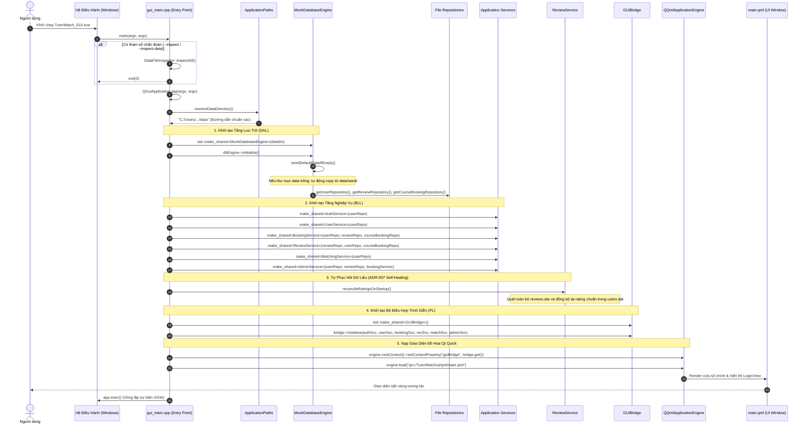

# VÒNG ĐỜI ỨNG DỤNG VÀ THIẾT KẾ COMPOSITION ROOT (APPLICATION LIFECYCLE & COMPOSITION)
## Trình tự Khởi tạo, Tự Phục Hồi Dữ liệu Khởi động và Dọn dẹp Tài nguyên

---

## 1. MẪU THIẾT KẾ COMPOSITION ROOT

TutorMatch áp dụng mẫu thiết kế **Composition Root** chuẩn mực tại điểm vào duy nhất của ứng dụng GUI ([`src/presentation/gui_main.cpp`](file:///C:/Users/DELL/.gemini/antigravity/scratch/TutorMatch/src/presentation/gui_main.cpp)).

Composition Root là nơi duy nhất trong toàn bộ hệ thống được phép biết và khởi tạo các lớp cụ thể (Concrete Classes), sau đó lắp ráp (wire) các phụ thuộc lại với nhau và tiêm (inject) vào các dịch vụ nghiệp vụ:

```
                               ┌───────────────────┐
                               │   gui_main.cpp    │
                               │(Composition Root) │
                               └─────────┬─────────┘
         ┌───────────────────────────────┼───────────────────────────────┐
         ▼                               ▼                               ▼
 ┌───────────────┐               ┌───────────────┐               ┌───────────────┐
 │1. Storage/DAL │               │  2. Services  │               │ 3. GUIBridge  │
 │ - MockDBEngine│ ────────────► │ - AuthService │ ────────────► │ - Controller  │
 │ - UserRepo    │ (Injects into)│ - BookingSvc  │ (Injects into)│ - QML Context │
 │ - BookingRepo │               │ - ReviewSvc...│               │   Property    │
 └───────────────┘               └───────────────┘               └───────────────┘
```

> [!NOTE]
> Sơ đồ tuần tự khởi động ứng dụng chi tiết đã được mô hình hóa tại:
> 📄 [`docs/diagrams/05_application_startup_sequence.mmd`](file:///C:/Users/DELL/.gemini/antigravity/scratch/TutorMatch/docs/diagrams/05_application_startup_sequence.mmd)

### 1.1. Sơ đồ Tuần tự Khởi tạo và Chu trình Sống của Ứng dụng (Application Startup Sequence Diagram)

Sơ đồ tuần tự dưới đây trực quan hóa chu trình khởi động ứng dụng từ hệ điều hành, quá trình phân giải đường dẫn dữ liệu, nạp Composition Root trong `gui_main.cpp`, cơ chế tự chữa lành dữ liệu (Self-Healing ADR-007) và kết nối giao diện Qt Quick:



#### Diễn giải Tuần tự Khởi động:

1. **Khởi chạy & Chế độ Chẩn đoán (Bước 1–8):** Khi tiến trình `TutorMatch_GUI.exe` được kích hoạt, `gui_main.cpp` kiểm tra các tham số dòng lệnh. Nếu có tham số chẩn đoán (`--inspect`), chương trình chạy kiểm tra dữ liệu và kết thúc ngay mà không khởi động đồ họa.
2. **Khởi tạo Tầng Lưu trữ & Tự Động Seed (Bước 9–14):** `ApplicationPaths` tìm kiếm thư mục dữ liệu hợp lệ. `MockDatabaseEngine` kiểm tra các tệp `.dat`; nếu thiếu dữ liệu, cơ chế tự động khôi phục từ `data/seed/` sẽ được kích hoạt nhằm đảm bảo ứng dụng luôn có dữ liệu mẫu để chạy ngay sau khi clone.
3. **Tiêm Phụ thuộc Nghiệp vụ (Bước 15–20):** Sáu Application Services được khởi tạo và nhận các Repository tương ứng thông qua constructor injection (tuân thủ DIP).
4. **Tự Chữa lành Rating ADR-007 (Bước 21–22):** `reviewService->reconcileRatingsOnStartup()` duyệt toàn bộ các bài đánh giá để đồng bộ hóa lại điểm rating và số lượt đánh giá của tất cả gia sư trong `users.dat`, loại bỏ hoàn toàn các lỗi sai lệch do bất đồng bộ trước đó.
5. **Đăng ký Bộ Điều hợp & Hiển thị Giao diện (Bước 23–28):** `GUIBridge` được khởi tạo và nhận đủ 6 Service. Đối tượng bridge được đăng ký vào `QQmlContext` của `QQmlApplicationEngine` dưới tên biến toàn cục `guiBridge`. Cuối cùng `main.qml` được nạp và vòng lặp sự kiện `app.exec()` bắt đầu.

---

## 2. TRÌNH TỰ KHỞI ĐỘNG 7 BƯỚC CHI TIẾT (STARTUP SEQUENCE)

Khi tệp thực thi `TutorMatch_GUI.exe` được kích hoạt, tiến trình thực thi diễn ra theo đúng 7 bước nghiêm ngặt:

### Bước 1: Xử lý tham số dòng lệnh chẩn đoán (Command-line Inspection)
- Duyệt qua `argv`: Nếu phát hiện cờ `-i`, `--inspect` hoặc `--inspect-data`, ứng dụng chuyển sang chế độ console, gọi `DataFileInspector::inspectAll()`, in báo cáo toàn vẹn dữ liệu và thoát ngay lập tức với mã 0 mà không khởi tạo QML Engine.

### Bước 2: Thiết lập môi trường Qt Quick & Ứng dụng
- `qputenv("QT_QUICK_CONTROLS_STYLE", "Basic");`: Đảm bảo giao diện sử dụng style chuẩn, không bị xung đột với theme hệ điều hành.
- Khởi tạo đối tượng `QGuiApplication app(argc, argv)` với định danh ứng dụng và tổ chức `TutorMatch`.

### Bước 3: Phân giải đường dẫn lưu trữ (`ApplicationPaths`)
- Gọi `ApplicationPaths::resolveDataDirectory()`. Hàm sẽ kiểm tra môi trường chạy (thư mục build, thư mục mã nguồn) và trả về đường dẫn tuyệt đối chuẩn xác trỏ đến thư mục `data/`.

### Bước 4: Khởi tạo Tầng Lưu Trữ & Tự động Seed dữ liệu
- Khởi tạo đối tượng `MockDatabaseEngine(dataDir)`.
- Gọi `dbEngine->initialize()`: Kiểm tra sự tồn tại của `data/users.dat`, `data/course_bookings.dat`, `data/reviews.dat`. Nếu thiếu hoặc rỗng, tự động sao chép từ `data/seed/`.
- Nạp các kho lưu trữ cụ thể: `userRepo`, `reviewRepo`, `courseBookingRepo`.

### Bước 5: Khởi tạo Tầng Nghiệp Vụ & Tiêm Phụ Thuộc (Dependency Injection)
- Khởi tạo 6 Application Services thông qua con trỏ chia sẻ `std::make_shared`:
  ```cpp
  auto authService = std::make_shared<TutorMatch::AuthService>(userRepo);
  auto userService = std::make_shared<TutorMatch::UserService>(userRepo);
  auto bookingService = std::make_shared<TutorMatch::BookingService>(userRepo, reviewRepo, courseBookingRepo);
  auto reviewService = std::make_shared<TutorMatch::ReviewService>(reviewRepo, userRepo, courseBookingRepo);
  auto matchingService = std::make_shared<TutorMatch::MatchingService>(userRepo);
  auto adminService = std::make_shared<TutorMatch::AdminService>(userRepo, reviewRepo, bookingService);
  ```

### Bước 6: Tự phục hồi dữ liệu lúc khởi động (ADR-007 Self-Healing)
- Gọi hàm:
  ```cpp
  reviewService->reconcileRatingsOnStartup();
  ```
- **Ý nghĩa:** Quét toàn bộ các bài đánh giá có thực trong `reviews.dat`, tính lại chính xác điểm rating trung bình tích lũy và số lượng đánh giá cho từng gia sư, sau đó cập nhật đè vào `users.dat`. Cơ chế này loại bỏ triệt để mọi nguy cơ sai lệch điểm rating tích lũy do các lỗi ghi trước đó hoặc do người dùng sửa file `.dat` thủ công.

### Bước 7: Khởi tạo GUIBridge, Nạp QML Engine & Chạy Vòng lặp
- Khởi tạo `GUIBridge` và gọi `bridge->initialize(authService, userService, bookingService, reviewService, matchingService, adminService)`.
- Đăng ký `guiBridge` vào không gian tên của QML Engine qua `engine.rootContext()->setContextProperty("guiBridge", bridge.get())`.
- Nạp giao diện gốc `engine.load("qrc:/TutorMatch/ui/qml/main.qml")`.
- Khởi chạy vòng lặp sự kiện đồ họa: `return app.exec();`.

---

## 3. VÒNG ĐỜI GIẢI PHÓNG TÀI NGUYÊN VÀ ĐÓNG ỨNG DỤNG (SHUTDOWN)

Khi người dùng nhấn nút đóng cửa sổ chính (hoặc phím tắt Alt+F4):
1. `QGuiApplication::exec()` kết thúc vòng lặp sự kiện và trả về mã thoát.
2. Cây đối tượng của `QQmlApplicationEngine` được hủy trước, đóng toàn bộ các kết nối tín hiệu (signal connections) với `GUIBridge`.
3. Con trỏ `std::shared_ptr<GUIBridge>` tự động giảm số đếm tham chiếu (ref count) và giải phóng.
4. Các con trỏ Service và Repository lần lượt được hủy theo thứ tự ngược lại với lúc khởi tạo.
5. Trước khi hủy, các Repository xả sạch các bộ đệm đang mở, đảm bảo không có giao dịch ghi tệp nào bị treo dở dang.
6. Toàn bộ tiến trình kết thúc sạch sẽ (clean exit) với mã thoát 0.
