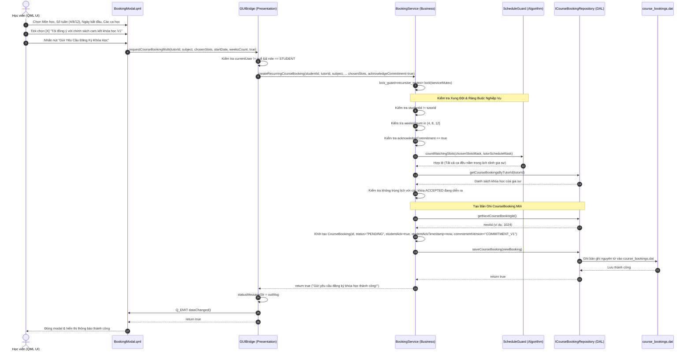

# ĐẶC TẢ CHỨC NĂNG DÀNH CHO HỌC VIÊN (STUDENT FEATURES SPECIFICATION)
## Khảo sát và Truy vết Chi tiết các Chức năng của Vai trò Học viên

---

## 1. DANH MỤC CÁC TÍNH NĂNG ĐÃ TRIỂN KHAI THỰC TẾ `[VERIFIED]`

Dưới đây là bảng tổng hợp toàn bộ các tính năng dành cho Học viên có thể truy vết trực tiếp trong mã nguồn:

| Mã tính năng | Tên tính năng nghiệp vụ | Thành phần QML chính | Phương thức C++ Bridge | Tệp dữ liệu liên quan |
| :---: | :--- | :--- | :--- | :--- |
| **STU-01** | Đăng ký & Đăng nhập Học viên | `LoginView.qml` | `qmlRegisterStudent`, `qmlLogin` | `data/users.dat` |
| **STU-02** | Xem Tổng quan & Thời khóa biểu | `StudentOverviewView.qml`, `TimetableGrid.qml` | `getStudentWeeklySchedule`, `getWeeklyScheduleMatrix` | `data/users.dat`, `data/course_bookings.dat` |
| **STU-03** | Chỉnh sửa Hồ sơ Học viên | `ProfileEditModal.qml`, `StudentProfileCard.qml` | `updateStudentProfile` | `data/users.dat` |
| **STU-04** | Thiết lập Lịch bận Cá nhân (56 ca) | `TimetableGrid.qml`, `TimetableCell.qml` | `qmlToggleStudentScheduleSlot`, `clearStudentBusySchedule` | `data/users.dat` |
| **STU-05** | Tìm kiếm Gia sư Đa tiêu chí | `StudentTutorSearchView.qml`, `TutorCard.qml` | `searchAndFilterTutors` | `data/users.dat` |
| **STU-06** | Gợi ý Gia sư Thông minh (SmartMatch) | `StudentSmartMatchView.qml`, `TutorCard.qml` | `qmlSearchSmartMatches` | `data/users.dat`, `data/course_bookings.dat` |
| **STU-07** | Xem Chi tiết Hồ sơ Gia sư | `TutorDetailModal.qml` | `getTutorDetail`, `getTutorAvailableBookingSlots` | `data/users.dat`, `data/course_bookings.dat` |
| **STU-08** | Đăng ký Khóa học Định kỳ & Cam kết V1 | `BookingModal.qml` | `requestCourseBookingMulti`, `calculateMultiSlotSessionDates` | `data/course_bookings.dat` |
| **STU-09** | Quản lý Khóa học & Lịch sử Học tập | `StudentBookingsView.qml` | `qmlGetStudentBookings`, `qmlGetStudentBookingMetrics` | `data/course_bookings.dat` |
| **STU-10** | Hủy Đơn Đăng ký Đang chờ duyệt | `StudentBookingsView.qml` | `qmlCancelBooking` | `data/course_bookings.dat` |
| **STU-11** | Đề xuất / Phản hồi Kết thúc sớm | `StudentBookingsView.qml` | `requestEarlyTermination`, `respondEarlyTermination` | `data/course_bookings.dat` |
| **STU-12** | Gửi Đánh giá & Xếp hạng Sao | `ReviewModal.qml`, `StudentBookingsView.qml` | `qmlSubmitReview` | `data/reviews.dat`, `data/users.dat` |

---

## 2. ĐẶC TẢ CHI TIẾT TỪNG TÍNH NĂNG VÀ TRUY VẾT MÃ NGUỒN

### 2.1. STU-01: Đăng ký & Đăng nhập Học viên
- **Mục đích:** Cho phép học sinh mới tạo tài khoản và đăng nhập vào hệ thống.
- **Tiền điều kiện:** Người dùng chưa đăng nhập.
- **Dữ liệu đầu vào:** Tên đăng nhập (username), mật khẩu (password), họ tên (fullName), email, khối lớp (gradeLevel từ 1-12).
- **Quy tắc xử lý:**
  - Kiểm tra username và email không được trùng với tài khoản đã có trong hệ thống.
  - Mật khẩu tối thiểu 6 ký tự.
  - Mật khẩu được băm SHA-256 an toàn qua `DateUtils::sha256()`.
  - Mặc định khởi tạo `scheduleBitmask = 0ULL` (chưa đánh dấu lịch bận nào).
- **Dữ liệu đầu ra:** Lưu bản ghi Student vào `users.dat`, đăng nhập tự động và chuyển hướng sang `MainDashboard`.
- **Truy vết mã nguồn:**
  - QML: [`ui/qml/LoginView.qml`](file:///C:/Users/DELL/.gemini/antigravity/scratch/TutorMatch/ui/qml/LoginView.qml)
  - C++ Bridge: [`GUIBridge::qmlRegisterStudent`](file:///C:/Users/DELL/.gemini/antigravity/scratch/TutorMatch/src/presentation/bridges/GUIBridge.cpp#L125)
  - Business Service: [`AuthService::registerStudent`](file:///C:/Users/DELL/.gemini/antigravity/scratch/TutorMatch/src/business/services/AuthService.cpp#L45)
  - Data File: `data/users.dat`
  - Test Suite: Suite 3 (`run_test_dip_isp_and_srp`).

---

### 2.2. STU-06: Gợi ý Gia sư Thông minh (SmartMatch)
- **Mục đích:** Đề xuất danh sách gia sư phù hợp nhất dựa trên tiêu chí học tập và lịch rảnh.
- **Tiền điều kiện:** Học viên đã đăng nhập thành công.
- **Dữ liệu đầu vào:** Môn học cần học (subject), ngân sách tối đa mỗi buổi (maxBudget), khối lớp (grade), mặt nạ các ca học rảnh mong muốn (`preferredScheduleMask`).
- **Quy tắc xử lý:**
  - **Lọc cứng bắt buộc (Mandatory Subject Filter):** Gia sư có chuyên môn không khớp với môn học yêu cầu sẽ bị loại bỏ ngay lập tức tại `MatchingEngine::isEligible()`.
  - **Lọc trùng lịch:** Gia sư phải rảnh ít nhất một ca học trong số các ca học viên yêu cầu và không bị trùng lịch với các khóa học đã duyệt (`ACCEPTED`) khác.
  - **Tính điểm 100 điểm:** Đánh giá ứng viên theo 5 tiêu chí: Lịch rảnh (35đ), Giá cả (25đ), Đánh giá sao (15đ), Thâm niên giảng dạy (15đ), Độ tin cậy (10đ).
  - **Xếp hạng:** Đưa các ứng viên đủ điều kiện vào `MaxHeap` và trích xuất Top-K (mặc định Top 5).
- **Dữ liệu đầu ra:** Danh sách gia sư kèm điểm tương thích (%) và giải trình lý do ghép nối.
- **Truy vết mã nguồn:**
  - QML: [`ui/qml/StudentSmartMatchView.qml`](file:///C:/Users/DELL/.gemini/antigravity/scratch/TutorMatch/ui/qml/StudentSmartMatchView.qml)
  - C++ Bridge: [`GUIBridge::qmlSearchSmartMatches`](file:///C:/Users/DELL/.gemini/antigravity/scratch/TutorMatch/src/presentation/bridges/GUIBridge.cpp#L415)
  - Business Service: [`MatchingService::findMatchesWithCriteria`](file:///C:/Users/DELL/.gemini/antigravity/scratch/TutorMatch/src/business/services/MatchingService.cpp#L25)
  - Algorithm: [`MatchingEngine::findTopMatchesWithCriteria`](file:///C:/Users/DELL/.gemini/antigravity/scratch/TutorMatch/src/business/matching/MatchingEngine.cpp#L120) & `WeightedScoreMatchingStrategy`
  - Test Suite: Suite 25 & Suite 27 (`run_test_smartmatch_mandatory_subject_filtering`).

---

### 2.3. STU-08: Đăng ký Khóa học Định kỳ & Cam kết V1
- **Mục đích:** Gửi yêu cầu mở khóa học nhiều tuần tới một gia sư được chọn.
- **Tiền điều kiện:** Học viên chọn một gia sư từ Tìm kiếm hoặc SmartMatch.
- **Dữ liệu đầu vào:** `tutorId`, `subject`, `weeksCount` (4, 8, 12 tuần), `startDate` (YYYY-MM-DD), danh sách các ca học trong tuần (`chosenSlots`), và tick chọn đồng ý cam kết chính sách V1 (`acknowledgeCommitment = true`).
- **Quy tắc xử lý:**
  - Kiểm tra bắt buộc tick cam kết V1 (`acknowledgeCommitment == true`).
  - Kiểm tra tính tương thích lịch: Tất cả các ca đã chọn phải nằm trong lịch rảnh của gia sư và không bị trùng với các khóa `ACCEPTED` khác của gia sư đó.
  - Khởi tạo bản ghi `CourseBooking` với `status = "PENDING"`, `studentAcknowledged = true`, `studentAckTimestamp = now`, `commitmentVersion = "COMMITMENT_V1"`.
- **Dữ liệu đầu ra:** Lưu bản ghi vào `course_bookings.dat`, phát tín hiệu `dataChanged()`.
- **Truy vết mã nguồn:**
  - QML: [`ui/qml/BookingModal.qml`](file:///C:/Users/DELL/.gemini/antigravity/scratch/TutorMatch/ui/qml/BookingModal.qml)
  - C++ Bridge: [`GUIBridge::requestCourseBookingMulti`](file:///C:/Users/DELL/.gemini/antigravity/scratch/TutorMatch/src/presentation/bridges/GUIBridge.cpp#L1620)
  - Business Service: [`BookingService::createRecurringCourseBooking`](file:///C:/Users/DELL/.gemini/antigravity/scratch/TutorMatch/src/business/services/BookingService.cpp#L110)
  - Repository: [`FileCourseBookingRepository::saveCourseBooking`](file:///C:/Users/DELL/.gemini/antigravity/scratch/TutorMatch/src/data_access/repositories/FileCourseBookingRepository.cpp#L45)
  - Data File: `data/course_bookings.dat`
  - Test Suite: Suite 20 & Suite 24 (`run_test_commitment_acknowledgment_and_review_matrix`).

#### 2.3.1. Sơ đồ Tuần tự Đăng ký Khóa học và Xác nhận Cam kết (Student Course Registration Sequence Diagram)

Sơ đồ tuần tự dưới đây thể hiện chi tiết luồng xử lý từ khi học viên thao tác trên hộp thoại `BookingModal.qml`, xác nhận điều khoản cam kết V1, thông qua phương thức bridge và lớp nghiệp vụ `BookingService`, kiểm tra xung đột thời khóa biểu bằng `ScheduleGuard` và lưu bản ghi khóa học mới xuống đĩa:

##### Diễn giải Quy trình Đăng ký Khóa học:
1. **Thu thập Dữ liệu & Cam kết (Bước 1–4):** Học viên bắt buộc phải chọn môn học, thời lượng gói (4, 8 hoặc 12 tuần), ngày bắt đầu, ít nhất một ca học trong tuần, và tick vào ô cam kết V1 (`acknowledgeCommitment = true`). Nếu thiếu điều kiện cam kết, modal sẽ chặn gửi yêu cầu ngay tại client.
2. **Kiểm tra Ràng buộc Nghiệp vụ (Bước 5–12):** `BookingService` xác minh rằng học viên không tự đặt lớp cho chính mình, số tuần hợp lệ, và sử dụng `ScheduleGuard` để so khớp mặt nạ bit các ca học với lịch rảnh của gia sư. Đồng thời, hệ thống duyệt danh sách các khóa học hiện có của gia sư để đảm bảo không trùng với bất kỳ ca học nào đã được chấp nhận trước đó.
3. **Khởi tạo và Lưu trữ (Bước 13–18):** `CourseBooking` mới được tạo với mã nhận diện tăng tự động (`nextId`), trạng thái ban đầu là `PENDING`, lưu trữ dấu thời gian cam kết của học viên (`studentAckTimestamp`) và phiên bản cam kết `COMMITMENT_V1`. Bản ghi được tuần tự hóa và ghi nguyên tử vào `course_bookings.dat`.
4. **Phản hồi Tức thời (Bước 19–24):** Tín hiệu `dataChanged()` được phát ra giúp giao diện học viên cập nhật ngay lập tức danh sách khóa học đang chờ duyệt mà không cần tải lại toàn bộ ứng dụng.

---

### 2.4. STU-12: Gửi Đánh giá & Xếp hạng Sao
- **Mục đích:** Đánh giá chất lượng giảng dạy của gia sư sau khi kết thúc khóa học.
- **Tiền điều kiện:** Khóa học thuộc về học viên đó và đã chuyển sang trạng thái `COMPLETED` hoặc `EARLY_TERMINATED`. Chưa từng gửi đánh giá cho khóa học này.
- **Dữ liệu đầu vào:** `bookingId`, `ratingScore` (số nguyên từ 1 đến 5), `comment` (chuỗi nhận xét, không được để trống).
- **Quy tắc xử lý:**
  - Kiểm tra tính hợp lệ bằng `ReviewService::isEligibleForReview()`.
  - Lưu bản ghi Review mới vào `reviews.dat`.
  - Tính toán lại điểm rating trung bình của gia sư dựa trên toàn bộ các bài đánh giá hợp lệ.
  - Cập nhật điểm rating mới và số lượt đánh giá vào `users.dat`.
  - **ADR-007 Compensating Rollback:** Nếu thao tác cập nhật User thất bại, tự động xóa bản ghi Review vừa lưu để bảo vệ tính toàn vẹn đa tệp.
- **Dữ liệu đầu ra:** Hiển thị đánh giá trên trang cá nhân của gia sư, ẩn nút đánh giá của đơn đó trên giao diện học viên.
- **Truy vết mã nguồn:**
  - QML: [`ui/qml/ReviewModal.qml`](file:///C:/Users/DELL/.gemini/antigravity/scratch/TutorMatch/ui/qml/ReviewModal.qml)
  - C++ Bridge: [`GUIBridge::qmlSubmitReview`](file:///C:/Users/DELL/.gemini/antigravity/scratch/TutorMatch/src/presentation/bridges/GUIBridge.cpp#L1226)
  - Business Service: [`ReviewService::submitReview`](file:///C:/Users/DELL/.gemini/antigravity/scratch/TutorMatch/src/business/services/ReviewService.cpp#L78)
  - Repositories: `FileReviewRepository`, `FileUserRepository`
  - Data Files: `data/reviews.dat`, `data/users.dat`
  - Test Suite: Suite 17 & Suite 18 (`run_test_dip_isp_and_srp`, Rating Recalculation).
