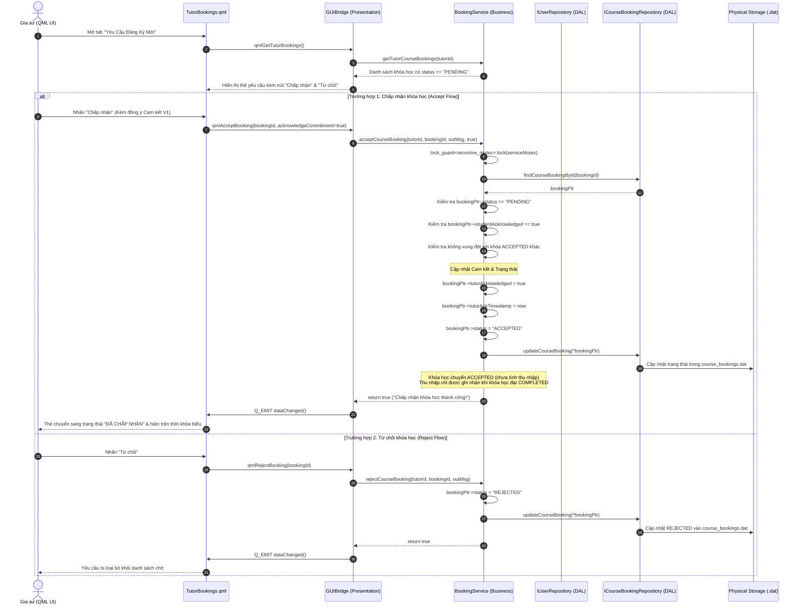

# ĐẶC TẢ CHỨC NĂNG DÀNH CHO GIA SƯ (TUTOR FEATURES SPECIFICATION)
## Khảo sát và Truy vết Chi tiết các Chức năng của Vai trò Gia sư

---

## 1. DANH MỤC CÁC TÍNH NĂNG ĐÃ TRIỂN KHAI THỰC TẾ `[VERIFIED]`

Dưới đây là bảng tổng hợp các chức năng dành cho Gia sư có thể truy vết trực tiếp trong mã nguồn:

| Mã tính năng | Tên tính năng nghiệp vụ | Thành phần QML chính | Phương thức C++ Bridge | Tệp dữ liệu liên quan |
| :---: | :--- | :--- | :--- | :--- |
| **TUT-01** | Đăng ký & Đăng nhập Gia sư | `LoginView.qml` | `qmlRegisterTutor`, `qmlLogin` | `data/users.dat` |
| **TUT-02** | Xem Bảng điều khiển, Tổng học phí tích lũy & Thời khóa biểu | `TutorOverview.qml`, `TimetableGrid.qml` | `getTutorWeeklySchedule`, `qmlGetTutorOverview` | `data/users.dat`, `data/course_bookings.dat` |
| **TUT-03** | Cập nhật Hồ sơ & Chuyên môn Giảng dạy | `ProfileEditModal.qml`, `TutorOverview.qml` | `updateTutorProfile` | `data/users.dat` |
| **TUT-04** | Thiết lập Lịch rảnh Giảng dạy (56 ca) | `TimetableGrid.qml`, `TimetableCell.qml` | `qmlToggleTutorScheduleSlot` | `data/users.dat` |
| **TUT-05** | Duyệt Yêu cầu Khóa học Mới & Cam kết V1 | `TutorBookings.qml` | `qmlAcceptBooking`, `qmlRejectBooking` | `data/course_bookings.dat`, `data/users.dat` |
| **TUT-06** | Quản lý Học viên & Khóa học Đang dạy | `TutorStudents.qml` | `qmlGetTutorStudents`, `qmlGetTutorActiveStudents` | `data/course_bookings.dat` |
| **TUT-07** | Đề xuất / Phản hồi Kết thúc sớm Khóa học | `TutorStudents.qml` | `requestEarlyTermination`, `respondEarlyTermination` | `data/course_bookings.dat` |
| **TUT-08** | Theo dõi Thống kê Tổng học phí & Phản hồi | `TutorStatistics.qml`, `TutorOverview.qml` | `qmlGetTutorStatistics`, `qmlGetTutorReviews` | `data/users.dat`, `data/course_bookings.dat`, `data/reviews.dat` |

---

## 2. ĐẶC TẢ CHI TIẾT TỪNG TÍNH NĂNG VÀ TRUY VẾT MÃ NGUỒN

### 2.1. TUT-03: Cập nhật Hồ sơ & Chuyên môn Giảng dạy
- **Mục đích:** Cho phép gia sư điều chỉnh thông tin cá nhân, tiểu sử giảng dạy, học phí đề xuất và môn chuyên môn.
- **Tiền điều kiện:** Gia sư đã đăng nhập thành công.
- **Dữ liệu đầu vào:** Họ tên (`name`), email, tiểu sử (`bio`), môn chuyên môn (`subjectSpecialty`), học phí đề xuất (`hourlyRate`).
- **Quy tắc xử lý:**
  - `hourlyRate` phải lớn hơn hoặc bằng 0.
  - Chuỗi chuyên môn `subjectSpecialty` sẽ được chuẩn hóa qua `SubjectTaxonomy` để phục vụ tìm kiếm ngữ nghĩa.
  - Dữ liệu được cập nhật vào đối tượng `Tutor` và lưu xuống `users.dat`.
- **Dữ liệu đầu ra:** Cập nhật thông tin hiển thị trên bảng điều khiển và trong kết quả tìm kiếm của học viên.
- **Truy vết mã nguồn:**
  - QML: [`ui/qml/ProfileEditModal.qml`](file:///C:/Users/DELL/.gemini/antigravity/scratch/TutorMatch/ui/qml/ProfileEditModal.qml)
  - C++ Bridge: [`GUIBridge::updateTutorProfile`](file:///C:/Users/DELL/.gemini/antigravity/scratch/TutorMatch/src/presentation/bridges/GUIBridge.cpp#L780)
  - Business Service: [`UserService::updateUser`](file:///C:/Users/DELL/.gemini/antigravity/scratch/TutorMatch/src/business/services/UserService.cpp#L45)
  - Data File: `data/users.dat`
  - Test Suite: Suite 6 (`run_test_tutor_profile_editing`).

---

### 2.2. TUT-04: Thiết lập Lịch rảnh Giảng dạy (56 Ca Tuần)
- **Mục đích:** Cấu hình các ca học gia sư sẵn sàng nhận lớp trong tuần (từ Thứ 2 đến Chủ nhật, mỗi ngày 8 ca).
- **Tiền điều kiện:** Gia sư mở bảng thời khóa biểu ở chế độ chỉnh sửa.
- **Dữ liệu đầu vào:** Chỉ số ngày `dayIndex` (0 đến 6) và chỉ số ca `slotIndex` (0 đến 7).
- **Quy tắc xử lý:**
  - Tính toán mặt nạ bit tương ứng: `slotMask = ScheduleGuard::getSlotMask(dayIndex, slotIndex)`.
  - Thực hiện đảo trạng thái bit trên `scheduleBitmask` của gia sư qua `ScheduleGuard::setSlot()`.
  - Khử bit ma bằng `ScheduleGuard::sanitizeMask()`.
  - Lưu cập nhật xuống `users.dat`.
- **Dữ liệu đầu ra:** Ô trên lưới thời khóa biểu đổi màu tương ứng (Xanh lá: Rảnh, Trắng: Bận).
- **Truy vết mã nguồn:**
  - QML: [`ui/qml/TimetableGrid.qml`](file:///C:/Users/DELL/.gemini/antigravity/scratch/TutorMatch/ui/qml/TimetableGrid.qml)
  - C++ Bridge: [`GUIBridge::qmlToggleTutorScheduleSlot`](file:///C:/Users/DELL/.gemini/antigravity/scratch/TutorMatch/src/presentation/bridges/GUIBridge.cpp#L610)
  - Business Service: [`UserService::updateUser`](file:///C:/Users/DELL/.gemini/antigravity/scratch/TutorMatch/src/business/services/UserService.cpp#L45)
  - Algorithm: [`ScheduleGuard::setSlot`](file:///C:/Users/DELL/.gemini/antigravity/scratch/TutorMatch/src/business/algorithms/ScheduleGuard.h#L54)
  - Test Suite: Suite 4 & Suite 7 (`run_test_schedule_synchronization`).

---

### 2.3. TUT-05: Duyệt Yêu cầu Khóa học Mới & Cam kết V1
- **Mục đích:** Gia sư tiếp nhận các khóa học do học viên gửi tới, xem xét các ca học yêu cầu và đưa ra quyết định Chấp nhận (`ACCEPTED`) hoặc Từ chối (`REJECTED`).
- **Tiền điều kiện:** Có yêu cầu đang ở trạng thái `PENDING` trỏ tới gia sư này.
- **Dữ liệu đầu vào:** `bookingId`, `acknowledgeCommitment` (bắt buộc `true` nếu chấp nhận).
- **Quy tắc xử lý:**
  - **Trường hợp Chấp nhận:**
    - Kiểm tra `acknowledgeCommitment == true`.
    - Kiểm tra khóa học không trùng lịch với các khóa đã nhận khác.
    - Cập nhật `tutorAcknowledged = true`, `tutorAckTimestamp = now`, `status = "ACCEPTED"`.
    - Khóa các ca học tương ứng trên thời khóa biểu tuần của gia sư.
    - *Lưu ý về Thu nhập:* Khi chấp nhận, khóa học chuyển sang `ACCEPTED` (đang diễn ra) và **chưa** ghi nhận vào thu nhập tích lũy. Thu nhập chỉ được cộng dồn khi khóa học hoàn thành trọn vẹn (`COMPLETED`).
  - **Trường hợp Từ chối:**
    - Cập nhật `status = "REJECTED"`, không tạo lịch học, không cộng thu nhập.
- **Dữ liệu đầu ra:** Cập nhật tệp `course_bookings.dat` và `users.dat`. Phát tín hiệu `dataChanged()`.
- **Truy vết mã nguồn:**
  - QML: [`ui/qml/TutorBookings.qml`](file:///C:/Users/DELL/.gemini/antigravity/scratch/TutorMatch/ui/qml/TutorBookings.qml)
  - C++ Bridge: [`GUIBridge::qmlAcceptBooking`](file:///C:/Users/DELL/.gemini/antigravity/scratch/TutorMatch/src/presentation/bridges/GUIBridge.cpp#L1250) & `qmlRejectBooking`
  - Business Service: [`BookingService::acceptCourseBooking`](file:///C:/Users/DELL/.gemini/antigravity/scratch/TutorMatch/src/business/services/BookingService.cpp#L320) & `rejectCourseBooking`
  - Repositories: `FileCourseBookingRepository`, `FileUserRepository`
  - Data Files: `data/course_bookings.dat`, `data/users.dat`
  - Test Suite: Suite 20 & Suite 24.

#### 2.3.1. Sơ đồ Tuần tự Gia sư Duyệt Khóa học và Đồng thuận Cam kết (Tutor Booking Approval Sequence Diagram)

Sơ đồ tuần tự dưới đây thể hiện chi tiết hai nhánh xử lý của gia sư trên màn hình `TutorBookings.qml` khi tiếp nhận một yêu cầu khóa học mới: quy trình Chấp nhận (`Accept Flow`) kèm xác thực cam kết V1 và tự động cộng dồn thu nhập, hoặc quy trình Từ chối (`Reject Flow`):

##### Diễn giải Quy trình Phê duyệt Khóa học:
1. **Tiếp nhận Yêu cầu (Bước 1–5):** Màn hình `TutorBookings.qml` truy vấn toàn bộ các yêu cầu có trạng thái `PENDING` của gia sư để hiển thị thẻ thông tin gồm: tên học viên, môn học, số tuần, các ca học trong tuần và mức học phí dự kiến.
2. **Nhánh Chấp nhận (`Accept Flow`, Bước 6–23):**
   - Gia sư xác nhận đồng thuận với các điều khoản cam kết V1 (`acknowledgeCommitment = true`).
   - `BookingService` khóa mutex và kiểm tra tính toàn vẹn: đơn còn ở trạng thái `PENDING`, học viên đã cam kết trước đó, và không có xung đột lịch phát sinh với các khóa khác.
   - Trạng thái được cập nhật thành `ACCEPTED`, lưu lại thời điểm gia sư ký xác nhận (`tutorAckTimestamp`).
   - Khóa các ca học trên thời khóa biểu tuần của cả hai bên. Khóa học bước vào giai đoạn thực hiện. Do TutorMatch không thu tiền học trước mà chỉ quản lý theo cam kết, thu nhập chưa được tính ở bước này.
3. **Nhánh Từ chối (`Reject Flow`, Bước 24–32):**
   - Nếu gia sư từ chối, khóa học chuyển sang trạng thái `REJECTED`, các ca học được bảo lưu trạng thái rảnh cho các yêu cầu khác và không có biến động thu nhập.
4. **Phản hồi Giao diện:** Cả hai nhánh đều phát tín hiệu `dataChanged()`, giúp thời khóa biểu và danh sách lớp học của cả học viên lẫn gia sư được đồng bộ hóa tức thời.

---

### 2.4. TUT-07: Đề xuất / Phản hồi Kết thúc sớm Khóa học
- **Mục đích:** Xử lý tình huống gia sư hoặc học viên bận việc đột xuất cần dừng khóa học trước thời hạn thỏa thuận.
- **Tiền điều kiện:** Khóa học đang ở trạng thái `ACCEPTED`.
- **Dữ liệu đầu vào:** `courseBookingId`, `reason` (nếu là người yêu cầu), hoặc `agree` (`true`/`false` nếu là người phản hồi).
- **Quy tắc xử lý:**
  - Khi một bên nhấn yêu cầu kết thúc sớm: Hệ thống ghi nhận `earlyTerminationRequesterId = userId`, `earlyTerminationStatus = "PENDING"`, `earlyTerminationReason = reason`. Khóa học **VẪN Ở TRẠNG THÁI `ACCEPTED`** và lịch học vẫn tiếp tục.
  - Khi bên còn lại phản hồi:
    - Nếu `agree == true`: Khóa học chính thức chuyển sang trạng thái `EARLY_TERMINATED`, `actualEndDate = today`. Toàn bộ các ca học tương lai của khóa học này được giải phóng ngay lập tức trên thời khóa biểu.
    - Nếu `agree == false`: Yêu cầu kết thúc sớm bị bác bỏ (`earlyTerminationStatus = "REJECTED"`), khóa học tiếp tục diễn ra bình thường theo lịch cũ.
- **Truy vết mã nguồn:**
  - QML: [`ui/qml/TutorStudents.qml`](file:///C:/Users/DELL/.gemini/antigravity/scratch/TutorMatch/ui/qml/TutorStudents.qml)
  - C++ Bridge: [`GUIBridge::requestEarlyTermination`](file:///C:/Users/DELL/.gemini/antigravity/scratch/TutorMatch/src/presentation/bridges/GUIBridge.cpp#L1690) & `respondEarlyTermination`
  - Business Service: [`BookingService::requestEarlyTermination`](file:///C:/Users/DELL/.gemini/antigravity/scratch/TutorMatch/src/business/services/BookingService.cpp#L480) & `respondEarlyTermination`
  - Data File: `data/course_bookings.dat`
  - Test Suite: Suite 23 (`run_test_multi_slot_course_and_consensual_termination`).

---

### 2.5. TUT-08: Theo dõi Tổng Học phí Tích lũy & Thống kê Giảng dạy `[VERIFIED]`
- **Mục đích:** Cung cấp cho Gia sư cái nhìn trực quan, minh bạch về tổng giá trị học phí tích lũy từ các khóa học đã hoàn thành theo thỏa thuận đào tạo định kỳ, cùng các chỉ số đánh giá sao và số lượt nhận xét.
- **Vị trí hiển thị giao diện:**
  - **Bảng điều khiển chính (`TutorOverview.qml`):** Thẻ số 5: `TỔNG HỌC PHÍ TÍCH LŨY` hiển thị số tiền định dạng VNĐ kèm biểu tượng `VNĐ` và phụ chú rõ ràng *"Tổng học phí từ các khóa đã hoàn thành theo thỏa thuận (không xử lý giao dịch tiền mặt)"*.
  - **Trang thống kê chuyên sâu (`TutorStatistics.qml`):** Grid 4 thẻ thống kê gồm: `Điểm Đánh Giá`, `Tổng Đánh Giá`, `Tổng Học Viên Đã Dạy`, và `Tổng Học Phí Tích Lũy`.
- **Nguyên tắc nghiệp vụ và Ranh giới tính toán:**
  - **Không xử lý thanh toán thực tế:** TutorMatch là nền tảng kết nối, không tích hợp cổng thanh toán (payment gateway) hay ví điện tử (wallet). Số tiền hiển thị là **Tổng học phí tích lũy theo thỏa thuận đào tạo (Accumulated Income)**.
  - **Nguồn chân lý duy nhất (SSOT):** Toàn bộ các khóa học trong `course_bookings.dat`.
  - **Điều kiện tính:** Chỉ tính các khóa học thỏa mãn đồng thời:
    $$\text{cb.tutorId} == \text{currentTutorId} \quad \text{và} \quad \text{cb.status} == \text{"COMPLETED"}$$
  - **Công thức:**
    $$\text{TotalEarnings} = \sum_{cb \in \text{COMPLETED}} (\text{cb.hourlyRate} \times \text{cb.weeksCount} \times \text{cb.slotsPerWeek})$$
  - **Khóa học loại trừ:**
    - `PENDING`: Chưa được gia sư chấp nhận.
    - `ACCEPTED`: Khóa học đang trong tiến trình diễn ra, chưa hoàn thành.
    - `REJECTED`: Bị từ chối.
    - `CANCELLED`: Bị hủy bởi học viên hoặc quản trị viên.
    - `EARLY_TERMINATED`: Kết thúc sớm theo thỏa thuận hai bên (không ghi nhận do hệ thống không điểm danh từng buổi).
- **Cơ chế Tự phục hồi dữ liệu (Self-Healing Reconciliation):**
  - Khi hoàn thành khóa học (`completeCourseBooking` hoặc `autoCompleteExpiredCourses`), hệ thống tự động triệu gọi `BookingService::reconcileTutorEarnings(tutorId)` để cập nhật giá trị chuẩn vào `users.dat`.
  - Khi khởi động ứng dụng (`gui_main.cpp` và `GUIBridge::initialize`), hệ thống tự động quét và đối soát lại toàn bộ gia sư qua `BookingService::reconcileAllTutorEarningsOnStartup()`, đảm bảo dữ liệu hiển thị và tệp lưu trữ luôn đồng nhất $100\%$.
- **Truy vết mã nguồn:**
  - QML: [`ui/qml/TutorOverview.qml`](file:///C:/Users/DELL/.gemini/antigravity/scratch/TutorMatch/ui/qml/TutorOverview.qml), [`ui/qml/TutorStatistics.qml`](file:///C:/Users/DELL/.gemini/antigravity/scratch/TutorMatch/ui/qml/TutorStatistics.qml)
  - C++ Bridge: [`GUIBridge::qmlGetTutorOverview`](file:///C:/Users/DELL/.gemini/antigravity/scratch/TutorMatch/src/presentation/bridges/GUIBridge.cpp), [`GUIBridge::qmlGetTutorStatistics`](file:///C:/Users/DELL/.gemini/antigravity/scratch/TutorMatch/src/presentation/bridges/GUIBridge.cpp)
  - Business Service: [`BookingService::calculateTutorAccumulatedIncome`](file:///C:/Users/DELL/.gemini/antigravity/scratch/TutorMatch/src/business/services/BookingService.cpp#L646), [`BookingService::reconcileTutorEarnings`](file:///C:/Users/DELL/.gemini/antigravity/scratch/TutorMatch/src/business/services/BookingService.cpp#L662), [`BookingService::reconcileAllTutorEarningsOnStartup`](file:///C:/Users/DELL/.gemini/antigravity/scratch/TutorMatch/src/business/services/BookingService.cpp#L679)
  - Data Files: `data/course_bookings.dat`, `data/users.dat`
  - Test Suite: Suite 32 (`run_test_tutor_accumulated_income_and_reconciliation`).
