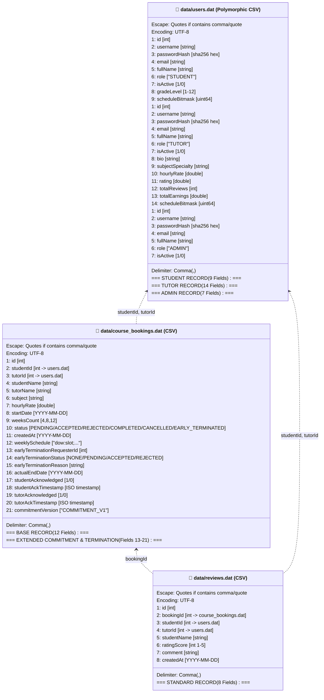

# TỔNG QUAN HỆ THỐNG LƯU TRỮ DỮ LIỆU TỆP (FILE STORAGE OVERVIEW)
## Khảo sát Toàn diện Kiến trúc Flat-File CSV, Cơ chế Nguyên tử hóa và Tự Động Khởi Tạo Dữ liệu

---

## 1. NGUYÊN LÝ LƯU TRỮ TỆP CỦA TUTORMATCH

Hệ thống TutorMatch sử dụng cơ chế lưu trữ dữ liệu dạng **tệp phẳng phân tách bằng dấu phẩy (Flat-File CSV)**, tuyệt đối không phụ thuộc vào các phần mềm quản trị CSDL quan hệ bên ngoài.

```
📁 data/
├── 📄 users.dat              (52 tài khoản người dùng đa hình: Student, Tutor, Admin)
├── 📄 course_bookings.dat    (23 hợp đồng khóa học định kỳ)
├── 📄 reviews.dat            (15 bản ghi nhận xét và đánh giá sao)
├── 📁 seed/                  (Bộ tệp hạt giống chuẩn mực: users.dat, course_bookings.dat, reviews.dat)
└── 📁 archive/               (Lưu trữ các phiên bản dữ liệu lịch sử phục vụ kiểm toán)
```

> [!NOTE]
> Sơ đồ bố cục trường vật lý và quan hệ giữa các tệp dữ liệu đã được mô hình hóa tại:
> 📄 [`docs/diagrams/18_physical_storage_diagram.mmd`](file:///C:/Users/DELL/.gemini/antigravity/scratch/TutorMatch/docs/diagrams/18_physical_storage_diagram.mmd)

### 1.1. Sơ đồ Cấu trúc Bản ghi Vật lý và Liên kết Tệp Dữ liệu (Physical Storage Diagram)

Sơ đồ lớp dưới đây chi tiết hóa cấu trúc trường vật lý của từng dòng CSV trong 3 tệp cơ sở dữ liệu (`data/users.dat`, `data/course_bookings.dat`, `data/reviews.dat`), làm rõ tính đa hình bản ghi của bảng người dùng, định dạng 23 cột của khóa học cam kết V1 và mối quan hệ khóa ngoại giữa các tệp:



#### Diễn giải Bố cục Vật lý và Cơ chế Khóa Ngoại:

1. **Bản ghi Đa hình trong `users.dat`:**
   - Trường thứ 6 (`role`) quyết định số lượng và ý nghĩa các cột phía sau. Nhánh `STUDENT` gồm 9 cột, nhánh `TUTOR` gồm 14 cột (không còn trường `isVerified`), và nhánh `ADMIN` gồm đúng 7 cột cơ sở. Trình phân tích cú pháp `UserSerializer::fromCsv` đọc cột thứ 6 trước để khởi tạo chính xác đối tượng con kế thừa tương ứng.
2. **Cấu trúc Chuẩn hóa 21 Cột của `course_bookings.dat`:**
   - Định dạng cơ sở gồm 12 cột với `weeklySchedule` là nguồn chân lý duy nhất cho lịch học định kỳ trong tuần (loại bỏ hoàn toàn trường dư thừa `dayOfWeek` và `slotIndex`). Khi có quy trình kết thúc sớm hai bên hoặc xác nhận cam kết chính sách `COMMITMENT_V1`, serializer mở rộng đủ 21 cột. Các cột 17–20 lưu dấu thời gian ISO 8601 phục vụ kiểm toán cam kết.
3. **Tính Nhất quán Tham chiếu Giữa các Tệp (Referential Integrity):**
   - Mặc dù lưu trữ dưới dạng tệp phẳng, hệ thống duy trì tính toàn vẹn quan hệ chặt chẽ: `CourseBooking` lưu `studentId` và `tutorId` tham chiếu sang `users.dat`; `Review` lưu `bookingId` tham chiếu sang `course_bookings.dat` cùng cặp ID tham chiếu chéo sang `users.dat`.
   - Các ràng buộc này được kiểm tra ở cấp Tầng Nghiệp vụ (`BookingService`, `ReviewService`) trước khi thực hiện bất kỳ thao tác ghi đĩa nào.

---

## 2. ĐỊNH DẠNG VÀ QUY CÁCH MÃ HÓA TỆP

Mỗi tệp `.dat` trong thư mục `data/` tuân thủ các quy chuẩn kỹ thuật nghiêm ngặt:

1. **Bảng mã ký tự (Character Encoding):** Toàn bộ các tệp được lưu trữ dưới định dạng **UTF-8 không BOM (UTF-8 without BOM)**, bảo toàn 100% tính nguyên vẹn của tiếng Việt có dấu trong tên người dùng, môn học và nhận xét.
2. **Ký tự phân tách (Delimiter):** Dấu phẩy `,` (`comma`).
3. **Quy tắc thoát ký tự (Escaping Rules):** Được điều phối tập trung bởi [`SerializerUtils::escapeCsv()`](file:///C:/Users/DELL/.gemini/antigravity/scratch/TutorMatch/src/data_access/serializers/SerializerUtils.cpp):
   - Nếu một chuỗi có chứa dấu phẩy `,`, dấu ngoặc kép `"` hoặc ký tự xuống dòng `\n`, toàn bộ chuỗi sẽ được bao bọc trong cặp dấu ngoặc kép `"..."`.
   - Mọi ký tự dấu ngoặc kép `"` bên trong chuỗi sẽ được nhân đôi thành `""`.
4. **Ký tự kết thúc dòng (Newline):** Chuẩn dòng `\n` (LF) hoặc `\r\n` (CRLF) trên Windows đều được hàm `splitCsvLine()` xử lý mượt mà.

---

## 3. DANH MỤC CÁC TỆP DỮ LIỆU CHÍNH

### 3.1. `data/users.dat`
- **Mục đích:** Lưu trữ toàn bộ thông tin tài khoản người dùng của hệ thống (Học viên, Gia sư, Quản trị viên).
- **Đặc tính đa hình (Polymorphism):** Mỗi dòng có số lượng trường khác nhau tùy thuộc vào vai trò (`role`) tại cột thứ 6:
  - Dòng `STUDENT`: gồm đúng **9 trường**.
  - Dòng `TUTOR`: gồm đúng **14 trường**. (Lưu ý: trường xác minh `isVerified` đã bị decommission).
  - Dòng `ADMIN`: gồm đúng **7 trường** (khớp chính xác 7 trường cơ sở của `User`).
- **Khóa chính:** Trường `id` (số nguyên duy nhất, tự tăng).
- **Chỉ số bộ nhớ:** Tự động nạp vào cây `AVLTree<double, int>` trong `FileUserRepository` để lập chỉ mục học phí gia sư.

### 3.2. `data/course_bookings.dat`
- **Mục đích:** Lưu trữ các hợp đồng khóa học định kỳ (4, 8, 12 tuần) giữa học viên và gia sư.
- **Cấu trúc trường:**
  - 13 trường cơ sở cho các khóa học đơn giản.
  - Tự động mở rộng thêm 10 trường bổ sung (tổng cộng **23 trường**) khi có thông tin nhiều ca tuần (`weeklySchedule`), quy trình kết thúc sớm hoặc dấu thời gian cam kết chính sách `COMMITMENT_V1`.
- **Khóa chính:** Trường `id`.
- **Khóa ngoại tham chiếu:** `studentId` $\rightarrow$ `users.dat`, `tutorId` $\rightarrow$ `users.dat`.

### 3.3. `data/reviews.dat`
- **Mục đích:** Lưu trữ các đánh giá sao và nhận xét phản hồi sau khi khóa học kết thúc.
- **Cấu trúc trường:** Gồm đúng **8 trường chuẩn**: `id`, `bookingId`, `studentId`, `tutorId`, `studentName`, `ratingScore`, `comment`, `createdAt`.
- **Khóa chính:** Trường `id`.
- **Khóa ngoại tham chiếu:** `bookingId` $\rightarrow$ `course_bookings.dat`, `studentId` $\rightarrow$ `users.dat`, `tutorId` $\rightarrow$ `users.dat`.

---

## 4. TÍNH NGUYÊN TỬ CỦA THAO TÁC LƯU TRỮ (ATOMIC PERSISTENCE)

Hệ thống triển khai cơ chế **ghi tệp tạm thời và đổi tên nguyên tử** để chống hỏng file:

1. **Khóa luồng (Mutex Locking):** Mọi thao tác ghi tệp trong các repository đều được bao bọc trong khối khóa `std::lock_guard` bảo vệ trước hiện tượng xung đột đa luồng.
2. **Ghi tệp tạm (.tmp):** Repository tạo tệp có tên mở rộng `.tmp` (ví dụ: `data/users.dat.tmp`), tuần tự hóa toàn bộ danh sách thực thể và xả dữ liệu xuống đĩa cứng.
3. **Đổi tên tức thì (Atomic Rename):** Sử dụng hàm API Windows `MoveFileExW(..., MOVEFILE_REPLACE_EXISTING | MOVEFILE_WRITE_THROUGH)` để hoán đổi tệp `.tmp` thành tệp `.dat` chính thức.
4. **Kháng sự cố (Fault Tolerance):** Nếu xảy ra sự cố sập nguồn hoặc ngắt ứng dụng bất ngờ trong lúc đang ghi, tệp `.dat` cũ vẫn nguyên vẹn 100%, không bị tình trạng tệp 0 byte.

---

## 5. TỰ ĐỘNG KHỞI TẠO VÀ BẢO TỒN DỮ LIỆU SEED

1. **Thư mục Seed chuẩn hóa ([`data/seed/`](file:///C:/Users/DELL/.gemini/antigravity/scratch/TutorMatch/data/seed/)):** Được kiểm soát phiên bản trực tiếp trong Git, chứa bộ dữ liệu mẫu ban đầu:
   - `data/seed/users.dat`: 52 tài khoản chuẩn hóa (3 Admin, 13 Tutor, 36 Student).
   - `data/seed/course_bookings.dat`: 23 hợp đồng mẫu với nhiều trạng thái khác nhau.
   - `data/seed/reviews.dat`: 15 bài nhận xét mẫu.
2. **Cơ chế nạp tự động lần đầu (First-Run Auto-Seed):** Tại thời điểm khởi động, nếu `MockDatabaseEngine` phát hiện thư mục `data/` chưa có tệp hoặc tệp rỗng, hệ thống tự động copy toàn bộ dữ liệu từ `seed/` sang `data/`.
3. **Bảo tồn dữ liệu khi chạy lại:** Ở các lần chạy tiếp theo, dữ liệu trong `data/*.dat` được bảo tồn nguyên vẹn tuyệt đối, không bao giờ bị ghi đè bởi dữ liệu seed.
