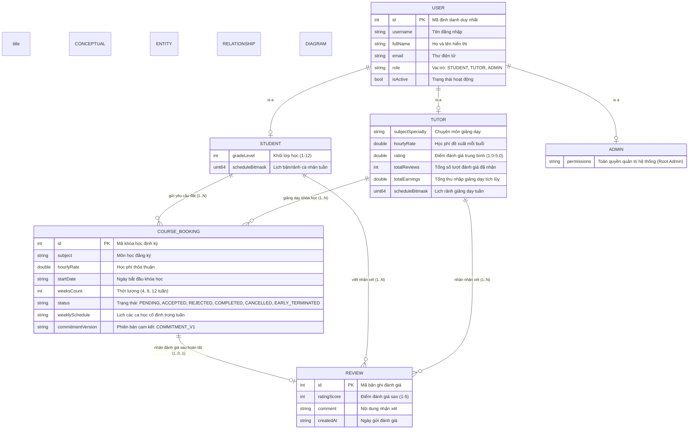

# MÔ HÌNH DỮ LIỆU KHÁI NIỆM, LOGIC VÀ VẬT LÝ (CONCEPTUAL, LOGICAL & PHYSICAL MODELS)
## Phân tích Ba Tầng Mô hình Hóa Dữ liệu và Lý do Phân kỳ Kiến trúc

---

## 1. BA CẤP ĐỘ MÔ HÌNH HÓA DỮ LIỆU

Để hiểu sâu sắc cấu trúc lưu trữ của TutorMatch, dữ liệu được phân tích qua 3 tầng mô hình hóa chuẩn:

```
┌────────────────────────────────────────────────────────┐
│     1. MÔ HÌNH KHÁI NIỆM (CONCEPTUAL DATA MODEL)       │
│  - Thực thể nghiệp vụ thuần túy: Học viên, Gia sư,     │
│    Quản trị viên, Khóa học định kỳ, Bản ghi đánh giá.  │
│  - Tập trung vào ngữ nghĩa kinh doanh, độc lập công nghệ│
└───────────────────────────┬────────────────────────────┘
                            │
                            ▼
┌────────────────────────────────────────────────────────┐
│       2. MÔ HÌNH LOGIC (LOGICAL DATA MODEL)            │
│  - Các thuộc tính cụ thể, kiểu dữ liệu, khóa chính,    │
│    khóa ngoại, ràng buộc toàn vẹn và bội số quan hệ.   │
│  - Bắt đầu chuẩn hóa dữ liệu (Normal Forms).           │
└───────────────────────────┬────────────────────────────┘
                            │
                            ▼
┌────────────────────────────────────────────────────────┐
│       3. MÔ HÌNH VẬT LÝ (PHYSICAL STORAGE MODEL)       │
│  - Các tệp phẳng .dat phân tách dấu phẩy (CSV).        │
│  - Phi chuẩn hóa (Denormalization: studentName, tutorName)│
│  - Đa hình trên cùng 1 tệp users.dat.                  │
│  - Mã hóa 56 ô lịch bằng số nguyên 64-bit uint64_t.    │
└────────────────────────────────────────────────────────┘
```

> [!NOTE]
> Các sơ đồ thực thể liên kết tương ứng đã được vẽ độc lập:
> - Khái niệm: 📄 [`docs/diagrams/16_conceptual_erd.mmd`](file:///C:/Users/DELL/.gemini/antigravity/scratch/TutorMatch/docs/diagrams/16_conceptual_erd.mmd)
> - Logic: 📄 [`docs/diagrams/17_logical_erd.mmd`](file:///C:/Users/DELL/.gemini/antigravity/scratch/TutorMatch/docs/diagrams/17_logical_erd.mmd)
> - Vật lý: 📄 [`docs/diagrams/18_physical_storage_diagram.mmd`](file:///C:/Users/DELL/.gemini/antigravity/scratch/TutorMatch/docs/diagrams/18_physical_storage_diagram.mmd)

### 1.1. Sơ đồ Thực thể Liên kết Mức Khái niệm (Conceptual Entity Relationship Diagram)

Sơ đồ ERD khái niệm dưới đây mô tả các thực thể nghiệp vụ cốt lõi, quan hệ phân cấp kế thừa ("is-a") từ người dùng tổng quát đến từng nhóm vai trò, cùng các tương tác đăng ký khóa học và đánh giá chất lượng trong hệ sinh thái TutorMatch:



#### Diễn giải Mô hình Thực thể Khái niệm:

1. **Phân cấp Người dùng ("is-a" Specialization):**
   - Thực thể cha `USER` chứa các thuộc tính định danh cơ sở (`id`, `username`, `email`, `fullName`, `role`, `isActive`).
   - Ba thực thể con mở rộng các thuộc tính đặc thù nghiệp vụ: `STUDENT` gắn liền với khối lớp và lịch bận; `TUTOR` sở hữu chuyên môn, mức phí, rating, doanh thu và lịch rảnh; `ADMIN` nắm quyền điều hành hệ thống.
2. **Quan hệ Đặt Khóa học (`COURSE_BOOKING`):**
   - Một `STUDENT` có thể gửi nhiều yêu cầu đặt khóa học ($1 \dots N$).
   - Một `TUTOR` có thể nhận giảng dạy nhiều khóa học định kỳ khác nhau ($1 \dots N$).
   - Mỗi `COURSE_BOOKING` là một hợp đồng liên kết chính xác 1 Học viên và 1 Gia sư xung quanh một môn học cụ thể trong khoảng thời gian xác định (4, 8 hoặc 12 tuần).
3. **Quan hệ Đánh giá Khóa học (`REVIEW`):**
   - Mỗi khóa học sau khi kết thúc chỉ được phép sinh ra tối đa 1 bản ghi `REVIEW` tương ứng ($1 \dots 0..1$), ngăn ngừa hiện tượng spam điểm số.
   - Bản ghi đánh giá gắn kết ngữ cảnh giữa người nhận xét (`STUDENT`), đối tượng được đánh giá (`TUTOR`) và hợp đồng đào tạo thực tế (`COURSE_BOOKING`).

---

## 2. SO SÁNH VÀ ĐỐI CHIẾU BA MÔ HÌNH

| Tiêu chí so sánh | Mô hình Khái niệm (Conceptual) | Mô hình Logic (Logical) | Mô hình Vật lý (Physical CSV) |
| :--- | :--- | :--- | :--- |
| **Thực thể Người dùng** | Phân chia thành 3 đối tượng riêng biệt: Học viên, Gia sư, Admin. | Bảng tổng quát `Users` kết hợp các bảng con hoặc trường chuyên biệt theo vai trò. | Lưu chung vào **1 tệp duy nhất** `data/users.dat`. Số trường biến đổi theo `role` (Student: 9, Tutor: 14, Admin: 7). |
| **Khóa học & Lịch học** | Khóa học định kỳ liên kết với các ca học trong tuần. | `CourseBookings` quan hệ $1 - N$ với bảng chi tiết ca học `BookingSessions`. | Gộp toàn bộ ca học tuần thành chuỗi định dạng CSV tại trường thứ 14 `weeklySchedule` (ví dụ: `"0:1;4:0"`). |
| **Thời khóa biểu tuần** | Lưới lịch tuần 7 ngày, mỗi ngày 8 ca (Tổng 56 ca). | Bảng quan hệ `UserAvailability (userId, dayOfWeek, slotIndex, isAvailable)`. | Nén toàn bộ 56 ca học vào **1 số nguyên duy nhất** `uint64_t scheduleBitmask`. |
| **Tên người dùng** | Truy xuất thông qua quan hệ Khóa ngoại với thực thể Người dùng. | `CourseBookings.studentId` trỏ tới `Users.id`; `CourseBookings.tutorId` trỏ tới `Users.id`. | **Phi chuẩn hóa (Denormalized):** Lưu trực tiếp chuỗi `studentName` và `tutorName` vào trong dòng của `course_bookings.dat` và `reviews.dat` để hiển thị tức thì mà không cần duyệt join tệp. |
| **Ràng buộc Toàn vẹn** | Do quy chế nghiệp vụ chi phối. | Khóa ngoại (Foreign Keys) với quy tắc ràng buộc chặt chẽ. | **Do tầng Ứng dụng C++ cưỡng chế (Application-Enforced)** tại các Repository/Services. Tệp vật lý không có cơ chế Foreign Key tự động của DBMS. |

---

## 3. LÝ DO THIẾT KẾ CHO SỰ KHÁC BIỆT GIỮA CÁC MÔ HÌNH

Sự phân kỳ giữa mô hình Logic thuần túy và mô hình Vật lý thực tế là kết quả của các tính toán kỹ thuật có chủ đích:

1. **Hiệu năng cực đại trên tệp phẳng:**
   - Nếu chuẩn hóa theo mô hình Logic (tách `BookingSessions` hay `UserAvailability` thành các tệp riêng), mỗi thao tác render giao diện sẽ phải đọc đồng thời 4-5 tệp trên đĩa và ghép nối (join) trong bộ nhớ, làm chậm tốc độ đáp ứng.
   - Việc denormalize `studentName` và `tutorName` giúp các view như `StudentBookingsView` và `AdminMatchesView` đọc thẳng một lượt là có đủ dữ liệu hiển thị ngay.
2. **Kỹ thuật nén Bitmask 64-bit (`ScheduleGuard`):**
   - Thay vì lưu 56 dòng dữ liệu cho mỗi người dùng trong một bảng lịch học, TutorMatch chỉ tốn đúng 1 trường số nguyên 64-bit (`uint64_t`) chiếm vài byte trong CSV.
   - Phép kiểm tra trùng lịch được thực hiện bằng toán tử nhị phân cấp CPU `(mask1 & mask2) != 0` trong **thời gian $O(1)$**, nhanh hơn hàng ngàn lần so với việc duyệt vòng lặp so sánh ngày giờ.
3. **Mở rộng tương thích ngược (Backward Compatibility):**
   - Trường `weeklySchedule` và 9 trường cam kết V1/kết thúc sớm được thêm vào đuôi của dòng `course_bookings.dat` (từ trường 14 đến 23) mà không làm hỏng các bản ghi 13 trường cơ sở cũ.
