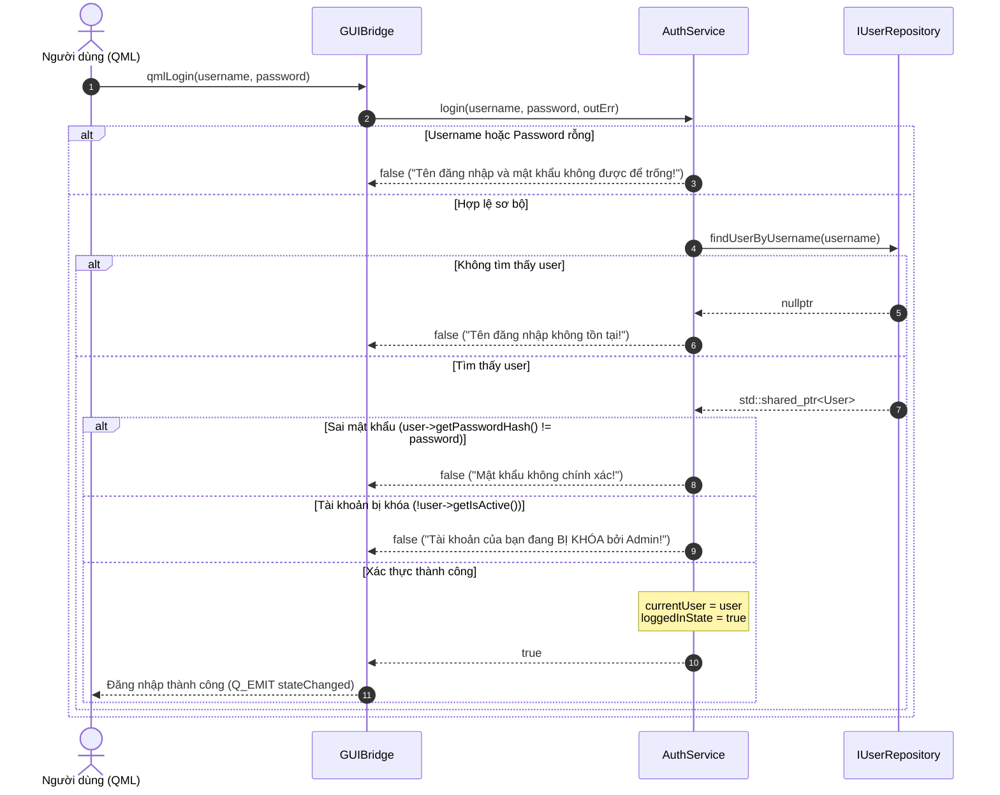

# LOGIC NGHIỆP VỤ XÁC THỰC VÀ PHÂN QUYỀN (AUTHENTICATION & AUTHORIZATION)
## Phân Tích Logic Nghiệp Vụ Xác Thực Người Dùng, Phiên Làm Việc và Kiểm Soát Truy Cập

---

## 1. TỔNG QUAN VÀ MỤC TIÊU THIẾT KẾ `[VERIFIED]`

Hệ thống TutorMatch quản lý ba vai trò người dùng riêng biệt: **STUDENT** (Học viên), **TUTOR** (Gia sư) và **ADMIN** (Quản trị viên). Toàn bộ nghiệp vụ xác thực tài khoản, kiểm tra trạng thái hoạt động (khóa/mở khóa), đăng ký tài khoản mới và quản lý vòng đời phiên làm việc (session lifecycle) được cô lập tại lớp Business Logic trong lớp [`AuthService`](file:///C:/Users/DELL/.gemini/antigravity/scratch/TutorMatch/include/business/services/AuthService.h) theo nguyên lý Đơn trách nhiệm (SRP).

Giao diện đồ họa Qt Quick/QML tương tác với logic xác thực thông qua bộ điều hợp [`GUIBridge`](file:///C:/Users/DELL/.gemini/antigravity/scratch/TutorMatch/include/presentation/bridges/GUIBridge.h), đảm bảo Presentation Layer không truy cập trực tiếp vào Repository hay tệp lưu trữ.

---

## 2. CƠ CHẾ ĐĂNG KÝ TÀI KHOẢN (REGISTRATION WORKFLOW) `[VERIFIED]`

Hệ thống hỗ trợ đăng ký cho hai đối tượng người dùng cuối: Học viên và Gia sư. Tài khoản Admin là tài khoản quản trị hệ thống được khởi tạo sẵn trong cơ sở dữ liệu (`data/users.dat`).

### 2.1. Đăng Ký Tài Khoản Học Viên (`registerStudent`)
- **Vị trí mã nguồn:** [`src/business/services/AuthService.cpp :: AuthService::registerStudent`](file:///C:/Users/DELL/.gemini/antigravity/scratch/TutorMatch/src/business/services/AuthService.cpp#L54-L97)
- **Phương thức Presentation:** [`src/presentation/bridges/GUIBridge.cpp :: GUIBridge::qmlRegisterStudent`](file:///C:/Users/DELL/.gemini/antigravity/scratch/TutorMatch/src/presentation/bridges/GUIBridge.cpp#L169-L186)
- **Quy trình kiểm tra tính hợp lệ (Validation):**
  1. Kiểm tra các trường bắt buộc: `username`, `password`, `fullName`, `email` không được để trống (`outError = "Vui lòng điền đầy đủ các thông tin bắt buộc!"`).
  2. Kiểm tra tính duy nhất của tên đăng nhập: Truy vấn `userRepo->findUserByUsername(username)`. Nếu đã tồn tại, từ chối với thông báo `"Tên đăng nhập đã tồn tại trong hệ thống!"`.
  3. Xử lý khối lớp (`gradeLevel`): Ép kiểu từ chuỗi sang số nguyên `1..12` qua `std::stoi()`; nếu lỗi mặc định về lớp `10`.
  4. Kiểm tra ngân sách tối đa (`maxBudget`): Nếu nhỏ hơn 0, từ chối với thông báo `"Ngân sách không thể là số âm!"`.
  5. Cấp phát định danh mới tự động: `newId = userRepo->getNextUserId()`.
  6. Khởi tạo đối tượng `Student` với:
     - `scheduleBitmask = ScheduleGuard::VALID_SCHEDULE_MASK` (`0x00FFFFFFFFFFFFFFULL` - mặc định toàn bộ 56 ca học trống/rảnh).
     - `isActive = true` (tài khoản kích hoạt ngay lập tức).
  7. Lưu đối tượng qua `userRepo->saveUser(s)`.

### 2.2. Đăng Ký Tài Khoản Gia Sư (`registerTutor`)
- **Vị trí mã nguồn:** [`src/business/services/AuthService.cpp :: AuthService::registerTutor`](file:///C:/Users/DELL/.gemini/antigravity/scratch/TutorMatch/src/business/services/AuthService.cpp#L99-L129)
- **Phương thức Presentation:** [`src/presentation/bridges/GUIBridge.cpp :: GUIBridge::qmlRegisterTutor`](file:///C:/Users/DELL/.gemini/antigravity/scratch/TutorMatch/src/presentation/bridges/GUIBridge.cpp#L188-L205)
- **Quy trình kiểm tra tính hợp lệ (Validation):**
  1. Kiểm tra các trường bắt buộc: `username`, `password`, `fullName`, `email`, `subjectSpecialty` không được để trống.
  2. Kiểm tra học phí theo giờ (`hourlyRate`): Phải thỏa mãn `hourlyRate > 0.0`. Nếu `<= 0.0`, trả về lỗi `"Học phí theo giờ phải lớn hơn 0!"`.
  3. Kiểm tra tính duy nhất của username qua `userRepo->findUserByUsername(username)`.
  4. Cấp phát ID mới: `newId = userRepo->getNextUserId()`.
  5. Khởi tạo thực thể `Tutor` với các giá trị mặc định chuẩn:
     - `rating = 5.0` (điểm uy tín khởi tạo ban đầu).
     - `totalReviews = 0` (chưa có đánh giá thực tế nào).
     - `totalEarnings = 0.0` (thu nhập tích lũy ban đầu).
     - `scheduleBitmask = ScheduleGuard::VALID_SCHEDULE_MASK` (`0x00FFFFFFFFFFFFFFULL` - sẵn sàng nhận lịch).
     - `isActive = true`.
     - Lưu ý: Thuộc tính `isVerified` đã được loại bỏ hoàn toàn khỏi thực thể `Tutor` theo quyết định kiến trúc lược bỏ tính năng xác thực gia sư.

---

## 3. CƠ CHẾ ĐĂNG NHẬP VÀ XÁC THỰC MẬT KHẨU (LOGIN & VERIFICATION) `[VERIFIED]`

- **Vị trí mã nguồn:** [`src/business/services/AuthService.cpp :: AuthService::login`](file:///C:/Users/DELL/.gemini/antigravity/scratch/TutorMatch/src/business/services/AuthService.cpp#L16-L47)
- **Chữ ký phương thức:**
  ```cpp
  bool AuthService::login(const std::string& username, const std::string& password, std::string& outError);
  ```

### 3.1. Các Bước Xử Lý Xác Thực Tuần Tự


### 3.2. Đánh Giá Hiện Trạng Mật Khẩu `[VERIFIED]`
- Thuộc tính trên thực thể `User` được định danh là `passwordHash`.
- **Thực tế mã nguồn:** Phương thức `AuthService::login` so sánh trực tiếp chuỗi mật khẩu đầu vào với giá trị lưu trong thực thể:
  ```cpp
  if (user->getPasswordHash() != password) {
      outError = "Mật khẩu không chính xác!";
      return false;
  }
  ```
- **Phát hiện Nợ Kỹ thuật (Technical Debt):** Mặc dù trường mang tên `passwordHash` và trong tiện ích có hàm băm `DateUtils::sha256()`, hệ thống hiện tại đang lưu trữ và đối soát chuỗi mật khẩu ở dạng plain-text (hoặc giá trị chuỗi do seed data tạo ra). Kiến trúc đã sẵn sàng để bọc hàm băm tại điểm đăng ký và đăng nhập mà không làm thay đổi chữ ký giao diện.

---

## 4. QUẢN LÝ TRẠNG THÁI PHIÊN LÀM VIỆC (SESSION LIFECYCLE) `[VERIFIED]`

Quản lý phiên làm việc trong TutorMatch được thiết kế theo mô hình **Stateful In-Memory Session**:
- `AuthService` lưu giữ con trỏ sở hữu phiên `std::shared_ptr<User> currentUser` và cờ boolean `loggedInState`.
- Khi người dùng đăng nhập thành công:
  - `currentUser` trỏ đến đối tượng User đã xác thực (Học viên, Gia sư hoặc Quản trị viên).
  - `loggedInState = true`.
- Khi người dùng đăng xuất (`AuthService::logout`):
  - `currentUser = nullptr`.
  - `loggedInState = false`.
- **Thông báo trạng thái lên UI:**
  - `GUIBridge::qmlLogout()` gọi `AuthService::logout()`, xóa sạch thông điệp trạng thái và phát tín hiệu `Q_EMIT stateChanged()` cùng `Q_EMIT statusMessageChanged()`.
  - QML `MainDashboard.qml` quan sát `bridge.isLoggedIn` và `bridge.currentUserRole` để lập tức đóng phiên và chuyển hướng người dùng về màn hình đăng nhập `LoginView.qml`.

---

## 5. PHÂN QUYỀN VÀ BẢO VỆ TÀI NGUYÊN (ROLE-BASED ACCESS CONTROL - RBAC) `[VERIFIED]`

Hệ thống phân quyền dựa trên `enum class UserRole`:
```cpp
enum class UserRole {
    STUDENT,
    TUTOR,
    ADMIN
};
```

### 5.1. Phân Quyền ở Tầng Trình Diễn (Presentation Layer)
`GUIBridge` cung cấp thuộc tính `currentUserRole` (`"STUDENT"`, `"TUTOR"`, `"ADMIN"`). Mã nguồn QML tại `MainDashboard.qml` sử dụng bộ điều hướng hiển thị các tab chức năng phù hợp:
- **STUDENT:** Hiển thị tab Tổng quan, Tìm kiếm gia sư, SmartMatch, Đơn đăng ký học, Đánh giá, Hồ sơ cá nhân.
- **TUTOR:** Hiển thị tab Tổng quan gia sư, Yêu cầu giảng dạy, Lịch dạy cố định, Hồ sơ chuyên môn, Thống kê thu nhập.
- **ADMIN:** Hiển thị tab Quản lý người dùng (khóa/mở khóa), Điều phối kết nối & đơn học, Kiểm duyệt đánh giá, Báo cáo thống kê toàn sàn.

### 5.2. Bảo Vệ Phân Quyền ở Tầng Nghiệp Vụ (Service Layer)
Các dịch vụ nghiệp vụ kiểm tra chặt chẽ vai trò và định danh người thao tác (`operatorUserId`, `operatorRole`):
- `BookingService::acceptCourseBooking`: Chỉ cho phép Gia sư (`operatorRole == UserRole::TUTOR`) và phải đúng `tutorId` của khóa học mới được duyệt đơn.
- `BookingService::cancelCourseBooking`:
  - Học viên (`UserRole::STUDENT`): Chỉ được hủy khi đơn ở trạng thái `PENDING` và thuộc về chính mình.
  - Quản trị viên (`UserRole::ADMIN`): Có quyền hủy cưỡng chế bất kỳ đơn nào bất kể trạng thái.
- `AdminService::toggleUserLock`: Chỉ được triệu gọi trong ngữ cảnh quyền Admin; kiểm tra trực tiếp quyền cập nhật trạng thái người dùng.
- `ReviewService::submitReview`: Chỉ Học viên (`studentId` khớp với `booking.studentId`) của khóa học đã `COMPLETED` hoặc `EARLY_TERMINATED` mới có quyền gửi nhận xét.

### 5.3. Mô Hình Thống Nhất Quyền Quản Trị (Unified Root Admin Authorization)
- **Bãi bỏ phân cấp số (No Permission Level):** Hệ thống không sử dụng trường `permissionLevel` (1–9). Mọi người dùng mang vai trò `UserRole::ADMIN` đều sở hữu quyền hạn Root Admin bình đẳng và tuyệt đối trong toàn bộ phạm vi ứng dụng.
- **Không có vai trò con hay hạn chế chức năng:** Mọi tài khoản Admin đều có toàn quyền thực thi:
  1. Thống kê toàn diện nền tảng (`AdminService::calculateMetrics`).
  2. Khóa hoặc kích hoạt lại bất kỳ tài khoản người dùng nào (`AdminService::toggleUserLock`), ngoại trừ việc tự khóa chính mình.
  3. Cưỡng chế chấm dứt bất kỳ khóa học đang hoạt động (`BookingService::cancelCourseBooking` / `AdminService::terminateMatch`).
  4. Kiểm duyệt và xóa bỏ các đánh giá vi phạm (`AdminService::deleteViolatingReview`), tự động tái tính toán rating của gia sư.
- **Mô hình thực thể tinh gọn:** Thực thể `Admin` kế thừa trực tiếp từ `User`, không chứa thêm bất kỳ trường mở rộng nào, sử dụng đúng 7 trường cơ sở của `User`.
