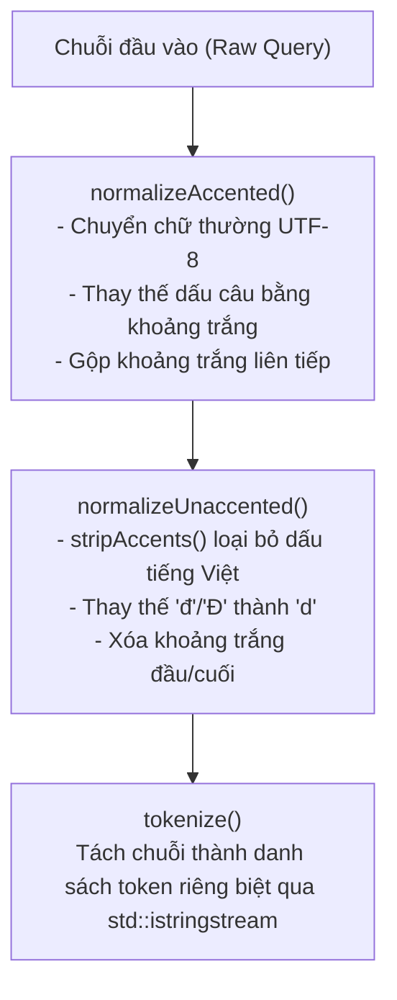

# CƠ CHẾ TÌM KIẾM VÀ ĐÁNH GIÁ ĐỘ TƯƠNG ĐỒNG GIA SƯ (TUTOR SEARCH ENGINE)
## Phân Tích Logic Chuẩn Hóa Chuỗi, Xử Lý Tiếng Việt, Phân Tầng Phù Hợp và Xếp Hạng Kết Quả

---

## 1. TỔNG QUAN VÀ MỤC TIÊU THIẾT KẾ `[VERIFIED]`

Tính năng Tìm kiếm Gia sư thông thường (phân biệt với thuật toán SmartMatch) cho phép học viên tự do tra cứu danh sách gia sư dựa trên:
1. Từ khóa văn bản tự do (`keyword`): Tên gia sư, tên môn học, khối lớp, cụm từ tiểu sử.
2. Bộ lọc môn học tường minh (`explicitSubjectFilter`): Chọn danh mục môn học chuẩn hóa từ ComboBox.
3. Bộ lọc học phí (`minPrice`, `maxPrice`): Khoảng giá theo giờ mong muốn.
4. Bộ lọc đánh giá (`minRating`): Ngưỡng sao đánh giá tối thiểu (ví dụ `>= 4.0`).

Logic tìm kiếm và xếp hạng độ liên quan được thiết kế độc lập, đóng gói hoàn toàn trong lớp [`TutorSearchMatcher`](file:///C:/Users/DELL/.gemini/antigravity/scratch/TutorMatch/include/business/matching/TutorSearchMatcher.h) và bổ trợ bởi từ điển chuyên ngành [`SubjectTaxonomy`](file:///C:/Users/DELL/.gemini/antigravity/scratch/TutorMatch/include/business/matching/SubjectTaxonomy.h).

---

## 2. TIỀN XỬ LÝ VĂN BẢN VÀ CHUẨN HÓA TIẾNG VIỆT `[VERIFIED]`

- **Vị trí mã nguồn:** [`src/business/matching/TutorSearchMatcher.cpp :: normalizeAccented / normalizeUnaccented / tokenize`](file:///C:/Users/DELL/.gemini/antigravity/scratch/TutorMatch/src/business/matching/TutorSearchMatcher.cpp#L11-L65)

Xử lý ngôn ngữ tự nhiên tiếng Việt đặt ra thách thức về dấu thanh điệu, chữ cái đặc thù (`đ`, `Đ`, `ă`, `â`, `ơ`, `ư`), dấu câu và khoảng trắng dư thừa. `TutorSearchMatcher` triển khai quy trình tiền xử lý 3 giai đoạn:



### Chi Tiết Kỹ Thuật:
1. **Loại bỏ dấu câu:** Sử dụng biểu thức chính quy `QRegularExpression(R"([_,\-/:&+\;\*\?\!#\[\]\(\)\{\}\"]+)")` thay thế toàn bộ ký tự phân cách thành dấu cách đơn.
2. **Loại bỏ dấu thanh điệu:** Phương thức `SubjectTaxonomy::stripAccents` chuyển đổi toàn bộ nguyên âm có dấu thành nguyên âm gốc Latinh và ánh xạ `đ`/`Đ` thành `d`.
3. **Phân tách Token:** Tách từ dựa trên khoảng trắng, tạo thành mảng `tokensAccented` (giữ nguyên dấu) và `tokensUnaccented` (không dấu).

---

## 3. PHÂN TÍCH Ý ĐỊNH TÌM KIẾM (SEARCH QUERY INTENT) `[VERIFIED]`

- **Vị trí mã nguồn:** [`src/business/matching/TutorSearchMatcher.cpp :: TutorSearchMatcher::parseQuery`](file:///C:/Users/DELL/.gemini/antigravity/scratch/TutorMatch/src/business/matching/TutorSearchMatcher.cpp#L67-L96)
- **Cấu trúc dữ liệu:** `SearchQueryIntent`

Khi học viên nhập một chuỗi truy vấn (ví dụ `"Toán Lý 12"`), hệ thống giải mã các thành phần ngữ nghĩa:
- **Nhận diện Môn học Chuẩn (Canonical Subjects):** Gọi `SubjectTaxonomy::getCanonicalSubjects(rawQuery)` để xác định danh sách mã môn (`MATH`, `PHYSICS`).
- **Cờ Đa môn học (`isMultiSubject`):** Bật `true` nếu nhận diện được $\ge 2$ môn học trong cùng truy vấn.
- **Nhận diện Khối lớp (`targetGrade`):** Quét ngược từ lớp 12 về lớp 1 (`12..1`) để tìm token số khớp nguyên vẹn; thiết lập `targetGrade = 12`.

---

## 4. MÔ HÌNH PHÂN TẦNG ĐỘ LIÊN QUAN (4-TIER RELEVANCE MODEL) `[VERIFIED]`

Khác với việc chấm điểm phẳng dễ dẫn đến kết quả sai lệch, hệ thống phân chia kết quả thành 4 tầng ưu tiên tuyệt đối (`enum class SearchRelevanceTier`):

| Tầng (Tier) | Giá trị Enum | Điểm cơ sở (Base Score) | Ý nghĩa nghiệp vụ |
| :--- | :---: | :---: | :--- |
| **Tier 1: FULL_SUBJECT_MATCH** | 3 | 1000.0 | Gia sư giảng dạy **toàn bộ** các môn học chuẩn được yêu cầu trong truy vấn. |
| **Tier 2: PARTIAL_SUBJECT_MATCH** | 2 | 500.0 | Gia sư giảng dạy **một phần** (nhưng không đủ tất cả) các môn học trong truy vấn đa môn. |
| **Tier 3: GENERAL_TEXT_MATCH** | 1 | 100.0 | Khớp tên gia sư, khớp cụm từ tiểu sử, hoặc khớp từ khóa tự do không chứa mã môn. |
| **Tier 4: NO_MATCH** | 0 | 0.0 | Không khớp bất kỳ tiêu chí nào (bị loại hoàn toàn khỏi kết quả tìm kiếm). |

> [!IMPORTANT]
> **Nguyên tắc Phân tầng Tuyệt đối:** Điểm số của Tier thấp hơn không bao giờ vượt qua điểm cơ sở của Tier cao hơn:
> - Điểm tối đa của Tier 2: $500.0 + 100.0 + 40.0 + 20.0 = 660.0 < 1000.0$ (Tier 1 Base).
> - Điểm tối đa của Tier 3: $100.0 + 400.0 + 150.0 + 50.0 = 700.0$.
> Nhờ đó, việc sắp xếp theo `tier` trước rồi mới đến `score` đảm bảo gia sư khớp môn học luôn đứng trên gia sư chỉ khớp từ khóa ngẫu nhiên trong tiểu sử.

---

## 5. THUẬT TOÁN ĐÁNH GIÁ VÀ TÍNH ĐIỂM (EVALUATION ALGORITHM) `[VERIFIED]`

- **Vị trí mã nguồn:** [`src/business/matching/TutorSearchMatcher.cpp :: TutorSearchMatcher::evaluate`](file:///C:/Users/DELL/.gemini/antigravity/scratch/TutorMatch/src/business/matching/TutorSearchMatcher.cpp#L98-L276)

### 5.1. Trường Hợp A: Truy Vấn Chứa Môn Học Chuẩn (`targetSubjects.size() > 0`)
1. **Kiểm tra khớp đầy đủ (Tier 1 - Full Match):**
   - Điều kiện: Số môn khớp bằng chính xác số môn được yêu cầu (`matchedCount == targetSubjects.size()`).
   - Điểm cơ sở: `score = 1000.0`.
   - Cộng điểm thưởng đa môn: `+100.0` nếu `isMultiSubject == true`.
   - Cộng điểm thưởng khối lớp:
     - `+100.0` nếu gia sư bao phủ chính xác khối lớp yêu cầu (`targetGrade >= minGrade && targetGrade <= maxGrade`).
     - `+40.0` nếu khối lớp liền kề (lệch tối đa 1 khối).
   - Cộng điểm khớp cụm từ chuyên môn: `+50.0` nếu chuyên môn gia sư chứa nguyên cụm tìm kiếm không dấu.
   - Cộng điểm khớp tên gia sư: `+20.0` cho mỗi token tên gia sư xuất hiện trong truy vấn (ví dụ tìm `"Thầy Bình Toán"`).

2. **Kiểm tra khớp một phần (Tier 2 - Partial Match):**
   - Điều kiện: Gia sư dạy được ít nhất một môn nhưng không đủ tất cả (`matchedCount > 0`).
   - Điểm cơ sở: `score = 500.0`.
   - Điểm tỷ lệ khớp môn: `score += (matchedCount / totalRequested) * 100.0`.
   - Điểm thưởng khối lớp: `+40.0` nếu đúng khối lớp.
   - Điểm thưởng cụm từ: `+20.0`.

3. **Không khớp môn nào (`matchedCount == 0`):**
   - Ngoại lệ tên riêng: Nếu tên gia sư khớp nguyên vẹn cụm tìm kiếm (ví dụ học viên gõ họ tên `"Nguyễn Văn Toàn"` nhưng hệ thống phân tích ra chữ `"Toàn"` gần giống `"Toán"`): Xếp vào Tier 3 với `score = 200.0`.
   - Ngược lại: Xếp vào Tier 0 (`NO_MATCH`) và loại bỏ.

### 5.2. Trường Hợp B: Truy Vấn Từ Khóa Tự Do Không Chứa Tên Môn
Áp dụng cơ chế quét đa trường (Multi-field Scan) trên: Họ tên (`tNameUnacc`), Chuyên môn (`tSubjUnacc`), Tiểu sử (`tBioUnacc`):
- Trùng tên gia sư chính xác tuyệt đối: `+400.0`.
- Chứa nguyên cụm họ tên gia sư: `+300.0`.
- Chứa toàn bộ các token trong họ tên: `+200.0`.
- Chứa nguyên cụm trong chuyên môn: `+150.0`.
- Chứa toàn bộ token trong chuyên môn: `+100.0`.
- Chứa nguyên cụm trong tiểu sử: `+50.0`.

---

## 6. QUY TRÌNH LỌC HÀNG LOẠT VÀ XẾP HẠNG (SEARCH AND RANK) `[VERIFIED]`

- **Vị trí mã nguồn:** [`src/business/matching/TutorSearchMatcher.cpp :: TutorSearchMatcher::searchAndRank`](file:///C:/Users/DELL/.gemini/antigravity/scratch/TutorMatch/src/business/matching/TutorSearchMatcher.cpp#L278-L316)

Quy trình lọc và xếp hạng thực thi qua 3 bước:
1. **Lọc cứng thuộc tính số (Hard Pruning):**
   - Loại bỏ ngay lập tức nếu gia sư không hoạt động (`!t->getIsActive()`).
   - Lọc theo khoảng giá: Bỏ qua nếu `hourlyRate < minPrice` hoặc `hourlyRate > maxPrice`.
   - Lọc theo số sao: Bỏ qua nếu `rating < minRating`.
2. **Đánh giá độ liên quan từng ứng viên:** Gọi `evaluate(intent, tutor, explicitSubjectFilter)`. Nếu `ev.isEligible == false`, bỏ qua.
3. **Sắp xếp ổn định (Stable Sort):**
   Áp dụng `std::stable_sort` với hàm so sánh đa tiêu chí:
   ```cpp
   std::stable_sort(evals.begin(), evals.end(), [](const TutorMatchEvaluation& a, const TutorMatchEvaluation& b) {
       if (a.tier != b.tier) {
           return static_cast<int>(a.tier) > static_cast<int>(b.tier); // Tier 3 > 2 > 1
       }
       return a.score > b.score; // Điểm số giảm dần trong cùng một Tier
   });
   ```
   Kết quả trả về danh sách `std::vector<std::shared_ptr<Tutor>>` đã được xếp hạng tối ưu theo đúng ý định tìm kiếm của học viên.
