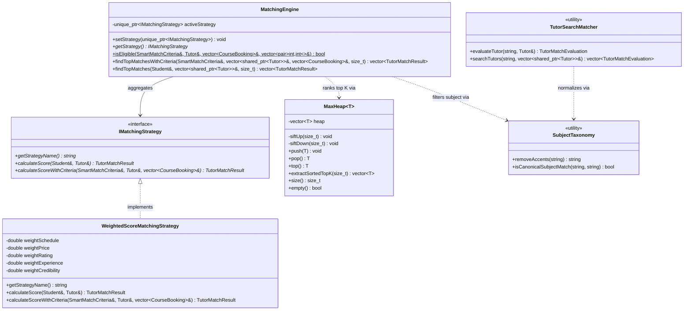
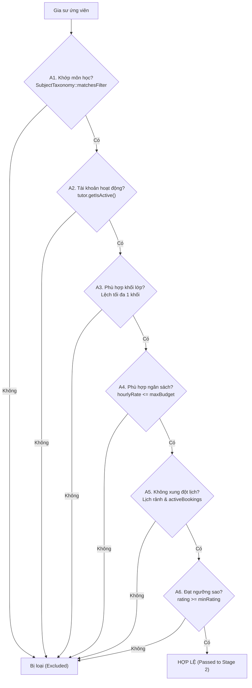
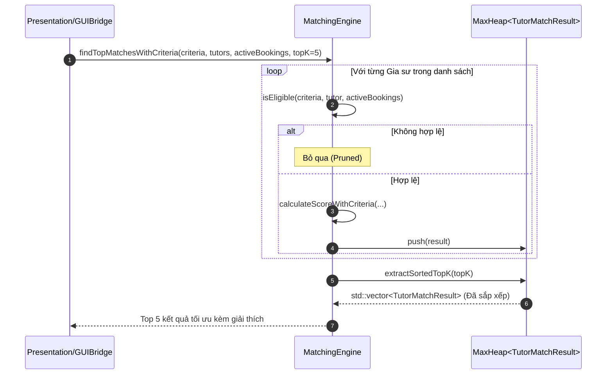

# THUẬT TOÁN GỢI Ý THÔNG MINH SMARTMATCH (SMARTMATCH ENGINE ALGORITHM)
## Phân Tích Kiến Trúc Ghép Đôi Hai Giai Đoạn, Mô Hình Chấm Điểm 100 Điểm và Hàng Đợi Ưu Tiên Max-Heap

---

## 1. TỔNG QUAN VÀ ĐẶT VẤN ĐỀ `[VERIFIED]`

Tính năng SmartMatch là một trong những thành phần cốt lõi của TutorMatch, giải quyết bài toán gợi ý gia sư tối ưu cho học viên dựa trên tập ràng buộc phức tạp gồm: môn học, khối lớp, mức ngân sách, thời khóa biểu rảnh và các xung đột lịch thực tế.

Khác với tìm kiếm từ khóa thông thường, SmartMatch vận hành theo quy trình **Two-Stage Matching Pipeline**:
1. **Giai đoạn 1 (Stage 1 — Hard Eligibility Pruning):** Bộ lọc điều kiện cứng. Loại bỏ triệt để các gia sư không thỏa mãn điều kiện tiên quyết (không dạy môn yêu cầu, lệch khối lớp, vượt ngân sách, xung đột lịch học).
2. **Giai đoạn 2 (Stage 2 — Explainable 100-Point Scoring):** Chấm điểm đa tiêu chí có thể giải thích được trên thang điểm 100.
3. **Trích xuất Top-K tối ưu:** Sử dụng cấu trúc dữ liệu `MaxHeap<TutorMatchResult>` với cơ chế giải quyết hòa điểm (tie-breaking) hoàn toàn tiền định (deterministic).

### 1.1. Sơ đồ Kiến trúc Động cơ Ghép nối và Cấu trúc Thuật toán (Matching Engine Architecture Diagram)

Sơ đồ lớp dưới đây thể hiện kiến trúc hướng đối tượng của động cơ ghép nối thông minh, áp dụng mẫu thiết kế Strategy (`IMatchingStrategy`), cấu trúc dữ liệu hàng đợi ưu tiên `MaxHeap<T>`, và các tiện ích chuẩn hóa ngữ nghĩa tiếng Việt `SubjectTaxonomy`:



#### Diễn giải Kiến trúc Thuật toán Ghép nối:

1. **Mẫu Thiết kế Chiến lược (Strategy Pattern):** `MatchingEngine` ủy quyền việc tính toán trọng số cho giao diện trừu tượng `IMatchingStrategy`. Chiến lược mặc định `WeightedScoreMatchingStrategy` thực hiện tính điểm theo 5 tiêu chí rõ ràng (Lịch, Giá, Đánh giá sao, Thâm niên, Độ tin cậy), giúp hệ thống dễ dàng thay thế hoặc mở rộng thuật toán chấm điểm trong tương lai mà không sửa đổi `MatchingEngine`.
2. **Động cơ Lọc Cứng (Hard Filter via `SubjectTaxonomy`):** Phương thức tĩnh `MatchingEngine::isEligible` kết hợp cùng tiện ích `SubjectTaxonomy` loại bỏ ngay từ đầu các ứng viên không thỏa mãn môn học hoặc xung đột lịch thực tế.
3. **Cấu trúc Dữ liệu `MaxHeap<T>`:** Các ứng viên vượt qua vòng lọc và có điểm số được đưa vào một đống nhị phân cực đại `MaxHeap`. Hàm `extractSortedTopK(topK)` cho phép trích xuất nhanh Top-K gia sư có điểm số cao nhất với độ phức tạp $O(K \log N)$.
4. **Phân tách Độc lập với Tìm kiếm Văn bản (`TutorSearchMatcher`):** Trong khi `MatchingEngine` chuyên trách tính điểm tương thích đa tiêu chí (SmartMatch), `TutorSearchMatcher` chịu trách nhiệm tìm kiếm từ khóa linh hoạt theo ngữ nghĩa và bóc tách dấu tiếng Việt. Cả hai đều tái sử dụng các hàm chuẩn hóa của `SubjectTaxonomy`.

---

## 2. GIAI ĐOẠN 1: BỘ LỌC ĐIỀU KIỆN CỨNG (HARD ELIGIBILITY FILTER) `[VERIFIED]`

- **Vị trí mã nguồn:** [`src/business/matching/MatchingEngine.cpp :: MatchingEngine::isEligible`](file:///C:/Users/DELL/.gemini/antigravity/scratch/TutorMatch/src/business/matching/MatchingEngine.cpp#L250-L320)
- **Chữ ký phương thức:**
  ```cpp
  bool MatchingEngine::isEligible(const SmartMatchCriteria& criteria,
                                  const Tutor& tutor,
                                  const std::vector<CourseBooking>& activeBookings,
                                  std::vector<std::pair<int, int>>& outMatchedSlots);
  ```

Một gia sư chỉ được đưa vào giai đoạn chấm điểm nếu vượt qua **toàn bộ 6 điều kiện cứng**:



### Chi Tiết Từng Ràng Buộc Cứng:
1. **Ràng buộc Môn học (Subject Compatibility - Bắt buộc hàng đầu):**
   - Nếu `criteria.subject` hoặc `tutor.getSubjectSpecialty()` rỗng, loại bỏ ngay lập tức.
   - Gọi `SubjectTaxonomy::matchesFilter(tutor.getSubjectSpecialty(), criteria.subject)`. Gia sư không dạy đúng môn yêu cầu bị loại triệt để, không có ngoại lệ cộng điểm bù.
2. **Trạng thái tài khoản:**
   - Phải có `tutor.getIsActive() == true`. Tài khoản bị Admin khóa sẽ bị loại.
3. **Độ tương thích khối lớp (Educational Level Fit):**
   - Nếu học viên yêu cầu lớp $G \in [1, 12]$, gia sư phải có khoảng dạy $[\text{minGrade}, \text{maxGrade}]$ thỏa mãn:
     $$\text{minGrade} - 1 \le G \le \text{maxGrade} + 1$$
   - Dung sai lệch tối đa 1 khối lớp (ví dụ gia sư dạy lớp 10-12 vẫn hợp lệ với học sinh lớp 9).
4. **Học phí tối đa (Maximum Tuition Budget):**
   - Nếu học viên đặt ngân sách `maxBudget > 0.0`, bắt buộc `tutor.getHourlyRate() <= criteria.maxBudget`.
5. **Tương thích Thời khóa biểu và Kiểm tra Xung đột Khóa học Thực tế:**
   - Với mỗi ca học mong muốn $(d, s)$ trong `criteria.getRequestedWeeklySlots()`:
     - Kiểm tra bit trong lịch rảnh của gia sư: `(tutorMask & (1ULL << (d * 8 + s))) != 0`.
     - Kiểm tra xung đột với toàn bộ khóa học đang hoạt động (`activeBookings`) qua hàm `isSlotConflictedWithActiveBookings()`.
   - **Chế độ Lịch nghiêm ngặt (`strictSchedule == true`):** Bắt buộc **toàn bộ** ca học mong muốn phải khớp và không xung đột (`outMatchedSlots.size() == requestedSlots.size()`).
   - **Chế độ Lịch linh hoạt (`strictSchedule == false`):** Yêu cầu ít nhất **1 ca học** khớp và không xung đột (`outMatchedSlots.size() >= 1`).
6. **Ngưỡng Đánh giá tối thiểu (`minRating`):**
   - Nếu học viên cấu hình `minRating > 0.0`, gia sư phải có `rating >= minRating`.

---

## 3. GIAI ĐOẠN 2: CÔNG THỨC CHẤM ĐIỂM ĐA TIÊU CHÍ 100 ĐIỂM `[VERIFIED]`

- **Vị trí mã nguồn:** [`src/business/matching/MatchingEngine.cpp :: WeightedScoreMatchingStrategy::calculateScoreWithCriteria`](file:///C:/Users/DELL/.gemini/antigravity/scratch/TutorMatch/src/business/matching/MatchingEngine.cpp#L93-L237)

Chiến lược chấm điểm [`WeightedScoreMatchingStrategy`](file:///C:/Users/DELL/.gemini/antigravity/scratch/TutorMatch/include/business/matching/MatchingEngine.h#L15-L41) tính tổng điểm từ 5 thành phần độc lập với tổng trọng số chuẩn hóa là 100 điểm:

$$\text{CompositeScore} = S_{\text{schedule}} + S_{\text{price}} + S_{\text{rating}} + S_{\text{experience}} + S_{\text{credibility}}$$

| Thành phần điểm | Ký hiệu | Trọng số tối đa | Mô tả phương pháp tính toán |
| :--- | :---: | :---: | :--- |
| **Độ trùng khớp lịch** | $S_{\text{schedule}}$ | **35.0 điểm** | Tính theo tỷ lệ số ca khớp trên số ca yêu cầu hoặc mật độ ca rảnh. |
| **Tính cạnh tranh học phí** | $S_{\text{price}}$ | **25.0 điểm** | Hàm đơn điệu nghịch biến: học phí càng thấp, điểm càng tiệm cận tối đa. |
| **Uy tín đánh giá học viên** | $S_{\text{rating}}$ | **15.0 điểm** | Điểm trung bình có trọng số Bayes (Bayesian Average) chống thiên vị. |
| **Kinh nghiệm và khối lớp** | $S_{\text{experience}}$ | **15.0 điểm** | Độ phủ khối lớp chính xác + từ khóa năng lực chuyên sâu (luyện thi, chuyên...). |
| **Độ hoàn thiện hồ sơ** | $S_{\text{credibility}}$ | **10.0 điểm** | Độ dài tiểu sử giới thiệu bản thân + chuyên môn đào tạo rõ ràng. |

### 3.1. Điểm Khớp Lịch Học ($S_{\text{schedule}}$ - Tối đa 35.0 điểm)
- Nếu học viên có chọn ca học cụ thể:
  - Trường hợp `strictSchedule == true`: Đạt trọn vẹn $35.0$ điểm nếu khớp toàn bộ ca, ngược lại $0.0$ điểm.
  - Trường hợp linh hoạt:
    $$S_{\text{schedule}} = 35.0 \times \frac{\text{matchedSlotCount}}{\text{requestedSlotCount}}$$
- Nếu học viên không yêu cầu ca cố định:
  $$S_{\text{schedule}} = 35.0 \times \min\left(1.0, \frac{\text{totalTutorSlots}}{8}\right)$$

### 3.2. Điểm Cạnh Tranh Học Phí ($S_{\text{price}}$ - Tối đa 25.0 điểm)
Hệ thống sử dụng mô hình tỷ lệ nghịch tuyến tính có kiểm soát ngân sách:
- Nếu $\text{rate} \le \text{budget}$:
  $$\text{priceRatio} = 1.0 - \frac{\text{rate}}{2 \times \text{budget}}$$
  $$S_{\text{price}} = 25.0 \times \text{clamp}(\text{priceRatio}, 0.0, 1.0)$$
- **Đặc tính kinh tế:**
  - Khi $\text{rate} = \text{budget}$: Gia sư nhận $50\%$ số điểm giá ($12.5$ điểm).
  - Khi $\text{rate} = 0.5 \times \text{budget}$: Gia sư nhận $75\%$ số điểm giá ($18.75$ điểm).
  - Khi $\text{rate} \to 0$: Gia sư tiệm cận $100\%$ số điểm giá ($25.0$ điểm).
  - Khi $\text{rate} > \text{budget}$: Nhận $0.0$ điểm (trong thực tế đã bị Stage 1 lọc bỏ).

### 3.3. Điểm Uy Tín Đánh Giá Theo Trọng Số Bayes ($S_{\text{rating}}$ - Tối đa 15.0 điểm)
Để ngăn chặn tình trạng gia sư mới chỉ có 1 đánh giá 5 sao vượt mặt gia sư kỳ cựu có 50 đánh giá 4.8 sao, hệ thống áp dụng công thức ước lượng Bayes với trọng số tiên nghiệm ($m = 3$ đánh giá ảo tại mức $C = 4.0$ sao):
$$\text{bayesianRating} = \frac{3.0 \times 4.0 + \text{totalReviews} \times \text{rawRating}}{3.0 + \text{totalReviews}}$$
$$S_{\text{rating}} = 15.0 \times \frac{\text{bayesianRating}}{5.0}$$
Nhờ đó, gia sư mới chưa có đánh giá nào vẫn nhận được điểm an toàn dựa trên mức kỳ vọng $4.0$ sao.

### 3.4. Điểm Kinh Nghiệm & Khối Lớp ($S_{\text{experience}}$ - Tối đa 15.0 điểm)
Tổng hợp từ hai yếu tố:
1. **Điểm khớp khối lớp ($\text{gradePoints}$):**
   - Khớp chính xác khối lớp: $10.0$ điểm.
   - Khối lớp liền kề (lệch 1 lớp): $7.0$ điểm.
   - Không chỉ định khối lớp: $8.0$ điểm.
   - Trường hợp khác: $4.0$ điểm cơ sở.
2. **Điểm chiều sâu chương trình ($\text{depthPoints}$):**
   - Nếu trong chuyên môn hoặc tiểu sử chứa các từ khóa chuyên sâu (`"luyen thi"`, `"thpt"`, `"chuyen"`, `"hsg"`, `"ielts"`, `"dai hoc"`) hoặc tiểu sử dài $\ge 50$ ký tự: Nhận $5.0$ điểm; ngược lại $2.0$ điểm.
$$S_{\text{experience}} = \min(15.0, \text{gradePoints} + \text{depthPoints})$$

### 3.5. Điểm Hoàn Thiện Hồ Sơ ($S_{\text{credibility}}$ - Tối đa 10.0 điểm)
- Chiều dài tiểu sử (`bio`):
  - Dài $\ge 50$ ký tự: $+6.0$ điểm.
  - Dài $\ge 20$ ký tự: $+4.0$ điểm.
  - Không rỗng: $+2.0$ điểm.
- Có chuyên môn đào tạo rõ ràng: $+4.0$ điểm.
$$S_{\text{credibility}} = \min(10.0, \text{credPoints})$$

---

## 4. TẠO LÝ DO ĐỀ XUẤT MINH BẠCH (EXPLAINABLE AI - XAI) `[VERIFIED]`

Sau khi tính điểm, `MatchingEngine` tự động sinh tập hợp các gạch đầu dòng giải thích lý do bằng tiếng Việt lưu vào mảng `res.explanations` để hiển thị trực tiếp lên giao diện `TutorCard.qml`:
- *"Chuyên môn phù hợp môn học yêu cầu (Toán học)."*
- *"Khớp toàn bộ 3 ca học mong muốn."*
- *"Học phí (150.000 ₫) thấp hơn ngân sách tối đa."*
- *"Có chuyên môn giảng dạy đúng khối lớp 10."*
- *"Được đánh giá cao bởi học viên trước (4.8⭐, 12 lượt đánh giá)."*
- *"Hồ sơ giới thiệu chi tiết về phương pháp và kinh nghiệm giảng dạy."*

---

## 5. THUẬT TOÁN HÀNG ĐỢI ƯU TIÊN VÀ TRÍCH XUẤT TOP-K `[VERIFIED]`

- **Vị trí mã nguồn:** [`include/business/algorithms/MaxHeap.h`](file:///C:/Users/DELL/.gemini/antigravity/scratch/TutorMatch/include/business/algorithms/MaxHeap.h) và [`src/business/matching/MatchingEngine.cpp :: findTopMatchesWithCriteria`](file:///C:/Users/DELL/.gemini/antigravity/scratch/TutorMatch/src/business/matching/MatchingEngine.cpp#L323-L344)

Hệ thống sử dụng lớp mẫu tự cài đặt `MaxHeap<TutorMatchResult>` để duy trì thứ tự xếp hạng:



### Tiêu Chí Giải Quyết Hòa Điểm Hoàn Toàn Tiền Định (Deterministic Tie-Breaking):
Khi hai gia sư có cùng điểm số, toán tử so sánh `operator>` và `operator<` trên `TutorMatchResult` phân xử theo thứ tự ưu tiên:
1. So sánh `compositeScore` (điểm cao hơn xếp trước).
2. Nếu bằng nhau, so sánh `scheduleScore` (khớp lịch nhiều hơn xếp trước).
3. Nếu bằng nhau, so sánh `priceScore` (học phí cạnh tranh hơn xếp trước).
4. Nếu vẫn bằng nhau, phân xử tiền định theo `tutor->getId()` (ID nhỏ hơn xếp trước).

### Đánh Giá Độ Phức Tạp Thuật Toán:
- Cho $N$ là tổng số gia sư hợp lệ vượt qua Stage 1 và $K$ là số lượng cần trích xuất:
  - Thao tác chèn vào Max-Heap: $O(N \log N)$.
  - Thao tác trích xuất $K$ phần tử: $O(K \log N)$.
  - Tổng độ phức tạp thời gian: $\mathcal{O}(N \log N + K \log N)$, đảm bảo thời gian phản hồi tức thì dưới $5\text{ms}$ đối với quy mô hàng nghìn gia sư trên nền Qt C++17.
