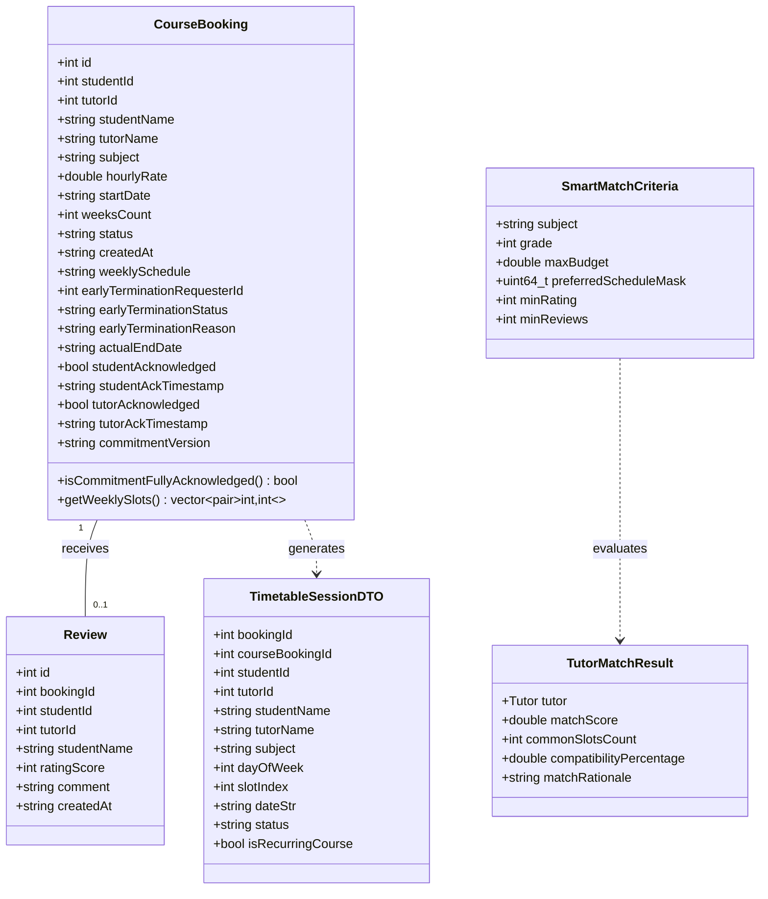
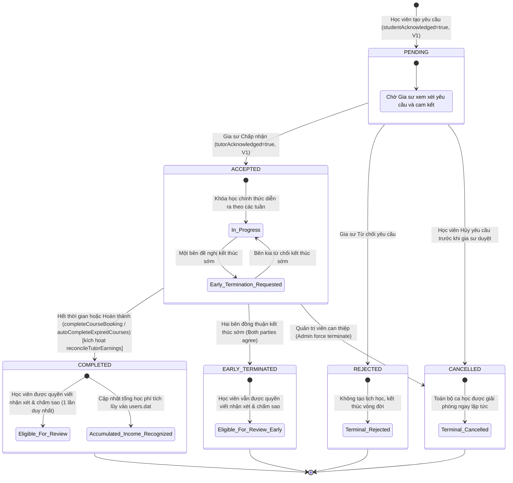
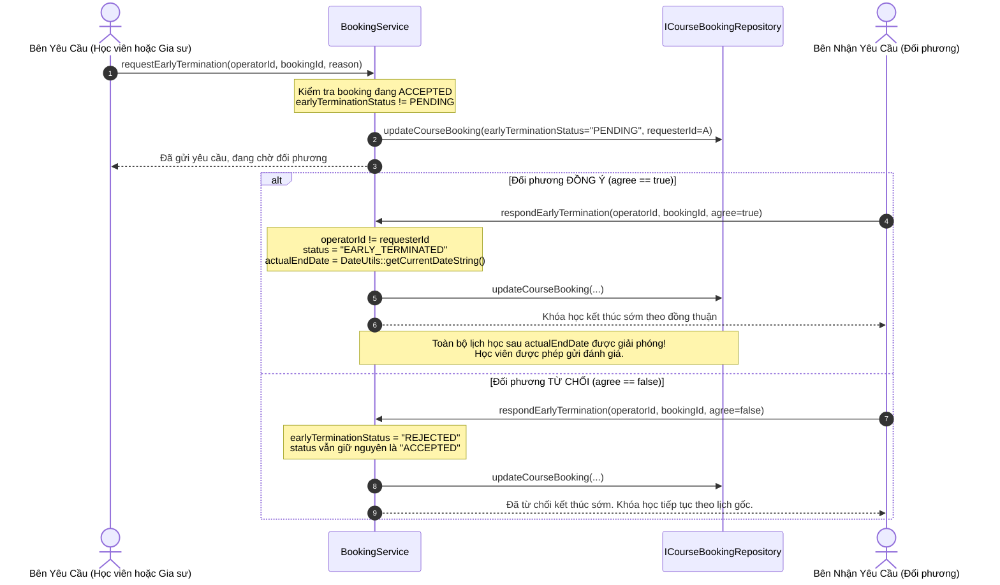

# MÁY TRẠNG THÁI VÒNG ĐỜI KHÓA HỌC (COURSE BOOKING LIFECYCLE & STATE MACHINE)
## Phân Tích Máy Trạng Thái Khóa Học Định Kỳ, Cam Kết Hai Chiều COMMITMENT_V1 và Quy Trình Đồng Thuận Kết Thúc Sớm

---

## 1. TỔNG QUAN VÀ ĐẶC TẢ MIỀN KHÓA HỌC ĐỊNH KỲ `[VERIFIED]`

Trong TutorMatch, thực thể [`CourseBooking`](file:///C:/Users/DELL/.gemini/antigravity/scratch/TutorMatch/include/business/domain/CourseBooking.h) đại diện cho một **Khóa học định kỳ nhiều tuần (Recurring Multi-Week Course Booking)**, khác với mô hình đặt từng buổi học lẻ truyền thống:
- **Chu kỳ nhiều buổi trong tuần (`weeklySchedule`):** Lưu trữ chuỗi các ca học định kỳ theo mẫu `"dow:slot;dow:slot"` (ví dụ `"0:1;4:0"` là Thứ 2 ca 2 và Thứ 6 ca 1).
- **Thời lượng khóa học (`weeksCount`):** Cố định theo các gói 4 tuần, 8 tuần hoặc 12 tuần.
- **Ngày bắt đầu hiệu lực (`startDate`):** Định dạng chuẩn `YYYY-MM-DD`.
- **Chính sách cam kết hai chiều (`COMMITMENT_V1`):** Cả Học viên và Gia sư đều phải đọc và xác nhận điều khoản cam kết trước khi khóa học chuyển sang trạng thái chính thức diễn ra (`ACCEPTED`).
- **Cơ chế Đồng thuận Kết thúc sớm (Consensual Early Termination):** Một bên đề xuất kết thúc sớm, bên còn lại có quyền đồng ý (đưa khóa học về `EARLY_TERMINATED` và giải phóng toàn bộ lịch tương lai) hoặc từ chối (khóa học tiếp tục theo lịch gốc).

### 1.1. Sơ đồ Mô hình Thực thể Miền Khóa học và Đánh giá (CourseBooking and Review Domain Entities Diagram)

Sơ đồ lớp dưới đây mô tả cấu trúc thực thể miền `CourseBooking` (với 23 thuộc tính bao quát toàn bộ vòng đời cam kết và kết thúc sớm), thực thể `Review`, đối tượng truyền dữ liệu lịch học `TimetableSessionDTO`, cùng các tiêu chí và kết quả ghép nối:

#### Diễn giải Mô hình Thực thể Miền:

1. **Thực thể Khóa học Đầy đủ (`CourseBooking`):** Chứa đựng toàn bộ các trường quản lý khóa học định kỳ: số tuần (`weeksCount`), lịch các ca tuần (`weeklySchedule`), các cờ và mốc thời gian cam kết chính sách (`studentAcknowledged`, `tutorAcknowledged`, `studentAckTimestamp`, `tutorAckTimestamp`), cùng các trường phục vụ quy trình đồng thuận kết thúc sớm (`earlyTerminationRequesterId`, `earlyTerminationStatus`, `earlyTerminationReason`, `actualEndDate`).
2. **Thực thể Đánh giá (`Review`):** Liên kết trực tiếp với một khóa học cụ thể qua `bookingId`. Tỷ lệ quan hệ $1 - 0..1$ bảo đảm mỗi khóa học chỉ được phép đánh giá một lần duy nhất.
3. **Đối tượng Truyền dữ liệu Thời khóa biểu (`TimetableSessionDTO`):** Được sinh ra động từ `CourseBooking` kết hợp với thuật toán tính lịch ngày của `DateUtils`, đại diện cho từng buổi học cụ thể trên lịch tuần để hiển thị trực quan lên giao diện QML.

---

## 2. BIỂU ĐỒ MÁY TRẠNG THÁI KHÓA HỌC (STATE MACHINE DIAGRAM) `[VERIFIED]`

Trạng thái của một khóa học được định nghĩa qua trường `CourseBooking::status` với 6 trạng thái nghiệp vụ chuẩn:

### 2.1. Sơ đồ Máy Trạng thái Vòng đời Khóa học Toàn diện (Course Booking Lifecycle State Machine Diagram)

Biểu đồ máy trạng thái dưới đây mô tả đầy đủ các trạng thái và chuyển dịch trạng thái của một khóa học từ lúc khởi tạo đến khi kết thúc, bao gồm các điều kiện cam kết V1, các nhánh duyệt/từ chối, quy trình đồng thuận kết thúc sớm và phân quyền đánh giá sau khi hoàn thành:

#### Diễn giải Máy Trạng Thái Khóa Học:

1. **Giai đoạn Đăng ký (`PENDING`):** Bắt đầu khi học viên gửi yêu cầu và đồng ý cam kết V1. Đơn ở trạng thái chờ gia sư quyết định. Học viên có thể hủy (`CANCELLED`).
2. **Giai đoạn Chấp nhận và Giảng dạy (`ACCEPTED`):** Khi gia sư chấp thuận và ký cam kết V1, khóa học chính thức diễn ra. Các ca học được đưa vào thời khóa biểu tuần của cả 2 bên.
3. **Quy trình Đề xuất Kết thúc sớm (`Early_Termination_Requested`):** Một bên có thể gửi lý do muốn dừng khóa học sớm. Nếu bên kia từ chối, khóa học tiếp tục diễn ra (`In_Progress`). Nếu bên kia đồng ý, khóa học chuyển sang `EARLY_TERMINATED`.
4. **Các Trạng thái Kết thúc (Terminal States):**
   - `COMPLETED`: Khóa học hoàn thành trọn vẹn số tuần. Học viên có quyền viết đánh giá sao (`Eligible_For_Review`).
   - `EARLY_TERMINATED`: Kết thúc sớm có đồng thuận. Học viên vẫn được quyền đánh giá phản ánh trải nghiệm thực tế.
   - `REJECTED` & `CANCELLED`: Khóa học dừng lại, toàn bộ lịch được giải phóng và không thể gửi đánh giá.

---

## 3. ĐẶC TẢ CHI TIẾT CÁC CHUYỂN TRẠNG THÁI (STATE TRANSITIONS) `[VERIFIED]`

### 3.1. Chuyển Trạng Thái: Khởi Tạo $\to$ `PENDING`
- **Tác tử thực hiện:** Học viên (`UserRole::STUDENT`).
- **Phương thức Service:** [`BookingService::bookCourseMultiSlot`](file:///C:/Users/DELL/.gemini/antigravity/scratch/TutorMatch/src/business/services/BookingService.cpp#L111-L254).
- **Tiền điều kiện và Kiểm tra Nghiệp vụ:**
  1. Gia sư phải đang hoạt động (`tutor->getIsActive() == true`).
  2. Thời lượng `weeksCount` phải là 4, 8 hoặc 12 tuần.
  3. Danh sách ca học định kỳ không được rỗng.
  4. Ngày bắt đầu `startDate` phải có định dạng hợp lệ `YYYY-MM-DD` và không được là ngày trong quá khứ so với ngày hiện tại (`DateUtils::compareDates(startDate, today) >= 0`).
  5. Kiểm tra xung đột lịch: Gọi `hasCourseConflictMulti()`. Cả học viên và gia sư không được trùng ca học với bất kỳ khóa học nào đang ở trạng thái `PENDING` hoặc `ACCEPTED`.
- **Hành vi:**
  - Tạo bản ghi mới với `status = "PENDING"`, `earlyTerminationStatus = "NONE"`.
  - Nếu học viên tích chọn đồng ý cam kết ngay tại modal đăng ký: `studentAcknowledged = true`, ghi nhận `studentAckTimestamp` và `commitmentVersion = "COMMITMENT_V1"`.

---

### 3.2. Chuyển Trạng Thái: `PENDING` $\to$ `ACCEPTED`
- **Tác tử thực hiện:** Gia sư được yêu cầu (`tutorId == booking.tutorId`).
- **Phương thức Service:** [`BookingService::acceptCourseBooking`](file:///C:/Users/DELL/.gemini/antigravity/scratch/TutorMatch/src/business/services/BookingService.cpp#L330-L405).
- **Điều kiện Chuyển trạng thái Nghiêm ngặt (4 bước kiểm tra):**
  1. **Xác nhận Cam kết của Gia sư:** Gia sư phải đánh dấu đồng ý cam kết (`tutorAcknowledgeCommitment == true`). Hệ thống ghi nhận `tutorAckTimestamp = now()`.
  2. **Kiểm tra Xác nhận của Học viên:** Bắt buộc `bPtr->studentAcknowledged == true` và có timestamp hợp lệ.
  3. **Kiểm tra Phiên bản Điều khoản:** `bPtr->commitmentVersion == CURRENT_COMMITMENT_VERSION` (`"COMMITMENT_V1"`).
  4. **Kiểm tra Lại Xung đột Lịch Cuối cùng:** Gọi lại `hasCourseConflictMulti` tại thời điểm duyệt để phòng ngừa tình trạng một trong hai bên đã chấp nhận một khóa học khác trong lúc đơn này đang chờ.
- **Hậu điều kiện:**
  - `status = "ACCEPTED"`.
  - Khóa toàn bộ các ca học định kỳ trong khoảng thời gian $[ \text{startDate}, \text{startDate} + \text{weeksCount} \times 7 \text{ ngày} ]$ cho cả hai bên.

---

### 3.3. Chuyển Trạng Thái: `PENDING` $\to$ `REJECTED`
- **Tác tử thực hiện:** Gia sư (`bPtr->tutorId == tutorId`).
- **Phương thức Service:** [`BookingService::rejectCourseBooking`](file:///C:/Users/DELL/.gemini/antigravity/scratch/TutorMatch/src/business/services/BookingService.cpp#L412-L443).
- **Hành vi:** Đổi trạng thái sang `"REJECTED"`. Giải phóng hoàn toàn các ca học đang giữ chỗ tạm thời trong giai đoạn chờ duyệt.

---

### 3.4. Chuyển Trạng Thái: `PENDING` / `ACCEPTED` $\to$ `CANCELLED`
- **Tác tử thực hiện:**
  - Học viên (`studentId == operatorUserId`): Được phép tự hủy khi đơn đang ở trạng thái `PENDING`.
  - Quản trị viên (`operatorRole == UserRole::ADMIN`): Có quyền hủy cưỡng chế bất kỳ đơn nào ở `PENDING` hoặc `ACCEPTED`.
- **Phương thức Service:** [`BookingService::cancelCourseBooking`](file:///C:/Users/DELL/.gemini/antigravity/scratch/TutorMatch/src/business/services/BookingService.cpp#L445-L477).
- **Hành vi:** Đổi trạng thái sang `"CANCELLED"`. Lịch học được giải phóng ngay lập tức.

---

### 3.5. Chuyển Trạng Thái: `ACCEPTED` $\to$ `COMPLETED`
- **Tác tử thực hiện:** Học viên, Gia sư liên quan hoặc Quản trị viên (qua `completeCourseBooking`) hoặc Hệ thống tự động khi khởi chạy / quét lịch (qua `autoCompleteExpiredCourses`).
- **Phương thức Service:** [`BookingService::completeCourseBooking`](file:///C:/Users/DELL/.gemini/antigravity/scratch/TutorMatch/src/business/services/BookingService.cpp#L479-L511) và [`BookingService::autoCompleteExpiredCourses`](file:///C:/Users/DELL/.gemini/antigravity/scratch/TutorMatch/src/business/services/BookingService.cpp#L622-L644).
- **Tiền điều kiện:** `bPtr->status == "ACCEPTED"`.
- **Hậu điều kiện:**
  - `status = "COMPLETED"`.
  - Cho phép học viên mở quyền đánh giá nhận xét (`ReviewService::isEligibleForReview`).
  - **Tự động đối soát và cập nhật thu nhập tích lũy của Gia sư (`reconcileTutorEarnings(tutorId)`):** Hệ thống tính toán lại tổng học phí tích lũy từ toàn bộ các khóa học `COMPLETED` của gia sư theo công thức $\sum (hourlyRate \times weeksCount \times totalSlotsPerWeek)$ và cập nhật trường `totalEarnings` vào `users.dat`. Lịch học hoàn tất được lưu vào lịch sử giảng dạy.

---

## 4. QUY TRÌNH ĐỒNG THUẬN KẾT THÚC SỚM (CONSENSUAL EARLY TERMINATION) `[VERIFIED]`

- **Vị trí mã nguồn:** [`BookingService::requestEarlyTermination`](file:///C:/Users/DELL/.gemini/antigravity/scratch/TutorMatch/src/business/services/BookingService.cpp#L518-L559) và [`BookingService::respondEarlyTermination`](file:///C:/Users/DELL/.gemini/antigravity/scratch/TutorMatch/src/business/services/BookingService.cpp#L561-L620).

### Các Quy Tắc Bảo Vệ Tính Toàn Vẹn Của Đồng Thuận:
1. **Chống Tự Phản Hồi:** Bên gửi yêu cầu không thể tự chấp nhận đề xuất của chính mình (`operatorUserId == bPtr->earlyTerminationRequesterId` sẽ bị từ chối).
2. **Quyền Phán Quyết của Admin:** Quản trị viên hệ thống có quyền phản hồi thay thế đối phương trong trường hợp có tranh chấp hoặc khiếu nại.
3. **Giải phóng Lịch Cục bộ Chính xác:** Khi chuyển sang `EARLY_TERMINATED`, trường `actualEndDate` được thiết lập bằng ngày hiện tại. Trong các thuật toán kiểm tra lịch (`isSlotConflictedWithActiveBookings`), mọi ca học diễn ra **sau** ngày `actualEndDate` sẽ không còn tính là bị xung đột, giúp các bên mở lại lịch cho khóa học mới.
