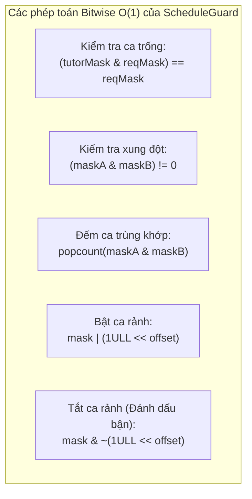
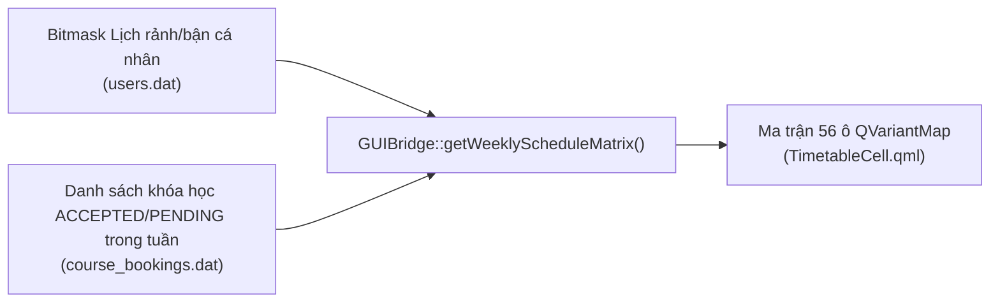

# QUẢN LÝ THỜI KHÓA BIỂU VÀ BẢO VỆ LỊCH SCHEDULE GUARD
## Phân Tích Kỹ Thuật Bitmask 56-Slot, Thuật Toán Phát Hiện Xung Đột O(1) và Mô Hình Tổng Hợp Ma Trận Lịch Tuần

---

## 1. TỔNG QUAN VÀ THIẾT KẾ TOÁN HỌC BITMASK 64-BIT `[VERIFIED]`

Hệ thống TutorMatch quản lý thời gian giảng dạy và học tập dựa trên cấu trúc tuần hoàn cố định 7 ngày/tuần:
- **Số ngày trong tuần:** 7 ngày (Thứ 2 đến Chủ Nhật, chỉ số `0..6`).
- **Số ca học trong ngày:** 8 ca học chuẩn (chỉ số `0..7`), trải dài từ 07:30 đến 23:30.
- **Tổng số ca học hoạt động trong tuần:** $7 \times 8 = 56$ ca học.

Thay vì lưu trữ 56 bản ghi hoặc 56 trường boolean trong cơ sở dữ liệu, kiến trúc sử dụng **một số nguyên không dấu 64-bit (`uint64_t`)** làm đại diện cho toàn bộ thời khóa biểu hàng tuần. Kỹ thuật này được đóng gói trong lớp [`ScheduleGuard`](file:///C:/Users/DELL/.gemini/antigravity/scratch/TutorMatch/include/business/algorithms/ScheduleGuard.h).

### 1.1. Bảng Phân Bố 8 Ca Học Hàng Ngày
- **Vị trí mã nguồn:** [`src/business/algorithms/ScheduleGuard.cpp`](file:///C:/Users/DELL/.gemini/antigravity/scratch/TutorMatch/src/business/algorithms/ScheduleGuard.cpp#L6-L10)

| Chỉ số ca (`slotIndex`) | Khung giờ thực tế | Nhãn buổi | Ý nghĩa sử dụng |
| :---: | :---: | :---: | :--- |
| **0** | `07:30 - 09:00` | Sáng 1 | Ca học sớm buổi sáng |
| **1** | `09:15 - 10:45` | Sáng 2 | Ca học chính buổi sáng |
| **2** | `13:30 - 15:00` | Chiều 1 | Ca học đầu buổi chiều |
| **3** | `15:15 - 16:45` | Chiều 2 | Ca học cuối buổi chiều |
| **4** | `17:00 - 18:30` | Tối 1 | Ca học chập tối |
| **5** | `18:45 - 20:15` | Tối 2 | Ca học cao điểm tối |
| **6** | `20:30 - 22:00` | Đêm 1 | Ca học muộn |
| **7** | `22:00 - 23:30` | Đêm 2 | Ca học đêm |

---

## 2. CÔNG THỨC ÁNH XẠ VÀ MẶT NẠ HỢP LỆ (BITMASK MATH) `[VERIFIED]`

### 2.1. Công Thức Tính Độ Dời Bit (Bit Offset)
Mỗi ca học được ánh xạ một-đối-một vào vị trí bit thứ $k$ ($0 \le k \le 55$):
$$\text{bitOffset} = (\text{dayIndex} \times 8) + \text{slotIndex}$$
$$\text{slotMask} = 1\text{ULL} \ll \text{bitOffset}$$

Ví dụ:
- Thứ 2 ca 0 (Sáng 1 Thứ 2): $\text{bitOffset} = 0 \times 8 + 0 = 0 \implies \text{mask} = 2^0 = 1$.
- Thứ 4 ca 5 (Tối 2 Thứ 4): $\text{bitOffset} = 2 \times 8 + 5 = 21 \implies \text{mask} = 2^{21} = 2\,097\,152$.
- Chủ Nhật ca 7 (Đêm 2 Chủ Nhật): $\text{bitOffset} = 6 \times 8 + 7 = 55 \implies \text{mask} = 2^{55}$.

### 2.2. Mặt Nạ Hợp Lệ Chuẩn Hóa (`VALID_SCHEDULE_MASK`)
Do một số nguyên `uint64_t` có 64 bit nhưng hệ thống chỉ sử dụng 56 bit (bit 0 đến 55), 8 bit cao nhất (bit 56 đến 63) là "bit ma" (ghost/phantom bits) có thể xuất hiện do tràn số hoặc dữ liệu lỗi:
```cpp
static constexpr uint64_t VALID_SCHEDULE_MASK = 0x00FFFFFFFFFFFFFFULL; // 56 bit 1 liên tiếp
```
Phương thức khử nhiễu bắt buộc (`sanitizeMask`):
```cpp
static uint64_t sanitizeMask(uint64_t mask) {
    return mask & VALID_SCHEDULE_MASK;
}
```

---

## 3. CÁC THAO TÁC THỜI KHÓA BIỂU ĐỘ PHỨC TẠP O(1) `[VERIFIED]`

Nhờ biểu diễn bitmask, các phép toán kiểm tra lịch phức tạp đạt hiệu năng tức thời $\mathcal{O}(1)$ ở mức tập lệnh vi xử lý (CPU instructions):



### 3.1. Kiểm Tra Gia Sư Có Rảnh Toàn Bộ Ca Yêu Cầu
- **Phương thức:** `ScheduleGuard::isSlotAvailable(tutorScheduleMask, requestedSlotMask)`
- **Mã nguồn:**
  ```cpp
  return (sanitizeMask(tutorScheduleMask) & sanitizeMask(requestedSlotMask)) == sanitizeMask(requestedSlotMask);
  ```

### 3.2. Phát Hiện Xung Đột Trùng Lịch Giữa Hai Lịch
- **Phương thức:** `ScheduleGuard::hasConflict(existingMask, newMask)`
- **Mã nguồn:**
  ```cpp
  return (sanitizeMask(existingMask) & sanitizeMask(newMask)) != 0;
  ```

### 3.3. Đếm Số Ca Trùng Khớp Giữa Học Viên và Gia Sư
- **Phương thức:** `ScheduleGuard::countMatchingSlots(tutorMask, studentMask)`
- **Thuật toán:** Đếm số lượng bit 1 chung (`popcount`):
  ```cpp
  uint64_t common = sanitizeMask(tutorMask) & sanitizeMask(studentMask);
  int count = 0;
  while (common > 0) {
      count += static_cast<int>(common & 1ULL);
      common >>= 1ULL;
  }
  return count;
  ```

---

## 4. MÔ HÌNH TỔNG HỢP MA TRẬN LỊCH TUẦN TRÊN GIAO DIỆN `[VERIFIED]`

- **Vị trí mã nguồn:** [`src/presentation/bridges/GUIBridge.cpp :: getStudentWeeklySchedule / getTutorWeeklySchedule / getWeeklyScheduleMatrix`](file:///C:/Users/DELL/.gemini/antigravity/scratch/TutorMatch/src/presentation/bridges/GUIBridge.cpp#L286-L377)

Giao diện thời khóa biểu tuần [`TimetableGrid.qml`](file:///C:/Users/DELL/.gemini/antigravity/scratch/TutorMatch/ui/qml/components/TimetableGrid.qml) hiển thị ma trận 8 dòng (ca học) $\times$ 7 cột (thứ trong tuần). Ma trận này không đọc đơn thuần từ bitmask mà là sự **hợp nhất động (Dynamic Compositing)** giữa hai nguồn dữ liệu:



### Trạng Thái Của Mỗi Ô Thời Khóa Biểu:
1. **Ô có Khóa học chính thức (`BOOKED` / `isCourse = true`):**
   - Lấy từ `BookingService::getAcceptedSessionsForWeek`.
   - Hiển thị: Tên môn học, tên đối tác (Gia sư/Học viên), số thứ tự buổi học (`Buổi 3/8`), khóa không cho phép sửa đổi (`locked = true`).
2. **Ô Lịch rảnh cá nhân (`FREE` / `status = "FREE"`):**
   - Bit trong bitmask là 1 và không có khóa học nào chiếm giữ.
   - Hiển thị màu xanh lá nhẹ hoặc nền sáng, có thể click để chuyển sang bận.
3. **Ô Lịch bận cá nhân (`BUSY` / `status = "BUSY"`):**
   - Học viên chủ động đánh dấu bận (bit 0 trong bitmask).
   - Hiển thị màu xám sọc, không nhận đề xuất ghép đôi vào ca này.

---

## 5. THUẬT TOÁN BẢO VỆ XUNG ĐỘT KHÓA HỌC NHIỀU TUẦN `[VERIFIED]`

- **Vị trí mã nguồn:** [`src/business/services/BookingService.cpp :: hasCourseConflictMulti`](file:///C:/Users/DELL/.gemini/antigravity/scratch/TutorMatch/src/business/services/BookingService.cpp#L36-L93)

Khi một khóa học định kỳ diễn ra trong $W \in \{4, 8, 12\}$ tuần bắt đầu từ ngày $D_{\text{start}}$, thuật toán kiểm tra xung đột với từng khóa học hiện có $CB$ theo 3 bước:
1. **Kiểm tra ca học trùng lặp:** Kiểm tra xem $CB$ có bất kỳ ca $(d, s)$ nào trùng với ca học của khóa mới hay không.
2. **Kiểm tra giao thoa khoảng ngày (Date Range Overlap):**
   - Khoảng của khóa mới: $[D_{\text{start}}, D_{\text{end}}]$ với $D_{\text{end}} = \text{addWeeks}(D_{\text{start}}, W)$.
   - Khoảng của khóa hiện có: $[CB.D_{\text{start}}, CB.D_{\text{end}}]$.
   - Hai khoảng giao nhau khi và chỉ khi:
     $$\max(D_{\text{start}}, CB.D_{\text{start}}) \le \min(D_{\text{end}}, CB.D_{\text{end}})$$
3. **Xử lý đặc biệt đối với khóa học Kết thúc sớm (`EARLY_TERMINATED`):**
   - Nếu $CB$ đã kết thúc sớm, ngày kết thúc thực tế là $CB.\text{actualEndDate}$.
   - Nếu ngày giao thoa bắt đầu **sau** $CB.\text{actualEndDate}$, hệ thống xác nhận **không có xung đột**, cho phép tái sử dụng ca học đó cho khóa học mới.

### 5.1. Sơ đồ Hoạt động Kiểm tra Va chạm Lịch bằng Mặt nạ Nhị phân 56 Ca (Scheduling Conflict Activity Diagram)

Sơ đồ luồng hoạt động dưới đây trực quan hóa toàn bộ quá trình kiểm tra va chạm thời khóa biểu hai tầng khi học viên gửi yêu cầu đăng ký: tầng 1 kiểm tra độ bao phủ lịch rảnh gốc của gia sư bằng mặt nạ bitmask, và tầng 2 kiểm tra xung đột với toàn bộ các khóa học đang diễn ra trong khoảng thời gian hiệu lực:

```mermaid
graph TD
    %% =========================================================================
    %% DIAGRAM 14: 56-SLOT BITWISE COLLISION CHECK & SCHEDULING ACTIVITY
    %% =========================================================================
    title["<b>QUY TRÌNH KIỂM TRA VA CHẠM LỊCH BẰNG MẶT NẠ NHỊ PHÂN 56 CA (SCHEDULEGUARD)</b>"]

    Start([Bắt đầu: Học viên yêu cầu đặt lịch các ca học]) --> Input[Nhận danh sách ca: dow_i, slot_i và gia sư targetTutor]

    Input --> SanitizeTutor[Lấy scheduleBitmask của Gia sư và khử bit thừa: cleanTutor = mask & 0x00FFFFFFFFFFFFFFULL]
    Input --> BuildReqMask[Khởi tạo requestedMask = 0ULL]

    BuildReqMask --> LoopSlots{Còn ca học nào trong danh sách?}
    LoopSlots -- Có --> CalcSlot[Tính bitOffset = dayIndex * 8 + slotIndex]
    CalcSlot --> BitOr[requestedMask |= (1ULL << bitOffset)]
    BitOr --> LoopSlots
    LoopSlots -- Hết --> CheckSanitizeReq[cleanReq = requestedMask & 0x00FFFFFFFFFFFFFFULL]

    CheckSanitizeReq --> CheckCoverage{cleanTutor & cleanReq == cleanReq ?<br/>Gia sư có rảnh tất cả ca này không?}
    CheckCoverage -- "Không (Thiếu ca)" --> RejectNotAvailable[Báo lỗi: Gia sư không rảnh vào các ca học yêu cầu] --> FinishFail([Thất bại: Không tạo yêu cầu])

    CheckCoverage -- "Có (Đủ ca)" --> QueryActiveBookings[Truy vấn ICourseBookingRepository lấy danh sách khóa ACCEPTED của gia sư]
    QueryActiveBookings --> BuildActiveMask[Khởi tạo activeConflictMask = 0ULL từ các khóa học đang diễn ra trong khoảng thời gian]

    BuildActiveMask --> ConflictCheck{activeConflictMask & cleanReq != 0 ?<br/>Có trùng với buổi dạy nào đã duyệt?}
    ConflictCheck -- "Có xung đột" --> RejectConflict[Báo lỗi: Trùng lịch với một khóa học khác đang diễn ra của gia sư] --> FinishFail

    ConflictCheck -- "Không xung đột" --> CreateBooking[Hợp lệ! Tạo CourseBooking mới với status = PENDING]
    CreateBooking --> FinishSuccess([Thành công: Yêu cầu được gửi đến Gia sư])

    style CheckCoverage fill:#fff3e0,stroke:#e65100,stroke-width:2px;
    style ConflictCheck fill:#fff3e0,stroke:#e65100,stroke-width:2px;
    style FinishFail fill:#ffebee,stroke:#c62828,stroke-width:2px;
    style FinishSuccess fill:#e8f5e9,stroke:#2e7d32,stroke-width:2px;
```

#### Diễn giải Quy trình Kiểm tra Va chạm Lịch:

1. **Khử Nhiễu và Chuẩn Hóa Mặt Nạ (Sanitization):** Bitmask của gia sư được làm sạch bằng mặt nạ `0x00FFFFFFFFFFFFFFULL` để loại bỏ 8 bit rác cao nhất. Các ca học yêu cầu được tính độ dời bit `bitOffset = dayIndex * 8 + slotIndex` và nén vào một số nguyên 64-bit `cleanReq`.
2. **Kiểm Tra Độ Bao Phủ Lịch Rảnh (Coverage Check):** Phép toán `(cleanTutor & cleanReq) == cleanReq` kiểm tra xem tất cả các ca học viên yêu cầu có nằm trong tập các ca gia sư đã mở rảnh hay không. Nếu thiếu dù chỉ 1 ca, hệ thống lập tức từ chối và thông báo lỗi.
3. **Kiểm Tra Xung Đột Khóa Học Hiện Hữu (Active Conflict Check):** Hệ thống truy vấn toàn bộ các khóa học đang ở trạng thái `ACCEPTED` của gia sư trong khoảng thời gian giao thoa. Mặt nạ `activeConflictMask` được tổng hợp từ các khóa học đó. Phép kiểm tra `(activeConflictMask & cleanReq) != 0` phát hiện va chạm lịch trong thời gian $O(1)$.
4. **Kết quả:** Chỉ khi vượt qua cả hai tầng kiểm tra, đối tượng `CourseBooking` mới được tạo với trạng thái `PENDING`, bảo đảm không bao giờ xảy ra hiện tượng đặt trùng lịch (double booking).
