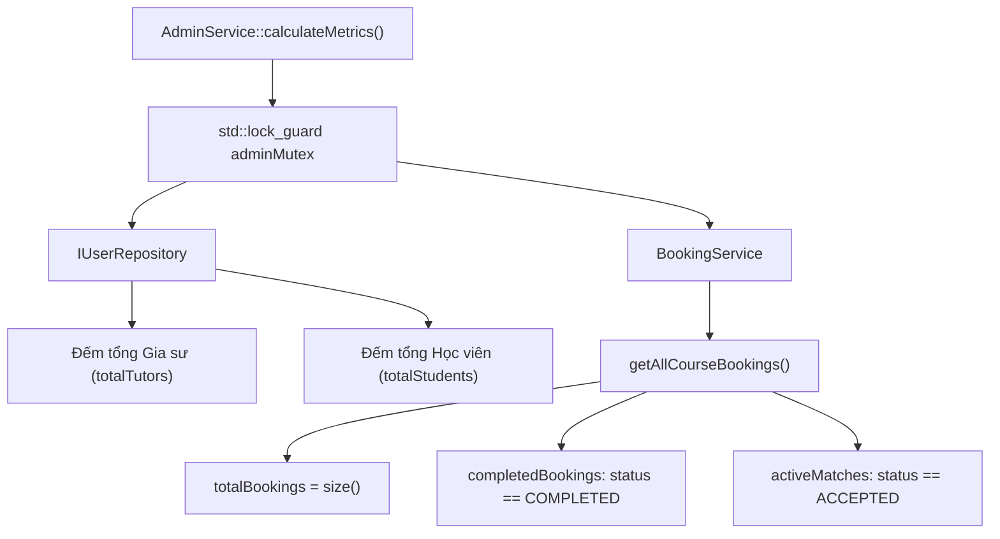
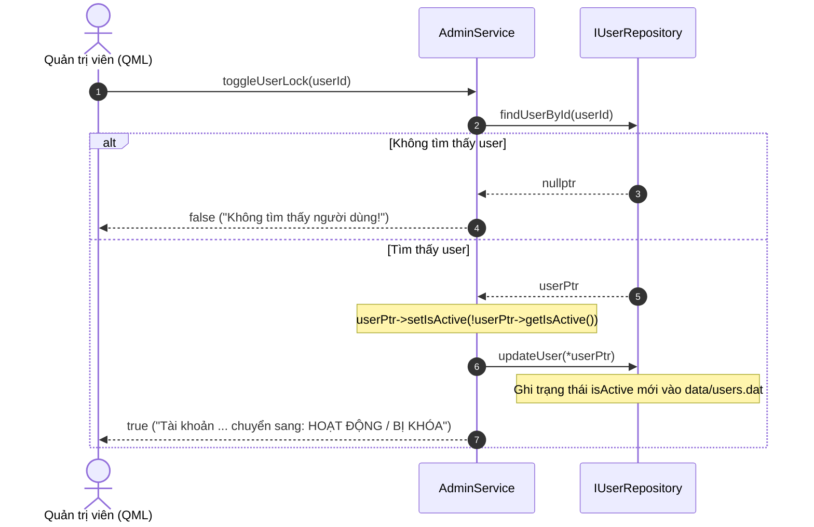

# QUY TRÌNH QUẢN TRỊ VÀ KIỂM DUYỆT HỆ THỐNG (ADMIN MODERATION WORKFLOWS)
## Phân Tích Thống Kê Nền Tảng, Khóa/Mở Khóa Tài Khoản, Xóa Đánh Giá Vi Phạm và Cưỡng Chế Hủy Khóa Học

---

## 1. TỔNG QUAN VÀ TRÁCH NHIỆM CỦA ADMINSERVICE `[VERIFIED]`

Trong kiến trúc TutorMatch, vai trò Quản trị viên (ADMIN) nắm giữ quyền hạn giám sát và điều phối cao nhất trên toàn hệ thống. Mọi nghiệp vụ quản trị, kiểm duyệt nội dung, thống kê số liệu và can thiệp khẩn cấp được gom cụm trong lớp [`AdminService`](file:///C:/Users/DELL/.gemini/antigravity/scratch/TutorMatch/include/business/services/AdminService.h).

Lớp `AdminService` tuân thủ nguyên lý Đơn trách nhiệm (SRP), Phân tách giao diện (ISP) và Đảo ngược phụ thuộc (DIP) bằng cách phụ thuộc vào các giao diện trừu tượng [`IUserRepository`](file:///C:/Users/DELL/.gemini/antigravity/scratch/TutorMatch/include/data_access/repositories/IRepository.h), [`IReviewRepository`](file:///C:/Users/DELL/.gemini/antigravity/scratch/TutorMatch/include/data_access/repositories/IRepository.h) và ủy quyền xử lý trạng thái khóa học cho [`BookingService`](file:///C:/Users/DELL/.gemini/antigravity/scratch/TutorMatch/include/business/services/BookingService.h).

---

## 2. THỐNG KÊ CHỈ SỐ HOẠT ĐỘNG TOÀN SÀN (PLATFORM METRICS) `[VERIFIED]`

- **Vị trí mã nguồn:** [`src/business/services/AdminService.cpp :: AdminService::calculateMetrics`](file:///C:/Users/DELL/.gemini/antigravity/scratch/TutorMatch/src/business/services/AdminService.cpp#L14-L35)
- **Cấu trúc dữ liệu:** `AdminMetrics`



### Các Chỉ Số Nghiệp Vụ Được Tính Toán Tức Thì:
1. `totalTutors`: Tổng số tài khoản gia sư trong hệ thống (`userRepo->getAllTutors().size()`).
2. `totalStudents`: Tổng số tài khoản học viên (`userRepo->getAllStudents().size()`).
3. `totalBookings`: Tổng số đơn đăng ký khóa học đã từng được tạo (`bookingService->getAllCourseBookings().size()`).
4. `completedBookings`: Tổng số khóa học đã hoàn thành (`status == "COMPLETED"`).
5. `activeMatches`: Tổng số khóa học đang diễn ra đồng thời (`status == "ACCEPTED"`).

---

## 3. TRA CỨU VÀ BỘ LỌC NGƯỜI DÙNG ĐA NĂNG (USER FILTERING & SEARCH) `[VERIFIED]`

- **Vị trí mã nguồn:** [`src/business/services/AdminService.cpp :: AdminService::getFilteredUsers`](file:///C:/Users/DELL/.gemini/antigravity/scratch/TutorMatch/src/business/services/AdminService.cpp#L42-L100)

Giao diện Quản trị viên [`AdminUserManagementView.qml`](file:///C:/Users/DELL/.gemini/antigravity/scratch/TutorMatch/ui/qml/views/AdminUserManagementView.qml) cung cấp khả năng tìm kiếm và phân loại người dùng theo hai cấp độ:

### 3.1. Phân Loại Vai Trò / Trạng Thái (`filter`)
- `ALL` hoặc rỗng: Lấy toàn bộ người dùng (Học viên, Gia sư, Admin).
- `STUDENT`: Chỉ lọc các tài khoản có `u->getRole() == UserRole::STUDENT`.
- `TUTOR` hoặc `ALL_TUTORS`: Chỉ lọc các tài khoản có `u->getRole() == UserRole::TUTOR`.
- `LOCKED`: Chỉ lọc các tài khoản đang bị vô hiệu hóa (`!u->getIsActive()`).

### 3.2. Quét Khớp Từ Khóa Đa Trường (`searchKeyword`)
Hệ thống chuyển đổi từ khóa và các trường dữ liệu người dùng về dạng chữ thường (`tolower`) và tìm kiếm chuỗi con trên 4 trường thông tin:
- Họ tên (`fullName`).
- Thư điện tử (`email`).
- Tên đăng nhập (`username`).
- Thuộc tính chuyên biệt: Chuyên môn giảng dạy (`subjectSpecialty`) đối với Gia sư hoặc khối lớp (`lớp X`) đối với Học viên.

---

## 4. QUY TRÌNH KHÓA VÀ MỞ KHÓA TÀI KHOẢN (ACCOUNT LOCK / UNLOCK) `[VERIFIED]`

- **Vị trí mã nguồn:** [`src/business/services/AdminService.cpp :: AdminService::toggleUserLock`](file:///C:/Users/DELL/.gemini/antigravity/scratch/TutorMatch/src/business/services/AdminService.cpp#L101-L112)
- **Chữ ký phương thức:**
  ```cpp
  bool AdminService::toggleUserLock(int userId, std::string& outMsg);
  ```



### Tác Động Hệ Thống Khi Tài Khoản Bị Khóa (`isActive == false`):
1. **Khóa Đăng Nhập:** Người dùng không thể đăng nhập vào hệ thống; `AuthService::login` từ chối với thông báo *"Tài khoản của bạn đang BỊ KHÓA bởi Admin!"*.
2. **Loại Bỏ Khỏi Kết Quả Tìm Kiếm:** `TutorSearchMatcher` đánh giá `isEligible = false` và xếp vào Tier 0 (`NO_MATCH`).
3. **Loại Bỏ Khỏi SmartMatch:** `MatchingEngine::isEligible` loại bỏ ngay tại Stage A2.
4. **Không Thể Nhận Khóa Học Mới:** `BookingService::bookCourseMultiSlot` từ chối nếu gia sư đang bị khóa.

---

## 5. KIỂM DUYỆT VÀ XÓA ĐÁNH GIÁ VI PHẠM (REVIEW MODERATION) `[VERIFIED]`

- **Vị trí mã nguồn:** [`src/business/services/AdminService.cpp :: AdminService::deleteViolatingReview`](file:///C:/Users/DELL/.gemini/antigravity/scratch/TutorMatch/src/business/services/AdminService.cpp#L114-L159)

Khi một đánh giá chứa ngôn từ tiêu cực sai sự thật hoặc vi phạm tiêu chuẩn cộng đồng, Admin có quyền xóa bỏ đánh giá đó. Quy trình thực hiện đảm bảo tính nhất quán dữ liệu hoàn hảo:
1. Xác định gia sư là đối tượng của đánh giá thông qua `reviewId`.
2. Xóa bản ghi đánh giá khỏi `data/reviews.dat` qua `reviewRepo->deleteReview(reviewId)`.
3. **Tái tính toán Điểm Uy Tín Ngay Lập Tức:** Lấy lại toàn bộ đánh giá còn lại của gia sư đó trong `reviews.dat`, tính lại điểm trung bình mới và số lượng đánh giá thực tế:
   $$\text{newAvg} = \frac{\sum r.\text{ratingScore}}{|\text{remainingReviews}|}$$
4. Cập nhật thực thể Gia sư và lưu vào `data/users.dat` qua `userRepo->updateUser(*t)`.

---

## 6. ĐIỀU PHỐI KẾT NỐI VÀ HỦY CƯỠNG CHẾ KHÓA HỌC (TERMINATE MATCH) `[VERIFIED]`

- **Vị trí mã nguồn:** [`src/business/services/AdminService.cpp :: AdminService::terminateMatch`](file:///C:/Users/DELL/.gemini/antigravity/scratch/TutorMatch/src/business/services/AdminService.cpp#L161-L167)
- **Cơ chế:** Ủy quyền xử lý cho `BookingService`:
  ```cpp
  bool AdminService::terminateMatch(int bookingId, std::string& outMsg) {
      if (!bookingService) {
          outMsg = "Booking service chưa sẵn sàng!";
          return false;
      }
      return bookingService->cancelCourseBooking(0, UserRole::ADMIN, bookingId, outMsg);
  }
  ```
- **Hành vi nghiệp vụ:** Với quyền `UserRole::ADMIN`, Admin có thẩm quyền chấm dứt ngay lập tức bất kỳ khóa học nào (dù đang ở `PENDING` hay `ACCEPTED`). Toàn bộ lịch học đã thỏa thuận được giải phóng tức thời, đưa trạng thái khóa học về `CANCELLED`.
