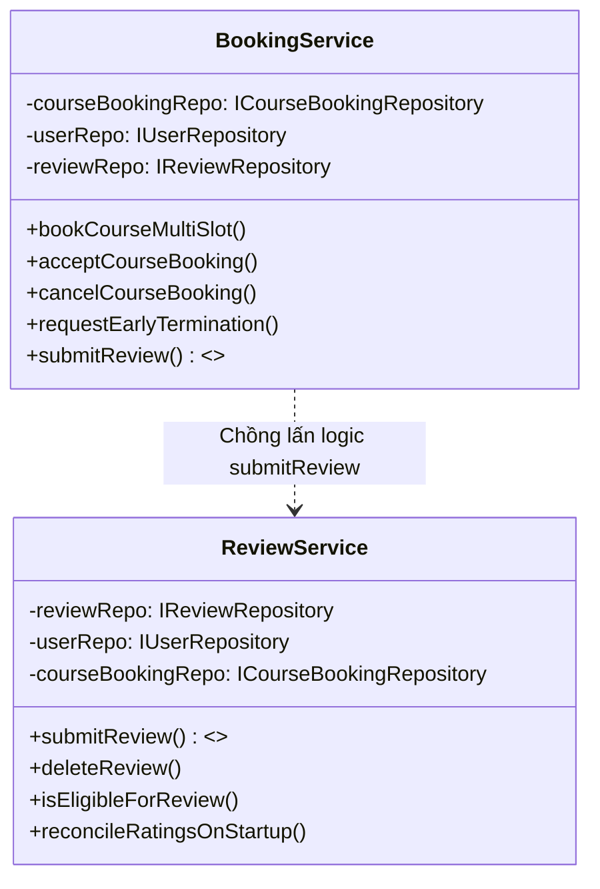

# PHÂN TÍCH NGUYÊN LÝ ĐƠN TRÁCH NHIỆM (SINGLE RESPONSIBILITY PRINCIPLE - SRP)
## Khảo Sát Tính Đơn Trách Nhiệm Trên Toàn Bộ Các Thành Phần Của TutorMatch

---

## 1. NGUYÊN LÝ ĐƠN TRÁCH NHIỆM VÀ TIÊU CHÍ ĐÁNH GIÁ `[VERIFIED]`

Theo định nghĩa của Robert C. Martin (Uncle Bob):
> *"A class should have one, and only one, reason to change."* (Một lớp chỉ nên có một, và chỉ một, lý do để thay đổi).

Trong ngữ cảnh kiến trúc 3 tầng của TutorMatch:
- Một thành phần **Presentation** chỉ thay đổi khi giao diện hoặc tương tác người dùng thay đổi.
- Một thành phần **Business Service** chỉ thay đổi khi quy tắc nghiệp vụ (business rules) thay đổi.
- Một thành phần **Data Access** chỉ thay đổi khi cấu trúc lưu trữ hoặc khuôn dạng tệp tin thay đổi.

---

## 2. KẾT QUẢ RÀ SOÁT SRP THEO TỪNG PHÂN HỆ `[VERIFIED]`

### 2.1. Tầng Trình Diễn (Presentation Layer)
- **`gui_main.cpp` — ĐẠT (`GOOD`):**
  - Đóng vai trò duy nhất là **Điểm Ráp Nối Thành Phần (Composition Root)**: khởi tạo kho dữ liệu, các service nghiệp vụ, bộ điều hợp `GUIBridge`, nạp QML engine và kích hoạt vòng lặp sự kiện Qt.
  - Lý do thay đổi duy nhất: Thay đổi cấu hình khởi chạy hoặc cơ chế Dependency Injection của ứng dụng.
- **`GUIBridge` — CẢNH BÁO (`WARNING`):**
  - **Mặt tích cực:** Tuân thủ phân tách ranh giới tầng xuất sắc — không chứa bất kỳ logic I/O tệp tin hay câu lệnh truy vấn dữ liệu nào; toàn bộ thao tác đều ủy thác cho Business Services.
  - **Mặt hạn chế (Chồng lấn trách nhiệm):** Đóng vai trò là một "Fat Adapter" nguyên khối tích hợp hơn 60 phương thức `Q_INVOKABLE` cho cả 3 vai trò (Student, Tutor, Admin). `GUIBridge` vừa quản lý trạng thái phiên đăng nhập, vừa điều phối tìm kiếm, vừa tổng hợp ma trận thời khóa biểu tuần, vừa xử lý gửi review. Khi bất kỳ luồng UI nào thay đổi, `GUIBridge` đều có lý do để sửa đổi.

---

### 2.2. Tầng Nghiệp Vụ (Business Logic Layer)
- **`AuthService` — ĐẠT (`GOOD`):**
  - Chịu trách nhiệm duy nhất về xác thực tài khoản, kiểm tra tính duy nhất của username/email và quản lý phiên người dùng (`currentUser`).
- **`UserService` — CẢNH BÁO (`WARNING`):**
  - Chịu trách nhiệm quản lý hồ sơ và lịch rảnh cá nhân. Tuy nhiên, lớp chứa thêm các phương thức tìm kiếm và lọc gia sư theo khoảng giá và rating, tạo nên sự giao thoa trách nhiệm nhẹ với `TutorSearchMatcher` và `MatchingService`.
- **`BookingService` — VI PHẠM NGHIÊM TRỌNG (`VIOLATION - PHÁT HIỆN P1`):**
  - **Bản chất vi phạm:** Quản lý xuất sắc vòng đời khóa học (đăng ký nhiều tuần, cam kết hai chiều, đồng thuận kết thúc sớm). Tuy nhiên, tại các dòng [`src/business/services/BookingService.cpp:643-700`](file:///C:/Users/DELL/.gemini/antigravity/scratch/TutorMatch/src/business/services/BookingService.cpp#L643-L700), `BookingService` lại chứa thêm phương thức:
    ```cpp
    bool BookingService::submitReview(int studentId, int bookingId, int ratingScore,
                                      const std::string& comment, std::string& outMsg);
    ```
    Đây là sự **nhân đôi logic thực thụ (True Duplication)** với `ReviewService::submitReview`, vi phạm trực tiếp SRP.
- **`ReviewService` — ĐẠT (`GOOD`):**
  - Chịu trách nhiệm duy nhất về quản lý vòng đời đánh giá, thẩm định quyền đánh giá, tính toán lại điểm rating trung bình của gia sư và tự phục hồi dữ liệu khi khởi động (`reconcileRatingsOnStartup`).
- **`MatchingService` & `MatchingEngine` — ĐẠT (`GOOD`):**
  - Chịu trách nhiệm duy nhất về điều phối gợi ý thông minh SmartMatch và thuật toán hàng đợi ưu tiên Max-Heap.

---

### 2.3. Tầng Truy Xuất Dữ Liệu (Data Access Layer)
- **Tách biệt Kho Lưu Trữ và Tuần Tự Hóa (ADR-004) — MẪU MỰC (`EXCELLENT`):**
  - Các Repository ([`FileUserRepository`](file:///C:/Users/DELL/.gemini/antigravity/scratch/TutorMatch/src/data_access/repositories/FileUserRepository.cpp), [`FileCourseBookingRepository`](file:///C:/Users/DELL/.gemini/antigravity/scratch/TutorMatch/src/data_access/repositories/FileCourseBookingRepository.cpp), [`FileReviewRepository`](file:///C:/Users/DELL/.gemini/antigravity/scratch/TutorMatch/src/data_access/repositories/FileReviewRepository.cpp)) chỉ chịu trách nhiệm quản lý tệp tin, khóa đa luồng `std::mutex` và chỉ mục RAM.
  - Toàn bộ thao tác chuyển đổi định dạng chuỗi CSV được ủy thác độc quyền cho các Serializer thuần túy ([`UserSerializer`](file:///C:/Users/DELL/.gemini/antigravity/scratch/TutorMatch/src/data_access/serializers/UserSerializer.cpp), [`CourseBookingSerializer`](file:///C:/Users/DELL/.gemini/antigravity/scratch/TutorMatch/src/data_access/serializers/CourseBookingSerializer.cpp), [`ReviewSerializer`](file:///C:/Users/DELL/.gemini/antigravity/scratch/TutorMatch/src/data_access/serializers/ReviewSerializer.cpp)), đảm bảo Repository không có lý do thay đổi khi cấu trúc trường CSV thay đổi.

---

## 3. PHÂN TÍCH PHÁT HIỆN P1 TRONG BOOKINGSERVICE `[VERIFIED]`



### So Sánh Đối Chiếu Logic Gửi Đánh Giá:
| Tiêu chí | `ReviewService::submitReview` (Chuẩn mực) | `BookingService::submitReview` (Trùng lặp P1) | Đánh giá rủi ro |
| :--- | :--- | :--- | :--- |
| **Bảo vệ đồng thời** | `std::recursive_mutex reviewMutex` | `std::recursive_mutex serviceMutex` | Sử dụng 2 mutex khác nhau, có thể xung đột ghi tệp `reviews.dat`. |
| **Giá trị mặc định khi chưa có review** | Gán `0.0` sao | Gán `5.0` sao | **Phân kỳ nghiệp vụ (Divergent Behavior)** nguy hiểm! |
| **Giao dịch bù (Compensating Rollback)** | Có: Gọi `deleteReview` nếu cập nhật `users.dat` lỗi (ADR-007). | **Không có:** Dữ liệu sẽ bị bất nhất vĩnh viễn nếu ghi user lỗi. | Rủi ro toàn vẹn dữ liệu. |
| **Độ bao phủ thực tế trên GUI** | `GUIBridge::qmlSubmitReview` gọi trực tiếp `ReviewService`. | **Không được sử dụng bởi GUI.** | Mã chết (Dead Code) cần loại bỏ. |
