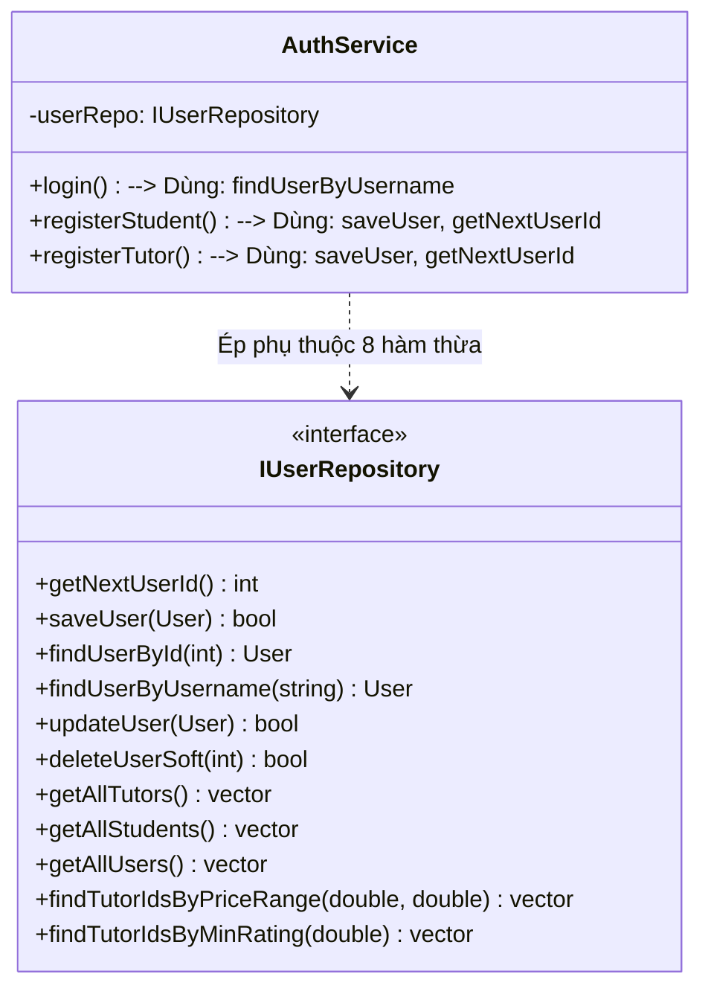

# ĐÁNH GIÁ NGUYÊN LÝ PHÂN TÁCH GIAO DIỆN (INTERFACE SEGREGATION PRINCIPLE - ISP)
## Phân Tích Độ Hạt Của Hợp Đồng, Sự Ép Buộc Phụ Thuộc Thừa và Bề Mặt API Tầng Trình Diễn

---

## 1. NGUYÊN TẮC CỐT LÕI CỦA ISP TRONG TUTORMATCH `[VERIFIED]`

Nguyên lý Phân tách Giao diện (Interface Segregation Principle - ISP) khẳng định: **Các Client không nên bị ép buộc phải phụ thuộc vào các giao diện hoặc phương thức mà chúng không bao giờ sử dụng (Clients should not be forced to depend upon interfaces that they do not use)**.

Các tiêu chuẩn đánh giá ISP trong TutorMatch:
1. Giao diện có tinh gọn, tập trung vào một nhóm hành vi gắn kết cao hay không?
2. Có hiện tượng một lớp triển khai phải cài đặt các hàm rỗng (`{}`) hoặc ném ngoại lệ không hỗ trợ hay không?
3. Khi sửa đổi một phương thức trong giao diện, có bao nhiêu client không liên quan bị buộc phải biên dịch lại (recompile)?

---

## 2. KHẢO SÁT CÁC GIAO DIỆN KHO DỮ LIỆU (REPOSITORY CONTRACTS) `[VERIFIED]`

- **Vị trí mã nguồn:** [`include/data_access/repositories/IRepository.h`](file:///C:/Users/DELL/.gemini/antigravity/scratch/TutorMatch/include/data_access/repositories/IRepository.h)

### 2.1. Điểm Tích Cực: Phân Tách Thành Công 3 Giao Ước Miền Độc Lập (ADR-002) — ĐẠT XUẤT SẮC (`GOOD`)
Hệ thống đã phân chia cơ sở dữ liệu thành 3 giao ước độc lập:
1. [`IUserRepository`](file:///C:/Users/DELL/.gemini/antigravity/scratch/TutorMatch/include/data_access/repositories/IRepository.h#L38-L55): Quản lý người dùng (`User`, `Student`, `Tutor`, `Admin`).
2. [`ICourseBookingRepository`](file:///C:/Users/DELL/.gemini/antigravity/scratch/TutorMatch/include/data_access/repositories/IRepository.h#L57-L70): Quản lý vòng đời hợp đồng khóa học (`CourseBooking`).
3. [`IReviewRepository`](file:///C:/Users/DELL/.gemini/antigravity/scratch/TutorMatch/include/data_access/repositories/IRepository.h#L72-L82): Quản lý đánh giá và xếp hạng (`Review`).

**Lợi ích kiến trúc thực tế:**
- `AuthService` chỉ cần tiêm `std::shared_ptr<IUserRepository>`. Lớp này hoàn toàn không biết đến sự tồn tại của `CourseBooking` hay `Review`.
- Việc thay đổi cấu trúc bảng `reviews.dat` hay thêm phương thức vào `IReviewRepository` sẽ không bao giờ làm ảnh hưởng hay yêu cầu biên dịch lại `AuthService`.

---

### 2.2. Điểm Hạn Chế: Giao Diện Béo (Fat Interface) Trong `IUserRepository` — CẢNH BÁO (`WARNING`)
Mặc dù đã tách khỏi Booking và Review, `IUserRepository` vẫn chứa 11 phương thức thuộc 3 nhóm trách nhiệm khác nhau:



- **Phân tích mức độ sử dụng của Client:**
  - `AuthService` chỉ cần đúng 3 phương thức: `findUserByUsername`, `saveUser`, `getNextUserId`. Nó bị ép phải phụ thuộc vào 8 phương thức còn lại, bao gồm cả các truy vấn khoảng giá và rating bằng cây AVL!
  - `MatchingService` chỉ cần phương thức `getAllTutors()`.
- **Hệ quả ISP:** Nếu `IUserRepository` bổ sung một phương thức truy vấn mới (ví dụ `findTutorsByExperience`), toàn bộ các dịch vụ không liên quan như `AuthService` đều bị kéo vào quá trình biên dịch lại.

---

### 2.3. Vấn Đề Gom Ngược Giao Diện Của `MockDatabaseEngine` — CẢNH BÁO (`WARNING`)
Lớp `MockDatabaseEngine` (`include/data_access/storage/MockDatabaseEngine.h:28-92`) kế thừa đồng thời cả 3 giao diện:
```cpp
class MockDatabaseEngine : public IUserRepository,
                           public IReviewRepository,
                           public ICourseBookingRepository
```
Việc này biến `MockDatabaseEngine` thành một Monolithic Facade ôm trọn toàn bộ 23 phương thức dữ liệu của hệ thống. Trước đây, khi CLI (`ConsoleApp`) nắm giữ con trỏ này, toàn bộ phân tách ISP bị vô hiệu hóa. Hiện tại, với việc loại bỏ CLI, chỉ có `gui_main.cpp` và `TestRunner.cpp` khởi tạo `MockDatabaseEngine`, giảm thiểu đáng kể rủi ro rò rỉ giao diện lên tầng trình diễn.

---

## 3. KHẢO SÁT GIAO DIỆN CHIẾN LƯỢC: `IMatchingStrategy` — ĐẠT MẪU MỰC (`EXCELLENT`)

- **Vị trí mã nguồn:** [`include/business/matching/IMatchingStrategy.h:92-110`](file:///C:/Users/DELL/.gemini/antigravity/scratch/TutorMatch/include/business/matching/IMatchingStrategy.h#L92-L110)
- **Số lượng phương thức:** Chính xác 3 phương thức có tính gắn kết tuyệt đối:
  1. `getStrategyName()`: Lấy tên mô tả chiến lược.
  2. `calculateScore()`: Hàm tương thích ngược nhận Student và Tutor.
  3. `calculateScoreWithCriteria()`: Hàm chấm điểm đầy đủ nhận `SmartMatchCriteria` và active bookings.
- **Đánh giá ISP:** Giao diện cực kỳ tinh gọn, không thừa phương thức nào. Lớp triển khai `WeightedScoreMatchingStrategy` hiện thực hóa đầy đủ cả 3 hàm mà không có hàm rỗng.

---

## 4. KHẢO SÁT BỀ MẶT API CỦA BỘ ĐIỀU HỢP `GUIBridge` — CẢNH BÁO (`WARNING`)

Bộ điều hợp [`GUIBridge`](file:///C:/Users/DELL/.gemini/antigravity/scratch/TutorMatch/include/presentation/bridges/GUIBridge.h) đóng vai trò làm cầu nối duy nhất giữa QML và C++.
- **Hiện trạng:** `GUIBridge` phơi bày hơn 60 phương thức `Q_INVOKABLE` trên một lớp duy nhất.
- **Đánh giá ISP:** Đối với các khung nhìn QML chuyên biệt (ví dụ: `StudentOverviewView.qml` chỉ cần đọc lịch học, trong khi `AdminUserManagementView.qml` chỉ cần khóa user), việc dùng chung một `GUIBridge` khổng lồ khiến mã QML có thể gọi bất kỳ hàm nào của bất kỳ vai trò nào mà không có rào cản interface phân tách.
- **Định hướng tối ưu:** Phân tách thành 3 Controller chuyên biệt cho QML: `StudentBridgeController`, `TutorBridgeController`, `AdminBridgeController`.
