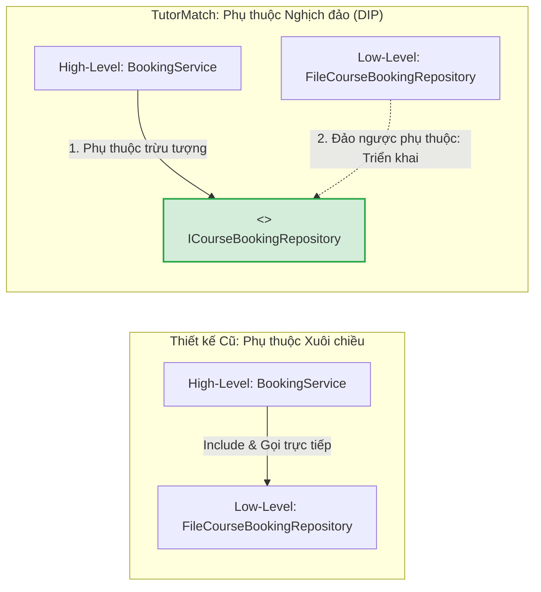
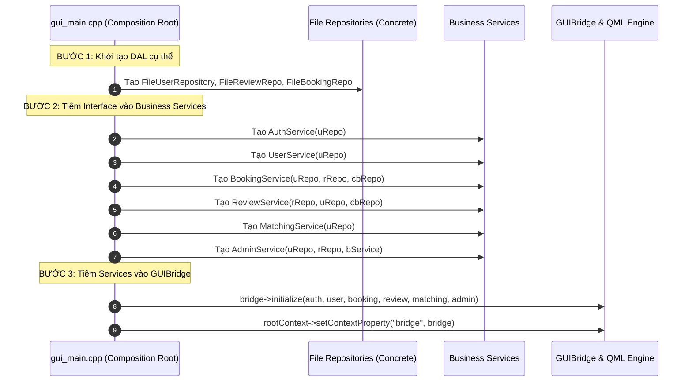

# ĐÁNH GIÁ NGUYÊN LÝ NGHỊCH ĐẢO PHỤ THUỘC (DEPENDENCY INVERSION PRINCIPLE - DIP)
## Phân Tích Các Tầng Trừu Tượng Hóa, Chiều Phụ Thuộc Biên Dịch, Điểm Ráp Nối Composition Root và Lịch Sử Loại Bỏ Vi Phạm CLI

---

## 1. NGUYÊN TẮC CỐT LÕI CỦA DIP TRONG TUTORMATCH `[VERIFIED]`

Nguyên lý Nghịch đảo Phụ thuộc (Dependency Inversion Principle - DIP) của Robert C. Martin thiết lập hai mệnh đề nền tảng cho kiến trúc hướng đối tượng:
1. **Các module cấp cao (High-level modules) không được phụ thuộc trực tiếp vào các module cấp thấp (Low-level modules). Cả hai bắt buộc phải phụ thuộc vào các sự trừu tượng hóa (Abstractions).**
2. **Sự trừu tượng hóa không được phụ thuộc vào các chi tiết cài đặt cụ thể (Details). Chi tiết cài đặt cụ thể phải phụ thuộc vào sự trừu tượng hóa.**

### Chiều Phụ Thuộc Biên Dịch và Luồng Điều Khiển Runtime:
- Trong thiết kế truyền thống kém chất lượng: Module cấp cao (`BookingService`) `#include` trực tiếp module lưu trữ đĩa (`FileCourseBookingRepository`). Chiều phụ thuộc biên dịch trùng với luồng điều khiển, khiến logic nghiệp vụ bị trói chặt vào phần cứng hoặc hệ thống tệp.
- Trong kiến trúc TutorMatch hiện tại: Module cấp cao định nghĩa hoặc phụ thuộc vào giao ước trừu tượng ([`ICourseBookingRepository`](file:///C:/Users/DELL/.gemini/antigravity/scratch/TutorMatch/include/data_access/repositories/IRepository.h#L57-L70)). Module cấp thấp muốn tham gia vào hệ thống phải phụ thuộc ngược lại vào giao ước này để triển khai (`FileCourseBookingRepository : public ICourseBookingRepository`). Chiều phụ thuộc biên dịch bị **đảo ngược hoàn toàn (Inverted)**.

---

## 2. KHẢO SÁT DIP GIỮA TẦNG NGHIỆP VỤ VÀ TẦNG TRUY XUẤT DỮ LIỆU `[VERIFIED]`

Toàn bộ các Business Services trong [`include/business/services/`](file:///C:/Users/DELL/.gemini/antigravity/scratch/TutorMatch/include/business/services/) đều tuân thủ nguyên lý DIP thông qua cơ chế tiêm phụ thuộc qua hàm khởi tạo (Constructor Dependency Injection):

1. **`AuthService`:**
   - Phụ thuộc: `std::shared_ptr<IUserRepository> userRepo;`.
   - Cơ chế: Tiêm qua constructor. Hoàn toàn không biết đến sự tồn tại của `FileUserRepository` hay tệp `users.dat`.
   - Đánh giá: **XUẤT SẮC (`GOOD`)**.
2. **`BookingService`:**
   - Phụ thuộc: `IUserRepository`, `IReviewRepository`, `ICourseBookingRepository`.
   - Cơ chế: Constructor Injection. Mọi thao tác lưu vết hợp đồng đều đi qua interface trừu tượng.
   - Đánh giá: **XUẤT SẮC (`GOOD`)**.
3. **`ReviewService`:**
   - Phụ thuộc: `IReviewRepository`, `IUserRepository`, `ICourseBookingRepository`.
   - Cơ chế: Constructor Injection.
   - Đánh giá: **XUẤT SẮC (`GOOD`)**.
4. **`MatchingService`:**
   - Phụ thuộc: `IUserRepository`, `ICourseBookingRepository`, `MatchingEngine`.
   - Cơ chế: Constructor Injection.
   - Đánh giá: **XUẤT SẮC (`GOOD`)**.
5. **`AdminService`:**
   - Phụ thuộc: `IUserRepository`, `IReviewRepository` và `std::shared_ptr<BookingService> bookingService`.
   - Đánh giá: **CẢNH BÁO (`WARNING`)**. Mặc dù phụ thuộc vào hai interface lưu trữ trừu tượng, `AdminService` lại phụ thuộc trực tiếp vào một lớp dịch vụ cụ thể là `BookingService` thay vì một giao diện trừu tượng hóa hành vi.

---

## 3. KHẢO SÁT DIP GIỮA TẦNG TRÌNH DIỄN VÀ TẦNG NGHIỆP VỤ `[VERIFIED]`

### 3.1. Phân Hệ Đồ Họa Hiện Tại: `GUIBridge` $\to$ Services — ĐẠT (`GOOD`)
- `GUIBridge` đóng vai trò là một Presentation Adapter sạch đối với tầng dữ liệu:
  - Chỉ phụ thuộc vào các dịch vụ nghiệp vụ (`AuthService`, `UserService`, `BookingService`, `ReviewService`, `MatchingService`, `AdminService`).
  - Khi QML phát tín hiệu, `GUIBridge` chuyển giao toàn bộ dữ liệu cho các Service xử lý.
  - **Hoàn toàn không gọi trực tiếp các lớp `File...Repository` hay tệp `.dat`.**

### 3.2. Lịch Sử Khắc Phục Lỗ Hổng CLI Vượt Tầng (P0 Decommission Resolution)
- **Vấn đề trước đây:** Trong phiên bản cũ có phân hệ CLI, lớp `ConsoleApp` đã vi phạm nghiêm trọng DIP khi giữ con trỏ `std::shared_ptr<MockDatabaseEngine> dbEngine`, vượt tầng gọi thẳng vào tầng dữ liệu mỗi khi Service rỗng, tự tính toán điểm rating và lưu mật khẩu plain-text.
- **Biện pháp xử lý triệt để:** Trong đợt chuyển đổi hệ thống sang kiến trúc chuyên biệt cho GUI (GUI-Only Transition), toàn bộ mã nguồn CLI (`ConsoleApp.h`, `ConsoleApp.cpp`, `cli_main.cpp`) và target CMake `TutorMatch_CLI` đã bị **loại bỏ hoàn toàn khỏi dự án**.
- **Kết quả:** Lỗ hổng vi phạm DIP nghiêm trọng nhất hệ thống đã được giải quyết vĩnh viễn, bảo vệ ranh giới 3 tầng tuyệt đối.

---

## 4. ĐIỂM RÁP NỐI THÀNH PHẦN (COMPOSITION ROOT) `[VERIFIED]`

- **Vị trí mã nguồn:** [`src/presentation/gui_main.cpp`](file:///C:/Users/DELL/.gemini/antigravity/scratch/TutorMatch/src/presentation/gui_main.cpp#L45-L95)

Điểm duy nhất trong toàn bộ hệ thống được phép biết và khởi tạo các lớp cụ thể (Concrete Implementations) là hàm `main()` tại `gui_main.cpp`. Trình tự khởi tạo tuân thủ chặt chẽ nguyên tắc lắp ráp Dependency Injection:

Kiến trúc Composition Root tại `gui_main.cpp` đạt độ chuẩn mực cao, cho phép hoán đổi toàn bộ hệ thống lưu trữ hoặc phục vụ kiểm thử tự động mà không làm ảnh hưởng đến mã nguồn nghiệp vụ.
