# PHÂN TÍCH LIÊN NGUYÊN LÝ VÀ BẢN ĐỒ NGUYÊN NHÂN GỐC RỄ (CROSS-PRINCIPLE ROOT CAUSE ANALYSIS)
## Mối Tương Quan Giữa Các Nguyên Lý SOLID, Bản Đồ Nguyên Nhân Gốc Rễ Và Hiện Trạng Khắc Phục

---

## 1. NGUYÊN LÝ CỦA PHÂN TÍCH LIÊN NGUYÊN LÝ `[VERIFIED]`

Trong thiết kế hướng đối tượng, các nguyên lý SOLID không tồn tại biệt lập mà liên kết chặt chẽ và tương hỗ lẫn nhau. Một khiếm khuyết cấu trúc ở mức nền tảng hiếm khi chỉ ảnh hưởng đến một nguyên lý đơn lẻ, mà thường kích hoạt hiệu ứng domino lan rộng:
- Vi phạm **SRP** (lớp gánh vác quá nhiều chức năng) thường dẫn tới vi phạm **DIP** (phụ thuộc vào cả module cấp cao lẫn module cấp thấp) và **ISP** (phơi bày giao diện quá rộng).
- Vi phạm **LSP** (lớp con thiếu đa hình hành vi) thường kéo theo vi phạm **OCP** (buộc mã gọi phải dùng `if-else`/`switch-case` và downcast ép kiểu hàng loạt, triệt tiêu khả năng mở rộng không sửa mã nguồn).
- Giao diện vi phạm **ISP** (quá nhiều phương thức) làm suy yếu **DIP** khi các client bị ép buộc phụ thuộc vào các chi tiết không cần thiết.

Mục tiêu của phân tích liên nguyên lý là **nhận diện các nguyên nhân gốc rễ (Root Causes)** của hệ thống TutorMatch để đưa ra lộ trình tái cấu trúc chính xác, tránh việc báo cáo trùng lặp các triệu chứng bề mặt.

### 1.1. Sơ đồ Bản đồ Nguyên nhân Gốc rễ và Tuân thủ các Nguyên lý SOLID (SOLID Compliance and Root Cause Map Diagram)

Biểu đồ dưới đây tổng hợp mối liên hệ giữa các nguyên nhân gốc rễ kiến trúc (phân tầng tiến hóa, cơ chế lưu trữ tệp phẳng, vai trò điều phối của `GUIBridge`), mức độ tuân thủ của từng nguyên lý trong bộ 5 nguyên lý SOLID, cùng lộ trình tái cấu trúc tối thiểu hóa (P1, P2) cho hệ thống:

```mermaid
graph TD
    %% =========================================================================
    %% DIAGRAM 20: SOLID COMPLIANCE & ROOT CAUSE MAP
    %% =========================================================================
    title["<b>BẢN ĐỒ NGUYÊN NHÂN GỐC RỄ & TUÂN THỦ CÁC NGUYÊN LÝ SOLID</b>"]

    subgraph Architectural_Root_Causes ["Nguyên Nhân Gốc Rễ Kiến Trúc (Root Causes)"]
        RC1["<b>RC-1: Lịch sử phân tầng tiến hóa từng phần</b><br/>Ban đầu BookingService ôm đồm Review (ADR-003 đã tách ReviewService nhưng còn mã tàn dư)"]
        RC2["<b>RC-2: Tư duy cơ sở dữ liệu tệp đơn giản</b><br/>Không có Transaction Coordinator cấp DBMS; phải dựa vào Compensating Rollback (ADR-007) và đồng bộ khởi động"]
        RC3["<b>RC-3: Ranh giới Presentation Controller</b><br/>GUIBridge giữ vai trò Mediator ôm nhiều phương thức Q_INVOKABLE (nhưng đã ủy quyền sạch sẽ cho Services)"]
    end

    subgraph SOLID_Principles ["Đánh Giá Tuân Thủ 5 Nguyên Lý SOLID"]
        subgraph SRP_Sub ["S — Single Responsibility"]
            SRP_Good["✅ Services & Serializers chia tách trách nhiệm rõ ràng"]
            SRP_Issue["⚠️ BookingService còn giữ các phương thức Review thừa (P1 finding)"]
        end

        subgraph OCP_Sub ["O — Open / Closed"]
            OCP_Good["✅ MatchingEngine mở rộng qua IMatchingStrategy"]
            OCP_Good2["✅ UserRole & SerializerUtils hỗ trợ đa hình"]
        end

        subgraph LSP_Sub ["L — Liskov Substitution"]
            LSP_Good["✅ Student, Tutor, Admin thay thế hoàn hảo cho User base"]
            LSP_Good2["✅ Virtual methods getRoleString(), displayProfile() tôn trọng hợp đồng"]
        end

        subgraph ISP_Sub ["I — Interface Segregation"]
            ISP_Good["✅ IUserRepository, ICourseBookingRepository, IReviewRepository độc lập"]
            ISP_Good2["✅ Client chỉ phụ thuộc vào Repository mình cần"]
        end

        subgraph DIP_Sub ["D — Dependency Inversion"]
            DIP_Good["✅ Services phụ thuộc vào Repository Interfaces (Abstractions)"]
            DIP_Good2["✅ GUI-Only: Đã loại bỏ hoàn toàn rò rỉ dbEngine từ CLI cũ"]
            DIP_Issue["ℹ️ Composition Root trong gui_main.cpp liên kết các concrete classes"]
        end
    end

    subgraph Improvements ["Lộ Trình Tối Thiểu Hóa (Minimal Refactoring Roadmap)"]
        P1_Clean["<b>Ưu tiên P1:</b> Rút sạch 3 hàm review thừa khỏi BookingService và loại bỏ reviewRepo khỏi BookingService"]
        DIP_Clean["<b>Ưu tiên P2:</b> Tách nhỏ GUIBridge thành các Sub-Controllers chuyên biệt theo Role (Student/Tutor/Admin)"]
    end

    RC1 -.-> SRP_Issue
    RC2 -.-> DIP_Good
    RC3 -.-> DIP_Issue

    SRP_Issue ==> P1_Clean
    DIP_Issue ==> DIP_Clean

    style SRP_Good fill:#e8f5e9,stroke:#2e7d32,stroke-width:1px;
    style OCP_Good,OCP_Good2 fill:#e8f5e9,stroke:#2e7d32,stroke-width:1px;
    style LSP_Good,LSP_Good2 fill:#e8f5e9,stroke:#2e7d32,stroke-width:1px;
    style ISP_Good,ISP_Good2 fill:#e8f5e9,stroke:#2e7d32,stroke-width:1px;
    style DIP_Good,DIP_Good2 fill:#e8f5e9,stroke:#2e7d32,stroke-width:1px;
    style SRP_Issue fill:#fff3e0,stroke:#ef6c00,stroke-width:2px;
    style DIP_Issue fill:#e3f2fd,stroke:#1976d2,stroke-width:1px;
    style P1_Clean fill:#fbe9e7,stroke:#d84315,stroke-width:2px;
    style DIP_Clean fill:#ede7f6,stroke:#512da8,stroke-width:2px;
```

#### Diễn giải Bản đồ Nguyên nhân Gốc rễ:

1. **Nguyên Nhân Kiến Trúc Cốt Lõi:**
   - **RC-1 (Tiến hóa lịch sử):** Khi hệ thống tách `ReviewService` theo ADR-003, `BookingService` vẫn còn sót lại 3 phương thức ủy quyền review cũ, dẫn đến vi phạm SRP cục bộ (P1 finding).
   - **RC-2 (Đặc thù tệp phẳng):** Vì không có cơ chế giao dịch ACID của DBMS, kiến trúc đã chủ động bù đắp bằng cơ chế bồi hoàn ADR-007 (Compensating Rollback) và tự phục hồi khi khởi động (`reconcileRatingsOnStartup`), bảo đảm tính toàn vẹn dữ liệu ở tầng BLL mà không phá vỡ DIP.
   - **RC-3 (Trọng tâm Presentation):** `GUIBridge` đóng vai trò Mediator duy nhất xuất hơn 45 hàm `Q_INVOKABLE` cho QML, nhưng tất cả đều ủy thác sạch sẽ xuống các Service nghiệp vụ.
2. **Đánh Giá Toàn Diện 5 Nguyên Lý SOLID:**
   - **SRP (S):** Đạt phần lớn nhờ phân tách Serializer và Service; còn vướng mắc nhỏ tại `BookingService`.
   - **OCP (O):** Rất tốt trong thuật toán ghép nối (`IMatchingStrategy`) và bộ tuần tự hóa.
   - **LSP (L):** Cây kế thừa `User` (`Student`, `Tutor`, `Admin`) tuân thủ nghiêm ngặt hợp đồng phương thức ảo.
   - **ISP (I):** Ba interface repository phân tách độc lập, không ép client phụ thuộc vào phương thức dư thừa.
   - **DIP (D):** Sau khi khai tử CLI, rò rỉ `MockDatabaseEngine` đã bị loại bỏ 100%. Các Service hoàn toàn chỉ giao tiếp qua các giao diện trừu tượng `IRepository`.
3. **Lộ Trình Tái Cấu Trúc Khuyến Nghị:**
   - Ưu tiên P1: Dọn sạch các phương thức review thừa trong `BookingService`.
   - Ưu tiên P2: Phân tách `GUIBridge` thành các sub-controller theo vai trò nếu kích thước tệp tiếp tục tăng trưởng.

---

## 2. BẢN ĐỒ NGUYÊN NHÂN GỐC RỄ (SYSTEMIC ROOT CAUSES) `[VERIFIED]`

### 2.1. RC-1: Phân Tầng Dở Dang Trong Phân Hệ Dòng Lệnh CLI `[RESOLVED BY DECOMMISSION]`
- **Bản chất khiếm khuyết:** Lớp `ConsoleApp` trước đây giữ con trỏ `std::shared_ptr<MockDatabaseEngine> dbEngine`, vượt tầng gọi thẳng vào tầng DAL mỗi khi Service rỗng, tự tính rating gia sư và ghi mật khẩu văn bản thô.
- **Tác động liên nguyên lý:** Vi phạm đồng thời **SRP**, **DIP**, **OCP**.
- **Hiện trạng xử lý:** **ĐÃ ĐƯỢC GIẢI QUYẾT TRIỆT ĐỂ (CONFIRMED RESOLVED)**. Trong đợt chuyển đổi kiến trúc sang GUI-only, toàn bộ mã nguồn CLI (`ConsoleApp.h`, `ConsoleApp.cpp`, `cli_main.cpp`) và target CMake `TutorMatch_CLI` đã được loại bỏ hoàn toàn, triệt tiêu vĩnh viễn rủi ro rò rỉ dữ liệu lên tầng trình diễn.

---

### 2.2. RC-2: Chồng Lấn Ranh Giới Miền Đặt Lịch (`Booking`) Và Đánh Giá (`Review`) `[ACTIVE FINDING — P1]`
- **Bản chất khiếm khuyết:** Dịch vụ `ReviewService` đã được tách riêng để quản trị vòng đời đánh giá chất lượng (theo ADR-003). Tuy nhiên, `BookingService` vẫn giữ lại phương thức `submitReview`, `getReviewsByTutor`, `getReviewsByStudent` và giữ con trỏ `IReviewRepository`. Đồng thời, `AdminService::deleteViolatingReview` lại tự ý xóa review và tự tính rating thay vì ủy thác cho `ReviewService`.
- **Tác động liên nguyên lý:**
  - **SRP:** `BookingService` vừa quản lý vòng đời khóa học vừa quản lý đánh giá; `AdminService` kiêm nhiệm nghiệp vụ tính toán rating.
  - **ISP:** `BookingService` bị ép phụ thuộc vào `IReviewRepository` trong khi chỉ cần `ICourseBookingRepository` và `IUserRepository`.
  - **DRY & OCP:** Trùng lặp mã nguồn tính rating gia sư tại 3 nơi (`ReviewService.cpp`, `BookingService.cpp`, `AdminService.cpp`). Đặc biệt, `BookingService::submitReview` có sự phân kỳ nguy hiểm khi gán rating mặc định ban đầu là `5.0` (thay vì `0.0` như `ReviewService`) và thiếu cơ chế bồi hoàn giao dịch ADR-007.

---

### 2.3. RC-3: Mô Hình Kế Thừa Thiếu Đa Hình (Anemic Subtyping) Trong Cây `User` `[ACTIVE FINDING — P2]`
- **Bản chất khiếm khuyết:** Lớp cha `User` chỉ chứa các trường thông tin cơ bản và 2 phương thức ảo hiển thị text. Toàn bộ hành vi đặc thù (khối lớp, lịch rảnh, học phí, rating) nằm riêng lẻ tại `Student` và `Tutor`.
- **Tác động liên nguyên lý:**
  - **LSP:** Giá trị đa hình thực tế của `User` bị suy giảm nghiêm trọng; mã nghiệp vụ hầu như không thể thao tác với `User` mà không downcast.
  - **OCP:** Hệ thống có tới hơn 70 vị trí gọi `std::static_pointer_cast<Student>` hoặc `std::static_pointer_cast<Tutor>` sau khi kiểm tra vai trò bằng `if-else` hoặc `switch-case`. Việc thêm một vai trò mới (như `Parent`) đòi hỏi phải sửa đổi mã nguồn tại hơn 70 vị trí này.

---

### 2.4. RC-4: Đóng Cứng Bộ Lọc Hợp Lệ Trong `MatchingEngine` `[ACTIVE FINDING — P2]`
- **Bản chất khiếm khuyết:** Trong khi thuật toán tính điểm được trừu tượng hóa xuất sắc qua `IMatchingStrategy` (Strategy Pattern), điều kiện lọc cứng ứng viên hợp lệ (`isEligible`) lại bị đóng cứng dưới dạng một hàm tĩnh (`static method`) trong [`MatchingEngine.cpp:250-320`](file:///C:/Users/DELL/.gemini/antigravity/scratch/TutorMatch/src/business/matching/MatchingEngine.cpp#L250-L320).
- **Tác động liên nguyên lý:**
  - **OCP:** Không thể bổ sung tiêu chí lọc cứng mới (ví dụ: khoảng cách địa lý, chứng chỉ sư phạm) mà không phải can thiệp sửa đổi trực tiếp vào mã nguồn của `MatchingEngine.cpp`.
  - **SRP:** `MatchingEngine` vừa quản lý giải thuật hàng đợi ưu tiên Max-Heap, vừa gánh vác trách nhiệm kiểm tra toàn bộ điều kiện tiên quyết của môn học và tài khoản.

---

### 2.5. RC-5: Vị Trí Thư Mục Vật Lý Của Giao Ước `IRepository.h` `[ACTIVE FINDING — P3]`
- **Bản chất khiếm khuyết:** Tệp tiêu đề `IRepository.h` chứa các giao ước thuần ảo (`IUserRepository`, `ICourseBookingRepository`, `IReviewRepository`), nhưng lại được đặt vật lý trong thư mục `include/data_access/repositories/`.
- **Tác động liên nguyên lý:**
  - **DIP:** Tầng Nghiệp vụ cấp cao (`include/business/services/`) buộc phải `#include "data_access/repositories/IRepository.h"`. Mặc dù về mặt ngữ nghĩa C++ các service phụ thuộc vào giao diện thuần ảo trừu tượng, về mặt tổ chức vật lý thư mục (Clean Architecture), tầng nghiệp vụ bị phụ thuộc vào tên thư mục của tầng truy xuất dữ liệu.

---

## 3. MA TRẬN NGUYÊN NHÂN GỐC RỄ TOÀN HỆ THỐNG (ROOT-CAUSE MATRIX) `[VERIFIED]`

| Mã Nguyên Nhân | Mô Tả Khiếm Khuyết Kiến Trúc Gốc Rễ | Nguyên Lý Bị Tác Động | Bằng Chứng Mã Nguồn Cụ Thể | Hệ Quả Thực Tế | Mức Độ Ưu Tiên | Trạng Thái Hiện Tại |
| :--- | :--- | :---: | :--- | :--- | :---: | :---: |
| **RC-1** | Rò rỉ lưu trữ và vượt tầng trong CLI `ConsoleApp`. | **SRP, DIP, OCP** | `include/presentation/cli/ConsoleApp.h` `src/presentation/cli/ConsoleApp.cpp` | Phân kỳ hành vi; lưu mật khẩu plain-text; vượt tầng DAL. | **P0 (Critical)** | **ĐÃ GIẢI QUYẾT (RESOLVED)** Loại bỏ hoàn toàn CLI |
| **RC-2** | Chồng lấn miền: `BookingService` và `AdminService` tự làm nghiệp vụ Review. | **SRP, ISP, OCP** | `src/business/services/BookingService.cpp:643-700` `src/business/services/AdminService.cpp:138-154` | Trùng lặp logic tính rating tại 3 nơi; phân kỳ giá trị mặc định 5.0 vs 0.0; thiếu rollback ADR-007. | **P1 (High)** | **ĐANG TỒN TẠI (ACTIVE)** Ưu tiên refactor số 1 |
| **RC-3** | Kế thừa thiếu đa hình (Anemic Subtyping) trong cây `User`. | **LSP, OCP** | `include/business/domain/User.h:38-80` Hơn 70 vị trí `static_pointer_cast` | Khó mở rộng thêm vai trò mới; phụ thuộc rẽ nhánh enum. | **P2 (Medium)** | **ĐANG TỒN TẠI (ACTIVE)** Khuyến nghị refactor P2 |
| **RC-4** | Đóng cứng hàm lọc hợp lệ `isEligible` dạng static method trong `MatchingEngine`. | **OCP, SRP** | `src/business/matching/MatchingEngine.cpp:250-320` | Không thể bổ sung tiêu chí lọc cứng mới mà không sửa Engine. | **P2 (Medium)** | **ĐANG TỒN TẠI (ACTIVE)** Khuyến nghị refactor P2 |
| **RC-5** | Đặt tệp giao ước trừu tượng `IRepository.h` trong thư mục `data_access/`. | **DIP** | `include/business/services/BookingService.h:8` `include/data_access/repositories/IRepository.h` | Tầng nghiệp vụ include đường dẫn của tầng truy xuất dữ liệu. | **P3 (Low)** | **ĐANG TỒN TẠI (ACTIVE)** Khuyến nghị refactor P3 |
