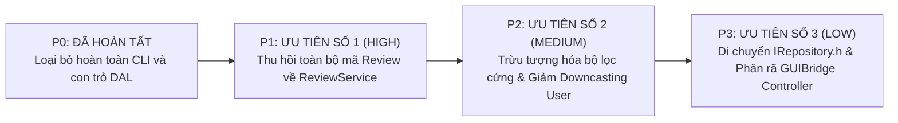

# LỘ TRÌNH VÀ KẾ HOẠCH TÁI CẤU TRÚC KIẾN TRÚC THEO CHUẨN SOLID (REFACTORING ROADMAP)
## Lộ Trình Tối Thiểu Hóa Rủi Ro Tái Cấu Trúc: Từ Ưu Tiên P1 Đến P3 Cho Hệ Thống GUI-Only

---

## 1. NGUYÊN TẮC VÀ ĐỊNH HƯỚNG TÁI CẤU TRÚC `[VERIFIED]`

Kế hoạch tái cấu trúc kiến trúc TutorMatch được xây dựng dựa trên 3 nguyên tắc:
1. **Bảo toàn Ranh giới 3 Lớp (Three-Layer Architecture):** Mọi sự cải tiến đều nhằm củng cố tính độc lập giữa Presentation $\to$ Business $\to$ Data Access, không phá vỡ ranh giới tầng.
2. **Ưu tiên Sự Thay Đổi Nhỏ Nhất (Smallest Effective Change):** Không đưa vào các Design Pattern phức tạp khi không cần thiết; tập trung xử lý trực tiếp các khiếm khuyết kỹ thuật có bằng chứng mã nguồn rõ ràng.
3. **Bảo đảm Không Gãy Hồi Quy (Zero Regression):** Toàn bộ 30 bộ kiểm thử tự động trong `tests/TestRunner.cpp` và các tệp dữ liệu thực tế (`users.dat`, `course_bookings.dat`, `reviews.dat`) phải duy trì trạng thái 100% PASS và khớp mã băm SHA-256.



---

## 2. TRẠNG THÁI HIỆN TẠI CỦA CÁC PHÁT HIỆN KIẾN TRÚC `[VERIFIED]`

- **P0 — Rò rỉ lưu trữ và vượt tầng trong CLI:** **ĐÃ HOÀN TẤT (CONFIRMED RESOLVED)**.
  Phân hệ dòng lệnh (`ConsoleApp.h`, `ConsoleApp.cpp`, `cli_main.cpp`) đã được loại bỏ hoàn toàn khỏi dự án khi chuyển đổi sang mô hình GUI-Only. Con trỏ `MockDatabaseEngine` trong presentation layer không còn tồn tại.
- **P1 — Chồng lấn miền Review trong `BookingService` và `AdminService`:** **ĐANG TỒN TẠI (ACTIVE FINDING — HIGHEST PRIORITY)**.
- **P2 — Đóng cứng `isEligible` trong `MatchingEngine` và Anemic Subtyping `User`:** **ĐANG TỒN TẠI (ACTIVE FINDING)**.
- **P3 — Vị trí vật lý `IRepository.h` và bề mặt API rộng của `GUIBridge`:** **ĐANG TỒN TẠI (ACTIVE FINDING)**.

---

## 3. P1 — ƯU TIÊN CAO NHẤT (HIGH): THU HỒI TOÀN BỘ LOGIC REVIEW VỀ `ReviewService`

### 3.1. Vấn Đề Kỹ Thuật
- `BookingService` chứa phương thức `submitReview`, `getReviewsByTutor`, `getReviewsByStudent`, giữ con trỏ `IReviewRepository` và tự tính toán rating gia sư ([`src/business/services/BookingService.cpp:643-700`](file:///C:/Users/DELL/.gemini/antigravity/scratch/TutorMatch/src/business/services/BookingService.cpp#L643-L700)).
- `AdminService::deleteViolatingReview` ([`src/business/services/AdminService.cpp:138-154`](file:///C:/Users/DELL/.gemini/antigravity/scratch/TutorMatch/src/business/services/AdminService.cpp#L138-L154)) tự gọi `reviewRepo->deleteReview` và tự viết vòng lặp tính lại rating trung bình thay vì ủy thác cho `ReviewService`.

### 3.2. Thiết Kế Refactoring Đề Xuất
1. **Tinh giản `BookingService`:**
   - Xóa bỏ trường thành viên `std::shared_ptr<IReviewRepository> reviewRepo`.
   - Xóa bỏ các phương thức: `submitReview`, `getReviewsByTutor`, `getReviewsByStudent` khỏi `BookingService.h` và `BookingService.cpp`.
   - Rút gọn constructor của `BookingService` về 2 tham số:
     ```cpp
     BookingService(std::shared_ptr<IUserRepository> uRepo,
                    std::shared_ptr<ICourseBookingRepository> cbRepo);
     ```
2. **Cập nhật `AdminService`:**
   - Tiêm `std::shared_ptr<ReviewService>` vào `AdminService` thay vì tiêm `IReviewRepository`.
   - Trong `deleteViolatingReview`, ủy thác hoàn toàn:
     ```cpp
     bool AdminService::deleteViolatingReview(int reviewId, std::string& outMsg) {
         if (!reviewService) return false;
         return reviewService->deleteReview(reviewId, outMsg);
     }
     ```
3. **Đánh giá tác động:**
   - Các file liên quan: `BookingService.h/.cpp`, `AdminService.h/.cpp`, `gui_main.cpp`.
   - Cải thiện nguyên lý: **SRP** (BookingService chỉ làm nhiệm vụ đặt lịch), **ISP** (BookingService không cần `IReviewRepository`), **DRY/OCP** (Chỉ duy nhất một nơi tính toán rating).
   - Rủi ro: Rất thấp, vì GUI hiện tại đã gọi `reviewService` và logic này đã được kiểm thử 100% trong Test Suite 24 & 25.

---

## 4. P2 — MỨC ĐỘ TRUNG BÌNH (MEDIUM): TRỪU TƯỢNG HÓA BỘ LỌC CỨNG VÀ MÔ HÌNH NGƯỜI DÙNG

### 4.1. Refactoring 4.1: Trừu Tượng Hóa Bộ Lọc Hợp Lệ Trong `MatchingEngine` (OCP/SRP)
- **Vấn đề:** Hàm tĩnh `MatchingEngine::isEligible` đóng cứng toàn bộ tiêu chí lọc.
- **Giải pháp:** Định nghĩa giao diện `IEvaluationFilter`:
  ```cpp
  class IEvaluationFilter {
  public:
      virtual ~IEvaluationFilter() = default;
      virtual bool isEligible(const SmartMatchCriteria& criteria,
                              const Tutor& tutor,
                              const std::vector<CourseBooking>& activeBookings,
                              std::vector<std::pair<int, int>>& outMatchedSlots) = 0;
  };
  ```
  Tách các điều kiện hiện tại thành: `SubjectFilter`, `ActiveAccountFilter`, `GradeFitFilter`, `BudgetFilter`, `ScheduleFilter`. `MatchingEngine` chỉ duyệt qua danh sách các filter, mở cho việc mở rộng bộ lọc trong tương lai.

### 4.2. Refactoring 4.2: Bổ Sung Phương Thức Đa Hình Cho `User` (OCP/LSP)
- **Vấn đề:** Hơn 70 vị trí gọi `std::static_pointer_cast<Student>` hoặc `std::static_pointer_cast<Tutor>` do lớp cha `User` anemic.
- **Giải pháp:** Đẩy các hành vi truy vấn chung lên lớp cha dưới dạng virtual method (ví dụ `virtual uint64_t getScheduleBitmask() const { return 0; }`, `virtual double getHourlyRate() const { return 0.0; }`), giúp mã gọi không cần downcast.

---

## 5. P3 — MỨC ĐỘ THẤP (LOW): TỔ CHỨC VẬT LÝ VÀ PHÂN RÃ BỘ ĐIỀU HỢP GUI

### 5.1. Refactoring 5.1: Chuyển Vị Trí Header `IRepository.h` (DIP)
- **Vấn đề:** Tầng nghiệp vụ phải `#include "data_access/repositories/IRepository.h"`.
- **Giải pháp:** Di chuyển tệp giao ước trừu tượng sang `include/business/repositories/IRepository.h` hoặc `include/common/interfaces/IRepository.h`, bảo toàn tính độc lập của Business Layer theo kiến trúc Hexagonal / Clean Architecture.

### 5.2. Refactoring 5.2: Phân Rã `GUIBridge` Thành Các Controller Chuyên Biệt (ISP/SRP)
- **Vấn đề:** `GUIBridge` chứa hơn 60 phương thức `Q_INVOKABLE` cho cả 3 vai trò.
- **Giải pháp:** Tách thành 3 controller nhỏ:
  - `StudentController` (đăng ký học, tìm gia sư, xem thời khóa biểu cá nhân).
  - `TutorController` (duyệt đơn học, quản lý ca dạy cố định).
  - `AdminController` (khóa tài khoản, kiểm duyệt đánh giá, báo cáo thống kê).
  `GUIBridge` chỉ đóng vai trò Facade mỏng tích hợp 3 controller này vào QML context.
