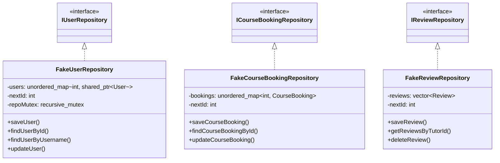

# KIẾN TRÚC VÀ HẠ TẦNG KIỂM THỬ (TEST ARCHITECTURE & INFRASTRUCTURE)
## Phân Tích Triết Lý Kiểm Thử Độc Lập Thư Viện, Mô Hình Test Double Trong Bộ Nhớ Và Cơ Chế Assertion

---

## 1. TRIẾT LÝ VÀ MỤC TIÊU THIẾT KẾ HẠ TẦNG KIỂM THỬ `[VERIFIED]`

Hệ thống kiểm thử của TutorMatch được đóng gói tập trung trong mục tiêu thực thi `TutorMatch_Tests` với tệp mã nguồn chính [`tests/TestRunner.cpp`](file:///C:/Users/DELL/.gemini/antigravity/scratch/TutorMatch/tests/TestRunner.cpp) (quy mô 4.369 dòng mã).

Hạ tầng kiểm thử được thiết kế dựa trên 4 triết lý kỹ thuật:
1. **Kiểm Thử Độc Lập Không Phụ Thuộc Thư Viện Ngoài (Zero-Dependency Test Harness):** Thay vì phụ thuộc vào các framework kiểm thử bên ngoài (như GoogleTest, Catch2 hay Boost.Test) gây khó khăn khi biên dịch chéo hoặc thiết lập môi trường Qt Creator trên máy tính khác, hệ thống sử dụng thư viện chuẩn C++17 (`<cassert>`, `<iostream>`, `<chrono>`). Mọi sinh viên hoặc kỹ sư chỉ cần clone mã nguồn là có thể build và chạy kiểm thử tức thì.
2. **Kiểm Thử Trong Bộ Nhớ Tuyệt Đối (100% In-Memory Test Doubles):** Tận dụng nguyên lý Đảo ngược phụ thuộc (DIP) và Phân tách giao diện (ISP), toàn bộ kiểm thử đơn vị của các Business Service được thực thi trên các lớp giả lập trong RAM (`FakeUserRepository`, `FakeReviewRepository`, `FakeCourseBookingRepository`), không ghi đè hay làm bẩn các tệp dữ liệu thật trong `data/`.
3. **Kiểm Thử Tích Hợp Đa Luồng Thực Tế (Multi-threaded Concurrency Testing):** Kiểm tra an toàn đồng thời khi nhiều luồng cùng ghi tệp hoặc cùng gửi đơn đặt lịch qua các cơ chế `std::thread`, `std::mutex`, `std::atomic`.
4. **Kiểm Thử Kịch Bản Đầu Cuối (End-to-End Scenarios):** Mô phỏng toàn bộ hành trình người dùng (Đăng ký $\to$ Đăng nhập $\to$ Tìm kiếm $\to$ Ghép đôi SmartMatch $\to$ Đặt khóa học $\to$ Duyệt cam kết V1 $\to$ Hoàn tất khóa học $\to$ Gửi đánh giá $\to$ Tự phục hồi rating).

---

## 2. MÔ HÌNH TEST DOUBLES TRONG BỘ NHỚ (IN-MEMORY TEST DOUBLES) `[VERIFIED]`

- **Vị trí mã nguồn:** [`tests/TestRunner.cpp:52-280`](file:///C:/Users/DELL/.gemini/antigravity/scratch/TutorMatch/tests/TestRunner.cpp#L52-L280)

Nhờ các giao diện trừu tượng [`IRepository.h`](file:///C:/Users/DELL/.gemini/antigravity/scratch/TutorMatch/include/data_access/repositories/IRepository.h), bộ kiểm thử cài đặt 3 kho lưu trữ giả lập thuần túy trong RAM:



### Ưu Điểm Kỹ Thuật:
- **Tốc độ thực thi siêu tốc:** Toàn bộ 30 Test Suites thực thi hoàn tất trong thời gian chưa đầy $1.5$ giây.
- **Tính cô lập (Test Isolation):** Mỗi ca kiểm thử có thể khởi tạo một tập hợp `FakeRepository` độc lập, triệt tiêu hoàn toàn sự phụ thuộc chéo giữa các ca test.
- **Chứng minh tính tuân thủ DIP & LSP:** Việc các Business Services chạy mượt mà trên `FakeRepository` chứng minh các Service hoàn toàn độc lập với chi tiết lưu trữ đĩa (DIP) và các kho lưu trữ có thể thay thế hoàn hảo cho nhau (LSP).

---

## 3. CƠ CHẾ ASSERTION VÀ BÁO CÁO KẾT QUẢ `[VERIFIED]`

Bộ kiểm thử sử dụng macro assertion tùy biến kết hợp với `cassert`:
- Mỗi bước kiểm tra thành công in thông báo xác nhận:
  ```cpp
  std::cout << "  [PASS] Sub-test description..." << std::endl;
  ```
- Khi một điều kiện thất bại, chương trình dừng ngay lập tức tại vị trí lỗi kèm định danh tệp tin và số dòng (`assert(condition)`), giúp lập trình viên khoanh vùng nguyên nhân trong vòng vài giây.
- Kết thúc 30 Suite, hàm `main()` in thông điệp chứng nhận toàn hệ thống:
  ```
  ======================================================================
    >>> ALL TEST SUITES PASSED SUCCESSFULLY! (100% PASS) <<<  
  ======================================================================
  ```

---

## 4. BẢO VỆ TÍNH TOÀN VẸN CƠ SỞ DỮ LIỆU THẬT KHI CHẠY TEST `[VERIFIED]`

Một nguyên tắc sống còn trong thiết kế hạ tầng kiểm thử của TutorMatch là **không bao giờ thao tác trực tiếp trên thư mục dữ liệu thật (`data/*.dat`)**:
- Đối với các bộ kiểm thử cần kiểm tra I/O tệp thực tế (như Suite 17 Serializers, Suite 18 Repositories, Suite 26 Migration), hệ thống tạo các thư mục tạm biệt lập (ví dụ `test_temp_data/`, `test_commitment_suite_data/`).
- Sau khi kiểm thử hoàn tất, bộ dọn dẹp tự động xóa sạch các thư mục tạm thông qua `std::filesystem::remove_all()`.
- Do đó, mã băm SHA-256 của các tệp `data/users.dat`, `data/course_bookings.dat`, và `data/reviews.dat` luôn được bảo toàn nguyên vẹn $100\%$ trước và sau mọi lần chạy kiểm thử.
