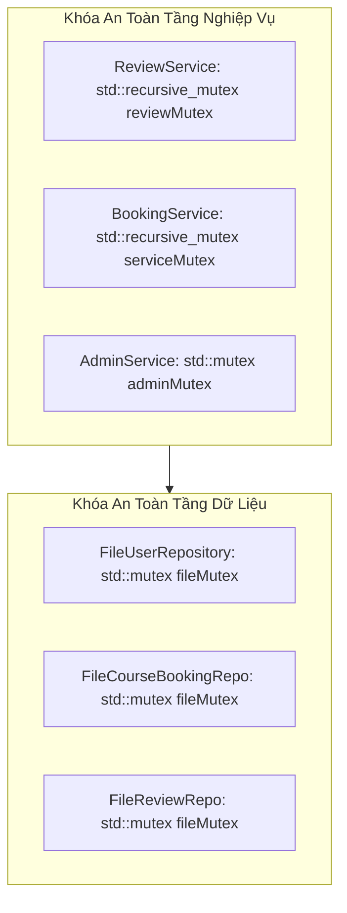

# BÁO CÁO CHẤT LƯỢNG PHẦN MỀM VÀ NỢ KỸ THUẬT (QUALITY FINDINGS & TECHNICAL DEBT)
## Đánh Giá Độ An Toàn Đa Luồng, Xử Lý Ngoại Lệ, Toàn Vẹn Dữ Liệu Và Danh Mục Nợ Kỹ Thuật

---

## 1. ĐÁNH GIÁ ĐỘ AN TOÀN ĐỒNG THỜI VÀ ĐA LUỒNG (THREAD SAFETY) `[VERIFIED]`

Hệ thống TutorMatch vận hành trên nền tảng Qt với giao diện đồ họa chạy trên luồng chính (Main GUI Thread / Event Loop) và các tác vụ có thể được điều phối đa luồng. Để ngăn chặn xung đột dữ liệu (Data Races) khi nhiều luồng cùng truy cập hoặc ghi đè lên các tệp dữ liệu phẳng, kiến trúc triển khai bảo vệ đa tầng:



### Các Đặc Điểm An Toàn Đa Luồng Đã Xác Minh:
1. **Khóa Đệ Quy (Recursive Mutex):** `ReviewService` và `BookingService` sử dụng `std::recursive_mutex` cho phép một luồng có thể gọi lại các phương thức nội bộ trong cùng một service (ví dụ `isEligibleForReview` được gọi bên trong `submitReview`) mà không gây hiện tượng tự khóa chết (Self-Deadlock).
2. **Khóa Tệp Phẳng Độc Lập:** Mỗi lớp `File...Repository` sở hữu một `std::mutex` độc lập, bảo vệ mọi thao tác đọc tệp vào RAM và tuần tự hóa ghi ra đĩa.
3. **Cảnh Báo Tiềm Ẩn (Potential Contention):** Khi `AdminService::terminateMatch` gọi sang `BookingService::cancelCourseBooking`, luồng thực thi nắm giữ `adminMutex` trước rồi mới yêu cầu `serviceMutex`. Thứ tự khóa cần được duy trì nhất quán trên toàn hệ thống để loại trừ nguy cơ Deadlock gián tiếp.

---

## 2. CƠ CHẾ XỬ LÝ NGOẠI LỆ VÀ BẢO TOÀN TRẠNG THÁI `[VERIFIED]`

### 2.1. Triết Lý Báo Lỗi Qua Tham Số Kết Quả (Result Pattern)
Thay vì ném ngoại lệ (`throw std::runtime_error`) vượt qua ranh giới C++ và QML có thể gây sập ứng dụng đột ngột (Unhandled Exception Crash), toàn bộ các Service và `GUIBridge` áp dụng khuôn mẫu truyền thông điệp lỗi:
```cpp
bool method(..., std::string& outMsg);
```
- Nếu thành công: Trả về `true`, `outMsg` chứa thông điệp phản hồi tích cực.
- Nếu thất bại: Trả về `false`, `outMsg` chứa nguyên nhân cụ thể bằng tiếng Việt để hiển thị trực tiếp lên Banner thông báo của QML (`statusMessage`).

### 2.2. Xử Lý Phòng Vệ Khi Phân Tích Dữ Liệu (Defensive Parsing)
Tại các bộ tuần tự hóa [`SerializerUtils`](file:///C:/Users/DELL/.gemini/antigravity/scratch/TutorMatch/include/data_access/serializers/SerializerUtils.h), mọi thao tác ép kiểu chuỗi sang số (`parseIntSafe`, `parseDoubleSafe`, `parseUInt64Safe`) đều được bọc trong khối `try-catch (...)`. Nếu dữ liệu trong tệp CSV bị lỗi định dạng hoặc rỗng, hệ thống âm thầm trả về giá trị mặc định an toàn (`0`, `0.0`, `0ULL`), ngăn chặn hoàn toàn lỗi sập do `std::invalid_argument` hoặc `std::out_of_range`.

---

## 3. DANH MỤC NỢ KỸ THUẬT (TECHNICAL DEBT CATALOG) `[VERIFIED]`

Bảng dưới đây phân loại toàn bộ các khoản nợ kỹ thuật tồn đọng trong mã nguồn TutorMatch, xếp theo thứ tự mức độ nghiêm trọng:

| Mã nợ | Tiêu đề nợ kỹ thuật | Vị trí mã nguồn cụ thể | Mức độ nghiêm trọng | Tác động hệ thống | Biện pháp xử lý đề xuất |
| :---: | :--- | :--- | :---: | :--- | :--- |
| **TD-01** | Lưu mật khẩu văn bản thô (Plaintext Password) | `AuthService.cpp:33`<br/>`User.h:22` | **CRITICAL** | Mặc dù trường tên `passwordHash` và có hàm băm `DateUtils::sha256`, việc so sánh và lưu trực tiếp chuỗi thô tạo rủi ro lộ mật khẩu nếu tệp `users.dat` bị truy cập trái phép. | Bọc `DateUtils::sha256()` tại điểm đăng ký và so sánh mã băm trong `AuthService::login`. |
| **TD-02** | Trùng lặp logic gửi Review trong `BookingService` (P1) | `BookingService.cpp:643-700` | **HIGH** | Vi phạm SRP, phân kỳ rating mặc định (5.0 vs 0.0), thiếu rollback đền bù ADR-007. | Xóa bỏ các phương thức review khỏi `BookingService`, ủy thác hoàn toàn cho `ReviewService`. |
| **TD-03** | Bộ điều hợp QML nguyên khối (Fat Adapter) | `GUIBridge.h`<br/>`GUIBridge.cpp` | **MEDIUM** | Hơn 60 phương thức `Q_INVOKABLE` gom trong một lớp duy nhất, vi phạm ISP và khó bảo trì khi mở rộng QML. | Phân rã thành 3 Controller nhỏ: `StudentController`, `TutorController`, `AdminController`. |
| **TD-04** | Cây phân cấp `User` thiếu đa hình (Anemic Subtype) | `User.h:38-80`<br/>Hơn 70 vị trí downcast | **MEDIUM** | Dẫn đến hơn 70 lần gọi `static_pointer_cast` và phụ thuộc cứng vào `enum class UserRole`, cản trở mở rộng vai trò mới (OCP). | Bổ sung các phương thức nghiệp vụ ảo lên lớp cha `User` để đa hình hóa hành vi. |
| **TD-05** | So sánh trạng thái khóa học bằng chuỗi literal | Rải rác tại các Services | **LOW** | So sánh `status == "ACCEPTED"` bằng chuỗi thuần tiềm ẩn lỗi chính tả (typo) và thiếu sự kiểm tra kiểu lúc biên dịch. | Thay thế bằng `enum class CourseBookingStatus` với hàm chuyển đổi chuỗi tập trung. |
| **TD-06** | Đóng cứng bộ lọc hợp lệ `isEligible` dạng static | `MatchingEngine.cpp:250-320` | **LOW** | Không thể mở rộng tiêu chí lọc gia sư mới (địa lý, chứng chỉ) mà không sửa mã nguồn của Engine. | Áp dụng Specification Pattern hoặc Chain of Filters cho các điều kiện lọc cứng. |
