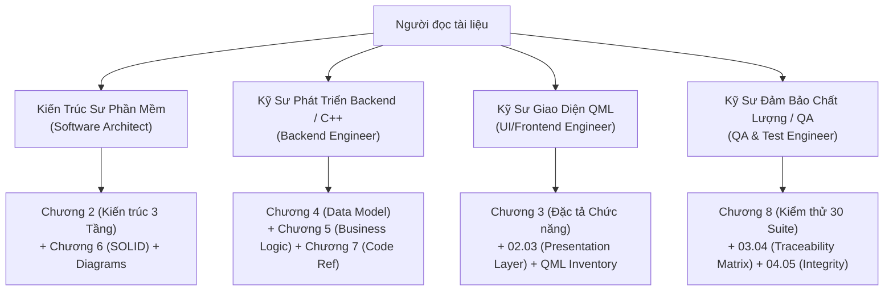

# TÀI LIỆU KỸ THUẬT HỆ THỐNG TUTORMATCH (SYSTEM TECHNICAL DOCUMENTATION)
## Cổng Thông Tin Toàn Diện Về Kiến Trúc, Đặc Tả Nghiệp Vụ, Mô Hình Dữ Liệu Và Đánh Giá Chất Lượng

---

## 1. GIỚI THIỆU TỔNG QUAN `[VERIFIED]`

Chào mừng bạn đến với bộ tài liệu kỹ thuật chính thức của dự án **TutorMatch** — Nền tảng kết nối gia sư và học sinh được phát triển bằng ngôn ngữ **C++17**, giao diện đồ họa **Qt Quick (QML)** trên nền tảng **Qt 6.11.2** và hệ thống lưu trữ tệp phẳng phân tán.

Bộ tài liệu này được xây dựng thông qua quy trình **Dò Mã Kỹ Thuật Đảo Ngược Toàn Diện (Complete System Reverse Engineering)**, khảo sát trực tiếp từng dòng mã nguồn, từng tệp dữ liệu hoạt động và 30 bộ kiểm thử tự động. Mỗi tuyên bố, quy tắc nghiệp vụ, giải thuật và thành phần kiến trúc đều có thể truy vết chính xác đến tệp tin, lớp và phương thức cụ thể trong kho mã nguồn.

---

## 2. HƯỚNG DẪN ĐỌC TÀI LIỆU THEO VAI TRÒ (READING PATHS) `[VERIFIED]`

Tùy theo mục đích công việc và vai trò chuyên môn, bạn có thể lựa chọn lộ trình đọc phù hợp nhất:

1. **Dành cho Kiến trúc sư Phần mềm (Software Architect):**
   - Khảo sát mô hình 3 tầng: [`docs/02_system_architecture/01_overall_architecture_VI.md`](file:///C:/Users/DELL/.gemini/antigravity/scratch/TutorMatch/docs/02_system_architecture/01_overall_architecture_VI.md)
   - Kiểm toán nguyên lý SOLID: [`docs/06_solid_analysis/06_class_level_solid_matrix_VI.md`](file:///C:/Users/DELL/.gemini/antigravity/scratch/TutorMatch/docs/06_solid_analysis/06_class_level_solid_matrix_VI.md)
   - Sơ đồ quan hệ kiến trúc: [`docs/diagrams/02_three_layer_architecture.mmd`](file:///C:/Users/DELL/.gemini/antigravity/scratch/TutorMatch/docs/diagrams/02_three_layer_architecture.mmd)
2. **Dành cho Kỹ sư Phát triển Backend / C++:**
   - Mô hình dữ liệu và từ điển: [`docs/04_data_and_database/02_data_dictionary_VI.md`](file:///C:/Users/DELL/.gemini/antigravity/scratch/TutorMatch/docs/04_data_and_database/02_data_dictionary_VI.md)
   - Thuật toán SmartMatch & Lịch 56 ca: [`docs/05_business_logic/03_smartmatch_engine_algorithm_VI.md`](file:///C:/Users/DELL/.gemini/antigravity/scratch/TutorMatch/docs/05_business_logic/03_smartmatch_engine_algorithm_VI.md) và [`docs/05_business_logic/05_weekly_timetable_and_schedule_guard_VI.md`](file:///C:/Users/DELL/.gemini/antigravity/scratch/TutorMatch/docs/05_business_logic/05_weekly_timetable_and_schedule_guard_VI.md)
   - Tham chiếu API C++: [`docs/07_code_reference/02_class_and_method_reference_VI.md`](file:///C:/Users/DELL/.gemini/antigravity/scratch/TutorMatch/docs/07_code_reference/02_class_and_method_reference_VI.md)
3. **Dành cho Kỹ sư Giao diện QML (Frontend Engineer):**
   - Đặc tả tính năng và luồng tương tác: [`docs/03_functional_specification/05_ui_navigation_and_interaction_flows_VI.md`](file:///C:/Users/DELL/.gemini/antigravity/scratch/TutorMatch/docs/03_functional_specification/05_ui_navigation_and_interaction_flows_VI.md)
   - Danh mục thuộc tính và phương thức Bridge: [`docs/02_system_architecture/03_presentation_layer_architecture_VI.md`](file:///C:/Users/DELL/.gemini/antigravity/scratch/TutorMatch/docs/02_system_architecture/03_presentation_layer_architecture_VI.md)
4. **Dành cho Kỹ sư Kiểm thử & Giám định Chất lượng (QA & Audit Engineer):**
   - Danh mục 30 Test Suites: [`docs/08_quality_and_testing/02_test_suites_inventory_VI.md`](file:///C:/Users/DELL/.gemini/antigravity/scratch/TutorMatch/docs/08_quality_and_testing/02_test_suites_inventory_VI.md)
   - Ma trận truy vết tính năng sang kiểm thử: [`docs/08_quality_and_testing/03_feature_to_test_coverage_mapping_VI.md`](file:///C:/Users/DELL/.gemini/antigravity/scratch/TutorMatch/docs/08_quality_and_testing/03_feature_to_test_coverage_mapping_VI.md)
   - Danh mục nợ kỹ thuật: [`docs/08_quality_and_testing/04_quality_findings_and_technical_debt_VI.md`](file:///C:/Users/DELL/.gemini/antigravity/scratch/TutorMatch/docs/08_quality_and_testing/04_quality_findings_and_technical_debt_VI.md)

---

## 3. MỤC LỤC CHI TIẾT 8 CHƯƠNG TÀI LIỆU (TABLE OF CONTENTS) `[VERIFIED]`

### [Chương 1: Giới Thiệu & Tổng Quan Sản Phẩm](file:///C:/Users/DELL/.gemini/antigravity/scratch/TutorMatch/docs/01_introduction/)
- [01.01. Tổng quan sản phẩm, tầm nhìn và bài toán giải quyết](file:///C:/Users/DELL/.gemini/antigravity/scratch/TutorMatch/docs/01_introduction/01_product_overview_VI.md)
- [01.02. Ngăn xếp công nghệ, thư viện phụ thuộc và môi trường build](file:///C:/Users/DELL/.gemini/antigravity/scratch/TutorMatch/docs/01_introduction/02_technology_stack_VI.md)
- [01.03. Thuật ngữ nghiệp vụ, định nghĩa và từ điển viết tắt](file:///C:/Users/DELL/.gemini/antigravity/scratch/TutorMatch/docs/01_introduction/03_terminology_and_glossary_VI.md)

### [Chương 2: Kiến Trúc Hệ Thống 3 Tầng](file:///C:/Users/DELL/.gemini/antigravity/scratch/TutorMatch/docs/02_system_architecture/)
- [02.01. Kiến trúc tổng thể 3 tầng và quy tắc phụ thuộc](file:///C:/Users/DELL/.gemini/antigravity/scratch/TutorMatch/docs/02_system_architecture/01_overall_architecture_VI.md)
- [02.02. Phân rã thành phần và cấu trúc thư mục mã nguồn](file:///C:/Users/DELL/.gemini/antigravity/scratch/TutorMatch/docs/02_system_architecture/02_component_and_directory_structure_VI.md)
- [02.03. Kiến trúc Tầng Trình Diễn (Presentation Layer & GUIBridge)](file:///C:/Users/DELL/.gemini/antigravity/scratch/TutorMatch/docs/02_system_architecture/03_presentation_layer_architecture_VI.md)
- [02.04. Kiến trúc Tầng Nghiệp Vụ (Business Logic Layer & Services)](file:///C:/Users/DELL/.gemini/antigravity/scratch/TutorMatch/docs/02_system_architecture/04_business_layer_architecture_VI.md)
- [02.05. Kiến trúc Tầng Truy Xuất Dữ Liệu (Data Access Layer & Repositories)](file:///C:/Users/DELL/.gemini/antigravity/scratch/TutorMatch/docs/02_system_architecture/05_data_access_layer_architecture_VI.md)
- [02.06. Vòng đời ứng dụng, Composition Root và quy trình khởi tạo](file:///C:/Users/DELL/.gemini/antigravity/scratch/TutorMatch/docs/02_system_architecture/06_application_lifecycle_and_composition_VI.md)

### [Chương 3: Đặc Tả Chức Năng Người Dùng](file:///C:/Users/DELL/.gemini/antigravity/scratch/TutorMatch/docs/03_functional_specification/)
- [03.01. Đặc tả chi tiết 12 tính năng của Học viên (STU-01 $\to$ STU-12)](file:///C:/Users/DELL/.gemini/antigravity/scratch/TutorMatch/docs/03_functional_specification/01_student_features_VI.md)
- [03.02. Đặc tả chi tiết 9 tính năng của Gia sư (TUT-01 $\to$ TUT-09)](file:///C:/Users/DELL/.gemini/antigravity/scratch/TutorMatch/docs/03_functional_specification/02_tutor_features_VI.md)
- [03.03. Đặc tả chi tiết 6 tính năng của Quản trị viên (ADM-01 $\to$ ADM-06)](file:///C:/Users/DELL/.gemini/antigravity/scratch/TutorMatch/docs/03_functional_specification/03_admin_features_VI.md)
- [03.04. Ma trận truy vết tính năng sang mã nguồn 8 cột hoàn chỉnh](file:///C:/Users/DELL/.gemini/antigravity/scratch/TutorMatch/docs/03_functional_specification/04_feature_to_code_traceability_matrix_VI.md)
- [03.05. Điều hướng giao diện người dùng và sơ đồ luồng tương tác](file:///C:/Users/DELL/.gemini/antigravity/scratch/TutorMatch/docs/03_functional_specification/05_ui_navigation_and_interaction_flows_VI.md)

### [Chương 4: Mô Hình Dữ Liệu & Lưu Trữ Tệp](file:///C:/Users/DELL/.gemini/antigravity/scratch/TutorMatch/docs/04_data_and_database/)
- [04.01. Tổng quan cơ chế lưu trữ tệp phẳng phân tán (.dat)](file:///C:/Users/DELL/.gemini/antigravity/scratch/TutorMatch/docs/04_data_and_database/01_file_storage_overview_VI.md)
- [04.02. Từ điển dữ liệu toàn diện (User, Student, Tutor, Admin, Booking, Review)](file:///C:/Users/DELL/.gemini/antigravity/scratch/TutorMatch/docs/04_data_and_database/02_data_dictionary_VI.md)
- [04.03. Mô hình khái niệm, mô hình logic và mô hình vật lý](file:///C:/Users/DELL/.gemini/antigravity/scratch/TutorMatch/docs/04_data_and_database/03_conceptual_logical_physical_models_VI.md)
- [04.04. Mối quan hệ giữa các thực thể và bản số lực lượng (Cardinality)](file:///C:/Users/DELL/.gemini/antigravity/scratch/TutorMatch/docs/04_data_and_database/04_entity_relationships_and_cardinality_VI.md)
- [04.05. Quy tắc toàn vẹn dữ liệu, kiểm định và bất biến hệ thống](file:///C:/Users/DELL/.gemini/antigravity/scratch/TutorMatch/docs/04_data_and_database/05_data_integrity_and_validation_VI.md)

### [Chương 5: Logic Nghiệp Vụ & Giải Thuật Cốt Lõi](file:///C:/Users/DELL/.gemini/antigravity/scratch/TutorMatch/docs/05_business_logic/)
- [05.01. Logic nghiệp vụ xác thực tài khoản và phân quyền người dùng](file:///C:/Users/DELL/.gemini/antigravity/scratch/TutorMatch/docs/05_business_logic/01_authentication_and_authorization_VI.md)
- [05.02. Cơ chế tìm kiếm và đánh giá độ tương đồng gia sư (TutorSearchMatcher)](file:///C:/Users/DELL/.gemini/antigravity/scratch/TutorMatch/docs/05_business_logic/02_tutor_search_engine_logic_VI.md)
- [05.03. Thuật toán gợi ý thông minh SmartMatch hai giai đoạn và Max-Heap](file:///C:/Users/DELL/.gemini/antigravity/scratch/TutorMatch/docs/05_business_logic/03_smartmatch_engine_algorithm_VI.md)
- [05.04. Máy trạng thái vòng đời khóa học, cam kết V1 và đồng thuận hủy sớm](file:///C:/Users/DELL/.gemini/antigravity/scratch/TutorMatch/docs/05_business_logic/04_course_booking_lifecycle_state_machine_VI.md)
- [05.05. Quản lý thời khóa biểu và bảo vệ lịch ScheduleGuard (Bitmask 56 ca)](file:///C:/Users/DELL/.gemini/antigravity/scratch/TutorMatch/docs/05_business_logic/05_weekly_timetable_and_schedule_guard_VI.md)
- [05.06. Đánh giá, tính toán xếp hạng sao và tự phục hồi dữ liệu ADR-007](file:///C:/Users/DELL/.gemini/antigravity/scratch/TutorMatch/docs/05_business_logic/06_reviews_ratings_and_reconciliation_VI.md)
- [05.07. Quy trình quản trị, khóa tài khoản và kiểm duyệt hệ thống](file:///C:/Users/DELL/.gemini/antigravity/scratch/TutorMatch/docs/05_business_logic/07_admin_moderation_workflows_VI.md)

### [Chương 6: Kiểm Toán Nguyên Lý Thiết Kế SOLID](file:///C:/Users/DELL/.gemini/antigravity/scratch/TutorMatch/docs/06_solid_analysis/)
- [06.01. Phân tích Nguyên lý Đơn trách nhiệm (Single Responsibility - SRP)](file:///C:/Users/DELL/.gemini/antigravity/scratch/TutorMatch/docs/06_solid_analysis/01_single_responsibility_principle_srp_VI.md)
- [06.02. Đánh giá Nguyên lý Đóng/Mở (Open/Closed - OCP)](file:///C:/Users/DELL/.gemini/antigravity/scratch/TutorMatch/docs/06_solid_analysis/02_open_closed_principle_ocp_VI.md)
- [06.03. Đánh giá Nguyên lý Thay thế Liskov (Liskov Substitution - LSP)](file:///C:/Users/DELL/.gemini/antigravity/scratch/TutorMatch/docs/06_solid_analysis/03_liskov_substitution_principle_lsp_VI.md)
- [06.04. Đánh giá Nguyên lý Phân tách Giao diện (Interface Segregation - ISP)](file:///C:/Users/DELL/.gemini/antigravity/scratch/TutorMatch/docs/06_solid_analysis/04_interface_segregation_principle_isp_VI.md)
- [06.05. Đánh giá Nguyên lý Nghịch đảo Phụ thuộc (Dependency Inversion - DIP)](file:///C:/Users/DELL/.gemini/antigravity/scratch/TutorMatch/docs/06_solid_analysis/05_dependency_inversion_principle_dip_VI.md)
- [06.06. Ma trận đánh giá nguyên lý SOLID ở cấp độ lớp cho 25 lớp](file:///C:/Users/DELL/.gemini/antigravity/scratch/TutorMatch/docs/06_solid_analysis/06_class_level_solid_matrix_VI.md)
- [06.07. Phân tích liên nguyên lý và bản đồ nguyên nhân gốc rễ](file:///C:/Users/DELL/.gemini/antigravity/scratch/TutorMatch/docs/06_solid_analysis/07_cross_principle_root_cause_analysis_VI.md)
- [06.08. Lộ trình và kế hoạch tái cấu trúc kiến trúc tối thiểu (P1 $\to$ P3)](file:///C:/Users/DELL/.gemini/antigravity/scratch/TutorMatch/docs/06_solid_analysis/08_minimal_refactoring_roadmap_VI.md)

### [Chương 7: Tra Cứu Mã Nguồn Toàn Diện](file:///C:/Users/DELL/.gemini/antigravity/scratch/TutorMatch/docs/07_code_reference/)
- [07.01. Danh mục tài sản toàn bộ repository (33 Headers, 25 Sources, 27 QML)](file:///C:/Users/DELL/.gemini/antigravity/scratch/TutorMatch/docs/07_code_reference/01_complete_repository_inventory_VI.md)
- [07.02. Tài liệu tham chiếu lớp và phương thức đầy đủ chữ ký](file:///C:/Users/DELL/.gemini/antigravity/scratch/TutorMatch/docs/07_code_reference/02_class_and_method_reference_VI.md)
- [07.03. Chỉ mục điều hướng mã nguồn nhanh theo tính năng và ký hiệu](file:///C:/Users/DELL/.gemini/antigravity/scratch/TutorMatch/docs/07_code_reference/03_source_code_navigation_index_VI.md)

### [Chương 8: Chất Lượng, Nợ Kỹ Thuật & Kiểm Thử](file:///C:/Users/DELL/.gemini/antigravity/scratch/TutorMatch/docs/08_quality_and_testing/)
- [08.01. Kiến trúc và hạ tầng kiểm thử độc lập thư viện ngoài](file:///C:/Users/DELL/.gemini/antigravity/scratch/TutorMatch/docs/08_quality_and_testing/01_test_architecture_and_infrastructure_VI.md)
- [08.02. Danh mục 30 bộ kiểm thử tự động (Test Suites Inventory)](file:///C:/Users/DELL/.gemini/antigravity/scratch/TutorMatch/docs/08_quality_and_testing/02_test_suites_inventory_VI.md)
- [08.03. Ma trận độ bao phủ tính năng và kiểm thử tự động](file:///C:/Users/DELL/.gemini/antigravity/scratch/TutorMatch/docs/08_quality_and_testing/03_feature_to_test_coverage_mapping_VI.md)
- [08.04. Báo cáo chất lượng phần mềm, an toàn đa luồng và nợ kỹ thuật](file:///C:/Users/DELL/.gemini/antigravity/scratch/TutorMatch/docs/08_quality_and_testing/04_quality_findings_and_technical_debt_VI.md)
- [08.05. Báo cáo tổng kết tái thiết toàn bộ tài liệu kỹ thuật](file:///C:/Users/DELL/.gemini/antigravity/scratch/TutorMatch/docs/08_quality_and_testing/DOCUMENTATION_REBUILD_REPORT_VI.md)

---

## 4. BẢN ĐỒ VÀ MỤC LỤC BIỂU ĐỒ MERMAID (DIAGRAM INDEX & READING GUIDE) `[VERIFIED]`

Hệ thống tài liệu TutorMatch áp dụng **mô hình tài liệu trực quan kép (Dual-Mode Visual Documentation)**:
- **Nguồn chân lý độc lập (Canonical Sources):** 20 tệp `.mmd` chuẩn hóa được lưu trữ độc lập trong thư mục [`docs/diagrams/`](file:///C:/Users/DELL/.gemini/antigravity/scratch/TutorMatch/docs/diagrams/).
- **Nhúng ngữ cảnh trực tiếp (In-Context Embedded):** Toàn bộ 20 biểu đồ đã được nhúng trực tiếp bằng khối mã Mermaid vào đúng các báo cáo Markdown tương ứng, kèm theo lời dẫn ngữ cảnh và phần phân tích diễn giải kỹ thuật chi tiết.
- **Báo cáo chỉ mục tích hợp toàn diện:** Xem [`docs/diagrams/DIAGRAM_INTEGRATION_INDEX_VI.md`](file:///C:/Users/DELL/.gemini/antigravity/scratch/TutorMatch/docs/diagrams/DIAGRAM_INTEGRATION_INDEX_VI.md).

### Bảng Điều Hướng Nhanh 20 Biểu Đồ và Vị Trí Nhúng Trong Báo Cáo:

| STT | Mã | Tên Biểu Đồ | Tệp Mermaid Gốc | Báo Cáo Chuyên Sâu Đã Nhúng |
| :---: | :---: | :--- | :--- | :--- |
| 1 | **01** | Bối cảnh Hệ thống (System Context) | [`01_system_context.mmd`](file:///C:/Users/DELL/.gemini/antigravity/scratch/TutorMatch/docs/diagrams/01_system_context.mmd) | [01.01. Tổng quan sản phẩm (§1.1)](file:///C:/Users/DELL/.gemini/antigravity/scratch/TutorMatch/docs/01_introduction/01_product_overview_VI.md#11-sơ-đồ-bối-cảnh-hệ-thống-system-context-diagram) |
| 2 | **02** | Kiến trúc Ba Tầng (Strict 3-Layer) | [`02_three_layer_architecture.mmd`](file:///C:/Users/DELL/.gemini/antigravity/scratch/TutorMatch/docs/diagrams/02_three_layer_architecture.mmd) | [02.01. Kiến trúc tổng thể 3 tầng (§1.1)](file:///C:/Users/DELL/.gemini/antigravity/scratch/TutorMatch/docs/02_system_architecture/01_overall_architecture_VI.md#11-sơ-đồ-kiến-trúc-ba-tầng-chi-tiết-three-layer-architecture-diagram) |
| 3 | **03** | Cấu trúc Thư mục và Module | [`03_directory_module_structure.mmd`](file:///C:/Users/DELL/.gemini/antigravity/scratch/TutorMatch/docs/diagrams/03_directory_module_structure.mmd) | [02.02. Cấu trúc thư mục mã nguồn (§1.1)](file:///C:/Users/DELL/.gemini/antigravity/scratch/TutorMatch/docs/02_system_architecture/02_component_and_directory_structure_VI.md#11-sơ-đồ-phân-cấp-thư-mục-và-phân-chia-module-directory-and-module-structure-diagram) |
| 4 | **04** | Máy Trạng thái Điều hướng GUI | [`04_gui_navigation_state_machine.mmd`](file:///C:/Users/DELL/.gemini/antigravity/scratch/TutorMatch/docs/diagrams/04_gui_navigation_state_machine.mmd) | [02.03. Tầng Trình Diễn & GUIBridge (§1.1)](file:///C:/Users/DELL/.gemini/antigravity/scratch/TutorMatch/docs/02_system_architecture/03_presentation_layer_architecture_VI.md#11-sơ-đồ-điều-hướng-và-máy-trạng-thái-giao-diện-gui-navigation-and-state-machine-diagram) |
| 5 | **05** | Tuần tự Khởi động Ứng dụng | [`05_application_startup_sequence.mmd`](file:///C:/Users/DELL/.gemini/antigravity/scratch/TutorMatch/docs/diagrams/05_application_startup_sequence.mmd) | [02.06. Vòng đời ứng dụng & Composition (§1.1)](file:///C:/Users/DELL/.gemini/antigravity/scratch/TutorMatch/docs/02_system_architecture/06_application_lifecycle_and_composition_VI.md#11-sơ-đồ-tuần-tự-khởi-tạo-và-chu-trình-sống-của-ứng-dụng-application-startup-sequence-diagram) |
| 6 | **06** | Tuần tự Gọi Xuyên Tầng Chuẩn | [`06_guibridge_service_repo_sequence.mmd`](file:///C:/Users/DELL/.gemini/antigravity/scratch/TutorMatch/docs/diagrams/06_guibridge_service_repo_sequence.mmd) | [02.03. Tầng Trình Diễn & GUIBridge (§2.4)](file:///C:/Users/DELL/.gemini/antigravity/scratch/TutorMatch/docs/02_system_architecture/03_presentation_layer_architecture_VI.md#24-sơ-đồ-tuần-tự-gọi-xuyên-tầng-chuẩn-standard-cross-layer-call-sequence-diagram) |
| 7 | **07** | Phân cấp Kế thừa Lớp Người dùng | [`07_user_class_hierarchy.mmd`](file:///C:/Users/DELL/.gemini/antigravity/scratch/TutorMatch/docs/diagrams/07_user_class_hierarchy.mmd) | [02.04. Tầng Nghiệp Vụ & Services (§3.1)](file:///C:/Users/DELL/.gemini/antigravity/scratch/TutorMatch/docs/02_system_architecture/04_business_layer_architecture_VI.md#31-sơ-đồ-phân-cấp-kế-thừa-lớp-người-dùng-user-class-hierarchy-and-polymorphism-diagram) |
| 8 | **08** | Thực thể Miền Khóa học & Review | [`08_course_booking_domain_model.mmd`](file:///C:/Users/DELL/.gemini/antigravity/scratch/TutorMatch/docs/diagrams/08_course_booking_domain_model.mmd) | [05.04. Vòng đời khóa học & Cam kết V1 (§1.1)](file:///C:/Users/DELL/.gemini/antigravity/scratch/TutorMatch/docs/05_business_logic/04_course_booking_lifecycle_state_machine_VI.md#11-sơ-đồ-mô-hình-thực-thể-miền-khóa-học-và-đánh-giá-coursebooking-and-review-domain-entities-diagram) |
| 9 | **09** | Kiến trúc Kho Lưu trữ & Serializers | [`09_repository_architecture.mmd`](file:///C:/Users/DELL/.gemini/antigravity/scratch/TutorMatch/docs/diagrams/09_repository_architecture.mmd) | [02.05. Tầng Truy Xuất Dữ Liệu (§1.1)](file:///C:/Users/DELL/.gemini/antigravity/scratch/TutorMatch/docs/02_system_architecture/05_data_access_layer_architecture_VI.md#11-sơ-đồ-cấu-trúc-kho-lưu-trữ-và-tuần-tự-hóa-repository-architecture-and-serialization-diagram) |
| 10 | **10** | Kiến trúc Động cơ SmartMatch | [`10_matching_engine_architecture.mmd`](file:///C:/Users/DELL/.gemini/antigravity/scratch/TutorMatch/docs/diagrams/10_matching_engine_architecture.mmd) | [05.03. Thuật toán SmartMatch & Max-Heap (§1.1)](file:///C:/Users/DELL/.gemini/antigravity/scratch/TutorMatch/docs/05_business_logic/03_smartmatch_engine_algorithm_VI.md#11-sơ-đồ-kiến-trúc-động-cơ-ghép-nối-và-cấu-trúc-thuật-toán-matching-engine-architecture-diagram) |
| 11 | **11** | Tuần tự Học viên Đăng ký Khóa học | [`11_student_course_registration_sequence.mmd`](file:///C:/Users/DELL/.gemini/antigravity/scratch/TutorMatch/docs/diagrams/11_student_course_registration_sequence.mmd) | [03.01. Đặc tả tính năng Học viên (§2.3.1)](file:///C:/Users/DELL/.gemini/antigravity/scratch/TutorMatch/docs/03_functional_specification/01_student_features_VI.md#231-sơ-đồ-tuần-tự-đăng-ký-khóa-học-và-xác-nhận-cam-kết-student-course-registration-sequence-diagram) |
| 12 | **12** | Tuần tự Gia sư Duyệt Khóa học | [`12_tutor_booking_approval_sequence.mmd`](file:///C:/Users/DELL/.gemini/antigravity/scratch/TutorMatch/docs/diagrams/12_tutor_booking_approval_sequence.mmd) | [03.02. Đặc tả tính năng Gia sư (§2.3.1)](file:///C:/Users/DELL/.gemini/antigravity/scratch/TutorMatch/docs/03_functional_specification/02_tutor_features_VI.md#231-sơ-đồ-tuần-tự-gia-sư-duyệt-khóa-học-và-đồng-thuận-cam-kết-tutor-booking-approval-sequence-diagram) |
| 13 | **13** | Máy Trạng thái Khóa học Toàn diện | [`13_course_booking_state_machine.mmd`](file:///C:/Users/DELL/.gemini/antigravity/scratch/TutorMatch/docs/diagrams/13_course_booking_state_machine.mmd) | [05.04. Vòng đời khóa học & Cam kết V1 (§2.1)](file:///C:/Users/DELL/.gemini/antigravity/scratch/TutorMatch/docs/05_business_logic/04_course_booking_lifecycle_state_machine_VI.md#21-sơ-đồ-máy-trạng-thái-vòng-đời-khóa-học-toàn-diện-course-booking-lifecycle-state-machine-diagram) |
| 14 | **14** | Kiểm tra Va chạm Thời khóa biểu 56 Ca | [`14_scheduling_conflict_activity.mmd`](file:///C:/Users/DELL/.gemini/antigravity/scratch/TutorMatch/docs/diagrams/14_scheduling_conflict_activity.mmd) | [05.05. Quản lý lịch ScheduleGuard (§5.1)](file:///C:/Users/DELL/.gemini/antigravity/scratch/TutorMatch/docs/05_business_logic/05_weekly_timetable_and_schedule_guard_VI.md#51-sơ-đồ-hoạt-động-kiểm-tra-va-chạm-lịch-bằng-mặt-nạ-nhị-phân-56-ca-scheduling-conflict-activity-diagram) |
| 15 | **15** | Gửi Đánh giá & Bồi hoàn ADR-007 | [`15_review_submission_rollback_sequence.mmd`](file:///C:/Users/DELL/.gemini/antigravity/scratch/TutorMatch/docs/diagrams/15_review_submission_rollback_sequence.mmd) | [05.06. Đánh giá & Phục hồi ADR-007 (§3.1)](file:///C:/Users/DELL/.gemini/antigravity/scratch/TutorMatch/docs/05_business_logic/06_reviews_ratings_and_reconciliation_VI.md#31-sơ-đồ-tuần-tự-gửi-đánh-giá-và-cơ-chế-bồi-hoàn-giao-dịch-adr-007-review-submission-with-compensating-rollback-diagram) |
| 16 | **16** | Mô hình Thực thể Khái niệm (ERD) | [`16_conceptual_erd.mmd`](file:///C:/Users/DELL/.gemini/antigravity/scratch/TutorMatch/docs/diagrams/16_conceptual_erd.mmd) | [04.03. Mô hình Khái niệm, Logic, Vật lý (§1.1)](file:///C:/Users/DELL/.gemini/antigravity/scratch/TutorMatch/docs/04_data_and_database/03_conceptual_logical_physical_models_VI.md#11-sơ-đồ-thực-thể-liên-kết-mức-khái-niệm-conceptual-entity-relationship-diagram) |
| 17 | **17** | Mô hình Thực thể Logic (ERD) | [`17_logical_erd.mmd`](file:///C:/Users/DELL/.gemini/antigravity/scratch/TutorMatch/docs/diagrams/17_logical_erd.mmd) | [04.04. Quan hệ thực thể & Cardinality (§1.1)](file:///C:/Users/DELL/.gemini/antigravity/scratch/TutorMatch/docs/04_data_and_database/04_entity_relationships_and_cardinality_VI.md#11-sơ-đồ-thực-thể-liên-kết-mức-logic-logical-entity-relationship-diagram) |
| 18 | **18** | Bố cục Lưu trữ Tệp Vật lý (.dat) | [`18_physical_storage_diagram.mmd`](file:///C:/Users/DELL/.gemini/antigravity/scratch/TutorMatch/docs/diagrams/18_physical_storage_diagram.mmd) | [04.01. Tổng quan lưu trữ tệp phẳng (§1.1)](file:///C:/Users/DELL/.gemini/antigravity/scratch/TutorMatch/docs/04_data_and_database/01_file_storage_overview_VI.md#11-sơ-đồ-cấu-trúc-bản-ghi-vật-lý-và-liên-kết-tệp-dữ-liệu-physical-storage-diagram) |
| 19 | **19** | Luồng Dữ liệu Hệ thống (DFD) | [`19_data_flow_diagram.mmd`](file:///C:/Users/DELL/.gemini/antigravity/scratch/TutorMatch/docs/diagrams/19_data_flow_diagram.mmd) | [02.01. Kiến trúc tổng thể 3 tầng (§5)](file:///C:/Users/DELL/.gemini/antigravity/scratch/TutorMatch/docs/02_system_architecture/01_overall_architecture_VI.md#5-sơ-đồ-luồng-dữ-liệu-hệ-thống-data-flow-diagram---dfd) |
| 20 | **20** | Bản đồ Nguyên nhân Gốc rễ SOLID | [`20_solid_dependency_root_cause.mmd`](file:///C:/Users/DELL/.gemini/antigravity/scratch/TutorMatch/docs/diagrams/20_solid_dependency_root_cause.mmd) | [06.07. Phân tích liên nguyên lý SOLID (§1.1)](file:///C:/Users/DELL/.gemini/antigravity/scratch/TutorMatch/docs/06_solid_analysis/07_cross_principle_root_cause_analysis_VI.md#11-sơ-đồ-bản-đồ-nguyên-nhân-gốc-rễ-và-tuân-thủ-các-nguyên-lý-solid-solid-compliance-and-root-cause-map-diagram) |
