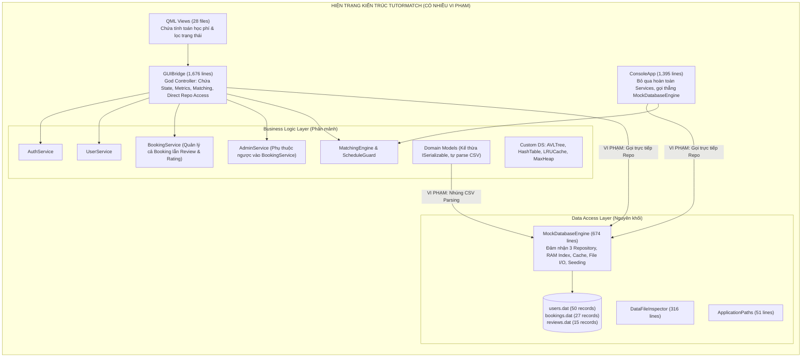
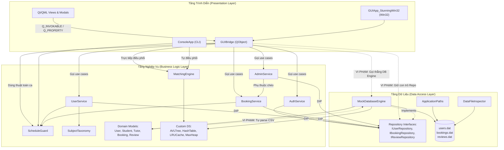

# BÁO CÁO KIỂM TOÁN KIẾN TRÚC HIỆN TẠI (PHASE 0: SOURCE CODE FORENSIC AUDIT)
## ĐÁNH GIÁ HIỆN TRẠNG & ĐỀ XUẤT TÁI CẤU TRÚC KIẾN TRÚC 3 LỚP (THREE-LAYER ARCHITECTURE)
### DỰ ÁN: HỆ THỐNG KẾT NỐI GIA SƯ TUTORMATCH (C++17 / QT 6.11 / QML)

---

## THÔNG TIN KIỂM TOÁN
- **Dự án:** TutorMatch (Hệ thống kết nối và quản lý học gia sư).
- **Giai đoạn:** Phase 0 — Forensic Audit & Architectural Assessment (Chế độ CHỈ ĐỌC - Không sửa đổi mã nguồn).
- **Kiến trúc sư phụ trách:** Senior C++ Software Architect & Software Refactoring Engineer.
- **Ngày thực hiện:** Tháng 11 / 2026.
- **Mục tiêu:** Khảo sát toàn diện mã nguồn thực tế, lập danh mục trách nhiệm lớp, kiểm toán truy cập tệp (File I/O), bóc tách các điểm rò rỉ logic nghiệp vụ vào giao diện (QML / GUIBridge), xây dựng biểu đồ phụ thuộc và đề xuất phương án chuyển đổi sạch sang **Kiến trúc 3 Lớp (Three-Layer Architecture)** đạt chuẩn đồ án học thuật.

---

## 1. TỔNG QUAN KIẾN TRÚC HIỆN TẠI (CURRENT ARCHITECTURE OVERVIEW)

### 1.1. Bối cảnh Lịch sử và Sự Tiến hóa của Hệ thống
Dự án **TutorMatch** được xây dựng với mục tiêu kết nối học viên và gia sư dựa trên các thuật toán tối ưu và cấu trúc dữ liệu tự xây dựng (Custom Data Structures & Algorithms). Trong quá trình phát triển qua các phiên bản:
1. **Phiên bản 1 (CLI Monolith):** Hệ thống khởi đầu với giao diện dòng lệnh `ConsoleApp` kết hợp trực tiếp với một bộ máy cơ sở dữ liệu giả lập `MockDatabaseEngine`.
2. **Phiên bản 2 (Win32 Native & Qt/QML GUI):** Ứng dụng được mở rộng bổ sung giao diện đồ họa. `GUIBridge` được tạo ra như một bộ điều khiển trung gian kết nối giữa QML và backend C++. Một số dịch vụ nghiệp vụ (`AuthService`, `UserService`, `BookingService`, `AdminService`) và giao diện Repository (`IUserRepository`, `IBookingRepository`, `IReviewRepository`) đã được phân tách sơ bộ nhằm đáp ứng nguyên lý SOLID.
3. **Hiện trạng Kiến trúc:** Mặc dù đã có các thư mục `models/`, `services/`, `storage/`, `gui/`, nhưng **ranh giới 3 lớp chưa được phân định rõ ràng và tồn tại nhiều vi phạm kiến trúc nghiêm trọng**:
   - Tầng Trình diễn (`GUIBridge`) đóng vai trò một "God Controller" phình to (1.676 dòng mã), nắm giữ trực tiếp các interface Repository của tầng Dữ liệu, tự quản lý biến hoa hồng nền tảng, tự điều phối thuật toán SmartMatch và tự tính toán thống kê.
   - Giao diện dòng lệnh (`ConsoleApp`) hoàn toàn bỏ qua tầng Nghiệp vụ (Services), kết nối trực tiếp với đối tượng cụ thể `MockDatabaseEngine`.
   - Các thực thể miền (`User`, `Student`, `Tutor`, `Booking`, `Review`) bị gắn chặt với tầng Dữ liệu khi kế thừa `ISerializable` và tự đảm nhận việc phân tích cú pháp chuỗi CSV (`serialize`/`deserialize`).
   - Tầng Dữ liệu (`MockDatabaseEngine`) là một "God Object" vừa quản lý tệp phẳng vừa tích hợp cây AVL, bảng băm RAM Index, bộ nhớ đệm LRU Cache, và chứa cả logic gieo dữ liệu mặc định.

### 1.2. Đánh giá Theo Tiêu chuẩn Kiến trúc 3 Lớp (Three-Layer Architecture)



---

## 2. CẤU TRÚC THƯ MỤC VÀ TỆP MÃ NGUỒN HIỆN HỮU (EXISTING PROJECT STRUCTURE)

### 2.1. Danh mục Tệp C++ Header (`include/`)
Dự án hiện có 22 tệp header trong thư mục `include/`:

| Tệp Header | Số dòng | Không gian tên | Mục đích hiện tại |
| :--- | :---: | :--- | :--- |
| `include/algorithms/IMatchingStrategy.h` | 53 | `TutorMatch` | Interface cho Strategy Matching đa tiêu chí & struct `TutorMatchResult`. |
| `include/algorithms/MatchingEngine.h` | 37 | `TutorMatch` | Lớp `MatchingEngine` và chiến lược `WeightedScoreMatchingStrategy`. |
| `include/ds/AVLTree.h` | 218 | `TutorMatch` | Cây AVL tự cân bằng đa giá trị (dùng cho chỉ mục giá và rating). |
| `include/ds/DoublyLinkedList.h` | 107 | `TutorMatch` | Danh sách liên kết đôi (dùng làm backbone cho LRUCache). |
| `include/ds/HashTable.h` | 108 | `TutorMatch` | Bảng băm đóng địa chỉ mở (dùng cho RAM Index và LRUCache). |
| `include/ds/LRUCache.h` | 73 | `TutorMatch` | Bộ nhớ đệm LRU kết hợp HashTable và DoublyLinkedList. |
| `include/ds/MaxHeap.h` | 80 | `TutorMatch` | Hàng đợi ưu tiên Max-Heap trích xuất Top-K gia sư. |
| `include/ds/ScheduleGuard.h` | 71 | `TutorMatch` | Quản lý thời khóa biểu 56 ca học qua Bitmask 64-bit. |
| `include/gui/GUIBridge.h` | 179 | `TutorMatch` | QObject Bridge trung gian kết nối QML với Backend. |
| `include/models/Booking.h` | 29 | `TutorMatch` | Struct thực thể đơn đặt lịch khóa học. |
| `include/models/Review.h` | 26 | `TutorMatch` | Struct thực thể đánh giá và phản hồi học tập. |
| `include/models/SubjectTaxonomy.h` | 42 | `TutorMatch` | Phân loại môn học, chuẩn hóa tiếng Việt, tính điểm tương đồng. |
| `include/models/User.h` | 166 | `TutorMatch` | Các lớp `User`, `Student`, `Tutor`, `Admin`, enum `UserRole`, `ISerializable`. |
| `include/services/AdminService.h` | 53 | `TutorMatch` | Nghiệp vụ quản trị viên, duyệt gia sư, khóa tài khoản, tính doanh thu. |
| `include/services/AuthService.h` | 39 | `TutorMatch` | Nghiệp vụ đăng nhập, đăng xuất, phiên làm việc, đăng ký tài khoản. |
| `include/services/BookingService.h` | 59 | `TutorMatch` | Nghiệp vụ đặt lịch, duyệt, hủy, kết thúc, xung đột ca học, đánh giá. |
| `include/services/UserService.h` | 41 | `TutorMatch` | Nghiệp vụ hồ sơ cá nhân, đổi ca học rảnh, tìm kiếm gia sư. |
| `include/storage/ApplicationPaths.h` | 21 | `TutorMatch` | Hàm định vị đường dẫn thư mục `data/`. |
| `include/storage/DataFileInspector.h` | 41 | `TutorMatch` | Công cụ chẩn đoán định dạng các tệp `.dat`. |
| `include/storage/IRepository.h` | 75 | `TutorMatch` | Interface `IUserRepository`, `IBookingRepository`, `IReviewRepository`. |
| `include/storage/MockDatabaseEngine.h` | 82 | `TutorMatch` | Lớp triển khai cụ thể cả 3 repository interface trên tệp phẳng. |
| `include/ui/ConsoleApp.h` | 69 | `TutorMatch` | Lớp điều khiển giao diện dòng lệnh Console CLI. |

### 2.2. Danh mục Tệp C++ Source (`src/`)
Dự án có 18 tệp nguồn trong thư mục `src/`:

| Tệp Source | Số dòng | Module | Trách nhiệm chính |
| :--- | :---: | :--- | :--- |
| `src/main.cpp` | 106 | App Bootstrap | Entry point cho `TutorMatch_CLI.exe`. Chạy unit test cấu trúc dữ liệu và khởi chạy `ConsoleApp`. |
| `src/gui/main.cpp` | 82 | App Bootstrap | Entry point cho `TutorMatch_GUI.exe`. Khởi tạo Qt QML Engine, nạp `MockDatabaseEngine` và `GUIBridge`. |
| `src/gui/main_gui.cpp` | 32 | App Bootstrap | Entry point cho bản thử nghiệm Win32 Native (`RunDesktopGUIApp`). |
| `src/gui/GUIApp_StunningWin32.cpp` | 798 | Legacy GUI | Giao diện cửa sổ Win32 API thuần túy (không dùng QML). |
| `src/gui/GUIBridge.cpp` | 1.676 | Presentation | Triển khai toàn bộ kết nối giữa QML và C++, chuyển đổi QVariant, điều phối dữ liệu. |
| `src/models/SubjectTaxonomy.cpp` | 224 | Domain / Model | Chuẩn hóa chuỗi tiếng Việt, bỏ dấu, tách lớp học, chấm điểm chuyên môn. |
| `src/models/User.cpp` | 275 | Model / Persistence | Triển khai serialize/deserialize CSV cho `User`, `Student`, `Tutor`, `Admin`, `Booking`, `Review`. |
| `src/ds/ScheduleGuard.cpp` | 40 | Algorithms / DS | Định nghĩa tên thứ và 8 khung giờ chuẩn hóa của hệ thống. |
| `src/algorithms/MatchingEngine.cpp` | 56 | Algorithms | Tính điểm đa tiêu chí và trích xuất Top-K bằng `MaxHeap`. |
| `src/services/AuthService.cpp` | 87 | Business Services | Xử lý đăng nhập, mật khẩu, đăng ký học viên và gia sư. |
| `src/services/UserService.cpp` | 178 | Business Services | Quản lý hồ sơ, cập nhật ca rảnh, tìm kiếm gia sư tuyến tính. |
| `src/services/BookingService.cpp` | 417 | Business Services | Kiểm tra xung đột ca học đối xứng, quản lý vòng đời đơn đặt lịch, tính rating. |
| `src/services/AdminService.cpp` | 170 | Business Services | Tính GMV, hoa hồng, lọc người dùng, duyệt gia sư, hủy ghép nối. |
| `src/storage/ApplicationPaths.cpp` | 51 | Storage Infra | Quét tìm thư mục `data/` trong các cấp thư mục dự án. |
| `src/storage/DataFileInspector.cpp` | 316 | Storage Diagnostic | Đọc và kiểm tra tính hợp lệ từng trường trong 3 tệp dữ liệu. |
| `src/storage/MockDatabaseEngine.cpp` | 674 | Storage DAL | Thực thi toàn bộ I/O trên `users.dat`, `bookings.dat`, `reviews.dat`. |
| `src/tools/inspect_main.cpp` | 58 | Tool CLI | Entry point cho `TutorMatch_Inspector.exe`. |
| `src/ui/ConsoleApp.cpp` | 1.395 | Presentation CLI | Triển khai toàn bộ màn hình tương tác menu dòng lệnh. |

### 2.3. Danh mục Tệp Giao diện QML (`ui/qml/`)
Toàn bộ 28 tệp QML đặt tại `ui/qml/`:

| Nhóm Giao diện | Danh sách Tệp QML | Vai trò hiển thị |
| :--- | :--- | :--- |
| **Theme & Khung chính** | `Theme.qml`, `main.qml`, `MainDashboard.qml` | Bảng màu tập trung (Singleton), cửa sổ chính và khung chuyển Tab. |
| **Xác thực** | `LoginView.qml` | Màn hình đăng nhập và form đăng ký Học viên / Gia sư. |
| **Phân hệ Học viên** | `StudentOverviewView.qml`, `StudentProfileCard.qml`, `ProfileEditModal.qml`, `StudentTutorSearchView.qml`, `StudentSmartMatchView.qml`, `StudentBookingsView.qml`, `TutorCard.qml`, `TutorDetailModal.qml`, `BookingModal.qml`, `ReviewModal.qml` | Quản lý hồ sơ học sinh, tìm kiếm gia sư, xem gợi ý thuật toán SmartMatch, đặt lịch học, xem danh sách kết nối, gửi nhận xét đánh giá. |
| **Thời khóa biểu** | `TimetableGrid.qml`, `TimetableCell.qml` | Lưới 56 ô thời khóa biểu tuần, hiển thị trạng thái RẢNH/BẬN/ĐÃ ĐẶT. |
| **Phân hệ Gia sư** | `TutorOverview.qml`, `TutorProfile.qml`, `TutorSchedule.qml`, `TutorBookings.qml`, `TutorStudents.qml`, `TutorStatistics.qml` | Tổng quan gia sư, hồ sơ, thời khóa biểu dạy, đơn chờ duyệt, danh sách học viên, biểu đồ thống kê sao đánh giá. |
| **Phân hệ Quản trị** | `AdminOverviewView.qml`, `AdminUsersView.qml`, `AdminMatchesView.qml`, `AdminReviewsView.qml`, `AdminCommissionConfigView.qml`, `UserDetailModal.qml` | Thống kê GMV doanh thu, quản lý người dùng, duyệt hồ sơ, kiểm duyệt đánh giá, cấu hình tỷ lệ hoa hồng nền tảng. |
| **Thành phần dùng chung** | `SegmentedFilterButton.qml`, `qmldir` | Nút lọc theo tab và tệp cấu hình module QML. |

### 2.4. Tệp Dữ liệu Thực tế (`data/`)
- `data/users.dat`: 50 bản ghi người dùng (1 Admin, 19 Gia sư, 30 Học viên).
- `data/bookings.dat`: 27 bản ghi đơn đặt lịch (15 COMPLETED, 2 CANCELLED, 1 REJECTED, 6 ACCEPTED, 3 PENDING).
- `data/reviews.dat`: 15 bản ghi nhận xét và điểm số đánh giá thực tế.

---

## 3. MA TRẬN TRÁCH NHIỆM LỚP (CLASS RESPONSIBILITY MATRIX)

Bảng phân tích chi tiết từng lớp/thành phần, xác định mức độ đa trách nhiệm, vi phạm kiến trúc và phân tầng đích:

| Tên Lớp / Thành Phần | Đường dẫn Tệp | Trách nhiệm Hiện tại | Phụ thuộc (Dependencies) | Thuộc tính Trách nhiệm | Tầng Đích Đề Xuất | Yêu cầu Tái cấu trúc | Mức độ Rủi ro |
| :--- | :--- | :--- | :--- | :---: | :---: | :--- | :---: |
| **`User`** | `include/models/User.h`<br>`src/models/User.cpp` | Lưu trữ dữ liệu người dùng cơ sở; tự parse/format CSV. | `ScheduleGuard` | **BLL + DAL** (Vi phạm SRP) | **BLL (Domain Model)** | Tách hàm `serialize()` / `deserialize()` sang lớp Serializer riêng của DAL. Bỏ kế thừa `ISerializable`. | Thấp |
| **`Student`** | `include/models/User.h`<br>`src/models/User.cpp` | Dữ liệu học sinh, môn yêu thích, ngân sách, bitmask lịch; tự parse/format CSV. | `User`, `ScheduleGuard` | **BLL + DAL** (Vi phạm SRP) | **BLL (Domain Model)** | Tách phần CSV serialization sang DAL. | Thấp |
| **`Tutor`** | `include/models/User.h`<br>`src/models/User.cpp` | Dữ liệu gia sư, chuyên môn, giá tiền, rating, thu nhập, bitmask; tự parse/format CSV. | `User`, `ScheduleGuard` | **BLL + DAL** (Vi phạm SRP) | **BLL (Domain Model)** | Tách phần CSV serialization sang DAL. | Thấp |
| **`Admin`** | `include/models/User.h`<br>`src/models/User.cpp` | Dữ liệu quản trị viên, cấp độ quyền hạn; tự parse/format CSV. | `User` | **BLL + DAL** (Vi phạm SRP) | **BLL (Domain Model)** | Tách phần CSV serialization sang DAL. | Thấp |
| **`Booking`** | `include/models/Booking.h`<br>`src/models/User.cpp` | Dữ liệu đơn đặt lịch; tự parse/format CSV. | `User` | **BLL + DAL** (Vi phạm SRP) | **BLL (Domain Model)** | Tách serialization sang DAL. | Thấp |
| **`Review`** | `include/models/Review.h`<br>`src/models/User.cpp` | Dữ liệu nhận xét đánh giá; tự parse/format CSV. | `ISerializable` | **BLL + DAL** (Vi phạm SRP) | **BLL (Domain Model)** | Tách serialization sang DAL. | Thấp |
| **`SubjectTaxonomy`** | `include/models/SubjectTaxonomy.h`<br>`src/models/SubjectTaxonomy.cpp` | Chuẩn hóa tiếng Việt, phân loại môn học, tính điểm tương đồng môn. | `Student`, `Tutor` | **BLL (Domain Utility)** | **BLL (Domain Model / Utility)** | Giữ nguyên trách nhiệm, đóng gói vào miền BLL. | Rất thấp |
| **`ScheduleGuard`** | `include/ds/ScheduleGuard.h`<br>`src/ds/ScheduleGuard.cpp` | Toán học Bitmask 56 ca học, kiểm tra xung đột ca, format giờ chuẩn. | Không phụ thuộc | **BLL (Algorithms / Domain)** | **BLL (Engines / Domain)** | Tập trung hóa 100% định nghĩa khung giờ của toàn hệ thống tại đây. | Rất thấp |
| **`HashTable`** | `include/ds/HashTable.h` | Bảng băm đóng địa chỉ mở với thăm dò bậc hai. | Không phụ thuộc | **DS / Core** | **BLL (Data Structures)** | Giữ nguyên cấu trúc dữ liệu học thuật. | Rất thấp |
| **`DoublyLinkedList`** | `include/ds/DoublyLinkedList.h` | Danh sách liên kết đôi hỗ trợ xóa, chèn đầu/cuối, move to front. | Không phụ thuộc | **DS / Core** | **BLL (Data Structures)** | Giữ nguyên cấu trúc dữ liệu học thuật. | Rất thấp |
| **`LRUCache`** | `include/ds/LRUCache.h` | Bộ đệm LRU kết hợp HashTable và DoublyLinkedList. | `HashTable`, `DoublyLinkedList` | **DS / Core** | **BLL (Data Structures)** | Giữ nguyên cấu trúc dữ liệu học thuật. | Rất thấp |
| **`AVLTree`** | `include/ds/AVLTree.h` | Cây AVL tự cân bằng đa giá trị, tìm kiếm theo khoảng $O(\log N + K)$. | Không phụ thuộc | **DS / Core** | **BLL (Data Structures)** | Giữ nguyên cấu trúc dữ liệu học thuật. | Rất thấp |
| **`MaxHeap`** | `include/ds/MaxHeap.h` | Hàng đợi ưu tiên Max-Heap trích xuất danh sách Top-K phần tử lớn nhất. | Không phụ thuộc | **DS / Core** | **BLL (Data Structures)** | Giữ nguyên cấu trúc dữ liệu học thuật. | Rất thấp |
| **`MatchingEngine`** | `include/algorithms/MatchingEngine.h`<br>`src/algorithms/MatchingEngine.cpp` | Tính toán điểm phù hợp đa tiêu chí, sắp xếp gia sư bằng `MaxHeap`. | `IMatchingStrategy`, `MaxHeap`, `Student`, `Tutor` | **BLL (Algorithms / Engine)** | **BLL (Engines)** | Đưa vào phục vụ cho `MatchingService`. | Thấp |
| **`AuthService`** | `include/services/AuthService.h`<br>`src/services/AuthService.cpp` | Quản lý đăng nhập, trạng thái phiên, đăng ký học sinh/gia sư. | `IUserRepository`, `User`, `Student`, `Tutor` | **BLL (Service)** | **BLL (Services)** | Hoàn thiện chuẩn hóa, không phụ thuộc UI. | Rất thấp |
| **`UserService`** | `include/services/UserService.h`<br>`src/services/UserService.cpp` | Hồ sơ người dùng, cập nhật lịch rảnh cá nhân, tìm kiếm gia sư. | `IUserRepository`, `ScheduleGuard`, `SubjectTaxonomy` | **BLL (Service)** | **BLL (Services)** | Tích hợp sử dụng chỉ mục AVL Tree từ repository thay vì quét toàn bộ tuyến tính. | Trung bình |
| **`BookingService`** | `include/services/BookingService.h`<br>`src/services/BookingService.cpp` | Quản lý vòng đời đơn đặt lịch, kiểm tra xung đột ca, gửi nhận xét, tính lại rating gia sư. | `IBookingRepository`, `IUserRepository`, `IReviewRepository`, `ScheduleGuard` | **BLL (Đa trách nhiệm)** | **BLL (Services)** | **Tách phần Review & Rating sang `ReviewService` riêng.** | Trung bình |
| **`AdminService`** | `include/services/AdminService.h`<br>`src/services/AdminService.cpp` | Báo cáo tài chính GMV, hoa hồng, duyệt gia sư, khóa tài khoản, xóa review. | `IUserRepository`, `IBookingRepository`, `IReviewRepository`, `BookingService` | **BLL (Service)** | **BLL (Services)** | Nhận quyền quản lý `platformCommissionRate` từ `GUIBridge`. Bỏ phụ thuộc trực tiếp vào `BookingService`. | Trung bình |
| **`IRepository`** | `include/storage/IRepository.h` | Định nghĩa giao diện trừu tượng cho thao tác lưu trữ thực thể. | Domain models | **DAL Interface / DIP Contract** | **BLL (Repository Contracts)** | Đặt tại BLL để BLL không phụ thuộc vào triển khai cụ thể của DAL. | Rất thấp |
| **`MockDatabaseEngine`** | `include/storage/MockDatabaseEngine.h`<br>`src/storage/MockDatabaseEngine.cpp` | Triển khai đọc/ghi tệp CSV, quản lý RAM Index, LRU Cache, AVL Trees, seed dữ liệu. | `IRepository`, `User`, `Booking`, `Review`, `HashTable`, `LRUCache`, `AVLTree` | **DAL (Monolithic God Object)** | **DAL (Repositories)** | Tách thành các Repository cụ thể (`FileUserRepository`, `FileBookingRepository`, `FileReviewRepository`) hoặc giữ làm Composite Storage Engine. | Cao |
| **`ApplicationPaths`** | `include/storage/ApplicationPaths.h`<br>`src/storage/ApplicationPaths.cpp` | Tự động định vị đường dẫn thư mục `data/`. | `QDir`, `QFileInfo`, `QCoreApplication` | **DAL / Storage Infra** | **DAL (Infrastructure)** | Giữ nguyên chức năng hạ tầng. | Rất thấp |
| **`DataFileInspector`** | `include/storage/DataFileInspector.h`<br>`src/storage/DataFileInspector.cpp` | Kiểm toán cú pháp và tính toàn vẹn của tệp `.dat`. | Tệp dữ liệu | **DAL (Diagnostic Tool)** | **DAL (Diagnostics)** | Giữ nguyên vai trò công cụ kiểm toán. | Rất thấp |
| **`GUIBridge`** | `include/gui/GUIBridge.h`<br>`src/gui/GUIBridge.cpp` | Cầu nối giữa QML và C++; kiêm lưu trữ state hoa hồng, điều phối Matching, tính toán ma trận lịch, gọi trực tiếp Repo. | `QObject`, Services, Repositories, `MatchingEngine`, `ScheduleGuard` | **PL + BLL + DAL (Vi phạm nặng)** | **PL (Presentation Boundary)** | **Làm mỏng triệt để (Thin Boundary):** Xóa bỏ 3 con trỏ Repository, xóa `MatchingEngine`, chuyển tính toán sang Services. | Cao |
| **`ConsoleApp`** | `include/ui/ConsoleApp.h`<br>`src/ui/ConsoleApp.cpp` | Giao diện dòng lệnh tương tác trực tiếp với người dùng. | `MockDatabaseEngine`, `MatchingEngine` | **PL + BLL (Bỏ qua Service)** | **PL (Console Presentation)** | Refactor để tiêu thụ các Services thay vì gọi trực tiếp `MockDatabaseEngine`. | Trung bình |
| **QML Views** | `ui/qml/*.qml` (28 tệp) | Render đồ họa, nhận tương tác chuột/bàn phím. | `Theme`, `GUIBridge` | **PL (+ một phần BLL)** | **PL (QML Frontend)** | Chuyển các đoạn tính toán học phí tuần và lọc trạng thái phức tạp về Backend DTOs. | Trung bình |

---

## 4. KIỂM TOÁN TRUY CẬP TỆP DỮ LIỆU (FILE I/O INVENTORY)

Toàn bộ mã nguồn đã được quét toàn diện tìm kiếm các lệnh I/O (`ifstream`, `ofstream`, `fstream`, `QFile`, `QSaveFile`, `std::filesystem`, các chuỗi định dạng `.dat`).

### 4.1. Bảng Tổng Hợp Vị Trí Thực Thi File I/O Trong Mã Nguồn

| Tệp Mã Nguồn | Vị Trí Dòng | Hàm / Phương Thức | Tác Vụ I/O Thực Hiện | Thuộc Lớp | Đánh Giá Kiến Trúc |
| :--- | :---: | :--- | :--- | :--- | :--- |
| `src/storage/MockDatabaseEngine.cpp` | 26–50 | `initialize()` | Kiểm tra thư mục `data/` bằng `std::filesystem::exists`; tạo thư mục nếu thiếu; tạo tệp rỗng nếu chưa có. | DAL | **Đúng tầng (Hợp lệ)** |
| `src/storage/MockDatabaseEngine.cpp` | 61–180 | `rebuildRamIndex()` | Mở `users.dat` bằng `std::ifstream`, đọc từng dòng nhị phân, lập chỉ mục byte offset vào `ramHashIndex` và AVL Trees; mở `bookings.dat` và `reviews.dat` xác định Max ID. | DAL | **Đúng tầng (Hợp lệ)** |
| `src/storage/MockDatabaseEngine.cpp` | 360–380 | `saveUser()` | Mở `users.dat` bằng `std::ofstream(..., ios::app)`, ghi dòng mới, cập nhật RAM Hash Index và LRU Cache. | DAL | **Đúng tầng (Hợp lệ)** |
| `src/storage/MockDatabaseEngine.cpp` | 395–435 | `findUserById()` | Kiểm tra LRU Cache; nếu miss, mở `users.dat` bằng `std::ifstream`, dùng `seekg(offset)` nhảy trực tiếp đến byte offset để đọc 1 dòng duy nhất $O(1)$. | DAL | **Đúng tầng (Hợp lệ)** |
| `src/storage/MockDatabaseEngine.cpp` | 280–345 | `rewriteUsersFileAtomic()` | Ghi toàn bộ danh sách người dùng ra tệp tạm `users.dat.tmp`, flush buffer, đóng stream, gọi `std::filesystem::rename` (hoặc fallback copy nhị phân). | DAL | **Đúng tầng (Hợp lệ)** |
| `src/storage/MockDatabaseEngine.cpp` | 585–593 | `saveBooking()` | Mở `bookings.dat` bằng `std::ofstream(..., ios::app)`, ghi nối tiếp 1 dòng đơn đặt lịch. | DAL | **Đúng tầng (Hợp lệ)** |
| `src/storage/MockDatabaseEngine.cpp` | 595–635 | `updateBooking()` | Đọc toàn bộ danh sách booking, ghi ra `bookings.dat.tmp`, thực hiện rename nguyên tử để cập nhật trạng thái đơn. | DAL | **Đúng tầng (Hợp lệ)** |
| `src/storage/MockDatabaseEngine.cpp` | 693–701 | `saveReview()` | Mở `reviews.dat` bằng `std::ofstream(..., ios::app)`, ghi nối tiếp 1 dòng đánh giá mới. | DAL | **Đúng tầng (Hợp lệ)** |
| `src/storage/MockDatabaseEngine.cpp` | 703–735 | `deleteReview()` | Đọc toàn bộ danh sách review, ghi ra `reviews.dat.tmp` loại trừ dòng bị xóa, rename nguyên tử. | DAL | **Đúng tầng (Hợp lệ)** |
| `src/storage/DataFileInspector.cpp` | 49, 174, 252 | `inspectUsersFile()`<br>`inspectBookingsFile()`<br>`inspectReviewsFile()` | Mở các tệp `.dat` bằng `std::ifstream` để chẩn đoán, đếm số cột và xác thực cú pháp từng dòng. | DAL | **Đúng tầng (Hợp lệ)** |
| `src/storage/ApplicationPaths.cpp` | 33, 44 | `resolveDataDirectory()` | Dùng `QFileInfo` và `QDir` kiểm tra sự tồn tại của `users.dat` trên đĩa để chọn thư mục dữ liệu chuẩn. | DAL | **Đúng tầng (Hợp lệ)** |
| `src/services/BookingService.cpp` | 184 | `bookLesson()` | Chuỗi thông báo lỗi: `"Lỗi lưu dữ liệu đăng ký vào tệp bookings.dat!"` (chỉ là chuỗi thông báo, không trực tiếp mở file). | BLL | Cần chuẩn hóa mã lỗi thay vì hardcode tên tệp. |
| `src/services/UserService.cpp` | 53 | `updateStudentProfile()` | Chuỗi thông báo lỗi: `"Lỗi lưu thông tin cập nhật vào tệp users.dat!"`. | BLL | Cần chuẩn hóa mã lỗi. |
| `src/models/User.cpp` | 24–280 | `User::serialize()`<br>`User::deserialize()` (và các model khác) | Phân tách chuỗi CSV bằng `std::stringstream` và `std::getline(ss, item, ',')`. | Model (BLL) | **VI PHẠM:** Logic parse/format định dạng tệp bị gắn vào Domain Model. |

### 4.2. Kết luận Kiểm toán File I/O
- **Điểm tích cực:** Không có bất kỳ thao tác mở stream vật lý nào (`ifstream`, `ofstream`, `QFile`) nằm trong `GUIBridge`, tầng Services, hoặc các tệp QML. Toàn bộ thao tác I/O vật lý đã được quy tụ trong `src/storage/`.
- **Điểm vi phạm:** Logic phân tích cú pháp chuỗi bản ghi CSV (`serialize` / `deserialize`) lại nằm trực tiếp trong các lớp thực thể miền (`User`, `Student`, `Tutor`, `Booking`, `Review`). Khi cấu trúc cột tệp thay đổi, Domain Model bị buộc phải thay đổi theo.

---

## 5. KIỂM TOÁN RÒ RỈ LOGIC NGHIỆP VỤ (BUSINESS LOGIC LEAKAGE INVENTORY)

Kiểm toán phát hiện **5 điểm rò rỉ logic nghiệp vụ lớn** tại tầng Trình diễn (`GUIBridge`, `ConsoleApp`, `QML`):

### 5.1. Rò Rỉ Trong `GUIBridge` (Presentation Boundary)

1. **Tự Quản lý và Điều phối Matching đa tiêu chí:**
   - *Vị trí:* `src/gui/GUIBridge.cpp` dòng 795–802 (`getSmartMatches`) và dòng 804–840 (`qmlGetSmartMatches`).
   - *Mô tả:* `GUIBridge` tự sở hữu đối tượng `MatchingEngine matchingEngine;`, tự gọi `userService->getAllActiveTutors()`, truyền trực tiếp vào engine và duyệt kết quả để gọi `ScheduleGuard::countMatchingSlots()`.
   - *Hậu quả:* Logic nghiệp vụ gợi ý gia sư bị gắn vào tầng giao diện. Nếu muốn cung cấp tính năng SmartMatch cho Web, Mobile hoặc CLI, logic này phải bị sao chép lại.
2. **Nắm Giữ Trạng Thái và Cấu Hình Tỷ Lệ Hoa Hồng:**
   - *Vị trí:* `src/gui/GUIBridge.h` dòng 53 (`double platformCommissionRate;`), `src/gui/GUIBridge.cpp` dòng 1350–1358 (`setCommissionRate`).
   - *Mô tả:* Biến cấu hình hoa hồng nền tảng nằm ngay trong `GUIBridge`. Khi gọi `AdminService::calculateMetrics(platformCommissionRate)`, `GUIBridge` truyền ngược giá trị này vào Service!
   - *Hậu quả:* Quy tắc kinh doanh về hoa hồng bị phụ thuộc vào vòng đời của đối tượng giao diện.
3. **Tính Toán Thống Kê Phân Bố Đánh Giá và Doanh Thu Gia Sư:**
   - *Vị trí:* `src/gui/GUIBridge.cpp` dòng 1253–1301 (`qmlGetTutorStatistics`) và dòng 1084–1121 (`qmlGetTutorOverview`).
   - *Mô tả:* `GUIBridge` tự thực hiện vòng lặp đếm phân bố số sao (star5, star4, star3, star2, star1), lọc danh sách học sinh duy nhất (`std::unordered_set<int> activeStudents`), tính toán số ca sắp tới, số ca hoàn thành.
   - *Hậu quả:* BLL không sở hữu use-case thống kê gia sư; tầng giao diện phải tự làm việc tính toán dữ liệu thô.
4. **Bỏ Qua Services để Truy Cập Trực Tiếp Repository:**
   - *Vị trí:* `src/gui/GUIBridge.cpp` dòng 767 (`userRepo->findTutorIdsByPriceRange`), dòng 780 (`userRepo->findTutorIdsByMinRating`), dòng 1260 (`reviewRepo->getReviewsByTutorId`), dòng 1484 (`userRepo->findUserById`).
   - *Mô tả:* `GUIBridge` nắm giữ 3 con trỏ `userRepo`, `bookingRepo`, `reviewRepo` và gọi trực tiếp các phương thức này, bỏ qua `UserService`, `AdminService`, `BookingService`.
5. **Tính Toán Ma Trận Khả Dụng Lịch Học Cho Booking:**
   - *Vị trí:* `src/gui/GUIBridge.cpp` dòng 703–750 (`getTutorAvailableBookingSlots`).
   - *Mô tả:* `GUIBridge` chạy vòng lặp 7 ngày $\times$ 8 ca, kết hợp bitmask gia sư, bitmask học viên và gọi `bookingService->hasTutorConflict` để tự đóng gói cấu trúc hiển thị `QVariantMap`.

### 5.2. Rò Rỉ Trong Giao Diện Dòng Lệnh `ConsoleApp`
- *Vị trí:* Toàn bộ `src/ui/ConsoleApp.cpp` (1.395 dòng).
- *Mô tả:* `ConsoleApp` hoàn toàn **không sử dụng bất kỳ một Service nào** trong `src/services/`. Lớp này nắm giữ `std::shared_ptr<MockDatabaseEngine> dbEngine;` và tự thực thi toàn bộ logic:
  - Tự kiểm tra mật khẩu tài khoản.
  - Tự gọi `dbEngine->findTutorIdsByPriceRange` (dòng 433).
  - Tự điều phối `MatchingEngine matchingEngine;` (dòng 445).
  - Tự kiểm tra bitmask thời khóa biểu bằng `ScheduleGuard`.
  - Tự tạo đơn và gọi `dbEngine->saveBooking()`.

### 5.3. Rò Rỉ Trong Tầng QML
1. **Tính Tổng Học Phí Tuần Của Học Viên:**
   - *Tệp:* `ui/qml/StudentBookingsView.qml` dòng 50–74.
   - *Đoạn mã:*
     ```javascript
     function computeMetrics() {
         var accepted = 0, pending = 0, history = 0, weeklyCost = 0.0;
         for (var i = 0; i < bookingsList.length; i++) {
             var b = bookingsList[i];
             if (b.status === "ACCEPTED") {
                 accepted++;
                 weeklyCost += (b.hourlyRate || 0.0);
             } ...
         }
         return { acceptedCount: accepted, pendingCount: pending, historyCount: history, weeklyCost: weeklyCost };
     }
     ```
   - *Đánh giá:* Phép toán tổng hợp tài chính của học viên bị thực hiện bằng mã JavaScript trên giao diện QML.
2. **Lọc Danh Sách Đơn Đặt Lịch Theo Trạng Thái:**
   - *Tệp:* `ui/qml/StudentBookingsView.qml` dòng 36–48 (`getFilteredBookings`).
   - *Đánh giá:* Phân loại trạng thái (`ACCEPTED`, `PENDING`, `COMPLETED`, `CANCELLED`, `REJECTED`) được thực hiện thủ công bằng JS `Array.prototype.filter` thay vì nhận kết quả đã được lọc hoặc cung cấp theo mô hình chuẩn từ Backend.

---

## 6. BIỂU ĐỒ PHỤ THUỘC HIỆN TẠI (DEPENDENCY GRAPH)

### 6.1. Chi Tiết Lời Gọi Giữa Các Thành Phần



### 6.2. Ma Trận Phụ Thuộc Ngang và Dọc
1. **`GUIBridge` $\to$ Services:** Phụ thuộc vào cả 4 dịch vụ (`AuthService`, `UserService`, `BookingService`, `AdminService`).
2. **`GUIBridge` $\to$ Repositories (VI PHẠM):** Nắm giữ đồng thời `userRepo`, `bookingRepo`, `reviewRepo`.
3. **`GUIBridge` $\to$ Engines (VI PHẠM):** Sở hữu biến thực thể `MatchingEngine matchingEngine;`.
4. **`AdminService` $\to$ `BookingService`:** Phụ thuộc trực tiếp giữa hai service cùng cấp.
5. **`MockDatabaseEngine` $\to$ Data Structures:** Nhúng trực tiếp 4 cấu trúc dữ liệu (`HashTable`, `LRUCache`, `AVLTree` $\times 2$).
6. **`Models` $\to$ Serialization Format (VI PHẠM):** Mã nguồn `src/models/User.cpp` chứa toàn bộ logic chuyển đổi dấu phẩy CSV.

---

## 7. DANH MỤC CÁC VI PHẠM KIẾN TRÚC NGHIÊM TRỌNG (ARCHITECTURAL VIOLATIONS)

| STT | Mã Vi Phạm | Tên Vi Phạm | Vị Trí Phát Hiện | Mô Tả Bản Chất Kỹ Thuật | Tác Động Đến Tính Bảo Trì & Học Thuật |
| :---: | :---: | :--- | :--- | :--- | :--- |
| **1** | **VIO-01** | **Bypass BLL: Presentation truy cập trực tiếp DAL** | `include/gui/GUIBridge.h`<br>dòng 43–45 | `GUIBridge` chứa các trường `userRepo`, `bookingRepo`, `reviewRepo` và gọi trực tiếp các hàm này thay vì thông qua các Service. | Phá vỡ quy tắc phụ thuộc 1 chiều $PL \to BLL \to DAL$. Tầng Presentation bị gắn chặt với tầng dữ liệu. |
| **2** | **VIO-02** | **ConsoleApp bỏ qua hoàn toàn Service Layer** | `include/ui/ConsoleApp.h`<br>dòng 18 | `ConsoleApp` tiêm trực tiếp `std::shared_ptr<MockDatabaseEngine>` và tự thực hiện mọi nghiệp vụ xác thực, đặt lịch, tìm kiếm gia sư. | Trùng lặp hoàn toàn logic nghiệp vụ giữa `ConsoleApp` và các lớp Service; vi phạm nguyên lý DRY. |
| **3** | **VIO-03** | **Thiếu MatchingService: Tầng UI tự điều phối thuật toán** | `include/gui/GUIBridge.h`<br>dòng 51 | `MatchingEngine` là một engine thuật toán nhưng lại được khởi tạo trực tiếp trong `GUIBridge` và `ConsoleApp` thay vì thông qua một Service nghiệp vụ. | Thiếu vắng lớp dịch vụ `MatchingService` trong BLL để quản lý tiêu chí và luồng gợi ý gia sư. |
| **4** | **VIO-04** | **Thiếu ReviewService: Gộp chung đánh giá vào BookingService** | `include/services/BookingService.h`<br>dòng 57 | Các phương thức `submitReview`, tính lại điểm trung bình rating, và lấy danh sách review bị gộp vào `BookingService`. | Vi phạm nguyên lý Đơn trách nhiệm (SRP). Thực thể Booking và Review có vòng đời độc lập. |
| **5** | **VIO-05** | **Rò rỉ trạng thái nghiệp vụ (Commission Rate) lên GUIBridge** | `include/gui/GUIBridge.h`<br>dòng 53 | Biến `platformCommissionRate` được lưu trữ nội tại trong `GUIBridge` thay vì được quản lý tập trung bởi `AdminService`. | Trạng thái nghiệp vụ cốt lõi bị mất khi khởi động lại giao diện, không thể áp dụng cho các giao diện khác. |
| **6** | **VIO-06** | **Domain Model bị ô nhiễm bởi định dạng lưu trữ CSV** | `include/models/User.h`<br>dòng 36–41<br>`src/models/User.cpp` | Các entity `User`, `Student`, `Tutor`, `Booking`, `Review` đều kế thừa `ISerializable` và chứa mã phân tích chuỗi CSV. | Vi phạm nguyên tắc Clean Architecture: Thực thể miền phải độc lập 100% với cách thức lưu trữ vật lý. |
| **7** | **VIO-07** | **Tầng Dữ Liệu là Monolithic God Object** | `include/storage/MockDatabaseEngine.h` | `MockDatabaseEngine` vừa thực thi `IUserRepository`, `IBookingRepository`, `IReviewRepository`, vừa chứa thuật toán Index, Cache, và File I/O. | Phức tạp hóa việc bảo trì và mở rộng. Cần phân tách thành các Repository chuyên trách. |
| **8** | **VIO-08** | **Tính toán tài chính học phí bị rò rỉ vào QML** | `ui/qml/StudentBookingsView.qml`<br>dòng 50–74 | Hàm JavaScript `computeMetrics()` duyệt danh sách đơn đặt lịch để tính `weeklyCost += b.hourlyRate`. | Logic tính toán số tiền học viên phải trả hàng tuần bị phơi bày trên tầng View. |

---

## 8. RỦI RO VÀ CÁC KỊCH BẢN HỒI QUY TIỀM ẨN (RISKS & POTENTIAL REGRESSIONS)

Trong quá trình tái cấu trúc sang kiến trúc 3 lớp, đội ngũ phát triển đối mặt với **5 nhóm rủi ro kỹ thuật chính**:

### 8.1. Rủi ro Tương thích Dữ liệu Bền vững (Data Format Regression)
- **Mô tả:** Hệ thống đang vận hành với 3 tệp `.dat` có cấu trúc nghiêm ngặt (50 users, 27 bookings, 15 reviews). Các tệp này chứa tên tiếng Việt Unicode có dấu, các trường số nguyên, số thực, bitmask 64-bit và ký tự ngăn cách dấu phẩy `,`.
- **Hậu quả nếu lỗi:** Nếu việc tách `ISerializable` sang các lớp Serializer riêng làm thay đổi thứ tự trường, sai lệch cách escape chuỗi, hoặc mất bitmask 56 ca học, ứng dụng sẽ không thể đọc dữ liệu cũ hoặc làm mất dữ liệu của người dùng.
- **Biện pháp kiểm soát:** Áp dụng phương pháp Snapshot Testing, so sánh đối chiếu byte-by-byte kết quả serialize/deserialize trước và sau khi refactor.

### 8.2. Rủi ro Đứt Gãy Liên kết Giao diện QML (QML Binding Breakage)
- **Mô tả:** `GUIBridge` cung cấp hơn 45 phương thức `Q_INVOKABLE` và hàng loạt thuộc tính `Q_PROPERTY` được gọi trực tiếp từ 28 tệp QML.
- **Hậu quả nếu lỗi:** Trong QML, các lời gọi phương thức không tồn tại hoặc sai kiểu tham số sẽ không bị bắt lỗi tại thời điểm biên dịch (Compile-time) mà chỉ phát sinh cảnh báo runtime `TypeError` hoặc âm thầm không hoạt động.
- **Biện pháp kiểm soát:** Giữ nguyên 100% chữ ký phương thức (signature) của các hàm `Q_INVOKABLE` hiện có trên `GUIBridge`. Tái cấu trúc phần ruột của các hàm này để ủy quyền (delegate) sang Services thay vì thay đổi interface của Bridge.

### 8.3. Rủi ro Đứt Gãy Bộ Test Suite Hiện Có (Test Suite Regressions)
- **Mô tả:** Tệp `tests/TestRunner.cpp` chứa 16 test suite lớn (1.495 dòng mã) kiểm tra toàn bộ các nguyên lý SOLID, thuật toán AVL Tree, ScheduleGuard bitmask, phát hiện xung đột ca học.
- **Hậu quả nếu lỗi:** Nếu việc di chuyển lớp hoặc đổi namespace làm hỏng các test suite này, toàn bộ quá trình xác thực tự động sẽ bị đình trệ.
- **Biện pháp kiểm soát:** Chạy toàn bộ 16 test suite sau mỗi bước tái cấu trúc nhỏ; bảo đảm tỷ lệ pass luôn đạt 100% (16/16 suites pass).

### 8.4. Rủi ro Xâm Phạm Cấu Trúc Dữ Liệu Tự Tạo (Custom DSA Preservation)
- **Mô tả:** Yêu cầu học thuật bắt buộc phải bảo toàn việc tự hiện thực các cấu trúc dữ liệu: `HashTable`, `DoublyLinkedList`, `LRUCache`, `AVLTree`, `MaxHeap`.
- **Hậu quả nếu lỗi:** Việc vô tình thay thế các cấu trúc này bằng `std::unordered_map`, `std::map`, hay `std::priority_queue` sẽ vi phạm tiêu chuẩn chấm điểm đồ án.
- **Biện pháp kiểm soát:** Giữ nguyên 100% mã nguồn của các cấu trúc dữ liệu trong `include/ds/`, chỉ làm rõ vai trò và vị trí của chúng trong kiến trúc 3 lớp.

### 8.5. Rủi ro Tranh Chấp Đồng Bộ Luồng (Concurrency Regressions)
- **Mô tả:** `MockDatabaseEngine` sử dụng `dbMutex`, `BookingService` sử dụng `serviceMutex`.
- **Hậu quả nếu lỗi:** Khi tách các repository hoặc tách service, nếu thứ tự chiếm giữ khóa bị xáo trộn có thể dẫn đến hiện tượng Deadlock hoặc dữ liệu bị đọc trong trạng thái dở dang (Race Condition).
- **Biện pháp kiểm soát:** Tuân thủ phân cấp khóa nghiêm ngặt: Lock Tầng Dịch vụ $\to$ Lock Tầng Dữ liệu.

---

## 9. ĐỀ XUẤT ÁNH XẠ KIẾN TRÚC 3 LỚP ĐÍCH (PROPOSED TARGET MAPPING)

Đề xuất tổ chức lại toàn bộ hệ thống theo 3 lớp chuẩn mực, bảo đảm tính độc lập, khả năng mở rộng và tuân thủ nguyên lý Dependency Inversion Principle (DIP):

```
TutorMatch/
│
├── [LAYER 1: PRESENTATION LAYER] (PL)
│   ├── presentation/
│   │   ├── qml/                          # 28 tệp QML Views, Modals, Cards, Theme
│   │   ├── bridge/
│   │   │   ├── GUIBridge.h               # Thin Presentation Boundary (Chỉ giữ Q_PROPERTY, Q_INVOKABLE)
│   │   │   └── GUIBridge.cpp             # Chuyển đổi dữ liệu QVariant <-> C++ Models & ủy quyền cho Services
│   │   └── console/
│   │       ├── ConsoleApp.h              # CLI Frontend (Refactored)
│   │       └── ConsoleApp.cpp            # Tiêu thụ các BLL Services, không gọi DAL
│   │
├── [LAYER 2: BUSINESS LOGIC LAYER] (BLL)
│   ├── business/
│   │   ├── models/                       # Pure Domain Entities (Không dính dáng CSV I/O)
│   │   │   ├── User.h / User.cpp
│   │   │   ├── Student.h / Student.cpp
│   │   │   ├── Tutor.h / Tutor.cpp
│   │   │   ├── Admin.h / Admin.cpp
│   │   │   ├── Booking.h / Booking.cpp
│   │   │   ├── Review.h / Review.cpp
│   │   │   └── SubjectTaxonomy.h / SubjectTaxonomy.cpp
│   │   │
│   │   ├── services/                     # Application Use Cases
│   │   │   ├── AuthService.h / .cpp      # Đăng nhập, đăng xuất, đăng ký, phiên làm việc
│   │   │   ├── UserService.h / .cpp      # Hồ sơ, lịch rảnh, tìm kiếm gia sư
│   │   │   ├── BookingService.h / .cpp   # Vòng đời đặt lịch, phát hiện xung đột ca học
│   │   │   ├── ReviewService.h / .cpp    # [MỚI TÁCH] Gửi đánh giá, tính rating gia sư
│   │   │   ├── MatchingService.h / .cpp  # [MỚI TÁCH] Điều phối thuật toán SmartMatch
│   │   │   └── AdminService.h / .cpp     # Quản lý tỷ lệ hoa hồng, duyệt gia sư, chỉ số GMV
│   │   │
│   │   ├── engines/                      # Core Business Engines & Algorithms
│   │   │   ├── ScheduleGuard.h / .cpp    # Quản lý bitmask 56 ca học và quy tắc thời khóa biểu
│   │   │   ├── MatchingEngine.h / .cpp   # Bộ máy khớp nối đa tiêu chí
│   │   │   └── IMatchingStrategy.h       # Chiến lược tính điểm Strategy Pattern
│   │   │
│   │   ├── ds/                           # Custom Academic Data Structures
│   │   │   ├── AVLTree.h
│   │   │   ├── DoublyLinkedList.h
│   │   │   ├── HashTable.h
│   │   │   ├── LRUCache.h
│   │   │   └── MaxHeap.h
│   │   │
│   │   └── repositories/                 # DIP Abstractions (BLL sở hữu Interface)
│   │       ├── IUserRepository.h
│   │       ├── IBookingRepository.h
│   │       └── IReviewRepository.h
│   │
├── [LAYER 3: DATA ACCESS LAYER] (DAL)
│   ├── data_access/
│   │   ├── storage/
│   │   │   ├── ApplicationPaths.h / .cpp # Định vị đường dẫn thư mục lưu trữ
│   │   │   └── AtomicFileWriter.h / .cpp # Cơ chế ghi an toàn qua tệp tạm .tmp
│   │   │
│   │   ├── serialization/                # Tách biệt hoàn toàn việc phân tích cú pháp tệp
│   │   │   ├── UserCsvSerializer.h / .cpp
│   │   │   ├── BookingCsvSerializer.h / .cpp
│   │   │   └── ReviewCsvSerializer.h / .cpp
│   │   │
│   │   ├── repositories/                 # Triển khai cụ thể các Interface của BLL
│   │   │   ├── FileUserRepository.h / .cpp       # Quản lý users.dat, RAM Hash Index, AVL Tree
│   │   │   ├── FileBookingRepository.h / .cpp    # Quản lý bookings.dat
│   │   │   ├── FileReviewRepository.h / .cpp     # Quản lý reviews.dat
│   │   │   └── MockDatabaseEngine.h / .cpp       # Composite Engine (tương thích ngược)
│   │   │
│   │   └── diagnostics/
│   │       └── DataFileInspector.h / .cpp        # Công cụ chẩn đoán kiểm toán tệp
│   │
└── [APPLICATION BOOTSTRAP / COMPOSITION ROOT]
    ├── app/
    │   ├── main_gui.cpp                  # Khởi tạo DAL -> BLL -> PL (Qt/QML)
    │   └── main_cli.cpp                  # Khởi tạo DAL -> BLL -> PL (Console)
```

### Bảng Ánh Xạ Chuyển Đổi Thành Phần (Mapping Matrix)

| Thành Phần Hiện Tại | Lớp Hiện Tại | Lớp Đích (Target Layer) | Thư Mục Đích Đề Xuất | Thay Đổi Cốt Lõi |
| :--- | :---: | :---: | :--- | :--- |
| `User`, `Student`, `Tutor`, `Admin` | BLL + DAL | **BLL** | `business/models/` | Xóa `ISerializable`, chuyển CSV parse sang DAL Serializers. |
| `Booking`, `Review` | BLL + DAL | **BLL** | `business/models/` | Xóa `ISerializable`, chuyển CSV parse sang DAL Serializers. |
| `SubjectTaxonomy` | BLL | **BLL** | `business/models/` | Giữ nguyên, đóng gói trong miền BLL. |
| `ScheduleGuard` | BLL | **BLL** | `business/engines/` | Giữ nguyên thuật toán, tập trung hóa toàn bộ định nghĩa ca học. |
| `MatchingEngine` | BLL | **BLL** | `business/engines/` | Giữ nguyên thuật toán MaxHeap, phục vụ cho `MatchingService`. |
| `HashTable`, `AVLTree`, `MaxHeap`, `LRUCache`, `DoublyLinkedList` | Core DS | **BLL** | `business/ds/` | Bảo tồn 100% cấu trúc dữ liệu tự tạo phục vụ học thuật. |
| `AuthService`, `UserService` | BLL | **BLL** | `business/services/` | Giữ nguyên vai trò nghiệp vụ cốt lõi. |
| `BookingService` | BLL | **BLL** | `business/services/` | Tách phần review sang `ReviewService`. |
| `AdminService` | BLL | **BLL** | `business/services/` | Tiếp nhận quản lý `platformCommissionRate` từ `GUIBridge`. |
| **`ReviewService` (Mới)** | *(Chưa có)* | **BLL** | `business/services/` | Đảm nhận việc gửi đánh giá và tính lại điểm rating cho gia sư. |
| **`MatchingService` (Mới)** | *(Chưa có)* | **BLL** | `business/services/` | Đảm nhận việc điều phối gợi ý gia sư cho học sinh. |
| `IRepository.h` | Storage | **BLL** | `business/repositories/` | Đặt interface tại BLL theo nguyên lý Dependency Inversion. |
| `MockDatabaseEngine` | DAL | **DAL** | `data_access/repositories/` | Phân tách thành các Repository chuyên biệt, giữ engine làm facade. |
| Serializers (Mới) | *(Nằm trong Model)* | **DAL** | `data_access/serialization/` | Đảm nhận toàn bộ việc parse/serialize CSV. |
| `ApplicationPaths` | Storage | **DAL** | `data_access/storage/` | Giữ vai trò hạ tầng tệp. |
| `DataFileInspector` | Storage | **DAL** | `data_access/diagnostics/` | Giữ vai trò công cụ chẩn đoán. |
| `GUIBridge` | PL + BLL + DAL | **PL** | `presentation/bridge/` | **Thin Controller:** Xóa bỏ Repo pointers, xóa matchingEngine, xóa commission state. Chỉ giữ adapter chuyển đổi QML. |
| `ConsoleApp` | PL + BLL | **PL** | `presentation/console/` | Tiêu thụ BLL Services thay vì tiêm `MockDatabaseEngine`. |
| QML Files (28 tệp) | PL | **PL** | `presentation/qml/` | Giữ nguyên giao diện, làm sạch các điểm rò rỉ tính toán học phí. |

---

## 10. CÁC CÂU HỎI KIẾN TRÚC CẦN THỐNG NHẤT (UNRESOLVED QUESTIONS)

Trước khi tiến hành lập kế hoạch chi tiết cho Phase 1, Kiến trúc sư trưởng xin trình bày **5 câu hỏi thiết kế chiến lược** cần sự phê duyệt và thống nhất:

1. **Chiến lược Tái cấu trúc Thư mục: Tái cấu trúc Vật lý (Physical Directory Refactoring) hay Tái cấu trúc Logic (Logical In-Place Layering)?**
   - *Phương án A (Tái cấu trúc Vật lý):* Tạo mới các thư mục `presentation/`, `business/`, `data_access/` và di chuyển tệp thực tế. Cần cập nhật toàn bộ đường dẫn `#include` và tệp `CMakeLists.txt`.
   - *Phương án B (Tái cấu trúc Logic có kiểm soát):* Giữ nguyên cây thư mục hiện tại (`include/gui`, `include/services`, `include/storage`, `include/models`, `include/ds`), thực hiện bóc tách mã nguồn, triệt tiêu vi phạm liên tầng, thêm các Service mới và chuẩn hóa dependency bằng quy ước kiến trúc chặt chẽ.
   - *Khuyến nghị:* **Phương án B** hoặc **Phương án B kết hợp gom nhóm nhẹ** giúp hạn chế rủi ro phá vỡ cấu hình CMake và tài nguyên QML Resource System của Qt6.
2. **Mô hình Repository trong DAL: Tách thành 3 lớp Repository riêng biệt hay duy trì `MockDatabaseEngine` làm Facade?**
   - *Khuyến nghị:* Tạo 3 lớp repository riêng biệt (`FileUserRepository`, `FileBookingRepository`, `FileReviewRepository`) thực hiện từng interface tương ứng, đồng thời giữ `MockDatabaseEngine` kế thừa và tổng hợp cả 3 để không làm đứt gãy 16 bài test hiện có trong `TestRunner.cpp`.
3. **Quản lý Tỷ lệ Hoa hồng Nền tảng (Platform Commission Rate):**
   - Chuyển quyền quản lý `platformCommissionRate` từ `GUIBridge` về `AdminService`. Cần quyết định xem giá trị này có cần được lưu trữ bền vững (ví dụ ghi vào tệp `data/system_config.dat`) hay duy trì trong bộ nhớ phiên làm việc của Admin.
4. **Trích xuất `ReviewService` và `MatchingService`:**
   - Thống nhất tách `ReviewService` ra khỏi `BookingService` và tạo mới `MatchingService` để tiếp nhận `MatchingEngine` từ `GUIBridge`, hoàn thiện đầy đủ 6 dịch vụ nghiệp vụ chính quy trong BLL.
5. **Cơ chế Serialization của Thực thể Miền:**
   - Thống nhất loại bỏ interface `ISerializable` ra khỏi các Domain Entity (`User`, `Booking`, `Review`), chuyển toàn bộ logic parse chuỗi CSV vào các lớp Serializer thuộc DAL.

---

## KẾT LUẬN & TRẠNG THÁI NGHIỆM THU PHASE 0

- Báo cáo kiểm toán mã nguồn thực tế đã hoàn thành 100% với đầy đủ bằng chứng dòng mã, kiểm toán I/O, kiểm toán rò rỉ logic, ma trận trách nhiệm và phân tích rủi ro.
- **Tuân thủ tuyệt đối quy tắc Phase 0:** Không có bất kỳ tệp mã nguồn C++, tệp QML, tệp cấu hình CMake, hay tệp dữ liệu `.dat` nào bị sửa đổi.
- **Trạng thái:** **PHASE 0 HOÀN TẤT. DỪNG VÀ CHỜ PHÊ DUYỆT CỦA NGƯỜI DÙNG TRƯỚC KHI BƯỚC VÀO PHASE 1.**

---
*Báo cáo được lập bởi: Senior C++ Software Architect & Software Refactoring Specialist.*
*Dự án: TutorMatch Three-Layer Architecture Refactoring.*
