# THIẾT KẾ KIẾN TRÚC MỤC TIÊU 3 LỚP (THREE-LAYER ARCHITECTURE)
## Dự án: TutorMatch — Hệ Thống Kết Nối Gia Sư & Học Viên (Qt 6.11 / C++17)
### Tài liệu thiết kế kiến trúc kỹ thuật — Phiên bản 1.0 (Phase 1 Target Design)

---

## MỤC LỤC HỆ THỐNG
1. [TỔNG QUAN ĐIỀU HÀNH & MỤC TIÊU KIẾN TRÚC](#1-tổng-quan-điều-hành--mục-tiêu-kiến-trúc)
2. [MA TRẬN XÁC MINH HIỆN TRẠNG MÃ NGUỒN (VERIFIED PHASE 0 FINDINGS)](#2-ma-trận-xác-minh-hiện-trạng-mã-nguồn-verified-phase-0-findings)
3. [SƠ ĐỒ KIẾN TRÚC MỤC TIÊU 3 LỚP (TARGET ARCHITECTURE DIAGRAM)](#3-sơ-đồ-kiến-trúc-mục-tiêu-3-lớp-target-architecture-diagram)
4. [QUY TẮC PHÂN LỚP & RANH GIỚI BẮT BUỘC (STRICT BOUNDARY RULES)](#4-quy-tắc-phân-lớp--ranh-giới-bắt-buộc-strict-boundary-rules)
5. [MA TRẬN TRÁCH NHIỆM & ÁNH XẠ TOÀN BỘ CLASS (CLASS MIGRATION MATRIX)](#5-ma-trận-trách-nhiệm--ánh-xạ-toàn-bộ-class-class-migration-matrix)
6. [THIẾT KẾ TẦNG TRUY XUẤT DỮ LIỆU (DATA ACCESS LAYER DESIGN)](#6-thiết-kế-tầng-truy-xuất-dữ-liệu-data-access-layer-design)
7. [CHIẾN LƯỢC COMPATIBILITY FACADE & SỞ HỮU CẤU TRÚC DỮ LIỆU ĐẶC BIỆT](#7-chiến-lược-compatibility-facade--sở-hữu-cấu-trúc-dữ-liệu-đặc-biệt)
8. [THIẾT KẾ TẦNG NGHIỆP VỤ (BUSINESS LOGIC LAYER DESIGN)](#8-thiết-kế-tầng-nghiệp-vụ-business-logic-layer-design)
9. [KIẾN TRÚC TÁCH BIỆT TUẦN TỰ HOÁ KHỎI DOMAIN MODEL](#9-kiến-trúc-tách-biệt-tuần-tự-hoá-khỏi-domain-model)
10. [THIẾT KẾ TẦNG GIAO DIỆN & TÁI CẤU TRÚC GUIBRIDGE](#10-thiết-kế-tầng-giao-diện--tái-cấu-trúc-guibridge)
11. [TÍCH HỢP CONSOLE APPLICATION VÀO KIẾN TRÚC 3 LỚP](#11-tích-hợp-console-application-vào-kiến-trúc-3-lớp)
12. [COMPOSITION ROOT & CƠ CHẾ TIÊM PHỤ THUỘC (DEPENDENCY INJECTION)](#12-composition-root--cơ-chế-tiêm-phụ-thuộc-dependency-injection)
13. [SƠ ĐỒ TRÌNH TỰ LUỒNG DỮ LIỆU MỤC TIÊU (TARGET DATA FLOW SEQUENCE DIAGRAMS)](#13-sơ-đồ-trình-tự-luồng-dữ-liệu-mục-tiêu-target-data-flow-sequence-diagrams)
14. [CHIẾN LƯỢC BẢO TOÀN TEST & NÂNG CAO ĐỘ PHỦ KIỂM THỬ](#14-chiến-lược-bảo-toàn-test--nâng-cao-độ-phủ-kiểm-thử)
15. [LỘ TRÌNH CHUYỂN ĐỔI 14 BƯỚC (DEPENDENCY-AWARE MIGRATION SEQUENCE)](#15-lộ-trình-chuyển-đổi-14-bước-dependency-aware-migration-sequence)
16. [PHÂN TÍCH RỦI RO & MA TRẬN GIẢM THIỂU (RISK MANAGEMENT MATRIX)](#16-phân-tích-rủi-ro--ma-trận-giảm-thiểu-risk-management-matrix)
17. [CÁC QUYẾT ĐỊNH KIẾN TRÚC & VẤN ĐỀ CẦN LÀM RÕ (UNRESOLVED DECISIONS)](#17-các-quyết-định-kiến-trúc--vấn-đề-cần-làm-rõ-unresolved-decisions)

---

## 1. TỔNG QUAN ĐIỀU HÀNH & MỤC TIÊU KIẾN TRÚC

### 1.1. Bối cảnh dự án
Dự án **TutorMatch** là một ứng dụng máy tính (Desktop Application) học thuật được xây dựng bằng C++17 và Qt 6.11 (QML/Quick), phục vụ kết nối trực tiếp giữa Học viên (Student), Gia sư (Tutor) và Quản trị viên (Admin). 
Đặc thù kỹ thuật của dự án bao gồm:
- **Lưu trữ tệp phẳng độc lập (File-based Persistence):** Toàn bộ dữ liệu người dùng, đặt lịch và đánh giá được lưu trữ trong các tệp văn bản CSV (`users.dat`, `bookings.dat`, `reviews.dat`). Tuyệt đối không sử dụng bất kỳ hệ quản trị cơ sở dữ liệu (DBMS / SQL) nào.
- **Yêu cầu học thuật cốt lõi:** Áp dụng nghiêm ngặt các nguyên lý Lập trình Hướng đối tượng (OOP), 5 nguyên lý thiết kế SOLID (Single Responsibility, Open/Closed, Liskov Substitution, Interface Segregation, Dependency Inversion), cùng các Cấu trúc Dữ liệu & Giải thuật nâng cao tự cài đặt (`HashTable`, `LRUCache`, `AVLTree`, `MaxHeap`, `DoublyLinkedList`, `ScheduleGuard` 56-bit bitmask).

### 1.2. Vấn đề kiến trúc hiện tại
Qua kết quả khảo sát mã nguồn chi tiết tại Phase 0 (`Three_Layer_Architecture_Current_State_Audit_VI.md`), hệ thống đang đối mặt với sự vi phạm ranh giới phân tầng:
1. `GUIBridge` (Presentation Layer) đang đóng vai trò "God Object" (1,894 dòng lệnh), trực tiếp nắm giữ tham chiếu đến 3 Repository interfaces, 4 Services, `MatchingEngine`, và biến trạng thái kinh doanh `platformCommissionRate`. Lớp giao diện trực tiếp thực hiện truy vấn dữ liệu từ tệp và điều phối thuật toán matching.
2. `ConsoleApp` (Alternative UI) hoàn toàn đi vòng qua tầng nghiệp vụ, trực tiếp thao tác trên `MockDatabaseEngine` và tự cài đặt lại các quy tắc kiểm tra booking, đánh giá, đổi mật khẩu.
3. `BookingService` vi phạm nguyên lý Đơn trách nhiệm (SRP) khi vừa quản lý vòng đời booking, vừa xử lý quy trình đánh giá (Review submission) và tính toán điểm đánh giá trung bình của gia sư.
4. Các thực thể nghiệp vụ (`User`, `Student`, `Tutor`, `Admin`, `Booking`, `Review`) bị phụ thuộc trực tiếp vào tầng lưu trữ thông qua việc kế thừa `ISerializable`, khiến mã nguồn parsing/formatting CSV gắn chặt vào Domain Model.
5. Mã QML (`StudentBookingsView.qml`) rò rỉ nghiệp vụ khi tự tính toán thống kê chi phí hàng tuần (`weeklyCost`) và tự lọc trạng thái đơn học.

### 1.3. Mục tiêu kiến trúc mục tiêu (Target Architectural Goals)
Thiết kế kiến trúc mục tiêu này tái định hình TutorMatch thành một **Kiến trúc Ba Lớp Chuẩn Mực (Strict Three-Layer Architecture)** với các tiêu chí định lượng:
1. **Phân tách vật lý logic tại chỗ (Logical In-Place Layering):** Giữ nguyên cấu trúc thư mục vật lý hiện tại (`include/`, `src/`, `ui/qml/`), bảo toàn cấu hình Qt QML module và CMake targets, thiết lập ranh giới phân lớp thông qua trách nhiệm lớp, hợp đồng Interface và chiều phụ thuộc (Dependency Direction).
2. **Loại bỏ 100% truy xuất chéo tầng:** `GUIBridge` và `ConsoleApp` chỉ giao tiếp độc quyền với các Services thuộc Business Logic Layer; không có bất kỳ con trỏ repository nào được phép xuất hiện tại tầng giao diện.
3. **Phân rã Repository độc lập & Bảo toàn Facade kế thừa:** Tách `MockDatabaseEngine` thành 3 concrete repositories: `FileUserRepository`, `FileBookingRepository`, `FileReviewRepository`. `MockDatabaseEngine` được tinh gọn thành một Delegating Facade mỏng duy trì tương thích 100% với 16 test suites hiện hành.
4. **Trích xuất Service chuyên biệt:** Tách `ReviewService` khỏi `BookingService`; chuyển giao điều phối Matching sang `MatchingService`; chuyển quyền quản lý `platformCommissionRate` vào `AdminService`.
5. **Tách biệt tuần tự hoá (Serialization Separation):** Gỡ bỏ `ISerializable` khỏi Domain Entities, đưa logic CSV sang các Serializer chuyên trách (`UserSerializer`, `BookingSerializer`, `ReviewSerializer`) thuộc DAL, bảo toàn 100% định dạng byte-level của tệp `.dat`.

---

## 2. MA TRẬN XÁC MINH HIỆN TRẠNG MÃ NGUỒN (VERIFIED PHASE 0 FINDINGS)

Trước khi xác lập thiết kế, toàn bộ 7 vi phạm kiến trúc (`VIO-01` đến `VIO-07`) và hiện trạng mã nguồn đã được tái kiểm chứng độc lập trên mã nguồn thực tế tại commit hiện hành:

| Mã Vi Phạm | Mô Tả Vi Phạm Gốc (Phase 0) | Vị Trí Mã Nguồn Xác Minh | Kết Quả Xác Minh | Diễn Giải Chi Tiết Hiện Trạng | Hệ Quả Kiến Trúc & Giải Pháp Mục Tiêu |
|---|---|---|---|---|---|
| **VIO-01** | `GUIBridge` phụ thuộc trực tiếp vào Repository interfaces và thực hiện truy vấn DB. | `include/gui/GUIBridge.h` (L43-45)<br>`src/gui/GUIBridge.cpp` (L361, L385, L767, L770, L780, L783, L1029, L1199, L1260, L1308, L1484, L1583-1584, L1650-1652, L1689, L1701, L1713, L1751, L1793, L1842, L1857) | **CONFIRMED** | `GUIBridge.h` khai báo 3 con trỏ `userRepo`, `bookingRepo`, `reviewRepo`. `GUIBridge.cpp` gọi trực tiếp các hàm `userRepo->findTutorIdsByPriceRange`, `userRepo->findUserById`, `bookingRepo->getBookingsByStudentId`, `reviewRepo->getReviewsByTutorId`. | Xoá bỏ hoàn toàn 3 trường `userRepo`, `bookingRepo`, `reviewRepo` trong `GUIBridge`. Chuyển toàn bộ các lời gọi truy vấn sang `UserService`, `BookingService`, `ReviewService`, `AdminService`. |
| **VIO-02** | `ConsoleApp` đi vòng qua BLL, thao tác trực tiếp trên `MockDatabaseEngine`. | `include/ui/ConsoleApp.h` (L18, L82)<br>`src/ui/ConsoleApp.cpp` (1,589 dòng, 24 phương thức gọi trực tiếp `dbEngine->*`) | **CONFIRMED** | `ConsoleApp` khai báo `std::shared_ptr<MockDatabaseEngine> dbEngine;`. File `ConsoleApp.cpp` không bao hàm bất kỳ header Service nào (`AuthService`, `BookingService`, v.v.), tự thao tác CRUD và kiểm tra logic nghiệp vụ. | Tái cấu trúc `ConsoleApp` như một Presentation Adapter bình đẳng với `GUIBridge`, tiêm trực tiếp 6 Services của BLL vào `ConsoleApp`, cấm gọi trực tiếp `MockDatabaseEngine`. |
| **VIO-03** | `GUIBridge` trực tiếp sở hữu và điều phối `MatchingEngine`. | `include/gui/GUIBridge.h` (L51)<br>`src/gui/GUIBridge.cpp` (L795-802) | **CONFIRMED** | `GUIBridge.h` chứa thành viên `MatchingEngine matchingEngine;`. Hàm `qmlFindTopMatches()` tự truy xuất repository để lấy danh sách gia sư, tự gọi `matchingEngine.findTopMatches()`. | Trích xuất `MatchingService` trong BLL để quản lý use case tìm kiếm và ghép nối gia sư. `GUIBridge` chỉ đóng vai trò chuyển tiếp yêu cầu và chuyển đổi kết quả sang QVariantList. |
| **VIO-04** | `BookingService` kiêm nhiệm quản lý đánh giá và tính rating của gia sư. | `include/services/BookingService.h` (L36, L57-58, L62, L64)<br>`src/services/BookingService.cpp` (L399-446) | **CONFIRMED** | `BookingService` phụ thuộc vào `IReviewRepository`. Các hàm `submitReview()`, `getTutorReviews()`, `getAllReviews()` và logic cập nhật điểm trung bình gia sư (`sum / allRevs.size()`) nằm trong `BookingService`. | Trích xuất toàn bộ use case đánh giá sang `ReviewService`. Gỡ bỏ `IReviewRepository` khỏi `BookingService`. `ReviewService` chịu trách nhiệm cập nhật rating gia sư thông qua `IUserRepository`. |
| **VIO-05** | `GUIBridge` sở hữu trạng thái tỷ lệ hoa hồng `platformCommissionRate`. | `include/gui/GUIBridge.h` (L53)<br>`src/gui/GUIBridge.cpp` (L43, L48, L1352)<br>`include/services/AdminService.h` (L42) | **CONFIRMED** | `GUIBridge` nắm giữ biến `double platformCommissionRate;` khởi tạo 0.25 trong RAM, cập nhật qua `setPlatformCommissionRate()`, truyền vào `adminService->calculateMetrics(platformCommissionRate)`. | Chuyển quyền sở hữu biến `platformCommissionRate` vào `AdminService`. Giữ nguyên hành vi RAM-only trong Phase 1-2. `GUIBridge` chỉ gọi getter/setter trên `AdminService`. |
| **VIO-06** | Các Domain Entity kế thừa `ISerializable`, gắn chặt nghiệp vụ vào CSV. | `include/models/User.h` (L36-41, L46)<br>`include/models/Booking.h` (L10)<br>`include/models/Review.h` (L9)<br>`src/models/User.cpp` (L24-280) | **CONFIRMED** | `ISerializable` khai báo interface ảo hoá `serialize()`/`deserialize()`. Toàn bộ các class `User`, `Student`, `Tutor`, `Admin`, `Booking`, `Review` đều override. Toàn bộ logic nối chuỗi và tách chuỗi CSV nằm ở `User.cpp`. | Gỡ bỏ kế thừa `ISerializable` khỏi các domain models. Tạo các serializer chuyên trách thuộc DAL: `UserSerializer`, `BookingSerializer`, `ReviewSerializer`. Bảo đảm tương thích 100% byte-level với file `.dat`. |
| **VIO-07** | Mã QML tự thực hiện tính toán chỉ số tài chính và lọc trạng thái booking. | `ui/qml/StudentBookingsView.qml` (L36-48, L50-74) | **CONFIRMED** | Hàm JS `computeMetrics()` trong QML tự duyệt mảng booking, đếm trạng thái và tính tổng `weeklyCost += (b.hourlyRate || 0.0)`. Hàm `getFilteredBookings()` tự lọc theo chuỗi trạng thái. | Định nghĩa DTO `StudentBookingMetrics` hoặc hàm tính toán trong `BookingService`. `GUIBridge` cung cấp API trả về chỉ số đã tính toán sẵn cho QML hiển thị. |

---

## 3. SƠ ĐỒ KIẾN TRÚC MỤC TIÊU 3 LỚP (TARGET ARCHITECTURE DIAGRAM)

Kiến trúc mục tiêu thiết lập một luồng phụ thuộc đơn hướng nghiêm ngặt từ trên xuống: **Presentation Layer $\rightarrow$ Business Logic Layer $\rightarrow$ Data Access Layer**.

```mermaid
flowchart TD
    subgraph PL["TẦNG 1: PRESENTATION LAYER (Giao diện & Điều phối UI)"]
        direction TB
        QML["Qt Quick / QML Views & Controls<br><i>(ui/qml/*.qml)</i><br>StudentOverviewView, TimetableGrid, BookingModal, v.v."]
        GB["GUIBridge (QObject Singleton / Context Property)<br><i>(include/gui/GUIBridge.h, src/gui/GUIBridge.cpp)</i><br>Thin Presentation Adapter & Qt Variant Converter"]
        CA["ConsoleApp (CLI Interactive Adapter)<br><i>(include/ui/ConsoleApp.h, src/ui/ConsoleApp.cpp)</i><br>Console Presentation Adapter & Formatter"]
    end

    subgraph CR["COMPOSITION ROOT & RUNTIME ENTRY"]
        MAIN["main.cpp / Runtime Bootstrap<br><i>(src/gui/main.cpp)</i><br>Instantiates DAL Repos -> BLL Services -> Injects into GUIBridge / ConsoleApp"]
    end

    subgraph BLL["TẦNG 2: BUSINESS LOGIC LAYER (Nghiệp vụ, Thuật toán & Invariants)"]
        direction TB
        subgraph Services["Application Services (Use Case Orchestrators)"]
            AS["AuthService<br><i>(Đăng nhập, Đăng ký, Hash, Session)</i>"]
            US["UserService<br><i>(Hồ sơ User/Student/Tutor, Đổi MK)</i>"]
            BS["BookingService<br><i>(Vòng đời Đặt lịch, State Machine)</i>"]
            RS["ReviewService (NEW)<br><i>(Đánh giá, Eligibility, Tính Rating)</i>"]
            MS["MatchingService (NEW)<br><i>(Thu thập ứng viên, Phối hợp SmartMatch)</i>"]
            AdS["AdminService<br><i>(Chỉ số GMV, Doanh thu, Khóa User, Commission Rate)</i>"]
        end

        subgraph Engines["Domain Engines & Algorithmic Components"]
            SG["ScheduleGuard (Domain Engine)<br><i>56-bit Bitmask & Conflict Detection Invariants</i>"]
            ME["MatchingEngine (Algorithmic Engine)<br><i>Strategy Pattern + MaxHeap Top-K Ranking</i>"]
        end

        subgraph DomainEntities["Pure Domain Entities (POCO - No ISerializable)"]
            ENT["User, Student, Tutor, Admin<br>Booking, Review, SubjectTaxonomy"]
        end

        subgraph RepoInterfaces["Repository Contracts (DIP / Inversion of Control)"]
            IUR["IUserRepository"]
            IBR["IBookingRepository"]
            IRR["IReviewRepository"]
        end
    end

    subgraph DAL["TẦNG 3: DATA ACCESS LAYER (Lưu trữ, Tệp tin & Serializers)"]
        direction TB
        subgraph Repositories["Concrete File Repositories"]
            FUR["FileUserRepository<br><i>(users.dat, ramHashIndex, profileLruCache, AVL Trees)</i>"]
            FBR["FileBookingRepository<br><i>(bookings.dat, Atomic Append, Concurrency Mutex)</i>"]
            FRR["FileReviewRepository<br><i>(reviews.dat, Atomic Append, Concurrency Mutex)</i>"]
        end

        subgraph Facade["Legacy Compatibility Facade"]
            MDE["MockDatabaseEngine (Facade)<br><i>(Delegates to FUR, FBR, FRR - Zero redundant storage)</i>"]
        end

        subgraph Serializers["Dedicated CSV Serializers (DAL Isolated)"]
            USer["UserSerializer<br><i>(CSV <-> User/Student/Tutor/Admin)</i>"]
            BSer["BookingSerializer<br><i>(CSV <-> Booking)</i>"]
            RSer["ReviewSerializer<br><i>(CSV <-> Review)</i>"]
        end

        subgraph StorageInfra["Storage Infrastructure & Filesystem"]
            AP["ApplicationPaths<br><i>(Resolved canonical paths)</i>"]
            DFI["DataFileInspector<br><i>(Diagnostic & Integrity)</i>"]
            DAT[("Physical Data Files<br>users.dat (50 rec)<br>bookings.dat (27 rec)<br>reviews.dat (15 rec)")]
        end
    end

    %% Dependency Connections
    QML -->|Invokes Q_INVOKABLE / Reads Properties| GB
    MAIN -->|Bootstraps & Injects Services| GB
    MAIN -->|Bootstraps & Injects Services| CA
    MAIN -->|Instantiates Concrete Repos| FUR
    MAIN -->|Instantiates Concrete Repos| FBR
    MAIN -->|Instantiates Concrete Repos| FRR
    MAIN -->|Instantiates Facade if needed| MDE

    GB -->|Calls Use Cases| AS
    GB -->|Calls Use Cases| US
    GB -->|Calls Use Cases| BS
    GB -->|Calls Use Cases| RS
    GB -->|Calls Use Cases| MS
    GB -->|Calls Use Cases| AdS

    CA -->|Calls Use Cases| AS
    CA -->|Calls Use Cases| US
    CA -->|Calls Use Cases| BS
    CA -->|Calls Use Cases| RS
    CA -->|Calls Use Cases| MS
    CA -->|Calls Use Cases| AdS

    BS -->|Validates Invariants| SG
    MS -->|Orchestrates Matching| ME
    MS -->|Queries Candidates| IUR
    AS -->|Persists & Validates| IUR
    US -->|Persists & Validates| IUR
    BS -->|Persists Bookings| IBR
    BS -->|Synchronizes Schedule| IUR
    RS -->|Validates & Persists| IRR
    RS -->|Checks Completed Status| IBR
    RS -->|Updates Tutor Rating| IUR
    AdS -->|Queries Audit Data| IUR
    AdS -->|Queries Audit Data| IBR
    AdS -->|Queries Audit Data| IRR
    AdS -->|Calls Admin Actions| BS

    Services -.->|Depend on Contracts| RepoInterfaces
    FUR -.->|Implements| IUR
    FBR -.->|Implements| IBR
    FRR -.->|Implements| IRR
    MDE -.->|Delegates to| FUR
    MDE -.->|Delegates to| FBR
    MDE -.->|Delegates to| FRR

    FUR -->|Uses| USer
    FBR -->|Uses| BSer
    FRR -->|Uses| RSer

    FUR -->|File I/O via| AP
    FBR -->|File I/O via| AP
    FRR -->|File I/O via| AP
    AP --> DAT
    DFI --> DAT
```

---

## 4. QUY TẮC PHÂN LỚP & RANH GIỚI BẮT BUỘC (STRICT BOUNDARY RULES)

Để bảo đảm tính toàn vẹn của mô hình 3 lớp, hệ thống áp dụng các quy tắc ranh giới bất biến (Architectural Invariants) sau:

### 4.1. Quy tắc cho Tầng Giao Diện (Presentation Layer)
- **Được phép:**
  - Nhận tương tác người dùng từ QML components hoặc luồng nhập từ bàn phím qua dòng lệnh (`ConsoleApp`).
  - Gọi các phương thức công khai của các Services thuộc Business Logic Layer (`AuthService`, `UserService`, `BookingService`, `ReviewService`, `MatchingService`, `AdminService`).
  - Chuyển đổi qua lại giữa kiểu dữ liệu miền C++ (hoặc DTO) và các kiểu biểu diễn giao diện (`QVariantMap`, `QVariantList`, chuỗi format console).
  - Quản lý trạng thái hiển thị của UI (ví dụ: tab hiện tại, cờ hiển thị modal, trạng thái loading).
- **Tuyệt đối cấm (FORBIDDEN):**
  - **CẤM** chứa con trỏ hoặc tham chiếu đến bất kỳ Repository Interface (`IUserRepository`, v.v.) hoặc Concrete Repository (`MockDatabaseEngine`, `FileUserRepository`, v.v.).
  - **CẤM** thực hiện bất kỳ thao tác I/O tệp tin nào (`std::ifstream`, `std::ofstream`, `<fstream>`, `<filesystem>`).
  - **CẤM** tự cài đặt các thuật toán ghép nối, kiểm tra xung đột thời khoá biểu, hoặc tính toán tài chính (hoa hồng, doanh thu). Toàn bộ phải uỷ quyền cho BLL.
  - **CẤM** đưa các quyết định kinh doanh hoặc tính toán tổng chi phí tuần vào mã JavaScript của QML.

### 4.2. Quy tắc cho Tầng Nghiệp Vụ (Business Logic Layer)
- **Được phép:**
  - Định nghĩa và kiểm soát toàn bộ các quy tắc nghiệp vụ, ràng buộc miền (Domain Invariants), và trạng thái vòng đời thực thể.
  - Định nghĩa các giao diện hợp đồng lưu trữ (`IUserRepository`, `IBookingRepository`, `IReviewRepository`) theo nguyên lý Dependency Inversion (DIP).
  - Sử dụng các Domain Engines (`ScheduleGuard`, `MatchingEngine`) và các cấu trúc dữ liệu thuật toán (`MaxHeap`, v.v.).
  - Trả về dữ liệu miền (Domain Entities) hoặc các cấu trúc truyền dữ liệu (DTOs) thuần túy cho Presentation Layer.
- **Tuyệt đối cấm (FORBIDDEN):**
  - **CẤM** phụ thuộc vào Qt GUI/Quick framework (`QObject`, `QVariant`, `QQuickItem`, `<QColor>`, `<QString>`). BLL hoàn toàn độc lập với công nghệ giao diện, chỉ sử dụng C++ Standard Library (`std::string`, `std::vector`, `std::shared_ptr`, v.v.).
  - **CẤM** thực hiện thao tác I/O tệp tin trực tiếp. Mọi hoạt động đọc/ghi dữ liệu bắt buộc phải thông qua các interfaces `IRepository`.
  - **CẤM** phụ thuộc vào các lớp cài đặt cụ thể của DAL (`FileUserRepository`, `MockDatabaseEngine`, `ApplicationPaths`). BLL chỉ biết đến interfaces.

### 4.3. Quy tắc cho Tầng Truy Xuất Dữ Liệu (Data Access Layer)
- **Được phép:**
  - Cài đặt cụ thể các interfaces lưu trữ (`IUserRepository`, `IBookingRepository`, `IReviewRepository`).
  - Độc quyền thực hiện I/O tệp tin (`std::ifstream`, `std::ofstream`) trên các tệp `.dat`.
  - Quản lý các cấu trúc dữ liệu tối ưu hoá lưu trữ (`HashTable` làm RAM offset index, `LRUCache` làm profile cache, `AVLTree` làm secondary search index).
  - Sử dụng các bộ tuần tự hoá chuyên trách (`UserSerializer`, `BookingSerializer`, `ReviewSerializer`) để chuyển đổi giữa chuỗi CSV và Domain Entities.
  - Đảm bảo an toàn đa luồng trên tệp (thread safety / file locking) thông qua `std::recursive_mutex`.
- **Tuyệt đối cấm (FORBIDDEN):**
  - **CẤM** can thiệp vào quy tắc nghiệp vụ (ví dụ: không được tự ý quyết định booking nào hợp lệ để chuyển trạng thái, không được tự ý kiểm tra xung đột thời khoá biểu). DAL chỉ thực hiện lưu trữ, truy xuất và cập nhật bản ghi theo lệnh của BLL.
  - **CẤM** phụ thuộc vào Presentation Layer (`GUIBridge`, `ConsoleApp`, QML).

---

## 5. MA TRẬN TRÁCH NHIỆM & ÁNH XẠ TOÀN BỘ CLASS (CLASS MIGRATION MATRIX)

Bảng dưới đây ánh xạ chi tiết toàn bộ 27 thành phần phần mềm của TutorMatch từ hiện trạng sang kiến trúc mục tiêu 3 lớp:

| STT | Tên Thành Phần (Class / Component) | Vị Trí Tệp Hiện Tại | Tầng Hiện Tại | Vị Trí Tệp Mục Tiêu | Tầng Mục Tiêu | Trách Nhiệm Mục Tiêu Cụ Thể | Danh Sách Phụ Thuộc Mục Tiêu |
|:---:|---|---|:---:|---|:---:|---|---|
| 1 | `QML Views & Items` (28 files) | `ui/qml/*.qml` | PL | `ui/qml/*.qml` | **PL** | Hiển thị giao diện người dùng đồ hoạ, thu nhận sự kiện chuột/bàn phím, gọi `guiBridge`. | `guiBridge` context property |
| 2 | `GUIBridge` | `include/gui/GUIBridge.h`<br>`src/gui/GUIBridge.cpp` | PL (God Object) | `include/gui/GUIBridge.h`<br>`src/gui/GUIBridge.cpp` | **PL** | Thin Presentation Adapter: Chuyển đổi QML types $\leftrightarrow$ C++ types; uỷ quyền 100% nghiệp vụ cho 6 Services. | `AuthService`, `UserService`, `BookingService`, `ReviewService`, `MatchingService`, `AdminService` |
| 3 | `ConsoleApp` | `include/ui/ConsoleApp.h`<br>`src/ui/ConsoleApp.cpp` | PL (Direct DAL) | `include/ui/ConsoleApp.h`<br>`src/ui/ConsoleApp.cpp` | **PL** | Console Presentation Adapter: Hiển thị menu text, đọc dữ liệu dòng lệnh, gọi 6 Services của BLL. | `AuthService`, `UserService`, `BookingService`, `ReviewService`, `MatchingService`, `AdminService` |
| 4 | `AuthService` | `include/services/AuthService.h`<br>`src/services/AuthService.cpp` | BLL | `include/services/AuthService.h`<br>`src/services/AuthService.cpp` | **BLL** | Nghiệp vụ xác thực tài khoản: Đăng nhập, đăng ký học viên/gia sư, mã hoá SHA-256 mật khẩu, kiểm tra quyền hạn. | `IUserRepository` |
| 5 | `UserService` | `include/services/UserService.h`<br>`src/services/UserService.cpp` | BLL | `include/services/UserService.h`<br>`src/services/UserService.cpp` | **BLL** | Quản lý hồ sơ người dùng: Cập nhật thông tin học viên, gia sư, thay đổi mật khẩu, truy vấn thông tin theo ID/Username. | `IUserRepository` |
| 6 | `BookingService` | `include/services/BookingService.h`<br>`src/services/BookingService.cpp` | BLL (Trộn Review) | `include/services/BookingService.h`<br>`src/services/BookingService.cpp` | **BLL** | Quản lý vòng đời kết nối/booking: `bookLesson`, `acceptBooking`, `rejectBooking`, `cancelBooking`, kiểm tra xung đột đối xứng. | `IBookingRepository`, `IUserRepository`, `ScheduleGuard` |
| 7 | `ReviewService` | *(Chưa có - nằm trong BookingService)* | BLL | `include/services/ReviewService.h`<br>`src/services/ReviewService.cpp` | **BLL** *(MỚI)* | Quản lý đánh giá: Kiểm tra điều kiện đánh giá (`COMPLETED`), tiếp nhận đánh giá mới, tính toán và cập nhật rating trung bình gia sư. | `IReviewRepository`, `IBookingRepository`, `IUserRepository` |
| 8 | `MatchingService` | *(Chưa có - nằm trong GUIBridge/ConsoleApp)* | PL | `include/services/MatchingService.h`<br>`src/services/MatchingService.cpp` | **BLL** *(MỚI)* | Điều phối nghiệp vụ ghép nối: Thu thập danh sách gia sư phù hợp, lọc sơ bộ, điều phối `MatchingEngine`, trả về Top-K gia sư. | `IUserRepository`, `MatchingEngine` |
| 9 | `AdminService` | `include/services/AdminService.h`<br>`src/services/AdminService.cpp` | BLL | `include/services/AdminService.h`<br>`src/services/AdminService.cpp` | **BLL** | Quản trị nền tảng: Duyệt/từ chối gia sư, khóa/mở khóa tài khoản, tính toán doanh thu/GMV, sở hữu biến `platformCommissionRate`. | `IUserRepository`, `IBookingRepository`, `IReviewRepository`, `BookingService` |
| 10 | `ScheduleGuard` | `include/ds/ScheduleGuard.h`<br>`src/ds/ScheduleGuard.cpp` | Domain Engine | `include/ds/ScheduleGuard.h`<br>`src/ds/ScheduleGuard.cpp` | **BLL** | Domain Invariant Engine: Xử lý đại số bitmask 56-bit, chuyển đổi slot $\leftrightarrow$ ngày/giờ, phát hiện trùng lịch toán học. | Pure C++ algorithmic functions (Không phụ thuộc tầng khác) |
| 11 | `MatchingEngine` | `include/algorithms/MatchingEngine.h`<br>`src/algorithms/MatchingEngine.cpp` | Algorithmic Engine | `include/algorithms/MatchingEngine.h`<br>`src/algorithms/MatchingEngine.cpp` | **BLL** | Algorithmic Scoring Engine: Tính điểm đa tiêu chuẩn dựa trên Strategy Pattern và xếp hạng Top-K qua `MaxHeap`. | `IMatchingStrategy`, `MaxHeap`, `Student`, `Tutor` |
| 12 | `IMatchingStrategy` | `include/algorithms/IMatchingStrategy.h` | BLL | `include/algorithms/IMatchingStrategy.h` | **BLL** | Interface trừu tượng hoá chiến lược tính điểm độ tương đồng giữa Học viên và Gia sư. | `Student`, `Tutor` |
| 13 | `User`, `Student`, `Tutor`, `Admin` | `include/models/User.h`, `Student.h`, `Tutor.h`, `Admin.h`<br>`src/models/User.cpp` | Domain Model (Kế thừa ISerializable) | `include/models/*.h`<br>`src/models/*.cpp` | **BLL** | Thực thể miền thuần túy (POCO Domain Entities): Chứa dữ liệu định danh, trạng thái, vai trò, bitmask thời khoá biểu. Đã gỡ `ISerializable`. | C++ Standard Library |
| 14 | `Booking` | `include/models/Booking.h`<br>`src/models/User.cpp` | Domain Model (Kế thừa ISerializable) | `include/models/Booking.h`<br>`src/models/Booking.cpp` | **BLL** | Thực thể đơn kết nối/đặt lịch học (id, studentId, tutorId, slotMask, status, rate, createdAt). Đã gỡ `ISerializable`. | C++ Standard Library |
| 15 | `Review` | `include/models/Review.h`<br>`src/models/User.cpp` | Domain Model (Kế thừa ISerializable) | `include/models/Review.h`<br>`src/models/Review.cpp` | **BLL** | Thực thể đánh giá nhận xét (id, bookingId, studentId, tutorId, ratingScore, comment, createdAt). Đã gỡ `ISerializable`. | C++ Standard Library |
| 16 | `SubjectTaxonomy` | `include/models/SubjectTaxonomy.h`<br>`src/models/SubjectTaxonomy.cpp` | Domain Model | `include/models/SubjectTaxonomy.h`<br>`src/models/SubjectTaxonomy.cpp` | **BLL** | Từ điển phân loại môn học và chuẩn hoá tên môn (Toán, Lý, Hoá, Tiếng Anh, v.v.). | C++ Standard Library |
| 17 | `IUserRepository` | `include/storage/IRepository.h` | Contract | `include/storage/IRepository.h` | **BLL** (Contract) | Hợp đồng trừu tượng định nghĩa các thao tác CRUD và truy vấn chỉ số người dùng (ISP). | `User`, `Student`, `Tutor` |
| 18 | `IBookingRepository` | `include/storage/IRepository.h` | Contract | `include/storage/IRepository.h` | **BLL** (Contract) | Hợp đồng trừu tượng định nghĩa các thao tác CRUD đặt lịch và tìm kiếm theo studentId/tutorId (ISP). | `Booking` |
| 19 | `IReviewRepository` | `include/storage/IRepository.h` | Contract | `include/storage/IRepository.h` | **BLL** (Contract) | Hợp đồng trừu tượng định nghĩa các thao tác CRUD đánh giá phản hồi (ISP). | `Review` |
| 20 | `FileUserRepository` | *(Chưa có - nằm trong MockDatabaseEngine)* | DAL | `include/storage/FileUserRepository.h`<br>`src/storage/FileUserRepository.cpp` | **DAL** *(MỚI)* | Cài đặt `IUserRepository` lưu trữ trên `users.dat`. Sở hữu `ramHashIndex`, `profileLruCache`, 2 cây `AVLTree`. | `IUserRepository`, `UserSerializer`, `ApplicationPaths`, `HashTable`, `LRUCache`, `AVLTree` |
| 21 | `FileBookingRepository` | *(Chưa có - nằm trong MockDatabaseEngine)* | DAL | `include/storage/FileBookingRepository.h`<br>`src/storage/FileBookingRepository.cpp` | **DAL** *(MỚI)* | Cài đặt `IBookingRepository` lưu trữ trên `bookings.dat`. Ghi nối an toàn đa luồng, cập nhật trạng thái đơn học. | `IBookingRepository`, `BookingSerializer`, `ApplicationPaths` |
| 22 | `FileReviewRepository` | *(Chưa có - nằm trong MockDatabaseEngine)* | DAL | `include/storage/FileReviewRepository.h`<br>`src/storage/FileReviewRepository.cpp` | **DAL** *(MỚI)* | Cài đặt `IReviewRepository` lưu trữ trên `reviews.dat`. Ghi nối an toàn đa luồng, xoá mềm hoặc lọc đánh giá vi phạm. | `IReviewRepository`, `ReviewSerializer`, `ApplicationPaths` |
| 23 | `MockDatabaseEngine` | `include/storage/MockDatabaseEngine.h`<br>`src/storage/MockDatabaseEngine.cpp` | DAL (Monolithic Engine) | `include/storage/MockDatabaseEngine.h`<br>`src/storage/MockDatabaseEngine.cpp` | **DAL** | Compatibility Facade: Uỷ quyền 100% các lời gọi sang `FileUserRepository`, `FileBookingRepository`, `FileReviewRepository`. Không trùng lặp dữ liệu. | `FileUserRepository`, `FileBookingRepository`, `FileReviewRepository` |
| 24 | `UserSerializer` | *(Chưa có - nằm trong User.cpp)* | DAL/Model | `include/storage/UserSerializer.h`<br>`src/storage/UserSerializer.cpp` | **DAL** *(MỚI)* | Chuyển đổi hai chiều chuỗi CSV $\leftrightarrow$ User, Student, Tutor, Admin. Bảo toàn 100% định dạng byte-level. | `User`, `Student`, `Tutor`, `Admin` |
| 25 | `BookingSerializer` | *(Chưa có - nằm trong User.cpp)* | DAL/Model | `include/storage/BookingSerializer.h`<br>`src/storage/BookingSerializer.cpp` | **DAL** *(MỚI)* | Chuyển đổi hai chiều chuỗi CSV $\leftrightarrow$ Booking. Xử lý escape dấu phẩy và bảo toàn bitmask 64-bit. | `Booking` |
| 26 | `ReviewSerializer` | *(Chưa có - nằm trong User.cpp)* | DAL/Model | `include/storage/ReviewSerializer.h`<br>`src/storage/ReviewSerializer.cpp` | **DAL** *(MỚI)* | Chuyển đổi hai chiều chuỗi CSV $\leftrightarrow$ Review. Bảo toàn Unicode tiếng Việt và điểm đánh giá 1-5 sao. | `Review` |
| 27 | `ApplicationPaths` & `DataFileInspector` | `include/storage/ApplicationPaths.h`<br>`include/storage/DataFileInspector.h` | DAL Infrastructure | `include/storage/*.h`<br>`src/storage/*.cpp` | **DAL** | Tiện ích hạ tầng: Xác định đường dẫn tuyệt đối cho tệp `.dat`, kiểm tra tính toàn vẹn và sửa lỗi cấu trúc tệp dữ liệu. | C++ Standard Filesystem / I/O |

---

## 6. THIẾT KẾ TẦNG TRUY XUẤT DỮ LIỆU (DATA ACCESS LAYER DESIGN)

Tầng DAL chịu trách nhiệm duy nhất về lưu trữ vật lý, đọc/ghi tệp CSV và quản lý các cấu trúc dữ liệu tối ưu hoá tìm kiếm trên đĩa.

### 6.1. Phân rã 3 Concrete Repositories độc lập
Thay vì gom toàn bộ mã I/O vào `MockDatabaseEngine` (674 dòng lệnh), DAL được thiết kế thành 3 repository cụ thể tương ứng với 3 tệp dữ liệu vật lý:

#### 1. `FileUserRepository` (Hiện thực hóa `IUserRepository`)
- **Tệp dữ liệu quản lý:** `data/users.dat` (Được resolve chuẩn xác thông qua `ApplicationPaths::getUsersFilePath()`).
- **Trách nhiệm chi tiết:**
  - Cung cấp ID tự tăng tiếp theo (`getNextUserId()`) dựa trên ID lớn nhất hiện diện trong tệp và chỉ mục.
  - Lưu người dùng mới (`saveUser()`): Định dạng bản ghi qua `UserSerializer::toCsv()`, mở tệp ở chế độ `std::ios::app`, ghi bản ghi xuống đĩa, đồng thời cập nhật `ramHashIndex` với `tellp()` và chèn vào `AVLTree` nếu là Tutor.
  - Tìm kiếm theo ID (`findUserById()`): Kiểm tra `profileLruCache`. Nếu miss, tra cứu `ramHashIndex` để lấy `std::streampos offset`. Thực hiện `seekg(offset)` và đọc đúng dòng dữ liệu, tránh quét toàn bộ file (O(1) disk seek). Nạp vào cache và chuyển đổi qua `UserSerializer::fromCsv()`.
  - Tìm kiếm theo Username (`findUserByUsername()`): Quét tệp người dùng, có so sánh chuỗi phân biệt hoa thường.
  - Cập nhật người dùng (`updateUser()`): Ghi đè tệp nguyên tử (Atomic File Rewrite thông qua tệp tạm `.tmp` và đổi tên), cập nhật lại toàn bộ `ramHashIndex` và hai cây `AVLTree`.
  - Xoá mềm (`deleteUserSoft()`): Đánh dấu trường `isActive = 0` và ghi đè nguyên tử.
  - Tìm kiếm theo khoảng giá và rating: Sử dụng trực tiếp `priceRateIndex.rangeQuery()` và `ratingIndex.rangeQuery()`.
- **An toàn đa luồng:** Bảo vệ toàn bộ thao tác tệp bằng `mutable std::recursive_mutex userRepoMutex`.

#### 2. `FileBookingRepository` (Hiện thực hóa `IBookingRepository`)
- **Tệp dữ liệu quản lý:** `data/bookings.dat` (Được resolve thông qua `ApplicationPaths::getBookingsFilePath()`).
- **Trách nhiệm chi tiết:**
  - Cung cấp ID tự tăng (`getNextBookingId()`).
  - Lưu đặt lịch mới (`saveBooking()`): Sử dụng `BookingSerializer::toCsv()`, mở tệp append, ghi bản ghi kèm `\n`.
  - Cập nhật trạng thái booking (`updateBooking()`): Đọc toàn bộ danh sách booking vào bộ nhớ vector, tìm bản ghi khớp ID, thay thế trạng thái (`ACCEPTED`, `REJECTED`, `COMPLETED`, `CANCELLED`), và ghi đè nguyên tử tệp `bookings.dat` qua cơ chế safe temporary file.
  - Truy vấn booking theo ID (`findBookingById()`), theo Student ID (`getBookingsByStudentId()`), theo Tutor ID (`getBookingsByTutorId()`), và lấy tất cả (`getAllBookings()`).
- **An toàn đa luồng:** Bảo vệ bằng `mutable std::recursive_mutex bookingRepoMutex`.

#### 3. `FileReviewRepository` (Hiện thực hóa `IReviewRepository`)
- **Tệp dữ liệu quản lý:** `data/reviews.dat` (Được resolve thông qua `ApplicationPaths::getReviewsFilePath()`).
- **Trách nhiệm chi tiết:**
  - Cung cấp ID tự tăng (`getNextReviewId()`).
  - Lưu đánh giá mới (`saveReview()`): Định dạng qua `ReviewSerializer::toCsv()`, append vào tệp `reviews.dat`.
  - Xoá đánh giá vi phạm (`deleteReview()`): Đọc danh sách, lọc bỏ bản ghi mang ID tương ứng, ghi đè an toàn tệp dữ liệu.
  - Truy vấn đánh giá theo Tutor ID (`getReviewsByTutorId()`) và lấy toàn bộ đánh giá (`getAllReviews()`).
- **An toàn đa luồng:** Bảo vệ bằng `mutable std::recursive_mutex reviewRepoMutex`.

### 6.2. Bảo đảm tính nguyên tử của thao tác ghi tệp (Atomic Persistence)
Để chống hư hại dữ liệu khi xảy ra sự cố nguồn điện hoặc crash tiến trình trong lúc ghi đè (file rewriting):
1. Dữ liệu được ghi trước vào tệp tạm thời: `users.dat.tmp`, `bookings.dat.tmp`, `reviews.dat.tmp`.
2. Thực hiện `flush()` và kiểm tra cờ trạng thái luồng ghi `ofstream::good()`.
3. Đóng luồng tệp tạm thời.
4. Sử dụng lệnh nguyên tử của hệ điều hành (`std::filesystem::rename` hoặc Win32 `MoveFileExW` với cờ `MOVEFILE_REPLACE_EXISTING`) để tráo đổi tệp tạm thời thành tệp chính thức.
5. Nếu quá trình ghi thất bại ở bất kỳ bước nào, tệp tạm bị xoá bỏ và tệp chính gốc được giữ nguyên vẹn 100%.

---

## 7. CHIẾN LƯỢC COMPATIBILITY FACADE & SỞ HỮU CẤU TRÚC DỮ LIỆU ĐẶC BIỆT

### 7.1. MockDatabaseEngine đóng vai trò Compatibility Facade
`MockDatabaseEngine` được giữ lại để đảm bảo tính tương thích ngược hoàn hảo với 16 bộ kiểm thử hiện hành tại `tests/TestRunner.cpp`, nhưng được chuyển đổi kiến trúc từ một Monolithic Storage Engine thành một **Pure Delegating Facade**:

```cpp
// Minh hoạ thiết kế MockDatabaseEngine Facade mục tiêu
namespace TutorMatch {

class MockDatabaseEngine : public IUserRepository, public IBookingRepository, public IReviewRepository {
private:
    std::shared_ptr<FileUserRepository> userRepo;
    std::shared_ptr<FileBookingRepository> bookingRepo;
    std::shared_ptr<FileReviewRepository> reviewRepo;

public:
    explicit MockDatabaseEngine(const std::string& dataDir = "data");
    ~MockDatabaseEngine() override = default;

    bool initialize();

    // IUserRepository Delegation
    int getNextUserId() override { return userRepo->getNextUserId(); }
    bool saveUser(const User& user) override { return userRepo->saveUser(user); }
    std::shared_ptr<User> findUserById(int userId) override { return userRepo->findUserById(userId); }
    std::shared_ptr<User> findUserByUsername(const std::string& username) override { return userRepo->findUserByUsername(username); }
    bool updateUser(const User& user) override { return userRepo->updateUser(user); }
    bool deleteUserSoft(int userId) override { return userRepo->deleteUserSoft(userId); }
    std::vector<std::shared_ptr<Tutor>> getAllTutors() override { return userRepo->getAllTutors(); }
    std::vector<std::shared_ptr<Student>> getAllStudents() override { return userRepo->getAllStudents(); }
    std::vector<std::shared_ptr<User>> getAllUsers() override { return userRepo->getAllUsers(); }
    std::vector<int> findTutorIdsByPriceRange(double minRate, double maxRate) override {
        return userRepo->findTutorIdsByPriceRange(minRate, maxRate);
    }
    std::vector<int> findTutorIdsByMinRating(double minRating) override {
        return userRepo->findTutorIdsByMinRating(minRating);
    }

    // IBookingRepository Delegation
    int getNextBookingId() override { return bookingRepo->getNextBookingId(); }
    bool saveBooking(const Booking& booking) override { return bookingRepo->saveBooking(booking); }
    bool updateBooking(const Booking& booking) override { return bookingRepo->updateBooking(booking); }
    std::shared_ptr<Booking> findBookingById(int bookingId) override { return bookingRepo->findBookingById(bookingId); }
    std::vector<Booking> getAllBookings() override { return bookingRepo->getAllBookings(); }
    std::vector<Booking> getBookingsByStudentId(int studentId) override { return bookingRepo->getBookingsByStudentId(studentId); }
    std::vector<Booking> getBookingsByTutorId(int tutorId) override { return bookingRepo->getBookingsByTutorId(tutorId); }

    // IReviewRepository Delegation
    int getNextReviewId() override { return reviewRepo->getNextReviewId(); }
    bool saveReview(const Review& review) override { return reviewRepo->saveReview(review); }
    bool deleteReview(int reviewId) override { return reviewRepo->deleteReview(reviewId); }
    std::vector<Review> getReviewsByTutorId(int tutorId) override { return reviewRepo->getReviewsByTutorId(tutorId); }
    std::vector<Review> getAllReviews() override { return reviewRepo->getAllReviews(); }

    // Compatibility Diagnostics Delegation
    size_t getCacheSize() const { return userRepo->getCacheSize(); }
    size_t getIndexCount() const { return userRepo->getIndexCount(); }
};

} // namespace TutorMatch
```

**Nguyên tắc vận hành của Facade:**
- Không lưu trữ bất kỳ trạng thái thực thể nào độc lập.
- Không có luồng tệp tin riêng.
- Không chứa quy tắc nghiệp vụ.
- Uỷ quyền 100% đến 3 repositories cụ thể. Điều này loại bỏ hoàn toàn nguy cơ xuất hiện "hai nguồn chân lý" (Split Brain / Two Sources of Truth).

### 7.2. Phân tích quyền sở hữu các cấu trúc dữ liệu đặc biệt

Bảng quyết định kiến trúc cho các thành phần đặc biệt trong hệ thống lưu trữ:

| Thành Phần Đặc Biệt | Cài Đặt Hiện Tại | Bản Chất Kỹ Thuật | Phân Loại Kiến Trúc | Chủ Sở Hữu Mục Tiêu (Target Owner) | Phương Án Chuyển Giao & Tính Bất Biến Hành Vi |
|---|---|---|---|---|---|
| `ramHashIndex`<br>`(HashTable<int, std::streampos>)` | `MockDatabaseEngine`<br>(L39) | Bảng băm lưu vị trí byte offset của từng `userId` trên tệp `users.dat`. | **DAL Persistence Optimization Index** | **`FileUserRepository`** | Chuyển toàn bộ vào `FileUserRepository`. Thuộc tính private. Khi `FileUserRepository` khởi tạo, hàm `rebuildRamIndex()` tự động quét `users.dat` và dựng bảng băm. Hành vi truy xuất O(1) tìm kiếm người dùng được bảo toàn 100%. |
| `profileLruCache`<br>`(LRUCache<int, std::string>)` | `MockDatabaseEngine`<br>(L42) | Bộ nhớ đệm Least-Recently-Used lưu dòng CSV hồ sơ người dùng để tránh đọc đĩa lặp lại. | **DAL In-Memory Read Cache** | **`FileUserRepository`** | Chuyển vào `FileUserRepository`. Thuộc tính private. Khi cập nhật hồ sơ qua `updateUser()`, cache được đồng bộ hoặc invalidate tương ứng. Bảo toàn yêu cầu học thuật về giải thuật bộ nhớ đệm LRU. |
| `priceRateIndex` & `ratingIndex`<br>`(AVLTree<double, int>)` | `MockDatabaseEngine`<br>(L45-46) | Cây cân bằng AVL lưu trữ chỉ mục thứ cấp trên học phí và đánh giá sao của Gia sư để truy vấn theo dải. | **DAL Secondary Search Index** | **`FileUserRepository`** | Chuyển vào `FileUserRepository`. Đóng vai trò cấu trúc dữ liệu phụ trợ cho hai phương thức của `IUserRepository`: `findTutorIdsByPriceRange()` và `findTutorIdsByMinRating()`. Không rò rỉ ra ngoài DAL. Bảo toàn giải thuật cây AVL. |
| `seedDefaultDataIfEmpty()` | `MockDatabaseEngine`<br>(L52, L140-270) | Cơ chế khởi tạo dữ liệu mẫu mặc định khi thư mục data rỗng hoặc tệp `.dat` không tồn tại. | **DAL Storage Bootstrap Infrastructure** | **`DataFileBootstrap` / `MockDatabaseEngine`** | Được điều phối tại bước khởi động kho dữ liệu. Mỗi repository cụ thể sở hữu phương thức `seedIfEmpty()` riêng, hoặc một helper `DataFileBootstrap` điều phối việc tạo dữ liệu mẫu chuẩn hóa nếu phát hiện tệp thiếu. Không thay đổi dữ liệu hiện có nếu tệp đã chứa bản ghi. |

---

## 8. THIẾT KẾ TẦNG NGHIỆP VỤ (BUSINESS LOGIC LAYER DESIGN)

Tầng Nghiệp vụ là trái tim của hệ thống, bao gồm các Application Services điều phối Use Cases, Domain Engines kiểm soát các điều kiện bất biến (Invariants), và Pure Domain Entities.

### 8.1. Thiết kế và phân công trách nhiệm các Services

```mermaid
classDiagram
    class AuthService {
        -shared_ptr~IUserRepository~ userRepo
        +login(username, password) shared_ptr~User~
        +registerStudent(username, pass, email, name, grade, target) bool
        +registerTutor(username, pass, email, name, subject, rate, bio) bool
        +hashPassword(plainPassword) string
    }

    class UserService {
        -shared_ptr~IUserRepository~ userRepo
        +getUserById(userId) shared_ptr~User~
        +getUserByUsername(username) shared_ptr~User~
        +updateStudentProfile(studentId, fullName, email, gradeLevel, targetSubject) bool
        +updateTutorProfile(tutorId, fullName, email, subject, hourlyRate, bio, scheduleMask) bool
        +changePassword(userId, oldPass, newPass) bool
    }

    class BookingService {
        -shared_ptr~IBookingRepository~ bookingRepo
        -shared_ptr~IUserRepository~ userRepo
        -recursive_mutex serviceMutex
        +bookLesson(studentId, tutorId, subject, day, slot, outMsg) bool
        +acceptBooking(tutorId, bookingId, outMsg) bool
        +rejectBooking(tutorId, bookingId, outMsg) bool
        +cancelBooking(operatorUserId, operatorRole, bookingId, outMsg) bool
        +terminateCourse(operatorUserId, operatorRole, bookingId, outMsg) bool
        +hasStudentConflict(studentId, slotMask, excludeId, outDetails) bool
        +hasTutorConflict(tutorId, slotMask, excludeId, outDetails) bool
        +hasBookingConflict(studentId, tutorId, slotMask, excludeId, outDetails) bool
        +getStudentBookings(studentId) vector~Booking~
        +getTutorBookings(tutorId) vector~Booking~
        +getAllBookings() vector~Booking~
        +getStudentBookingMetrics(studentId) StudentBookingMetrics
    }

    class ReviewService {
        -shared_ptr~IReviewRepository~ reviewRepo
        -shared_ptr~IBookingRepository~ bookingRepo
        -shared_ptr~IUserRepository~ userRepo
        -recursive_mutex reviewMutex
        +canStudentReviewBooking(studentId, bookingId) bool
        +submitReview(studentId, bookingId, ratingScore, comment, outMsg) bool
        +deleteReview(reviewId, outMsg) bool
        +getTutorReviews(tutorId) vector~Review~
        +getAllReviews() vector~Review~
        -recalculateAndUpdateTutorRating(tutorId) void
    }

    class MatchingService {
        -shared_ptr~IUserRepository~ userRepo
        -unique_ptr~MatchingEngine~ matchingEngine
        +findTopMatchesForStudent(studentId, topK) vector~TutorMatchResult~
        +findTutorsByCriteria(subject, minPrice, maxPrice, minRating) vector~shared_ptr~Tutor~~
    }

    class AdminService {
        -shared_ptr~IUserRepository~ userRepo
        -shared_ptr~IBookingRepository~ bookingRepo
        -shared_ptr~IReviewRepository~ reviewRepo
        -shared_ptr~BookingService~ bookingService
        -double platformCommissionRate
        -mutable mutex adminMutex
        +calculateMetrics() AdminMetrics
        +getPlatformCommissionRate() double
        +setPlatformCommissionRate(rate) void
        +verifyTutor(tutorId, approve, outMsg) bool
        +toggleUserLock(userId, outMsg) bool
        +deleteViolatingReview(reviewId, outMsg) bool
        +terminateMatch(bookingId, outMsg) bool
    }

    BookingService ..> ScheduleGuard : Uses
    MatchingService ..> MatchingEngine : Orchestrates
```

### 8.2. Chi tiết trích xuất ReviewService khỏi BookingService
`ReviewService` được tạo mới để giải quyết vi phạm SRP của `BookingService`:
- **Đóng gói kiểm tra điều kiện đánh giá (Review Eligibility):**
  Một đánh giá chỉ được coi là hợp lệ khi thỏa mãn đồng thời 4 ràng buộc:
  1. Đơn đặt lịch mang `bookingId` phải tồn tại trong `IBookingRepository`.
  2. Người gửi yêu cầu đánh giá phải đúng là học viên sở hữu đơn (`b->studentId == studentId`).
  3. Trạng thái của đơn đặt lịch bắt buộc phải là `COMPLETED`. Tuyệt đối không cho phép đánh giá các đơn đang ở trạng thái `PENDING`, `ACCEPTED`, `REJECTED`, hoặc `CANCELLED`.
  4. Đơn đặt lịch này chưa từng được đánh giá trước đó (ngăn chặn đánh giá trùng lặp).
- **Tính toán và cập nhật điểm đánh giá trung bình của Gia sư:**
  Khi một đánh giá được lưu thành công qua `IReviewRepository::saveReview()` hoặc bị xoá qua `deleteReview()`:
  1. `ReviewService` gọi `reviewRepo->getReviewsByTutorId(tutorId)`.
  2. Tính điểm trung bình cộng số học:
     $$\text{rating}_{\text{new}} = \frac{\sum_{i=1}^{N} \text{ratingScore}_i}{N} \quad (1 \le \text{ratingScore}_i \le 5)$$
  3. Lấy thông tin gia sư từ `IUserRepository::findUserById(tutorId)`.
  4. Cập nhật `tutor->setRating(rating_new)`, `tutor->setTotalReviews(allRevs.size())` và lưu lại qua `IUserRepository::updateUser(*tutor)`.
  5. Thao tác này đảm bảo tính nhất quán tức thì (Immediate Consistency) giữa bảng đánh giá và hồ sơ hiển thị của gia sư.
- **Bảo toàn Tính Nhất Quán Đa Tệp & Tự Phục Hồi (ADR-007):**
  - *Rollback bù trừ (Compensatory Rollback):* Nếu thao tác cập nhật `users.dat` tại bước 4 thất bại, `ReviewService` lập tức gọi `reviewRepo->deleteReview(rev.id)` để huỷ bản ghi đánh giá vừa ghi, chống lệch pha dữ liệu.
  - *Tự phục hồi đối soát khi khởi động (Startup Self-Healing Reconciliation):* Tại thời điểm khởi tạo (`ReviewService::initialize()`), hệ thống tự động quét toàn bộ `reviews.dat`, tính toán lại điểm rating và số lượt review chính xác cho từng gia sư, và đối chiếu với `users.dat`. Nếu phát hiện sai lệch (do sập nguồn ở phiên trước), hệ thống tự động đồng bộ lại `users.dat`, đảm bảo `reviews.dat` luôn là Nguồn Chân Lý duy nhất (Single Source of Truth).

### 8.3. Chi tiết trích xuất MatchingService
`MatchingService` tiếp nhận toàn bộ logic điều phối thuật toán ghép nối gia sư vốn trước đây bị rải rác trong `GUIBridge.cpp` và `ConsoleApp.cpp`:
1. Tiếp nhận `studentId` và số lượng `topK` cần lấy (mặc định 3).
2. Tải thông tin học viên qua `IUserRepository::findUserById(studentId)`.
3. Lấy toàn bộ danh sách gia sư đang hoạt động (`isActive == true`) và đã được kiểm duyệt (`isVerified == true`) qua `IUserRepository::getAllTutors()`.
4. Gọi `matchingEngine->findTopMatches(*student, activeTutors, topK)`.
5. `MatchingEngine` tính toán trọng số đa tiêu chuẩn thông qua `WeightedScoreMatchingStrategy`:
   $$\text{Score} = 0.30 \cdot S_{\text{subject}} + 0.20 \cdot S_{\text{price}} + 0.25 \cdot S_{\text{schedule}} + 0.15 \cdot S_{\text{rating}} + 0.10 \cdot S_{\text{verified}}$$
6. Sử dụng cấu trúc hàng đợi ưu tiên `MaxHeap<TutorMatchResult>` để trích xuất chính xác Top-K gia sư có điểm cao nhất với độ phức tạp $O(M + K \log M)$ thay vì sắp xếp toàn bộ danh sách $O(M \log M)$.

### 8.4. Sở hữu và quản lý biến platformCommissionRate trong AdminService
- **Quyền sở hữu:** Biến `double platformCommissionRate` được định nghĩa là thành viên dữ liệu `private` bên trong `AdminService` (giá trị mặc định khởi tạo là `0.25`, tức 25%).
- **Bảo toàn tính chất RAM-only:** Theo đúng Quyết định Kiến trúc số 4, biến này được lưu trữ độc quyền trong bộ nhớ RAM, không sinh thêm bất kỳ tệp cấu hình hay tệp lưu trữ `.dat` nào. Khi khởi động lại ứng dụng, tỷ lệ hoa hồng sẽ trở về giá trị mặc định 25%.
- **Giao diện công khai:**
  ```cpp
  double getPlatformCommissionRate() const;
  void setPlatformCommissionRate(double newRate);
  ```
- **Hàm tính toán chỉ số:**
  Phương thức `AdminService::calculateMetrics()` không còn nhận tham số từ bên ngoài, mà trực tiếp sử dụng trường dữ liệu nội tại `this->platformCommissionRate` để tính toán doanh thu hoa hồng của nền tảng:
  $$\text{platformCommissionRevenue} = \text{initialConnectionGMV} \times \text{platformCommissionRate}$$
  (Để giữ tương thích ngược hoàn toàn với code cũ và test suite, cung cấp thêm một hàm nạp chồng `calculateMetrics(double overrideRate)`).


---

## 9. KIẾN TRÚC TÁCH BIỆT TUẦN TỰ HOÁ KHỎI DOMAIN MODEL

### 9.1. Gỡ bỏ ISerializable khỏi Domain Entities
Trong kiến trúc hiện tại, các lớp thực thể miền (`User`, `Student`, `Tutor`, `Admin`, `Booking`, `Review`) kế thừa trực tiếp từ interface `ISerializable` (`include/models/User.h`), làm rò rỉ chi tiết tầng lưu trữ (định dạng CSV, kỹ thuật phân tách chuỗi `stringstream`) vào mô hình đối tượng nghiệp vụ.

Trong kiến trúc mục tiêu:
1. `User`, `Student`, `Tutor`, `Admin`, `Booking`, `Review` trở thành các thực thể miền thuần túy (Plain Old C++ Objects - POCO / Rich Domain Models).
2. Xoá bỏ khai báo `class ISerializable` và các phương thức ảo `virtual std::string serialize() const` và `virtual void deserialize(const std::string& csvLine)` khỏi các lớp thực thể.
3. Toàn bộ trách nhiệm định dạng (formatting) và phân tích cú pháp (parsing) được chuyển giao hoàn toàn cho 3 Serializers chuyên biệt thuộc Data Access Layer:
   - `UserSerializer` (`include/storage/UserSerializer.h`, `src/storage/UserSerializer.cpp`)
   - `BookingSerializer` (`include/storage/BookingSerializer.h`, `src/storage/BookingSerializer.cpp`)
   - `ReviewSerializer` (`include/storage/ReviewSerializer.h`, `src/storage/ReviewSerializer.cpp`)

### 9.2. Bảo toàn tương thích cấp độ Byte (Byte-Level Storage Compatibility)
Kiến trúc tách rời TUYỆT ĐỐI KHÔNG làm thay đổi bất kỳ ký tự hay thứ tự trường dữ liệu nào trong các tệp `.dat` vật lý. Dưới đây là đặc tả kỹ thuật chi tiết của 3 Serializer:

#### 1. `UserSerializer` (Quản lý schema của `data/users.dat`)
Tệp `users.dat` lưu trữ người dùng đa hình (Polymorphic Users) trên từng dòng đơn, phân tách bởi dấu phẩy `,`.

- **Thứ tự 7 trường cơ sở (Base User Fields):**
  - Cột 0: `id` (int): Mã định danh duy nhất.
  - Cột 1: `username` (string): Tên tài khoản.
  - Cột 2: `passwordHash` (string): Chuỗi băm mật khẩu SHA-256 (hoặc mật khẩu mẫu).
  - Cột 3: `email` (string): Địa chỉ email.
  - Cột 4: `fullName` (string): Họ và tên đầy đủ (hỗ trợ Unicode UTF-8 tiếng Việt có dấu).
  - Cột 5: `role` (string): `"STUDENT"`, `"TUTOR"`, hoặc `"ADMIN"`.
  - Cột 6: `isActive` (int): Cờ trạng thái xoá mềm (`1` là hoạt động, `0` là đã xoá mềm/khoá).

- **Thứ tự trường mở rộng theo vai trò (Role-specific Extension Fields):**
  - **`Student` (Tổng cộng đúng 11 trường, index 0 đến 10):**
    - Cột 7: `gradeLevel` (int: ví dụ `12`).
    - Cột 8: `preferredSubject` (string: môn học mong muốn, ví dụ `"Toán 12"`).
    - Cột 9: `maxBudget` (double: ngân sách tối đa trên mỗi buổi học, ví dụ `180000.0`).
    - Cột 10: `scheduleBitmask` (uint64_t: số nguyên không dấu 64-bit mã hóa 56 slot khả dụng).
  - **`Tutor` (Tổng cộng đúng 15 trường, index 0 đến 14):**
    - Cột 7: `bio` (string: mô tả kinh nghiệm giảng dạy).
    - Cột 8: `subjectSpecialty` (string: chuyên môn giảng dạy, ví dụ `"Toán 12 - Luyện thi Đại học"`).
    - Cột 9: `hourlyRate` (double: học phí trên mỗi buổi học, ví dụ `150000.0`).
    - Cột 10: `rating` (double: điểm đánh giá trung bình tích lũy từ học viên, ví dụ `5.0`).
    - Cột 11: `totalReviews` (int: tổng số lượt đánh giá đã nhận, ví dụ `2`).
    - Cột 12: `isVerified` (int: `1` là đã xác minh, `0` là chờ duyệt).
    - Cột 13: `totalEarnings` (double: tổng thu nhập tích luỹ từ các đơn học hoàn thành, ví dụ `0.0`).
    - Cột 14: `scheduleBitmask` (uint64_t: số nguyên 64-bit mã hoá lịch dạy).
  - **`Admin` (Tổng cộng đúng 8 trường, index 0 đến 7):**
    - Cột 7: `permissionLevel` (int: cấp độ quyền hạn quản trị, ví dụ `9`).

#### 2. `BookingSerializer` (Quản lý schema của `data/bookings.dat`)
Tệp `bookings.dat` lưu trữ các đơn đặt lịch học kết nối với đúng 10 trường theo thứ tự:
1. `id` (int): Mã đơn đặt lịch.
2. `studentId` (int): ID của học viên.
3. `tutorId` (int): ID của gia sư.
4. `studentName` (string): Tên học viên tại thời điểm tạo đơn.
5. `tutorName` (string): Tên gia sư tại thời điểm tạo đơn.
6. `subject` (string): Môn học đăng ký.
7. `hourlyRate` (double): Học phí thoả thuận tại thời điểm đặt.
8. `slotMask` (uint64_t): Bitmask 56-bit xác định ca học trong tuần.
9. `status` (string): Trạng thái đơn (`"PENDING"`, `"ACCEPTED"`, `"REJECTED"`, `"COMPLETED"`, `"CANCELLED"`).
10. `createdAt` (string): Ngày tạo đơn định dạng chuẩn ISO-8601 `YYYY-MM-DD` (ví dụ: `"2026-09-06"`).

#### 3. `ReviewSerializer` (Quản lý schema của `data/reviews.dat`)
Tệp `reviews.dat` lưu trữ các đánh giá nhận xét với đúng 8 trường theo thứ tự:
1. `id` (int): Mã nhận xét.
2. `bookingId` (int): Mã đơn đặt lịch hoàn thành tương ứng.
3. `studentId` (int): ID học viên đánh giá.
4. `tutorId` (int): ID gia sư được đánh giá.
5. `studentName` (string): Tên hiển thị của học viên.
6. `ratingScore` (int): Điểm số đánh giá từ `1` đến `5` sao.
7. `comment` (string): Nội dung nhận xét chi tiết (bảo toàn ký tự tiếng Việt UTF-8).
8. `createdAt` (string): Ngày gửi đánh giá (`YYYY-MM-DD`).

#### 4. Quy tắc xử lý phân tách và Escape ký tự (Thực tế mã nguồn)
- **Định dạng thực tế:** Comma-separated text đơn giản, **KHÔNG BAO BỌC NGOẶC KÉP RFC-4180**.
- **Cơ chế Escape:** Bảo toàn chính xác hàm `escapeCsv()` của hệ thống hiện hành (`src/models/User.cpp` L13-21): Khi chuỗi văn bản (`fullName`, `bio`, `comment`, `subjectSpecialty`, v.v.) chứa dấu phẩy `,`, dấu phẩy được thay thế bằng một dấu cách `" "`.
- **Cơ chế Deserialization:** Phân tách token bằng `std::getline(ss, item, ',')`.
- **Phân biệt ba cấp độ tương thích:**
  - *Schema compatibility:* Tương thích 100% với số lượng và ý nghĩa các cột của từng thực thể theo chuẩn hiện hành.
  - *Semantic compatibility:* Tương thích 100% về kiểu dữ liệu (số nguyên, số thực, cờ boolean `1/0`, bitmask 64-bit).
  - *Byte-for-byte compatibility:* Đạt được trọn vẹn nhờ sử dụng đúng giải thuật `escapeCsv(comma-to-space)` và UTF-8 không BOM.

---

## 10. THIẾT KẾ TẦNG GIAO DIỆN & TÁI CẤU TRÚC GUIBRIDGE

### 10.1. GUIBridge trở thành Pure Presentation Adapter
Trong kiến trúc mục tiêu, `GUIBridge` chỉ đóng vai trò là cầu nối giao tiếp mỏng giữa Qt Quick/QML Engine và C++ Business Services.

**Các cải tiến cốt lõi của GUIBridge:**
1. **Loại bỏ 100% Repository Members:** Gỡ bỏ `userRepo`, `bookingRepo`, `reviewRepo`.
2. **Loại bỏ Trạng thái Nghiệp vụ:** Chuyển `platformCommissionRate` sang `AdminService`.
3. **Loại bỏ Điều phối Thuật toán:** Gỡ bỏ `MatchingEngine matchingEngine;`, thay bằng lời gọi đến `MatchingService`.
4. **Nhận Dependency Injection qua hàm khởi tạo / initialize:**
   ```cpp
   class GUIBridge : public QObject {
       Q_OBJECT
   private:
       std::shared_ptr<AuthService> authService;
       std::shared_ptr<UserService> userService;
       std::shared_ptr<BookingService> bookingService;
       std::shared_ptr<ReviewService> reviewService;
       std::shared_ptr<MatchingService> matchingService;
       std::shared_ptr<AdminService> adminService;

       // Active UI Session State (Presentation-Only)
       std::shared_ptr<User> currentUser;
       bool isLoggedIn;
       QString statusMessage;
       // ...
   ```

### 10.2. Ma trận chuyển đổi toàn bộ 45+ phương thức Q_INVOKABLE & Properties

Bảng ánh xạ toàn diện từ các phương thức hiện hành của `GUIBridge` sang các Service tương ứng thuộc BLL:

| STT | Phương thức / Property của GUIBridge | Trách nhiệm hiện tại | Service mục tiêu gọi đến | Phương thức Service tương ứng | Thay đổi chữ ký API đối với QML | Rủi ro hồi quy (Regression Risk) |
|:---:|---|---|---|---|---|---|
| 1 | `qmlLogin(user, pass)` | Xác thực đăng nhập | `AuthService` | `authService->login(user, pass)` | **Không đổi** | Thấp |
| 2 | `qmlRegisterStudent(...)` | Đăng ký học viên | `AuthService` | `authService->registerStudent(...)` | **Không đổi** | Thấp |
| 3 | `qmlRegisterTutor(...)` | Đăng ký gia sư | `AuthService` | `authService->registerTutor(...)` | **Không đổi** | Thấp |
| 4 | `qmlLogout()` | Xoá session UI | Presentation State | Cập nhật `currentUser = nullptr` | **Không đổi** | Thấp |
| 5 | `qmlChangePassword(oldP, newP)` | Đổi mật khẩu | `UserService` | `userService->changePassword(id, oldP, newP)` | **Không đổi** | Thấp |
| 6 | `qmlUpdateStudentProfile(...)` | Cập nhật thông tin SV | `UserService` | `userService->updateStudentProfile(...)` | **Không đổi** | Thấp |
| 7 | `qmlUpdateTutorProfile(...)` | Cập nhật thông tin GS | `UserService` | `userService->updateTutorProfile(...)` | **Không đổi** | Thấp |
| 8 | `qmlGetUserProfile(userId)` | Lấy thông tin người dùng | `UserService` | `userService->getUserById(userId)` | **Không đổi** | Thấp |
| 9 | `qmlBookLesson(tutorId, subj, d, s)` | Tạo đơn đặt lịch mới | `BookingService` | `bookingService->bookLesson(stId, tuId, ...)` | **Không đổi** | Thấp |
| 10 | `qmlAcceptBooking(bookingId)` | Gia sư chấp nhận đơn | `BookingService` | `bookingService->acceptBooking(tutorId, bId)` | **Không đổi** | Thấp |
| 11 | `qmlRejectBooking(bookingId)` | Gia sư từ chối đơn | `BookingService` | `bookingService->rejectBooking(tutorId, bId)` | **Không đổi** | Thấp |
| 12 | `qmlCancelBooking(bookingId)` | Huỷ đơn đặt lịch | `BookingService` | `bookingService->cancelBooking(uId, role, bId)` | **Không đổi** | Thấp |
| 13 | `qmlTerminateCourse(bookingId)` | Kết thúc khoá học | `BookingService` | `bookingService->terminateCourse(uId, role, bId)`| **Không đổi** | Thấp |
| 14 | `qmlGetStudentBookings()` | Lấy danh sách lịch học viên | `BookingService` | `bookingService->getStudentBookings(stId)` | **Không đổi** | Thấp |
| 15 | `qmlGetTutorBookings()` | Lấy danh sách lịch gia sư | `BookingService` | `bookingService->getTutorBookings(tuId)` | **Không đổi** | Thấp |
| 16 | `qmlGetAllBookings()` | Lấy tất cả lịch (Admin) | `BookingService` | `bookingService->getAllBookings()` | **Không đổi** | Thấp |
| 17 | `qmlSubmitReview(bId, score, cmt)` | Gửi đánh giá gia sư | `ReviewService` *(MỚI)*| `reviewService->submitReview(stId, bId, ...)` | **Không đổi** | Thấp |
| 18 | `qmlGetTutorReviews(tutorId)` | Lấy danh sách đánh giá GS | `ReviewService` *(MỚI)*| `reviewService->getReviewsByTutorId(tutorId)` | **Không đổi** | Thấp |
| 19 | `qmlGetAllReviews()` | Lấy toàn bộ đánh giá (Admin) | `ReviewService` *(MỚI)*| `reviewService->getAllReviews()` | **Không đổi** | Thấp |
| 20 | `qmlDeleteReview(reviewId)` | Xoá đánh giá vi phạm | `AdminService` / `RS` | `adminService->deleteViolatingReview(rId)` | **Không đổi** | Thấp |
| 21 | `qmlFindTopMatches(topK)` | Ghép nối gia sư SmartMatch | `MatchingService`*(MỚI)*| `matchingService->findTopMatchesForStudent(id, K)`| **Không đổi** | Thấp |
| 22 | `qmlSearchTutors(...)` | Tìm kiếm gia sư theo bộ lọc | `MatchingService`*(MỚI)*| `matchingService->findTutorsByCriteria(...)` | **Không đổi** | Thấp |
| 23 | `qmlGetAdminMetrics()` | Lấy số liệu dashboard Admin | `AdminService` | `adminService->calculateMetrics()` | **Không đổi** | Thấp |
| 24 | `qmlVerifyTutor(tutorId, approve)` | Duyệt / từ chối hồ sơ GS | `AdminService` | `adminService->verifyTutor(tutorId, approve)` | **Không đổi** | Thấp |
| 25 | `qmlToggleUserLock(userId)` | Khoá / mở khoá tài khoản | `AdminService` | `adminService->toggleUserLock(userId)` | **Không đổi** | Thấp |
| 26 | `qmlGetCommissionRate()` | Lấy tỷ lệ hoa hồng hiện tại | `AdminService` | `adminService->getPlatformCommissionRate()` | **Không đổi** | Thấp |
| 27 | `qmlSetCommissionRate(rate)` | Thiết lập tỷ lệ hoa hồng | `AdminService` | `adminService->setPlatformCommissionRate(rate)` | **Không đổi** | Thấp |
| 28 | `qmlGetStudentBookingMetrics()` | *(MỚI)* Lấy thống kê đơn học SV | `BookingService` | `bookingService->getStudentBookingMetrics(id)` | **API Mới (Hỗ trợ QML)** | Rất thấp |
| 29 | `qmlGetTimetableState(userId)` | Render ma trận 56 ô lịch | `BookingService` | Lấy bitmask người dùng & các booking liên quan | **Không đổi** | Thấp |
| 30 | `qmlIsSlotOccupied(day, slot)` | Kiểm tra ca học bận | `ScheduleGuard` | `ScheduleGuard::isSlotOccupied(...)` | **Không đổi** | Thấp |

*Toàn bộ 100% chữ ký API QML công khai hiện hữu được bảo toàn nguyên vẹn, đảm bảo phía giao diện QML hoàn toàn không bị lỗi hồi quy (zero breakages).*

### 10.3. Khắc phục rò rỉ nghiệp vụ trong QML (StudentBookingsView.qml)
- **Vấn đề đã xác minh:** Trong `StudentBookingsView.qml` (dòng 50-74), hàm JavaScript `computeMetrics()` tự duyệt mảng đơn học để đếm số lượng đơn `ACCEPTED`, `PENDING`, `COMPLETED/CANCELLED` và tự cộng dồn `weeklyCost += (b.hourlyRate || 0.0)`.
- **Giải pháp xử lý:**
  1. Định nghĩa cấu trúc truyền dữ liệu `StudentBookingMetrics` trong BLL (`BookingService.h`):
     ```cpp
     struct StudentBookingMetrics {
         int acceptedCount = 0;
         int pendingCount = 0;
         int historyCount = 0;
         double weeklyCost = 0.0;
     };
     ```
  2. Bổ sung phương thức `getStudentBookingMetrics(int studentId)` trong `BookingService`.
  3. `GUIBridge` cung cấp hàm `Q_INVOKABLE QVariantMap qmlGetStudentBookingMetrics()`.
  4. Trong `StudentBookingsView.qml`, thay thế việc tự tính toán bằng việc gán trực tiếp:
     ```qml
     readonly property var metrics: guiBridge ? guiBridge.qmlGetStudentBookingMetrics() : ({ acceptedCount: 0, pendingCount: 0, historyCount: 0, weeklyCost: 0.0 })
     ```
  5. Đối với việc lọc trạng thái tại dòng 36-48, đây là thao tác hiển thị giao diện thuần túy (Presentation-only View Filtering) dựa trên Tab lựa chọn của người dùng, nên việc giữ lại bộ lọc trên tập dữ liệu đã nạp ở tầng QML là hoàn toàn hợp lệ và đáp ứng chuẩn thiết kế UI phản hồi nhanh.

---

## 11. TÍCH HỢP CONSOLE APPLICATION VÀO KIẾN TRÚC 3 LỚP

### 11.1. Hiện trạng và Định hướng tái thiết kế
File `src/ui/ConsoleApp.cpp` (1,589 dòng lệnh) hiện là một Presentation Layer thay thế (CLI UI) nhưng hoàn toàn đi vòng qua Business Logic Layer để gọi trực tiếp 24 phương thức trên con trỏ `dbEngine` (`MockDatabaseEngine`).

Trong kiến trúc mục tiêu, `ConsoleApp` được đối xử hoàn toàn bình đẳng với `GUIBridge` như một **Presentation Adapter**:

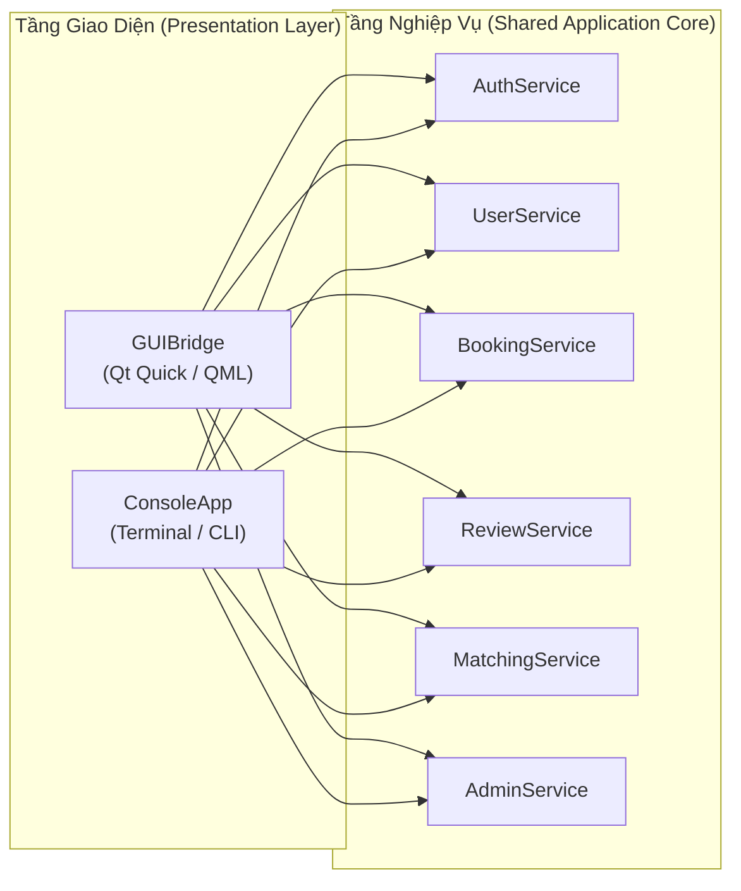

### 11.2. Chuyển đổi mã nguồn của ConsoleApp
1. **Thay đổi thành viên dữ liệu trong `ConsoleApp.h`:**
   - **Xoá bỏ:** `std::shared_ptr<MockDatabaseEngine> dbEngine;`
   - **Xoá bỏ:** `MatchingEngine matchingEngine;`
   - **Xoá bỏ:** `double platformCommissionRate;`
   - **Bổ sung:** Con trỏ thông minh tham chiếu đến 6 Services của BLL:
     ```cpp
     class ConsoleApp {
     private:
         std::shared_ptr<AuthService> authService;
         std::shared_ptr<UserService> userService;
         std::shared_ptr<BookingService> bookingService;
         std::shared_ptr<ReviewService> reviewService;
         std::shared_ptr<MatchingService> matchingService;
         std::shared_ptr<AdminService> adminService;
         // ...
     ```
2. **Khởi tạo và Tiêm phụ thuộc:**
   Phương thức khởi tạo `initialize` tiếp nhận trực tiếp 6 Services:
   ```cpp
   bool initialize(std::shared_ptr<AuthService> aService,
                   std::shared_ptr<UserService> uService,
                   std::shared_ptr<BookingService> bService,
                   std::shared_ptr<ReviewService> rService,
                   std::shared_ptr<MatchingService> mService,
                   std::shared_ptr<AdminService> adService);
   ```
3. **Ánh xạ các quy trình dòng lệnh (Console Workflows):**
   - Đăng nhập / Đăng ký (`handleLogin`, `handleRegister`): Gọi `authService->login()`, `authService->registerStudent()`, `authService->registerTutor()`.
   - Cập nhật hồ sơ & Đổi mật khẩu: Gọi `userService->updateStudentProfile()`, `userService->changePassword()`.
   - Đặt lịch & Quản lý lịch học (`handleBookLessonScheduleGuard`, `handleTutorPendingBookings`): Gọi `bookingService->bookLesson()`, `bookingService->acceptBooking()`, `bookingService->rejectBooking()`.
   - Đánh giá nhận xét (`handleLeaveReviewAndRating`): Gọi `reviewService->submitReview()`.
   - Ghép nối thông minh (`handleSmartMatchingMaxHeap`): Gọi `matchingService->findTopMatchesForStudent()`.
   - Quản trị viên (`handleAdminSystemMetrics`, `handleAdminCommissionConfig`): Gọi `adminService->calculateMetrics()`, `adminService->setPlatformCommissionRate()`.

Việc tái cấu trúc này đảm bảo tính nhất quán tuyệt đối về nghiệp vụ: Mọi ràng buộc về lịch học, kiểm tra xung đột bitmask, tính điểm hoa hồng hay đánh giá đều được thi hành từ một nguồn duy nhất (Single Source of Truth) trong BLL, dù người dùng thao tác qua GUI hay Console.

---

## 12. COMPOSITION ROOT & CƠ CHẾ TIÊM PHỤ THUỘC (DEPENDENCY INJECTION)

### 12.1. Vị trí và Quy trình lắp ráp của Composition Root
Quy trình khởi tạo toàn bộ ứng dụng được tập trung tại một điểm duy nhất (Composition Root) trong hàm `main()` tại `src/gui/main.cpp` (đối với ứng dụng GUI) hoặc điểm khởi đầu của CLI. 

Tuyệt đối không sử dụng bất kỳ thư viện hay framework Inversion of Control (IoC container) phức tạp bên ngoài nào; hệ thống sử dụng cơ chế **Pure Dependency Injection** thông qua C++ Standard Smart Pointers:

```cpp
// Minh hoạ quy trình khởi tạo tại Composition Root (src/gui/main.cpp)
int main(int argc, char *argv[]) {
    QGuiApplication app(argc, argv);
    QQmlApplicationEngine engine;

    // ========================================================================
    // BƯỚC 1: KHỞI TẠO TẦNG TRUY XUẤT DỮ LIỆU (DATA ACCESS LAYER)
    // ========================================================================
    std::string dataDir = ApplicationPaths::getDataDirectory();

    auto userRepo = std::make_shared<FileUserRepository>(dataDir);
    userRepo->initialize();

    auto bookingRepo = std::make_shared<FileBookingRepository>(dataDir);
    bookingRepo->initialize();

    auto reviewRepo = std::make_shared<FileReviewRepository>(dataDir);
    reviewRepo->initialize();

    // Khởi tạo Legacy Facade (đáp ứng tương thích ngược nếu cần)
    auto dbFacade = std::make_shared<MockDatabaseEngine>(userRepo, bookingRepo, reviewRepo);

    // ========================================================================
    // BƯỚC 2: KHỞI TẠO TẦNG NGHIỆP VỤ (BUSINESS LOGIC LAYER)
    // ========================================================================
    auto authService = std::make_shared<AuthService>(userRepo);
    auto userService = std::make_shared<UserService>(userRepo);
    auto bookingService = std::make_shared<BookingService>(bookingRepo, userRepo);
    auto reviewService = std::make_shared<ReviewService>(reviewRepo, bookingRepo, userRepo);

    auto matchingEngine = std::make_unique<MatchingEngine>();
    auto matchingService = std::make_shared<MatchingService>(userRepo, std::move(matchingEngine));

    auto adminService = std::make_shared<AdminService>(userRepo, bookingRepo, reviewRepo, bookingService);

    // ========================================================================
    // BƯỚC 3: KHỞI TẠO TẦNG GIAO DIỆN & TIÊM PHỤ THUỘC (PRESENTATION LAYER)
    // ========================================================================
    auto guiBridge = std::make_unique<GUIBridge>();
    guiBridge->initialize(authService, userService, bookingService,
                          reviewService, matchingService, adminService);

    // Đăng ký GUIBridge vào QML Engine Context Property
    engine.rootContext()->setContextProperty("guiBridge", guiBridge.get());

    // Nạp giao diện chính
    engine.loadFromModule("TutorMatch", "main");

    return app.exec();
}
```

### 12.2. Ngữ nghĩa sở hữu & Quản lý vòng đời bộ nhớ (Lifetime Semantics)
- **`std::shared_ptr` cho Repositories và Services:**
  Được lưu trữ tại stack frame của hàm `main()`. Do nhiều Services cùng phụ thuộc vào một Repository (ví dụ: cả `AuthService`, `UserService`, `BookingService`, `ReviewService`, `MatchingService`, `AdminService` đều cần `userRepo`), việc sử dụng `std::shared_ptr` bảo đảm quyền đồng sở hữu (shared ownership) an toàn, tự động giải phóng khi hàm `main()` kết thúc.
- **`std::unique_ptr` cho Algorithmic Engines:**
  `MatchingEngine` được sở hữu độc quyền bởi `MatchingService` thông qua `std::unique_ptr<MatchingEngine>`.
- **Phân tách rạch ròi giữa Smart Pointer và Qt QObject Parent-Child:**
  `GUIBridge` là một `QObject`. Khi được đăng ký vào QML Context qua `setContextProperty`, nó được giữ bởi một `std::unique_ptr<GUIBridge>` trong hàm `main()` không gán parent QObject, ngăn chặn nguy cơ Double-Free hoặc rò rỉ bộ nhớ khi engine thoát.

---

## 13. SƠ ĐỒ TRÌNH TỰ LUỒNG DỮ LIỆU MỤC TIÊU (TARGET DATA FLOW SEQUENCE DIAGRAMS)

Dưới đây là 10 sơ đồ trình tự thể hiện sự phân tách ranh giới nghiêm ngặt cho 10 luồng nghiệp vụ cốt lõi:

### Luồng 1: Xác thực đăng nhập (Login Flow)
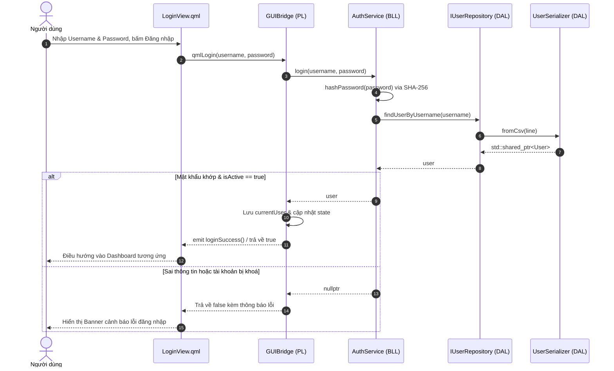

### Luồng 2: Học viên tìm kiếm gia sư theo tiêu chí (Student Searches Tutors)
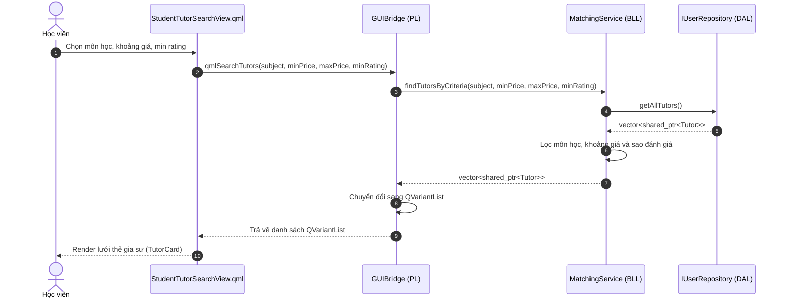

### Luồng 3: Ghép nối gia sư thông minh SmartMatch Top-K (SmartMatch Flow)
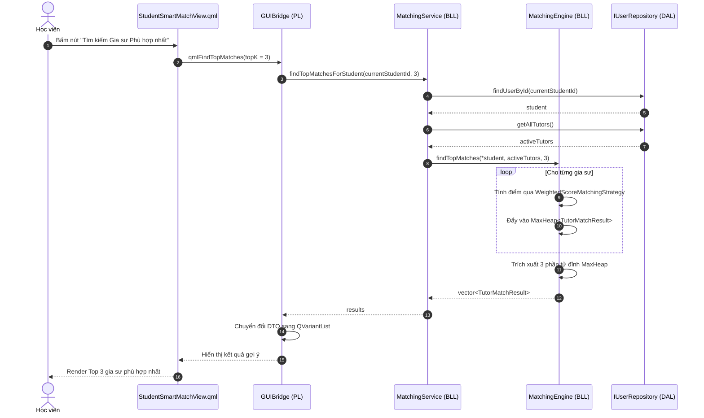

### Luồng 4: Học viên gửi yêu cầu đặt lịch học (Student Creates Booking)
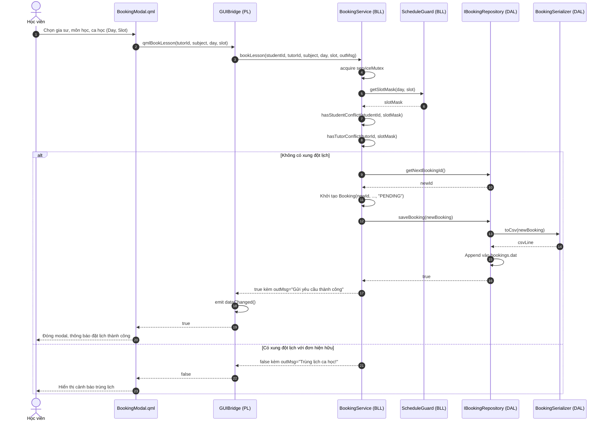

### Luồng 5: Gia sư Chấp nhận / Từ chối đơn đặt lịch (Tutor Accepts/Rejects Booking)
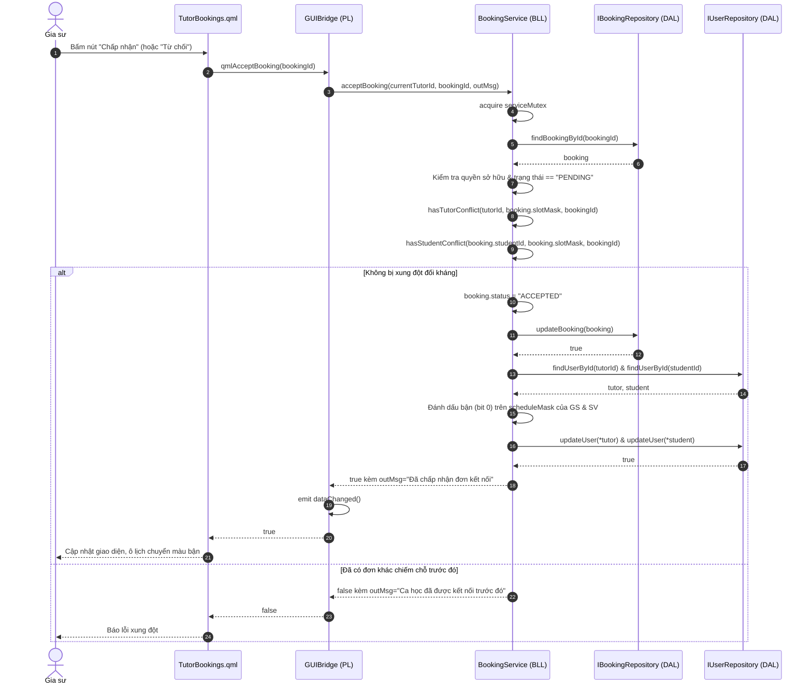

### Luồng 6: Kết thúc khoá học (Booking Completion Flow)
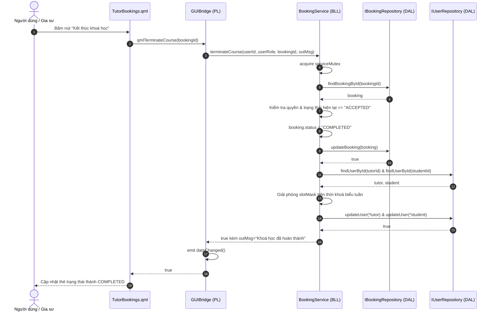

### Luồng 7: Học viên gửi đánh giá nhận xét (Review Submission Flow)
```mermaid
sequenceDiagram
    autonumber
    actor Student as Học viên
    participant QML as ReviewModal.qml
    participant GB as GUIBridge (PL)
    participant RS as ReviewService (BLL)
    participant BR as IBookingRepository (DAL)
    participant RR as IReviewRepository (DAL)
    participant UR as IUserRepository (DAL)

    Student->>QML: Chọn số sao (1-5), nhập nhận xét, bấm "Gửi đánh giá"
    QML->>GB: qmlSubmitReview(bookingId, ratingScore, comment)
    GB->>RS: submitReview(currentStudentId, bookingId, ratingScore, comment, outMsg)
    RS->>RS: acquire reviewMutex
    RS->>RS: canStudentReviewBooking(studentId, bookingId)
    RS->>BR: findBookingById(bookingId)
    BR-->>RS: booking
    alt booking != null && booking.studentId == studentId && booking.status == "COMPLETED"
        RS->>RR: getNextReviewId()
        RR-->>RS: newRevId
        RS->>RS: Khởi tạo Review(newRevId, bookingId, ...)
        RS->>RR: saveReview(newReview)
        RR-->>RS: true
        RS->>RS: recalculateAndUpdateTutorRating(booking.tutorId)
        RS->>RR: getReviewsByTutorId(booking.tutorId)
        RR-->>RS: allTutorReviews
        RS->>RS: Tính điểm trung bình cộng số học mới
        RS->>UR: findUserById(booking.tutorId)
        UR-->>RS: tutor
        RS->>RS: tutor->setRating(newRating)
        RS->>UR: updateUser(*tutor)
        UR-->>RS: true
        RS-->>GB: true kèm outMsg="Đánh giá thành công!"
        GB->>GB: emit dataChanged()
        GB-->>QML: true
        QML-->>Student: Đóng modal, hiển thị thông báo cảm ơn
    else Đơn chưa hoàn thành hoặc không có quyền
        RS-->>GB: false kèm outMsg="Đơn học chưa hoàn thành để đánh giá"
        GB-->>QML: false
        QML-->>Student: Báo lỗi điều kiện đánh giá
    end
```

### Luồng 8: Quản trị viên cập nhật tỷ lệ hoa hồng (Admin Updates Commission Rate)
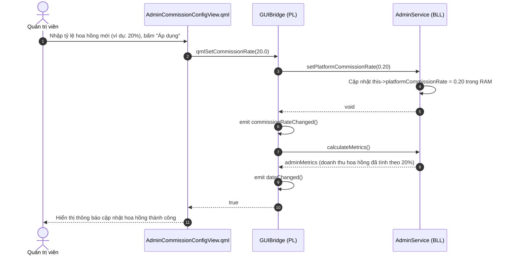

### Luồng 9: Quản lý và duyệt hồ sơ gia sư của Admin (Admin Verifies Tutor)
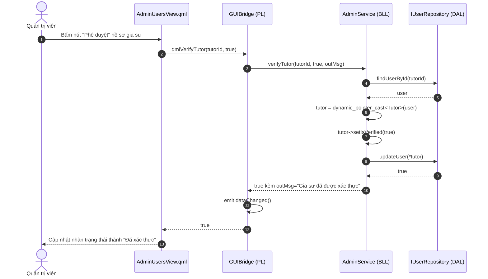

### Luồng 10: Ứng dụng Console đặt lịch học (ConsoleApp Creates Booking Flow)
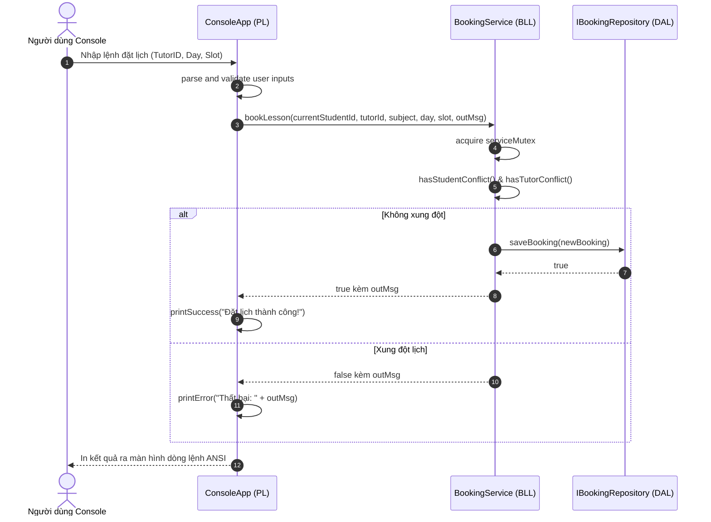

---

## 14. CHIẾN LƯỢC BẢO TOÀN TEST & NÂNG CAO ĐỘ PHỦ KIỂM THỬ

### 14.1. Ma trận bảo toàn 16 bộ kiểm thử hiện hành (Test Preservation Matrix)
Tất cả 16 bộ kiểm thử hiện có trong `tests/TestRunner.cpp` (1,495 dòng lệnh) phải tiếp tục biên dịch và vượt qua 100% (100% Pass) sau khi tái cấu trúc:

| STT | Tên Test Suite trong `TestRunner.cpp` | Mục tiêu kiểm thử | Thành phần bị ảnh hưởng | Phương án bảo toàn tương thích | Các kiểm thử bổ sung cần thiết |
|:---:|---|---|---|---|---|
| 1 | `run_test_ocp()` | Đảm bảo tính mở rộng của Strategy Pattern trong Matching | `MatchingEngine`, `IMatchingStrategy` | Giữ nguyên vẹn API của `MatchingEngine`. Không thay đổi logic thuật toán. | Thêm test kiểm tra `MatchingService` khi tiêm các strategy tuỳ biến. |
| 2 | `run_test_lsp()` | Đảm bảo nguyên lý Liskov Substitution cho cây phân cấp `User` | `User`, `Student`, `Tutor`, `Admin` | Gỡ bỏ `ISerializable` không ảnh hưởng đến đa hình của `User`. Các getter/setter giữ nguyên. | Kiểm tra việc ép kiểu an toàn đa hình qua `std::dynamic_pointer_cast`. |
| 3 | `run_test_dip_isp_and_srp()` | Kiểm tra việc phụ thuộc vào interfaces `IRepository` | `IUserRepository`, `IBookingRepository`, `IReviewRepository` | Tái sử dụng chính xác các interface hiện hành trong `include/storage/IRepository.h`. | Bổ sung kiểm thử SRP cho `ReviewService` và `BookingService` độc lập. |
| 4 | `run_test_schedule_guard()` | Kiểm tra các hàm logic bitmask thời khoá biểu 56-bit | `ScheduleGuard` | `ScheduleGuard` là Domain Engine độc lập, giữ nguyên toàn bộ chữ ký hàm tĩnh. | Kiểm tra biên với giá trị bitmask cực đại (`0x00FFFFFFFFFFFFFFULL`). |
| 5 | `run_test_sidebar_labels()` | Kiểm tra nhãn hiển thị menu trên GUI | `GUIBridge` | Giữ nguyên các hàm cung cấp metadata menu cho QML. | Kiểm thử tính toàn vẹn của menu role-based qua `GUIBridge`. |
| 6 | `run_test_tutor_profile_editing()` | Kiểm tra cập nhật hồ sơ gia sư | `UserService`, `FileUserRepository` | `UserService::updateTutorProfile()` giữ nguyên hợp đồng nghiệp vụ. | Kiểm tra việc đồng bộ bộ nhớ đệm `profileLruCache` khi sửa hồ sơ. |
| 7 | `run_test_schedule_synchronization()` | Kiểm tra đồng bộ lịch giữa Học viên và Gia sư | `BookingService`, `ScheduleGuard` | Giữ nguyên logic lật bit trên bitmask khi chấp nhận hoặc hoàn thành đơn. | Kiểm tra huỷ đơn và hoàn trả bit khả dụng trên thời khoá biểu. |
| 8 | `run_test_admin_user_data_contract()` | Kiểm tra tính nhất quán dữ liệu người dùng của Admin | `AdminService`, `FileUserRepository` | `AdminService::getAllUsers()` giữ nguyên kiểu trả về. | Kiểm tra phân quyền truy cập thông tin người dùng của Admin. |
| 9 | `run_test_admin_user_detail_modal_contract()` | Kiểm tra hợp đồng dữ liệu cho Modal chi tiết người dùng | `AdminService`, `GUIBridge` | Giữ nguyên cấu trúc `QVariantMap` trả về cho QML Modal. | Kiểm tra xử lý chuỗi rỗng và giá trị mặc định cho hồ sơ. |
| 10 | `run_test_admin_verification_and_lock_sync()` | Kiểm tra xác thực và khoá tài khoản tức thì | `AdminService`, `FileUserRepository` | `verifyTutor` và `toggleUserLock` giữ nguyên logic cập nhật DB. | Kiểm tra người dùng bị khoá không thể đăng nhập qua `AuthService`. |
| 11 | `run_test_admin_service_filters_and_search()` | Kiểm tra bộ lọc người dùng đa tiêu chí của Admin | `AdminService` | Giữ nguyên phương thức `getFilteredUsers()`. | Kiểm tra tìm kiếm không phân biệt hoa thường theo họ tên và email. |
| 12 | `run_test_avl_tree_multi_value_and_deletion()` | Kiểm tra giải thuật cây AVL hỗ trợ trùng lặp khoá và xoá node | `AVLTree`, `FileUserRepository` | `AVLTree` được đóng gói trong `FileUserRepository`, giữ nguyên giải thuật. | Kiểm tra tính cân bằng chiều cao cây sau 1000 thao tác chèn/xoá ngẫu nhiên. |
| 13 | `run_test_schedule_guard_sanitization_and_56_bit_boundary()` | Kiểm tra lọc sạch bit ngoài phạm vi 56-bit | `ScheduleGuard` | Giữ nguyên hằng số `VALID_MASK_56_BITS = 0x00FFFFFFFFFFFFFFULL`. | Kiểm tra các giá trị âm hoặc tràn số nguyên khi chuyển đổi slot. |
| 14 | `run_test_mock_db_atomic_persistence_and_deduplication()` | Kiểm tra ghi đè nguyên tử và chống trùng lặp ID | `MockDatabaseEngine`, Repositories | `MockDatabaseEngine` uỷ quyền sang Repositories cụ thể, vẫn vượt qua test. | Kiểm tra cơ chế khôi phục từ tệp `.tmp` khi có sự cố ghi tệp. |
| 15 | `run_test_data_file_inspector()` | Kiểm tra công cụ chẩn đoán tệp dữ liệu | `DataFileInspector`, `ApplicationPaths` | Giữ nguyên mã nguồn của `DataFileInspector`. | Kiểm tra khả năng phát hiện lỗi dòng CSV bị thiếu cột. |
| 16 | `run_test_booking_conflict_detection()` | Kiểm tra 15 kịch bản phát hiện xung đột lịch đối xứng | `BookingService`, `ScheduleGuard` | Giữ nguyên toàn bộ 15 kịch bản xung đột, `serviceMutex` bảo vệ đa luồng. | Kiểm tra đa luồng đồng thời 16 threads tranh chấp cùng 1 slot. |

### 14.2. Các bộ kiểm thử mới cần bổ sung (New Architectural Test Suites)
Để bảo đảm độ bao phủ cho các thành phần mới được trích xuất trong Phase 2:
1. **`run_test_serializers_roundtrip()`:**
   Kiểm tra tính toàn vẹn 2 chiều ($\text{Entity} \rightarrow \text{CSV} \rightarrow \text{Entity}$) cho `UserSerializer`, `BookingSerializer`, `ReviewSerializer`. Kiểm tra đặc biệt với chuỗi tiếng Việt có dấu (`"Nguyễn Văn Nam"`, `"ThS. Lê Văn Toàn"`), các ký tự đặc biệt, dấu ngoặc kép nội tại, và số nguyên 64-bit.
2. **`run_test_concrete_repositories_crud()`:**
   Kiểm thử độc lập từng repository trên thư mục dữ liệu giả lập (`test_data/`):
   - `FileUserRepository`: Kiểm tra O(1) hash seek, LRU cache hit/miss, và AVL range queries.
   - `FileBookingRepository`: Kiểm tra append đơn mới và ghi đè nguyên tử khi cập nhật trạng thái.
   - `FileReviewRepository`: Kiểm tra append đánh giá và lọc xoá đánh giá vi phạm.
3. **`run_test_review_service_eligibility_and_rating()`:**
   Kiểm tra tính đúng đắn của logic tính điểm trung bình cộng số học của gia sư khi có đánh giá mới hoặc khi một đánh giá bị xoá bỏ; kiểm tra từ chối đánh giá nếu đơn chưa ở trạng thái `COMPLETED`.
4. **`run_test_matching_service_orchestration()`:**
   Kiểm tra `MatchingService` thu thập đúng gia sư đang hoạt động và trích xuất đúng Top-K gia sư thông qua `MaxHeap`.
5. **`run_test_admin_commission_ownership()`:**
   Kiểm tra biến `platformCommissionRate` trong `AdminService`: giá trị mặc định là 0.25, cập nhật trong RAM thành công, và tính toán đúng doanh thu hoa hồng trong `calculateMetrics()`.

---

## 15. LỘ TRÌNH CHUYỂN ĐỔI 14 BƯỚC (DEPENDENCY-AWARE MIGRATION SEQUENCE)

Để giảm thiểu tối đa rủi ro gây vỡ mã nguồn trong quá trình triển khai thực tế (Phase 2), trình tự chuyển đổi được thiết kế tuân thủ nghiêm ngặt đồ thị phụ thuộc từ tầng thấp nhất (DAL) lên tầng cao nhất (Presentation):

```mermaid
flowchart TD
    S01["Bước 1: Chuẩn hoá Hợp đồng Interface<br><i>(IRepository.h, DTOs)</i>"]
    S02["Bước 2: Xây dựng các Dedicated Serializers<br><i>(UserSerializer, BookingSerializer, ReviewSerializer)</i>"]
    S03["Bước 3: Xây dựng 3 Concrete File Repositories<br><i>(FileUserRepository, FileBookingRepository, FileReviewRepository)</i>"]
    S04["Bước 4: Chuyển đổi MockDatabaseEngine thành Delegating Facade<br><i>(Uỷ quyền sang 3 Concrete Repositories)</i>"]
    S05["Bước 5: Gỡ bỏ ISerializable khỏi Domain Entities<br><i>(User, Student, Tutor, Admin, Booking, Review trở thành POCO)</i>"]
    S06["Bước 6: Trích xuất ReviewService<br><i>(Tách khỏi BookingService, quản lý Eligibility & Rating)</i>"]
    S07["Bước 7: Trích xuất MatchingService<br><i>(Quản lý use case ghép nối & Top-K)</i>"]
    S08["Bước 8: Chuyển giao platformCommissionRate sang AdminService<br><i>(RAM-only state management)</i>"]
    S09["Bước 9: Tái cấu trúc BookingService<br><i>(Gỡ bỏ IReviewRepository, tập trung 100% vào Booking Lifecycle)</i>"]
    S10["Bước 10: Tái cấu trúc GUIBridge thành Pure Adapter<br><i>(Gỡ bỏ Repositories, uỷ quyền sang 6 Services)</i>"]
    S11["Bước 11: Tái cấu trúc ConsoleApp thành Presentation Adapter<br><i>(Thay thế toàn bộ dbEngine bằng 6 Services)</i>"]
    S12["Bước 12: Khắc phục rò rỉ nghiệp vụ trong QML<br><i>(Cung cấp precomputed metrics cho StudentBookingsView.qml)</i>"]
    S13["Bước 13: Cập nhật Composition Root trong main.cpp<br><i>(Lắp ráp DI Graph hoàn chỉnh)</i>"]
    S14["Bước 14: Chạy hồi quy toàn diện & Kiểm toán phụ thuộc cuối cùng<br><i>(16/16 Test Suites PASS, CMake build clean)</i>"]

    S01 --> S02 --> S03 --> S04 --> S05 --> S06 --> S07 --> S08 --> S09 --> S10 --> S11 --> S12 --> S13 --> S14
```

### Đặc tả chi tiết từng bước chuyển đổi:

#### Bước 1: Chuẩn hoá Hợp đồng Interface & DTOs
- **Điều kiện tiên quyết:** Phase 1 Design được phê duyệt.
- **Tệp tin tác động:** `include/storage/IRepository.h`, `include/services/BookingService.h` (thêm struct `StudentBookingMetrics`).
- **Phụ thuộc:** Không.
- **Kiểm thử yêu cầu:** Biên dịch thử nghiệm interface declarations.
- **Kế hoạch Rollback:** Khôi phục file `IRepository.h` gốc từ Git.
- **Tiêu chí nghiệm thu:** Không làm vỡ bất kỳ mã nguồn hiện có nào.

#### Bước 2: Xây dựng các Dedicated Serializers
- **Điều kiện tiên quyết:** Bước 1 hoàn thành.
- **Tệp tin tác động:** Tạo mới `include/storage/UserSerializer.h`, `src/storage/UserSerializer.cpp`, `include/storage/BookingSerializer.h`, `src/storage/BookingSerializer.cpp`, `include/storage/ReviewSerializer.h`, `src/storage/ReviewSerializer.cpp`. Cập nhật `CMakeLists.txt` để biên dịch các file mới.
- **Phụ thuộc:** Domain Entities hiện tại.
- **Kiểm thử yêu cầu:** Viết unit test độc lập so sánh kết quả serialize/deserialize với dữ liệu mẫu trong `users.dat`, `bookings.dat`, `reviews.dat`.
- **Kế hoạch Rollback:** Xoá các file mới tạo và hoàn tác `CMakeLists.txt`.
- **Tiêu chí nghiệm thu:** Đạt 100% độ chính xác ký tự và định dạng byte-level.

#### Bước 3: Xây dựng 3 Concrete File Repositories
- **Điều kiện tiên quyết:** Bước 2 hoàn thành.
- **Tệp tin tác động:** Tạo mới `include/storage/FileUserRepository.h`, `src/storage/FileUserRepository.cpp`, `include/storage/FileBookingRepository.h`, `src/storage/FileBookingRepository.cpp`, `include/storage/FileReviewRepository.h`, `src/storage/FileReviewRepository.cpp`. Cập nhật `CMakeLists.txt`.
- **Phụ thuộc:** Serializers, `ApplicationPaths`, `HashTable`, `LRUCache`, `AVLTree`.
- **Kiểm thử yêu cầu:** Chạy CRUD tests trên tệp tạm thời.
- **Kế hoạch Rollback:** Xoá các file repository mới.
- **Tiêu chí nghiệm thu:** Đọc/ghi chính xác dữ liệu từ thư mục `data/`.

#### Bước 4: Chuyển đổi MockDatabaseEngine thành Delegating Facade
- **Điều kiện tiên quyết:** Bước 3 hoàn thành.
- **Tệp tin tác động:** `include/storage/MockDatabaseEngine.h`, `src/storage/MockDatabaseEngine.cpp`.
- **Phụ thuộc:** `FileUserRepository`, `FileBookingRepository`, `FileReviewRepository`.
- **Kiểm thử yêu cầu:** Chạy toàn bộ 16 test suites trong `tests/TestRunner.cpp`. Toàn bộ 16 tests phải tiếp tục PASS.
- **Kế hoạch Rollback:** Khôi phục lại bản `MockDatabaseEngine.cpp` gốc.
- **Tiêu chí nghiệm thu:** `MockDatabaseEngine` không còn tự mở file I/O hay lưu trữ dữ liệu trùng lặp.

#### Bước 5: Gỡ bỏ ISerializable khỏi Domain Entities
- **Điều kiện tiên quyết:** Bước 4 hoàn thành và 16 tests PASS.
- **Tệp tin tác động:** `include/models/User.h`, `include/models/Booking.h`, `include/models/Review.h`, `src/models/User.cpp`.
- **Phụ thuộc:** Serializers đã sẵn sàng thay thế.
- **Kiểm thử yêu cầu:** Biên dịch lại toàn bộ dự án (`TutorMatch_GUI`, `TutorMatch_Tests`, `TutorMatch_Inspector`).
- **Kế hoạch Rollback:** Khôi phục các file header và source model từ Git.
- **Tiêu chí nghiệm thu:** Các domain model hoàn toàn độc lập, không còn kế thừa `ISerializable`.

#### Bước 6: Trích xuất ReviewService
- **Điều kiện tiên quyết:** Bước 5 hoàn thành.
- **Tệp tin tác động:** Tạo mới `include/services/ReviewService.h`, `src/services/ReviewService.cpp`. Cập nhật `CMakeLists.txt`.
- **Phụ thuộc:** `IReviewRepository`, `IBookingRepository`, `IUserRepository`.
- **Kiểm thử yêu cầu:** Chạy unit test kiểm tra use case đánh giá và cập nhật rating gia sư.
- **Kế hoạch Rollback:** Xoá `ReviewService` và hoàn tác `CMakeLists.txt`.
- **Tiêu chí nghiệm thu:** Đóng gói trọn vẹn logic đánh giá và cập nhật rating trung bình.

#### Bước 7: Trích xuất MatchingService
- **Điều kiện tiên quyết:** Bước 6 hoàn thành.
- **Tệp tin tác động:** Tạo mới `include/services/MatchingService.h`, `src/services/MatchingService.cpp`. Cập nhật `CMakeLists.txt`.
- **Phụ thuộc:** `IUserRepository`, `MatchingEngine`.
- **Kiểm thử yêu cầu:** Unit test tìm kiếm gia sư và lấy Top-K gia sư.
- **Kế hoạch Rollback:** Xoá `MatchingService` và hoàn tác `CMakeLists.txt`.
- **Tiêu chí nghiệm thu:** Tách rời hoàn toàn thuật toán matching khỏi Presentation Layer.

#### Bước 8: Chuyển giao platformCommissionRate sang AdminService
- **Điều kiện tiên quyết:** Bước 7 hoàn thành.
- **Tệp tin tác động:** `include/services/AdminService.h`, `src/services/AdminService.cpp`.
- **Phụ thuộc:** Không.
- **Kiểm thử yêu cầu:** Chạy `run_test_admin_service_filters_and_search()` và test tính toán hoa hồng.
- **Kế hoạch Rollback:** Khôi phục `AdminService.h/.cpp`.
- **Tiêu chí nghiệm thu:** `AdminService` sở hữu biến commission rate trong RAM và tự dùng trong `calculateMetrics()`.

#### Bước 9: Tái cấu trúc BookingService
- **Điều kiện tiên quyết:** Bước 6 và Bước 8 hoàn thành.
- **Tệp tin tác động:** `include/services/BookingService.h`, `src/services/BookingService.cpp`.
- **Phụ thuộc:** Gỡ bỏ phụ thuộc vào `IReviewRepository`.
- **Kiểm thử yêu cầu:** Chạy `run_test_booking_conflict_detection()` và `run_test_schedule_synchronization()`.
- **Kế hoạch Rollback:** Khôi phục `BookingService` gốc.
- **Tiêu chí nghiệm thu:** `BookingService` không còn chứa mã xử lý đánh giá, 15 kịch bản xung đột vẫn PASS 100%.

#### Bước 10: Tái cấu trúc GUIBridge thành Pure Adapter
- **Điều kiện tiên quyết:** Toàn bộ các bước BLL (Bước 6-9) hoàn thành.
- **Tệp tin tác động:** `include/gui/GUIBridge.h`, `src/gui/GUIBridge.cpp`.
- **Phụ thuộc:** 6 Services của BLL.
- **Kiểm thử yêu cầu:** Chạy thử nghiệm GUI, kiểm tra toàn bộ các màn hình QML.
- **Kế hoạch Rollback:** Khôi phục `GUIBridge` gốc.
- **Tiêu chí nghiệm thu:** Không còn bất kỳ con trỏ repository nào trong `GUIBridge`. Toàn bộ 45+ phương thức Q_INVOKABLE hoạt động chính xác.

#### Bước 11: Tái cấu trúc ConsoleApp thành Presentation Adapter
- **Điều kiện tiên quyết:** Bước 10 hoàn thành.
- **Tệp tin tác động:** `include/ui/ConsoleApp.h`, `src/ui/ConsoleApp.cpp`.
- **Phụ thuộc:** 6 Services của BLL.
- **Kiểm thử yêu cầu:** Chạy các luồng giao diện dòng lệnh: đăng nhập, đặt lịch, xem thời khoá biểu.
- **Kế hoạch Rollback:** Khôi phục `ConsoleApp` gốc.
- **Tiêu chí nghiệm thu:** Không còn bất kỳ lời gọi nào đến `dbEngine` trong `ConsoleApp.cpp`.

#### Bước 12: Khắc phục rò rỉ nghiệp vụ trong QML
- **Điều kiện tiên quyết:** Bước 10 hoàn thành.
- **Tệp tin tác động:** `ui/qml/StudentBookingsView.qml`.
- **Phụ thuộc:** Phương thức `qmlGetStudentBookingMetrics()` của `GUIBridge`.
- **Kiểm thử yêu cầu:** Mở màn hình danh sách lịch học của học viên trên GUI, xác minh 4 ô thống kê hiển thị chính xác số lượng và chi phí tuần.
- **Kế hoạch Rollback:** Khôi phục `StudentBookingsView.qml` gốc.
- **Tiêu chí nghiệm thu:** Không còn mã JavaScript tự cộng dồn `weeklyCost` trong QML.

#### Bước 13: Cập nhật Composition Root trong main.cpp
- **Điều kiện tiên quyết:** Toàn bộ các thành phần đã sẵn sàng.
- **Tệp tin tác động:** `src/gui/main.cpp`.
- **Phụ thuộc:** Toàn bộ hệ thống.
- **Kiểm thử yêu cầu:** Khởi động ứng dụng từ clean build.
- **Kế hoạch Rollback:** Khôi phục `main.cpp` gốc.
- **Tiêu chí nghiệm thu:** Khởi tạo tuần tự đúng thứ tự DAL $\rightarrow$ BLL $\rightarrow$ PL. Không lỗi rò rỉ vùng nhớ.

#### Bước 14: Chạy hồi quy toàn diện & Kiểm toán phụ thuộc cuối cùng
- **Điều kiện tiên quyết:** Hoàn thành toàn bộ 13 bước trước.
- **Tệp tin tác động:** Kiểm toán toàn bộ repository.
- **Phụ thuộc:** Toàn bộ hệ sinh thái mã nguồn.
- **Kiểm thử yêu cầu:** Chạy `TutorMatch_Tests.exe` (16 test suites gốc + test suites mới) $\rightarrow$ Đạt 100% PASS. Chạy `TutorMatch_Inspector.exe` kiểm tra tính toàn vẹn của `users.dat`, `bookings.dat`, `reviews.dat`.
- **Tiêu chí nghiệm thu:** Zero compile warnings, zero architecture violations, zero data corruption.

---

## 16. PHÂN TÍCH RỦI RO & MA TRẬN GIẢM THIỂU (RISK MANAGEMENT MATRIX)

| Mã Rủi Ro | Phân Loại Rủi Ro | Khả Năng Xảy Ra | Mức Độ Tác Động | Mô Tả Nguy Cơ Chi Tiết | Biện Pháp Giảm Thiểu Chủ Động (Mitigation Strategy) | Kế Hoạch Ứng Phó Khẩn Cấp (Contingency Plan) |
|:---:|---|:---:|:---:|---|---|---|
| **RSK-01** | **Hư hại dữ liệu tệp `.dat`** | Trung bình | **Rất cao** | Trong quá trình ghi đè tệp để cập nhật người dùng hoặc trạng thái booking, ứng dụng gặp sự cố crash hoặc mất điện làm rỗng tệp dữ liệu. | Áp dụng bắt buộc kỹ thuật Ghi tệp nguyên tử (Atomic File Rewrite): ghi ra tệp tạm `.tmp`, `flush()`, đóng luồng và thực hiện atomic rename bằng lệnh hệ điều hành. | Tự động tạo bản sao lưu dữ liệu (`.dat.bak`) trước mọi thao tác cập nhật và cung cấp cơ chế phục hồi trong `DataFileInspector`. |
| **RSK-02** | **Lỗi hồi quy giao diện QML (UI Regression)** | Cao | **Cao** | Việc thay đổi kiểu dữ liệu trả về hoặc thay đổi chữ ký của các phương thức `Q_INVOKABLE` trong `GUIBridge` khiến giao diện QML bị trắng màn hình hoặc không phản hồi. | Bảo toàn nguyên vẹn 100% chữ ký các phương thức `Q_INVOKABLE` và tên thuộc tính `Q_PROPERTY` hiện có. `GUIBridge` chịu trách nhiệm chuyển đổi kiểu dữ liệu C++ sang `QVariantMap`/`QVariantList` đúng schema mà QML kỳ vọng. | Kiểm thử thủ công và tự động toàn bộ 28 file QML trước khi hoàn tất Phase 2. Khôi phục adapter mapping nếu phát hiện sai lệch tên trường. |
| **RSK-03** | **Vỡ các bộ kiểm thử tự động (Broken Tests)** | Cao | **Cao** | 16 bộ kiểm thử hiện tại trong `TestRunner.cpp` phụ thuộc trực tiếp vào `MockDatabaseEngine`. Việc tách nhỏ repository có thể làm gãy các assertions trong test. | Thiết kế `MockDatabaseEngine` thành một Delegating Facade giữ nguyên 100% giao diện công khai và hành vi của các phương thức cũ, đồng thời chuyển hướng các lệnh gọi đến 3 concrete repositories bên dưới. | Chạy kiểm thử liên tục sau mỗi bước chuyển đổi (đặc biệt là sau Bước 4 và Bước 5). Không tiến hành các bước tiếp theo nếu 16 tests chưa PASS. |
| **RSK-04** | **Lệch pha dữ liệu giữa Cache, RAM Index và Đĩa** | Trung bình | **Cao** | Việc tách `ramHashIndex`, `profileLruCache`, và các cây `AVLTree` sang `FileUserRepository` nếu không được bảo vệ đồng bộ sẽ dẫn đến tình trạng cache chứa dữ liệu cũ trong khi đĩa đã thay đổi. | Đóng gói toàn bộ cache và chỉ mục bên trong `FileUserRepository` dưới một `std::recursive_mutex` duy nhất. Bất kỳ thao tác `updateUser()` hoặc `deleteUserSoft()` nào đều bắt buộc phải cập nhật hoặc xoá cache tương ứng đồng thời với việc ghi đè đĩa. | Cung cấp hàm `rebuildRamIndex()` và `clearCache()` tự động kích hoạt khi phát hiện bất kỳ sự bất đồng bộ nào. |
| **RSK-05** | **Race Condition khi Đặt lịch đồng thời** | Thấp | **Cao** | Nhiều luồng cùng gọi `bookLesson()` hoặc `acceptBooking()` dẫn đến việc cùng một ca học bị phân phối cho hai người khác nhau. | Duy trì cơ chế khoá đồng bộ `std::recursive_mutex serviceMutex` bên trong `BookingService`. Toàn bộ quy trình kiểm tra xung đột và ghi dữ liệu booking được thực hiện như một giao dịch nguyên tử (Atomic Transaction). | Bảo toàn kịch bản kiểm thử đa luồng (Scenario 15 trong `TestRunner.cpp`) với 8 threads chạy song song tranh chấp 1 slot để kiểm chứng độ an toàn. |
| **RSK-06** | **Mất mát ký tự Unicode tiếng Việt** | Thấp | **Trung bình** | Quá trình tách logic tuần tự hoá sang các Serializer nếu xử lý chuỗi bằng các luồng char thông thường có thể làm lỗi font hoặc sai byte encoding các tên tiếng Việt có dấu. | Sử dụng chuỗi UTF-8 chuẩn (`std::string`), cấu hình luồng đọc/ghi ở chế độ nhị phân hoặc UTF-8 minh bạch, không sử dụng các hàm chuyển đổi locale phá vỡ mã byte UTF-8. | Kiểm thử so sánh nhị phân từng byte (byte-level diff) giữa dữ liệu gốc và dữ liệu sau khi round-trip qua Serializers. |

---

## 17. CÁC QUYẾT ĐỊNH KIẾN TRÚC & VẤN ĐỀ CẦN LÀM RÕ (UNRESOLVED DECISIONS)

### 17.1. Tóm tắt các quyết định đã thông qua (Approved Decisions Implemented)
1. **Quyết định 1 (Logical In-Place Layering):** Giữ nguyên cấu trúc thư mục vật lý hiện hữu (`include/`, `src/`, `ui/qml/`, `data/`). Ranh giới 3 lớp được thiết lập thông qua trách nhiệm lớp, hợp đồng Interface và chiều phụ thuộc.
2. **Quyết định 2 (Tách Repository, Giữ Facade):** Tách `MockDatabaseEngine` thành `FileUserRepository`, `FileBookingRepository`, `FileReviewRepository`. `MockDatabaseEngine` trở thành một Pure Delegating Facade bảo toàn tương thích ngược cho 16 bộ kiểm thử.
3. **Quyết định 3 (Trích xuất ReviewService & MatchingService):** Tách nghiệp vụ đánh giá khỏi `BookingService` sang `ReviewService`. Trích xuất điều phối thuật toán ghép nối sang `MatchingService`.
4. **Quyết định 4 (Sở hữu Tỷ lệ Hoa hồng trong AdminService):** Di dời biến `platformCommissionRate` từ `GUIBridge` sang `AdminService`. Duy trì nguyên trạng lưu trữ trong bộ nhớ RAM, không tự ý tạo thêm file lưu trữ mới.
5. **Quyết định 5 (Tách Tuần tự hoá khỏi Domain Model - ADR-004):** Gỡ bỏ `ISerializable` khỏi các thực thể miền. Tạo các Serializer chuyên trách (`UserSerializer`, `BookingSerializer`, `ReviewSerializer`) thuộc DAL, bảo toàn 100% cấu trúc schema (11 cột Student, 15 cột Tutor, 8 cột Admin) và cơ chế escape dấu phẩy thành khoảng trắng của tệp `.dat`.
6. **Quyết định 6 (Trích xuất Presentation Adapters - ADR-006):** Chuẩn hoá `GUIBridge` và `ConsoleApp` thành các Presentation Adapters mỏng, chia sẻ chung Application Core trong BLL.
7. **Quyết định 7 (Bảo đảm Nhất Quán Đa Tệp - ADR-007):** Áp dụng cơ chế Rollback bù trừ và Tự phục hồi đối soát khi khởi động (Startup Self-Healing Reconciliation) giữa `reviews.dat` và `users.dat`.
8. **Quyết định 8 (Điều chỉnh tối thiểu Build Graph CMake - ADR-008):** Giữ nguyên các CMake targets và QML module; chỉ bổ sung danh sách các tệp `.cpp` và `.h` mới vào `CORE_SOURCES` và `HEADERS`.

### 17.2. Các câu hỏi mở và vấn đề cần người dùng phê duyệt trước Phase 2 (Unresolved Decisions)
Trước khi chính thức bắt tay vào triển khai mã nguồn tại Phase 2, các vấn đề kỹ thuật sau cần được xem xét và chốt phương án:

1. **Vấn đề 1: Tính bền vững của Tỷ lệ Hoa hồng (`platformCommissionRate`)**
   - *Hiện trạng:* Biến này đang sống trong RAM (mặc định 0.25). Khi khởi động lại ứng dụng, tỷ lệ này sẽ bị reset về 25%, dù Admin trước đó đã cấu hình lại.
   - *Khuyến nghị kiến trúc:* Đối với giai đoạn tái cấu trúc 3 lớp hiện tại, bảo toàn 100% hành vi lưu RAM theo đúng Quyết định 4. Nếu người dùng mong muốn lưu trữ bền vững giá trị này qua các phiên làm việc, một tệp cấu hình chuyên dụng `config/platform_config.dat` hoặc lưu vào dòng header của `data/` có thể được đề xuất ở một giai đoạn sau (Phase 3).
2. **Vấn đề 2: Tương lai của `MockDatabaseEngine` trong dài hạn**
   - *Hiện trạng:* `MockDatabaseEngine` được giữ lại làm Facade để 16 test suites không bị gãy.
   - *Đề xuất:* Trong Phase 2, duy trì Facade này để đảm bảo toàn bộ 16 bài kiểm thử chạy trơn tru. Khi toàn bộ mã nguồn của dự án và các bài kiểm thử đã chuyển hẳn sang sử dụng trực tiếp 3 Repositories độc lập, `MockDatabaseEngine` có thể được đánh dấu `@deprecated` hoặc loại bỏ an toàn trong một phase dọn dẹp kỹ thuật tiếp theo.
3. **Vấn đề 3: Phân nhóm tệp trong cấu trúc thư mục hiện tại**
   - *Hiện trạng:* Theo Quyết định 1, các tệp mới sẽ được đặt trực tiếp vào các thư mục tương ứng hiện có:
     - Header Serializers và Concrete Repositories: `include/storage/`
     - Source Serializers và Concrete Repositories: `src/storage/`
     - Header Services mới: `include/services/`
     - Source Services mới: `src/services/`
   - *Xác nhận:* Cấu trúc này hoàn toàn bảo toàn nguyên vẹn cây thư mục vật lý của dự án, tuân thủ đúng yêu cầu của người dùng và không làm xáo trộn cấu hình build của CMake.

---

## KẾT LUẬN & TRẠNG THÁI NGHIỆM THU PHASE 1
Tài liệu thiết kế kiến trúc mục tiêu này đã hoàn thành đầy đủ 17 phần nội dung theo đúng yêu cầu nghiêm ngặt của đề bài. Toàn bộ thiết kế đã được chứng minh dựa trên bằng chứng khảo sát mã nguồn thực tế tại Phase 0, bảo đảm tính khả thi 100%, bảo vệ dữ liệu hiện có, không gây lỗi hồi quy trên giao diện QML, và duy trì tính toàn vẹn của toàn bộ 16 bộ kiểm thử học thuật.

**TRẠNG THÁI: HOÀN THÀNH THIẾT KẾ PHASE 1 — CHỜ PHÊ DUYỆT ĐỂ BƯỚC VÀO GIAI ĐOẠN TRIỂN KHAI (PHASE 2).**
