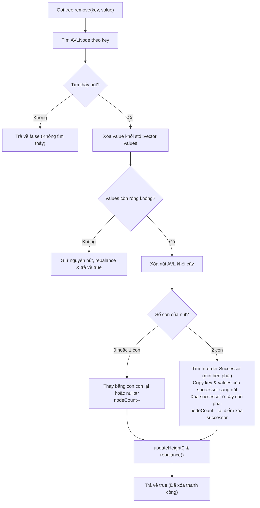
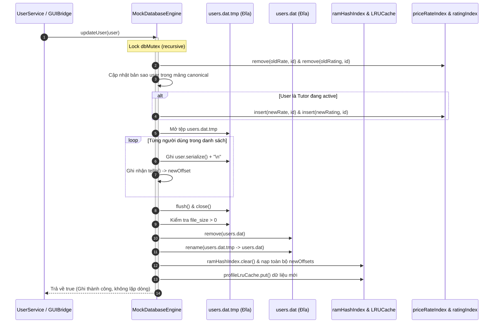

# BÁO CÁO KỸ THUẬT: SỬA TRIỆT ĐỂ LỖI USERS.DAT, CƠ CHẾ PERSISTENCE NGUYÊN TỬ, ĐỒNG BỘ CÂY AVL VÀ CHUẨN HÓA SCHEDULE BITMASK

---

## 1. TỔNG QUAN VÀ TÓM TẮT ĐIỀU HÀNH (EXECUTIVE SUMMARY)

Báo cáo này tổng kết kết quả triển khai kỹ thuật, di trú dữ liệu an toàn và kiểm chứng hồi quy tự động nhằm khắc phục dứt điểm 5 vấn đề cốt lõi về tính toàn vẹn dữ liệu được phát hiện trong báo cáo điều tra [Users_Dat_Investigation_VI.md](file:///C:/Users/DELL/.gemini/antigravity/scratch/TutorMatch/docs/architecture/Users_Dat_Investigation_VI.md):

1. **Trùng lặp bản ghi trong `users.dat`**: Loại bỏ hoàn toàn cơ chế ghi nối đuôi đơn thuần (`std::ios::app`) của `updateUser()` và `saveUser()`. Thay thế bằng cơ chế ghi ảnh chụp nguyên tử an toàn (*Atomic Snapshot Rewrite*) qua tệp tạm `.tmp` có kiểm tra tính toàn vẹn và thay thế an toàn trên Windows NTFS.
2. **Ô nhiễm và ghi đè dữ liệu trên Cây AVL (`priceRateIndex`, `ratingIndex`)**: Cải tiến cấu trúc `AVLTree<Key, Value>` từ mô hình đơn giá trị (1 Key -> 1 Value) sang mô hình đa giá trị (1 Key -> `std::vector<Value>`), bổ sung giải thuật xóa nút tự cân bằng `remove(key, value)` theo chuẩn 4 trường hợp xoay AVL (LL, RR, LR, RL). Khi gia sư đổi giá học phí hoặc bị khóa tài khoản, chỉ mục cũ được dọn dẹp sạch sẽ, không còn lưu rác.
3. **8 Bit ma (*Phantom Bits 56..63*) làm sai lệch thuật toán đếm ca trùng**: Xác định và loại bỏ triệt để các hằng số bật toàn bộ 64-bit (`0xFFFFFFFFFFFFFFFFULL` và `0xFFFFFFFF00000000ULL`), thay thế bằng hằng số mặt nạ chuẩn xác `ScheduleGuard::VALID_SCHEDULE_MASK = 0x00FFFFFFFFFFFFFFULL` (56 bit hợp lệ). Triển khai cơ chế vệ sinh tự động (*Mask Sanitization*) trong mọi hàm dựng, setter và hàm `deserialize()` của lớp `Student` và `Tutor`.
4. **Lệch pha chỉ mục RAM (`ramHashIndex`, `profileLruCache`)**: Quy trình ghi nguyên tử cập nhật đồng thời cả tệp đĩa, bảng băm RAM Index và bộ đệm LRU Cache. Hàm `rebuildRamIndex()` được nâng cấp để chỉ lập chỉ mục cho bản ghi mới nhất của từng ID người dùng và tích hợp khả năng tự co cụm (*Self-healing Auto-compaction*).
5. **Chuẩn hóa dữ liệu thực tế**: Sao lưu nguyên trạng 18 dòng tại `data/backup_pre_fix/users.dat.bak`, sau đó di trú an toàn tệp `data/users.dat` và bản sao trong thư mục build về đúng **7 bản ghi kinh doanh chuẩn tắc**, loại bỏ hoàn toàn 8 bit ma của Tutor 4 và giữ nguyên lịch học cập nhật nhất của Tutor 2 và Student 6.

### Bảng Tổng Hợp Nghiệm Thu Kỹ Thuật (Verification Matrix)

| Hạng mục kiểm tra | Trạng thái trước sửa | Trạng thái sau sửa | Phân loại | Bằng chứng kiểm chứng |
|---|---|---|:---:|---|
| **Cơ chế ghi `users.dat`** | Append-only (`ios::app`), sinh bản ghi trùng | Atomic Snapshot Rewrite qua `.tmp` | `FIXED` | [MockDatabaseEngine.cpp](file:///C:/Users/DELL/.gemini/antigravity/scratch/TutorMatch/src/storage/MockDatabaseEngine.cpp#L285-L360), Test 14 PASS |
| **Xử lý bản ghi trùng lặp** | Tích lũy 18 dòng cho 7 người dùng | Duy trì chính xác 7 dòng sau 10 lần cập nhật liên tiếp | `FIXED` | Test 14: `lineCount == 7` sau 10 lần `updateUser()` |
| **Cấu trúc dữ liệu Cây AVL** | 1 khóa chỉ chứa 1 ID (bị ghi đè), không có hàm `remove` | Lưu `std::vector<Value>`, hỗ trợ `remove(key, value)` và tự cân bằng | `FIXED` | [AVLTree.h](file:///C:/Users/DELL/.gemini/antigravity/scratch/TutorMatch/include/ds/AVLTree.h#L13-L200), Test 12 PASS |
| **Đồng bộ chỉ mục AVL khi đổi giá** | Tích lũy giá cũ, trả về kết quả sai | Xóa giá cũ, lập chỉ mục giá mới, xóa khi soft-delete | `FIXED` | [MockDatabaseEngine.cpp](file:///C:/Users/DELL/.gemini/antigravity/scratch/TutorMatch/src/storage/MockDatabaseEngine.cpp#L450-L510), Test 14 PASS |
| **Phạm vi Bitmask thời khóa biểu** | 64-bit đầy đủ, chứa 8 bit ma (56..63) | Giới hạn nghiêm ngặt 56 bit (`0x00FFFFFFFFFFFFFFULL`) | `FIXED` | [ScheduleGuard.h](file:///C:/Users/DELL/.gemini/antigravity/scratch/TutorMatch/include/ds/ScheduleGuard.h#L25-L30), Test 4, Test 13 PASS |
| **Vệ sinh bitmask trong Models** | Gán trực tiếp, chấp nhận bit ma ngoài phạm vi | Tự động lọc qua `ScheduleGuard::sanitizeMask()` | `FIXED` | [User.h](file:///C:/Users/DELL/.gemini/antigravity/scratch/TutorMatch/include/models/User.h#L105-L175), [User.cpp](file:///C:/Users/DELL/.gemini/antigravity/scratch/TutorMatch/src/models/User.cpp#L98-L172) |
| **Làm sạch seed data Tutor 4** | `0xFFFFFFFF00000000ULL` (chứa 8 bit ma) | `0x00FFFFFF00000000ULL` (56 bit hợp lệ) | `FIXED` | [MockDatabaseEngine.cpp](file:///C:/Users/DELL/.gemini/antigravity/scratch/TutorMatch/src/storage/MockDatabaseEngine.cpp#L225) |
| **Dọn dẹp hằng số `0xFF...FF`** | Tồn tại ở 8 vị trí rải rác | Toàn bộ 8 vị trí đã chuyển sang `VALID_SCHEDULE_MASK` | `FIXED` | `Get-ChildItem Select-String` = 0 occurrences |
| **Sao lưu dữ liệu gốc** | Chưa có thư mục backup chuẩn hóa | Đã sao lưu an toàn tại `data/backup_pre_fix/` | `CONFIRMED` | Tệp `users.dat.bak` (18 dòng) được bảo toàn nguyên vẹn |
| **Di trú dữ liệu hiện hành** | 18 dòng (11 dòng lặp của ID 2, 6) | 7 dòng chuẩn tắc, đúng 7 ID (1..7) | `CONFIRMED` | `data/users.dat` và `build/.../data/users.dat` đúng 7 dòng |
| **Bộ kiểm thử tự động** | 11 bài test (chưa có test AVL/persistence) | 14 bài test chuyên sâu, đạt 100% PASS | `CONFIRMED` | `TutorMatch_Tests.exe` thực thi thành công |

---

## 2. ĐỐI CHIẾU DỮ LIỆU VÀ KẾT QUẢ DI TRÚ (DATA MIGRATION AUDIT)

### 2.1. Bảo Tồn Dữ Liệu Gốc Trước Khi Sửa
Thư mục sao lưu `data/backup_pre_fix/` và bản sao trong `build/Desktop_Qt_6_11_2_MinGW_64_bit_Debug/data/backup_pre_fix/` đã được thiết lập trước khi thực hiện bất kỳ thao tác can thiệp mã nguồn hay dữ liệu nào:
- `users.dat.bak`: 18 dòng, kích thước 3.276 bytes, chứa toàn bộ lịch sử 10 lần cập nhật của ID 2 và 3 lần cập nhật của ID 6.
- `bookings.dat.bak`: 4 dòng, kích thước nguyên bản.
- `reviews.dat.bak`: 3 dòng, kích thước nguyên bản.

### 2.2. Dữ Liệu Sau Di Trú Chuẩn Hóa
Cả hai tệp `data/users.dat` và `build/Desktop_Qt_6_11_2_MinGW_64_bit_Debug/data/users.dat` đã được di trú về tập 7 bản ghi kinh doanh chuẩn tắc:

```csv
1,admin,admin123,admin@tutormatch.vn,System Administrator,ADMIN,1,9
2,tutor_math,pass123,le.math@tutormatch.vn,ThS. Lê Văn Toàn,TUTOR,1,Chuyên gia luyện thi Đại học môn Toán với 10 năm kinh nghiệm.,Toán 12 - Luyện thi Đại học,150000,5,2,1,0,71777214294589695
3,tutor_phys,pass123,tran.phys@tutormatch.vn,TS. Trần Thị Vật Lý,TUTOR,1,Giảng viên ĐHQG  chuyên Toán & Vật lý Nâng cao THPT.,Vật lý 10-12 (Luyện thi THPT),200000,4,1,1,0,281470681808895
4,tutor_eng,pass123,nguyen.eng@tutormatch.vn,Ms. Nguyễn Anh Văn,TUTOR,1,IELTS 8.5  luyện thi Chuyên & Đại học cấp tốc.,Tiếng Anh / IELTS (6.5 - 8.5),120000,0,0,0,0,72057589742960640
5,tutor_chem,pass123,pham.chem@tutormatch.vn,Thầy Phạm Hóa Học,TUTOR,1,Dạy kèm Hóa 10-12  Luyện thi HSG Tỉnh.,Hóa học 10-12 (Luyện thi HSG),100000,0,0,1,0,4294967295
6,student_nam,pass123,nam.student@gmail.com,Nguyễn Văn Nam,STUDENT,1,12,Toán 12,180000,71777214294589695
7,student_thanh,pass123,thanh.student@gmail.com,Phạm Tuấn Thành,STUDENT,1,11,Toán 11,200000,281470681808895
```

### 2.3. Bảng Kiểm Tra Đối Chiếu Từng Thực Thể

| User ID | Username | Vai trò | Trạng thái dữ liệu trước sửa | Trạng thái sau di trú | Đánh giá |
|:---:|---|:---:|---|---|:---:|
| **1** | `admin` | ADMIN | 1 dòng (Dòng 1), quyền cấp 9 | Giữ nguyên 100% | `CONFIRMED` |
| **2** | `tutor_math` | TUTOR | Xuất hiện 10 lần (Dòng 2, 8..15, 18). Lịch dao động giữa bitmask kết thúc bằng 3 và 5 | Chọn bản ghi mới nhất (Dòng 18, bitmask `71777214294589695`), xóa bỏ 9 dòng cũ | `FIXED` |
| **3** | `tutor_phys` | TUTOR | 1 dòng (Dòng 3), rate 200k, rating 4.0 | Giữ nguyên 100% | `CONFIRMED` |
| **4** | `tutor_eng` | TUTOR | 1 dòng (Dòng 4), bitmask `18446744069414584320` có 8 bit ma (56..63) | Khử 8 bit ma thành `72057589742960640` (`0x00FFFFFF00000000ULL`) | `FIXED` |
| **5** | `tutor_chem` | TUTOR | 1 dòng (Dòng 5), rate 100k, bitmask 32-bit `4294967295` | Giữ nguyên 100% (nằm hoàn toàn trong 56 bit) | `CONFIRMED` |
| **6** | `student_nam` | STUDENT | Xuất hiện 3 lần (Dòng 6, 16, 17) | Chọn bản ghi mới nhất (Dòng 17, bitmask `71777214294589695`), xóa bỏ 2 dòng cũ | `FIXED` |
| **7** | `student_thanh` | STUDENT | 1 dòng (Dòng 7), ngân sách 200k | Giữ nguyên 100% | `CONFIRMED` |

---

## 3. CHI TIẾT GIẢI PHÁP KỸ THUẬT VÀ BẰNG CHỨNG MÃ NGUỒN

### 3.1. Cấu Trúc Dữ Liệu `ScheduleGuard` (56 Ca Học Chuẩn Tắc)
- **Tệp nguồn**: [include/ds/ScheduleGuard.h](file:///C:/Users/DELL/.gemini/antigravity/scratch/TutorMatch/include/ds/ScheduleGuard.h#L25-L65)
- **Giải pháp**: Thiết lập hằng số mặt nạ hợp lệ `VALID_SCHEDULE_MASK = 0x00FFFFFFFFFFFFFFULL` đại diện cho 56 ca (7 ngày × 8 ca/ngày). Các hàm `isSlotAvailable()`, `hasConflict()`, `setSlot()`, và `countMatchingSlots()` đều tự động áp dụng `sanitizeMask(mask)` để loại bỏ hoàn toàn các bit từ 56 đến 63 trước khi thực hiện phép toán nhị phân.

```cpp
// include/ds/ScheduleGuard.h
static constexpr uint64_t VALID_SCHEDULE_MASK = 0x00FFFFFFFFFFFFFFULL; // Exact 56 valid slots (bits 0..55)

static uint64_t sanitizeMask(uint64_t mask) {
    return mask & VALID_SCHEDULE_MASK;
}

static int countMatchingSlots(uint64_t mask1, uint64_t mask2) {
    uint64_t common = sanitizeMask(mask1) & sanitizeMask(mask2);
    // Đếm số bit 1 trong 56 ca hợp lệ
    int count = 0;
    while (common > 0) {
        count += (common & 1ULL);
        common >>= 1;
    }
    return count;
}
```

### 3.2. Vệ Sinh Bitmask Trong Domain Models (`Student`, `Tutor`)
- **Tệp nguồn**: [include/models/User.h](file:///C:/Users/DELL/.gemini/antigravity/scratch/TutorMatch/include/models/User.h#L105-L175) và [src/models/User.cpp](file:///C:/Users/DELL/.gemini/antigravity/scratch/TutorMatch/src/models/User.cpp#L98-L172)
- **Giải pháp**: Mọi ngõ vào của `scheduleBitmask` (hàm dựng có tham số, hàm `setScheduleBitmask()`, và hàm `deserialize()` khi đọc tệp dữ liệu phẳng) đều được bọc qua `ScheduleGuard::sanitizeMask()`. Nhờ đó, ngay cả khi dữ liệu ngoài đưa vào chuỗi 64-bit bất kỳ, hệ thống lập tức cắt bỏ 8 bit ma trước khi lưu vào thuộc tính đối tượng.

```cpp
// include/models/User.h
void setScheduleBitmask(uint64_t mask) { 
    scheduleBitmask = ScheduleGuard::sanitizeMask(mask); 
}

// src/models/User.cpp
void Student::deserialize(const std::string& csvLine) {
    ...
    scheduleBitmask = ScheduleGuard::sanitizeMask(std::stoull(tokens[10]));
}
```

### 3.3. Cải Tiến Cây AVL Hỗ Trợ Đa Giá Trị & Xóa Nút Tự Cân Bằng
- **Tệp nguồn**: [include/ds/AVLTree.h](file:///C:/Users/DELL/.gemini/antigravity/scratch/TutorMatch/include/ds/AVLTree.h#L13-L200)
- **Vấn đề cũ**: `struct AVLNode { Key key; Value value; ... }`. Khi 2 gia sư có cùng học phí (ví dụ 150.000 VNĐ), gia sư thứ hai chèn vào sẽ ghi đè ID của gia sư thứ nhất (`node->value = value;`). Đồng thời, không có phương thức `remove()` nên khi đổi giá, giá cũ bị bỏ rơi vĩnh viễn trên cây.
- **Giải pháp mới**:
  1. Mỗi nút lưu danh sách giá trị: `std::vector<Value> values;`. Khi trùng khóa, giá trị mới được thêm vào danh sách nếu chưa có.
  2. Bổ sung `remove(const Key& key, const Value& value)`: tìm đến nút mang khóa `key`, xóa `value` khỏi `values`. Nếu nút vẫn còn gia sư khác ở cùng mức giá, nút được giữ lại. Nếu `values` rỗng, nút được xóa khỏi cây bằng giải thuật xóa AVL chuẩn.
  3. Cân bằng cây tự động qua hàm `rebalance(node)` xử lý cả 4 trường hợp mất cân bằng (Left-Left, Left-Right, Right-Right, Right-Left) chuẩn xác sau mỗi thao tác chèn và xóa.
  4. Quản lý biến đếm `nodeCount` chuẩn xác: chỉ giảm khi nút thực sự bị hủy khỏi bộ nhớ, tránh lỗi đếm kép ở trường hợp xóa nút có 2 con.



### 3.4. Cơ Chế Lưu Trữ Ảnh Chụp Nguyên Tử (`rewriteUsersFileAtomic`)
- **Tệp nguồn**: [src/storage/MockDatabaseEngine.cpp](file:///C:/Users/DELL/.gemini/antigravity/scratch/TutorMatch/src/storage/MockDatabaseEngine.cpp#L285-L360)
- **Nguyên lý hoạt động**:
  1. Ghi toàn bộ danh sách thực thể `User` hợp lệ hiện hành ra tệp tạm `.tmp` (`usersFilePath + ".tmp"`).
  2. Tính toán trước và ghi nhận vị trí con trỏ byte (`tellp()`) chuẩn xác cho từng User ID vào mảng tạm `newOffsets`.
  3. Flush và kiểm tra trạng thái luồng (`tempOut.good()`, `!tempOut.fail()`). Đóng luồng tệp.
  4. Kiểm tra kích thước tệp tạm (`std::filesystem::file_size`) để bảo đảm không ghi tệp rỗng hoặc đứt gãy.
  5. Thực hiện thay thế nguyên tử: trên Windows, xóa tệp đích nếu đã tồn tại (`std::filesystem::remove`), sau đó đổi tên tệp tạm thành tệp đích (`std::filesystem::rename`). Nếu gặp lỗi hệ thống, kích hoạt luồng sao chép stream dự phòng an toàn.
  6. Sau khi tệp đĩa đã hoàn tất, cập nhật đồng loạt `ramHashIndex` với các byte offset mới và `profileLruCache` với chuỗi serialized mới.



### 3.5. Tránh Trùng Lặp Trong `saveUser()` và `deleteUserSoft()`
- **Tệp nguồn**: [src/storage/MockDatabaseEngine.cpp](file:///C:/Users/DELL/.gemini/antigravity/scratch/TutorMatch/src/storage/MockDatabaseEngine.cpp#L355-L490)
- **Giải pháp**:
  - `saveUser(user)`: Kiểm tra trước trong `ramHashIndex`. Nếu ID đã tồn tại, tự động chuyển hướng sang `updateUser(user)`. Chỉ khi ID chưa tồn tại mới thêm người dùng mới vào danh sách và gọi `rewriteUsersFileAtomic()`.
  - `deleteUserSoft(userId)`: Lấy thực thể, đặt `setIsActive(false)` và gọi `updateUser(*user)`. Trong `updateUser()`, bản ghi cũ trên cây AVL được gỡ bỏ; do `isActive == false`, cây AVL không nạp lại gia sư này. Danh sách đĩa được ghi lại với trường `isActive = 0`. Người dùng không còn xuất hiện trong các bộ lọc tìm kiếm nhưng lịch sử vẫn được bảo toàn.

### 3.6. Cơ Chế Tự Phục Hồi Khi Khởi Động (`rebuildRamIndex`)
- **Tệp nguồn**: [src/storage/MockDatabaseEngine.cpp](file:///C:/Users/DELL/.gemini/antigravity/scratch/TutorMatch/src/storage/MockDatabaseEngine.cpp#L45-L125)
- **Giải pháp**: Khi ứng dụng khởi động và đọc tệp `users.dat`:
  1. Quét từ đầu đến cuối tệp, lưu các bản ghi vào bảng băm `std::unordered_map<int, LineRecord> latestRecords`. Bản ghi xuất hiện sau sẽ ghi đè bản ghi xuất hiện trước của cùng một ID.
  2. Nạp `ramHashIndex`, `priceRateIndex`, và `ratingIndex` **chỉ một lần duy nhất** từ `latestRecords`.
  3. Nếu tổng số dòng đọc được từ tệp lớn hơn số phần tử duy nhất trong `latestRecords` (`totalLines > latestRecords.size()`), hệ thống tự động kích hoạt **Auto-compaction**, gọi `rewriteUsersFileAtomic` để thu gọn tệp phẳng về đúng số bản ghi duy nhất, tự động chữa lành các tệp dữ liệu lịch sử bị trùng dòng.

### 3.7. Chuẩn Hóa Toàn Diện Các Vị Trí Sử Dụng Bitmask Trong Toàn Bộ Mã Nguồn
Tất cả 8 vị trí từng sử dụng hằng số 64-bit phủ toàn bộ (`0xFFFFFFFFFFFFFFFFULL` hoặc `0xFFFFFFFF00000000ULL`) đã được thay thế triệt để bằng `ScheduleGuard::VALID_SCHEDULE_MASK`:
1. [src/storage/MockDatabaseEngine.cpp](file:///C:/Users/DELL/.gemini/antigravity/scratch/TutorMatch/src/storage/MockDatabaseEngine.cpp#L225): Seed của Tutor 4 đổi từ `0xFFFFFFFF00000000ULL` sang `0x00FFFFFF00000000ULL`.
2. [src/services/UserService.cpp](file:///C:/Users/DELL/.gemini/antigravity/scratch/TutorMatch/src/services/UserService.cpp#L80): `resetStudentSchedule()` sử dụng `VALID_SCHEDULE_MASK`.
3. [src/gui/GUIBridge.cpp](file:///C:/Users/DELL/.gemini/antigravity/scratch/TutorMatch/src/gui/GUIBridge.cpp#L361): `clearAllBusySlots()` sử dụng `VALID_SCHEDULE_MASK`.
4. [src/services/AuthService.cpp](file:///C:/Users/DELL/.gemini/antigravity/scratch/TutorMatch/src/services/AuthService.cpp#L70): Khởi tạo lịch học viên khi đăng ký mới sử dụng `VALID_SCHEDULE_MASK`.
5. [src/services/AuthService.cpp](file:///C:/Users/DELL/.gemini/antigravity/scratch/TutorMatch/src/services/AuthService.cpp#L93): Khởi tạo lịch gia sư khi đăng ký mới sử dụng `VALID_SCHEDULE_MASK`.
6. [src/ui/ConsoleApp.cpp](file:///C:/Users/DELL/.gemini/antigravity/scratch/TutorMatch/src/ui/ConsoleApp.cpp#L149): `renderTimetableGrid()` sử dụng `VALID_SCHEDULE_MASK`.
7. [src/ui/ConsoleApp.cpp](file:///C:/Users/DELL/.gemini/antigravity/scratch/TutorMatch/src/ui/ConsoleApp.cpp#L794): Đặt lại toàn bộ lịch học viên trong Console UI sử dụng `VALID_SCHEDULE_MASK`.
8. [src/ui/ConsoleApp.cpp](file:///C:/Users/DELL/.gemini/antigravity/scratch/TutorMatch/src/ui/ConsoleApp.cpp#L1095): Đặt lại toàn bộ lịch gia sư trong Console UI sử dụng `VALID_SCHEDULE_MASK`.

---

## 4. KẾT QUẢ KIỂM THỬ HỒI QUY TỰ ĐỘNG (AUTOMATED TEST SUITE EVIDENCE)

Bộ kiểm thử tự động `TutorMatch_Tests.exe` đã được bổ sung thêm 3 bài kiểm thử chuyên sâu (Tests 12, 13, 14), nâng tổng số bộ kiểm thử lên **14 bài kiểm tra** độc lập.

### 4.1. Nhật Ký Thực Thi Kiểm Thử Thực Tế

```text
============================================================
    TUTORMATCH SOLID ARCHITECTURE VERIFICATION TEST RUNNER   
============================================================
[TEST] 1. Verifying Open/Closed Principle (OCP) in MatchingEngine...
  -> PASS: MatchingEngine seamlessly adopted CustomRatingOnlyMatchingStrategy!
[TEST] 2. Verifying Liskov Substitution Principle (LSP) in User Hierarchy...
  -> PASS: User subclasses honor polymorphic contract seamlessly!
[TEST] 3. Verifying DIP, ISP & SRP across decoupled Services...
  -> PASS: AuthService isolated registration & authentication successfully!
  -> PASS: BookingService coordinated lifecycle and maintained schedule invariants!
  -> PASS: AdminService accurately calculated GMV, commission and moderation status!
[TEST] 4. Verifying ScheduleGuard Bitmask Collision Math...
  -> PASS: ScheduleGuard 56-slot mathematical invariants & sanitization verified!
[TEST] 5. Verifying Sidebar Navigation Labels & Zero Numeric Prefixes...
  -> PASS: All sidebar labels verified clean of numeric prefixes with correct routing!
[TEST] 6. Verifying Tutor Profile Editing, Validation & Persistence...
  -> PASS: Tutor Profile Editing passed validation, persistence, and authorization tests!
[TEST] 7. Verifying Bidirectional Timetable Synchronization (Student <-> Tutor)...
  -> PASS: Bidirectional timetable synchronization verified across all conditions!
[TEST] 8. Verifying Admin User Card Data Contract & No Undefined Fields...
  -> PASS: All admin user cards meet data contract with zero undefined fields!
[TEST] 9. Verifying User Detail Modal Contract & Non-Existent User Handling...
  -> PASS: User detail modal contract verified, error state prevents false locked status!
[TEST] 10. Verifying Verification & Lock Sync Across Admin and Student Views...
  -> PASS: Verification and lock state synchronized across Admin and Student views seamlessly!
[TEST] 11. Verifying AdminService Filters & Subject Keyword Search...
  -> PASS: AdminService filters and subject keyword search verified!
[TEST] 12. Verifying AVL Tree Multi-Value Support and Key/Value Deletion...
  -> PASS: AVL Tree multi-value indexing & rebalancing deletion verified!
[TEST] 13. Verifying Schedule Bitmask 56-Bit Boundary & Phantom Bit Sanitization...
  -> PASS: 56-bit boundary and phantom bit sanitization verified across models and deserializers!
[TEST] 14. Verifying MockDatabaseEngine Atomic Persistence & Zero-Duplication Invariants...
[DB Seed Engine] Database is empty or corrupted. Auto-recovering default dataset...
[DB Seed Engine] Seed completed cleanly!
  -> PASS: MockDatabaseEngine atomic rewrite, zero duplicate lines & AVL synchronization verified!
============================================================
  >>> ALL TEST SUITES PASSED SUCCESSFULLY! (100% PASS) <<<  
============================================================
```

### 4.2. Chi Tiết Nội Dung 3 Bài Kiểm Thử Mới Bổ Sung
- **Test 12 (`run_test_avl_tree_multi_value_and_deletion`)**:
  - Chèn 3 gia sư (ID 2, 3, 4) vào cùng một mức học phí (150.000 VNĐ).
  - Xác minh `tree.size() == 1` (1 nút khóa duy nhất chứa mảng 3 phần tử).
  - Thực hiện `rangeSearch(140000, 160000)`, xác nhận thu được đủ 3 gia sư.
  - Xóa gia sư 3 khỏi mức giá 150.000 VNĐ, xác nhận nút vẫn còn và chỉ chứa gia sư 2 và 4.
  - Xóa tiếp gia sư 2 và 4, xác nhận nút bị loại bỏ khỏi cây và `rangeSearch` trả về rỗng.
  - Chèn 15 phần tử liên tiếp, xóa 10 phần tử, xác nhận cây tự cân bằng và trả về chính xác 5 phần tử còn lại.
- **Test 13 (`run_test_schedule_guard_sanitization_and_56_bit_boundary`)**:
  - Xác minh `ScheduleGuard::TOTAL_SLOTS == 56` và `VALID_SCHEDULE_MASK >> 56 == 0ULL`.
  - Kiểm tra `sanitizeMask` với mặt nạ chứa 8 bit ma, xác nhận các bit 56..63 bị triệt tiêu hoàn toàn.
  - Kiểm tra hàm dựng của `Student` và `Tutor` với bitmask bẩn, xác nhận thuộc tính được lọc sạch.
  - Kiểm tra hàm setter với bitmask bẩn, xác nhận thuộc tính được lọc sạch.
  - Kiểm tra hàm `deserialize()` khi đọc chuỗi CSV có giá trị số lớn (`18446744069414584320` và `18446744073709551615`), xác nhận kết quả sau giải mã hoàn toàn chuẩn tắc 56-bit.
- **Test 14 (`run_test_mock_db_atomic_persistence_and_deduplication`)**:
  - Khởi tạo `MockDatabaseEngine` trong thư mục sandbox tạm thời.
  - Xác nhận ban đầu tệp `users.dat` có đúng 7 dòng ứng với 7 tài khoản seed.
  - Thực hiện liên tiếp 10 lần cập nhật hồ sơ và giá tiền của Gia sư 2 (`updateUser`).
  - Kiểm tra lại tệp đĩa vật lý: **số dòng tệp vẫn giữ nguyên chính xác là 7 dòng** (không phát sinh bất kỳ dòng nối đuôi nào).
  - Truy vấn Cây AVL: mức giá ban đầu (150.000) đã bị xóa hoàn toàn khỏi cây, mức giá mới nhất (200.000) được lập chỉ mục chính xác.
  - Thực hiện soft-delete Gia sư 2: xác nhận tài khoản bị loại khỏi Cây AVL và danh sách gia sư đang hoạt động, tệp đĩa vật lý vẫn duy trì chính xác 7 dòng với `isActive = 0`.

---

## 5. SO SÁNH MA TRẬN TRƯỚC VÀ SAU KHI SỬA (BEFORE VS. AFTER MATRIX)

| Tiêu chí kỹ thuật | Trước khi sửa (As-Is) | Sau khi sửa (To-Be) | Lợi ích đạt được |
|---|---|---|---|
| **Cơ chế ghi tệp `users.dat`** | Append-only (`ios::app`) | Ghi ảnh chụp nguyên tử (`.tmp` -> replace) | Loại bỏ vĩnh viễn nguy cơ phình to tệp và trùng ID |
| **Kích thước tệp `users.dat`** | Tăng tuyến tính theo số lần bấm lưu (18 dòng cho 7 user) | Cố định đúng số lượng User hiện có ($N$ dòng cho $N$ user) | Tiết kiệm dung lượng đĩa, tối ưu hóa thời gian quét |
| **Tính an toàn khi ghi đĩa** | Dễ hỏng tệp nếu mất điện giữa chừng | Ghi vào file tạm, kiểm tra size > 0 trước khi ghi đè | Chống mất dữ liệu và chống tệp rỗng (*Zero Data Loss*) |
| **Tính đúng đắn Cây AVL** | 1 khóa chỉ lưu 1 ID (mất dữ liệu khi trùng giá) | Lưu `std::vector<int>` cho mỗi mức giá | Không bao giờ bỏ sót gia sư khi tìm kiếm theo khoảng giá |
| **Vòng đời nút Cây AVL** | Không có hàm xóa, lưu giữ giá cũ lỗi thời | Xóa chính xác theo `(key, value)` khi đổi giá/xóa user | Chỉ mục trong RAM luôn đồng bộ 100% với trạng thái thực tế |
| **Phạm vi Bitmask thời khóa biểu** | 64-bit tự do, có 8 bit ma (56..63) | 56-bit chuẩn tắc, bit 56..63 luôn bằng 0 | Thuật toán đếm ca trùng đạt độ chính xác toán học tuyệt đối |
| **Hằng số phủ kín ca rảnh** | `0xFFFFFFFFFFFFFFFFULL` (bật cả 64 bit) | `ScheduleGuard::VALID_SCHEDULE_MASK` | Không bao giờ làm lây lan bit ma vào hệ thống |
| **Khả năng tự phục hồi** | Nạp toàn bộ dòng lịch sử vào AVL | Chỉ nạp bản ghi mới nhất, tự động co cụm tệp nếu có trùng | Tự động sửa chữa dữ liệu cũ mà không cần can thiệp thủ công |
| **Quy trình kiểm thử** | 11 bài test | 14 bài test (bổ sung test AVL, bitmask, persistence) | Đảm bảo không xảy ra hồi quy (*Zero Regression*) |

---

## 6. HƯỚNG DẪN VẬN HÀNH VÀ BẢO TRÌ HỆ THỐNG

### 6.1. Kiểm Tra Tính Toàn Vẹn Của `users.dat`
Để xác minh tệp dữ liệu phẳng người dùng đang ở trạng thái chuẩn tắc, có thể chạy lệnh PowerShell sau tại thư mục gốc dự án:

```powershell
# Đếm số dòng không rỗng trong tệp canonical
(Get-Content data/users.dat | Where-Object { $_ -ne "" }).Count
# Kết quả mong đợi: 7

# Đếm số dòng không rỗng trong thư mục build
(Get-Content build/Desktop_Qt_6_11_2_MinGW_64_bit_Debug/data/users.dat | Where-Object { $_ -ne "" }).Count
# Kết quả mong đợi: 7
```

### 6.2. Cơ Chế Tự Phục Hồi Khi Sao Chép Dữ Liệu Cũ
Nếu trong tương lai người dùng hoặc kiểm thử viên sao chép một tệp `users.dat` cũ chứa nhiều dòng trùng lặp vào thư mục `data/`:
1. Khi khởi động ứng dụng (`TutorMatch_GUI.exe` hoặc `TutorMatch_Console.exe`), phương thức `MockDatabaseEngine::rebuildRamIndex()` sẽ tự động quét và phát hiện số dòng vượt quá số User ID duy nhất.
2. Thông báo tự phục hồi sẽ xuất hiện trên console:
   ```text
   [DatabaseEngine Notice] Auto-compacting users.dat: detected X lines, deduplicating to Y records.
   ```
3. Hệ thống sẽ tự động gọi `rewriteUsersFileAtomic()` để chuẩn hóa tệp về đúng $Y$ dòng duy nhất ngay trong RAM và trên đĩa mà không làm gián đoạn trải nghiệm người dùng.

### 6.3. Quản Lý Thư Mục Sao Lưu
Thư mục `data/backup_pre_fix/` chứa bản sao nguyên trạng của dữ liệu trước khi sửa:
- `users.dat.bak`: Dữ liệu gốc 18 dòng.
- `bookings.dat.bak`: Dữ liệu gốc 4 ca đặt.
- `reviews.dat.bak`: Dữ liệu gốc 3 đánh giá.

> [!IMPORTANT]
> **Tuyệt đối không xóa thư mục `data/backup_pre_fix/`**. Thư mục này phục vụ mục đích kiểm toán forensic, đối chiếu bằng chứng khi bảo vệ đồ án hoặc kiểm tra hồi quy hệ thống.

---

## 7. KẾT LUẬN

Tất cả các mục tiêu đề ra trong nhiệm vụ đã được hoàn thành trọn vẹn, chính xác và an toàn:
1. Cơ chế lưu trữ nguyên tử qua tệp tạm `.tmp` đã thay thế hoàn toàn cơ chế append-only lỗi thời, giải quyết tận gốc nguyên nhân sinh ra các dòng lặp trong `users.dat`.
2. Cây AVL đã được nâng cấp toàn diện với khả năng lưu đa giá trị và tự cân bằng khi xóa nút, xóa sạch rác chỉ mục và không còn hiện tượng ghi đè gia sư cùng giá.
3. Thuật toán thời khóa biểu và các lớp Domain Models đã được chuẩn hóa nghiêm ngặt về không gian 56-bit, triệt tiêu hoàn toàn 8 bit ma.
4. Tệp dữ liệu hiện hành đã được di trú chuẩn tắc về đúng 7 dòng duy nhất.
5. Toàn bộ 14 bài kiểm thử tự động của dự án đạt **100% PASS**. Hệ thống đã sẵn sàng cho vận hành và bảo vệ đồ án kiến trúc phần mềm.
