# BÁO CÁO ĐIỀU TRA TOÀN DIỆN: HIỆN TƯỢNG TRÙNG LẶP BẢN GHI, TUẦN TỰ HÓA VÀ SAI LỆCH BITMASK TRONG USERS.DAT
## Users_Dat_Investigation_VI.md

---

## 1. NGUYÊN NHÂN GỐC ĐÃ XÁC NHẬN VÀ BẰNG CHỨNG MÃ NGUỒN (CONFIRMED ROOT CAUSES)

Sau khi tiến hành kiểm toán tĩnh (*Static Code Analysis*) toàn bộ các luồng I/O tệp, cấu trúc tuần tự hóa và giải mã bitmask trên 100% mã nguồn thực tế của dự án TutorMatch, chúng tôi xác nhận **ba nguyên nhân gốc độc lập** dẫn đến hiện tượng tệp `users.dat` chứa nhiều bản ghi trùng ID và các giá trị số rất lớn:

### Nguyên nhân gốc 1: Hàm `updateUser` và `deleteUserSoft` sử dụng cơ chế Append-only (`std::ios::app`) thay vì ghi đè snapshot hoàn chỉnh
- **Bằng chứng tại mã nguồn:**
  - Trong [src/storage/MockDatabaseEngine.cpp: 321-324](file:///C:/Users/DELL/.gemini/antigravity/scratch/TutorMatch/src/storage/MockDatabaseEngine.cpp#L321-L324):
    ```cpp
    bool MockDatabaseEngine::updateUser(const User& user) {
        std::lock_guard<std::recursive_mutex> lock(dbMutex);
        return saveUser(user);
    }
    ```
  - Trong [src/storage/MockDatabaseEngine.cpp: 326-334](file:///C:/Users/DELL/.gemini/antigravity/scratch/TutorMatch/src/storage/MockDatabaseEngine.cpp#L326-L334):
    ```cpp
    bool MockDatabaseEngine::deleteUserSoft(int userId) {
        std::lock_guard<std::recursive_mutex> lock(dbMutex);
        auto user = findUserById(userId);
        if (user) {
            user->setIsActive(false);
            return saveUser(*user);
        }
        return false;
    }
    ```
  - Trong [src/storage/MockDatabaseEngine.cpp: 226-234](file:///C:/Users/DELL/.gemini/antigravity/scratch/TutorMatch/src/storage/MockDatabaseEngine.cpp#L226-L234):
    ```cpp
    bool MockDatabaseEngine::saveUser(const User& user) {
        std::ofstream outfile(usersFilePath, std::ios::out | std::ios::app | std::ios::binary);
        if (!outfile.is_open()) return false;

        std::streampos pos = outfile.tellp();
        std::string line = user.serialize();
        outfile << line << "\n";
        outfile.close();
        // ...
    }
    ```
- **Phân tích cơ chế:**
  - Khác với `updateBooking` (mở file bằng `std::ios::trunc` và ghi lại toàn bộ danh sách) hay `deleteReview` (mở file bằng `std::ios::trunc` để loại bỏ review bị xóa), hàm `updateUser` **ủy quyền trực tiếp cho `saveUser(user)`**.
  - `saveUser` luôn mở tệp `usersFilePath` ở chế độ **`std::ios::app` (Append Mode)**.
  - Do đó, **mỗi khi có bất kỳ thao tác nào làm thay đổi trạng thái của người dùng** (đổi hồ sơ, bật/tắt ô lịch, duyệt ca học, hủy ca học, đổi trạng thái khóa/mở, xác minh gia sư, nhận đánh giá mới), hệ thống **ghi thêm một dòng CSV mới vào cuối tệp `users.dat`**.

### Nguyên nhân gốc 2: Ý đồ kiến trúc "Append-Only Log + RAM Offset Index" nhưng thiếu cơ chế nén tệp (Compaction)
- **Bằng chứng tại tài liệu thiết kế:**
  Trong [include/storage/MockDatabaseEngine.h: 27](file:///C:/Users/DELL/.gemini/antigravity/scratch/TutorMatch/include/storage/MockDatabaseEngine.h#L27) có ghi chú:
  > *"- DB Compaction & Soft Delete: Update logic appends new version or rewrites file safely."*
- **Phân tích cơ chế:**
  - Tác giả ban đầu thiết kế hệ thống theo mô hình **Log-structured Storage / Append-only Log**: Mọi bản cập nhật đều ghi vào đuôi tệp, và bảng băm trong bộ nhớ `ramHashIndex` (`HashTable<int, std::streampos>`) sẽ cập nhật lại giá trị con trỏ byte `offset` trỏ thẳng tới dòng mới nhất:
    `ramHashIndex.insert(user.getId(), pos);`
  - Khi khởi động lại ứng dụng, hàm `rebuildRamIndex()` đọc từ đầu đến cuối tệp. Nhờ tính chất `HashTable::insert` ghi đè giá trị nếu khóa đã tồn tại, `ramHashIndex` cuối cùng vẫn trỏ đúng vào **dòng mới nhất** của mỗi ID.
  - **Tuy nhiên, cơ chế nén tệp (DB Compaction) chưa từng được hiện thực hóa trong mã nguồn**. Không có phương thức nào dọn dẹp các dòng lịch sử cũ, khiến tệp `users.dat` phình to vô hạn theo thời gian (*Unbounded Monotonic Growth*).

### Nguyên nhân gốc 3: Sự tồn tại của các bit "ma" (Phantom Bits 56..63) ngoài không gian 56 ca học tuần
- **Bằng chứng tại mã nguồn:**
  - Trong [src/storage/MockDatabaseEngine.cpp: 166](file:///C:/Users/DELL/.gemini/antigravity/scratch/TutorMatch/src/storage/MockDatabaseEngine.cpp#L166):
    ```cpp
    Tutor t3(getNextUserId(), "tutor_eng", "pass123", "nguyen.eng@tutormatch.vn", "Ms. Nguyễn Anh Văn",
             "IELTS 8.5, luyện thi Chuyên & Đại học cấp tốc.", "Tiếng Anh / IELTS (6.5 - 8.5)",
             120000.0, 0.0, 0, false, 0.0, 0xFFFFFFFF00000000ULL, true);
    ```
  - Trong [src/services/UserService.cpp: 80](file:///C:/Users/DELL/.gemini/antigravity/scratch/TutorMatch/src/services/UserService.cpp#L80):
    ```cpp
    bool UserService::resetStudentSchedule(Student& student, std::string& outMsg) {
        if (!userRepo) return false;
        student.setScheduleBitmask(0xFFFFFFFFFFFFFFFFULL);
        userRepo->updateUser(student);
        // ...
    }
    ```
- **Phân tích cơ chế:**
  - Một tuần có đúng $7 \text{ ngày} \times 8 \text{ ca} = 56 \text{ slots}$ (tương ứng với các bit từ **bit 0 đến bit 55**).
  - Giá trị `0xFFFFFFFF00000000ULL` (thập phân: `18446744069414584320`) được lập trình viên gán cho `tutor_eng` với ý định bật lịch cho các ngày cuối tuần (32 bit cao). Tuy nhiên, 32 bit cao bao gồm cả các bit **56, 57, 58, 59, 60, 61, 62, 63** — vốn hoàn toàn nằm ngoài không gian 56 ca học của một tuần!
  - Giá trị `0xFFFFFFFFFFFFFFFFULL` trong `resetStudentSchedule` bật toàn bộ 64 bit lên 1, dẫn đến 8 bit cao ngoài phạm vi cũng bị bật.
  - Khi hàm `ScheduleGuard::countMatchingSlots` tính toán số ca trùng giữa học viên và gia sư:
    `uint64_t common = tutorMask & studentMask;`
    Nó thực hiện đếm số lượng bit 1 trên toàn bộ 64 bit mà không áp dụng mặt nạ lọc 56 bit (`0x00FFFFFFFFFFFFFFULL`). Kết quả là thuật toán ghép đôi cộng thêm **8 ca rảnh ảo (Ghost Slots)**, làm sai lệch điểm số tương thích thời khóa biểu (`scheduleScore`).

---

## 2. SƠ ĐỒ LUỒNG ĐỌC / GHI `USERS.DAT`

Dưới đây là sơ đồ chi tiết biểu diễn sự khác biệt giữa luồng ghi Append và luồng đọc qua RAM Hash Index:

```mermaid
flowchart TD
    subgraph WriteFlow["LUỒNG GHI DỮ LIỆU (Write / Update Flow)"]
        Action["Thao tác người dùng:\n• Đổi hồ sơ (updateTutorProfile)\n• Toggle ca học (toggleStudentScheduleSlot)\n• Duyệt booking (acceptBooking)\n• Khóa/mở user (toggleUserLock)"]
        ServiceCall["Service gọi: userRepo->updateUser(user)"]
        MockUpdate["MockDatabaseEngine::updateUser(user)\n-> Gọi thẳng saveUser(user)"]
        AppendFile["std::ofstream outfile(usersFilePath, std::ios::app)\n-> GHI THÊM 1 DÒNG MỚI VÀO CUỐI TỆP users.dat"]
        UpdateRAM["ramHashIndex.insert(id, pos)\n-> Cập nhật offset mới nhất cho ID"]
        UpdateCache["profileLruCache.put(id, line)\n-> Cập nhật bản ghi mới vào Cache"]
        UpdateAVL["AVLTree::insert(rate, id)\n-> Thêm vào cây AVL (Không xóa rate cũ!)"]
        
        Action --> ServiceCall --> MockUpdate --> AppendFile
        AppendFile --> UpdateRAM --> UpdateCache --> UpdateAVL
    end

    subgraph ReadFlow["LUỒNG ĐỌC DỮ LIỆU (Read / Query Flow)"]
        ReadReq["Truy vấn người dùng: findUserById(userId)"]
        CheckCache{"Kiểm tra profileLruCache?"}
        CacheHit["Cache Hit: Parse CSV dòng cached\n-> Trả về đối tượng User O(1)"]
        CheckIndex{"Tra cứu ramHashIndex.find(userId, offset)?"}
        IndexSeek["Định vị con trỏ byte: infile.seekg(offset)\n-> ĐỌC DUY NHẤT DÒNG MỚI NHẤT TRÊN ĐĨA"]
        PopCache["Nạp vào Cache và trả về đối tượng User"]

        ReadReq --> CheckCache
        CheckCache -- "Trúng" --> CacheHit
        CheckCache -- "Trượt" --> CheckIndex
        CheckIndex -- "Tìm thấy offset" --> IndexSeek --> PopCache
        CheckIndex -- "Không thấy" --> NotFound["Trả về nullptr"]
    end
```



### Tại sao ứng dụng vẫn hoạt động bình thường trên giao diện dù tệp bị trùng?
- Khi khởi động lại ứng dụng, hàm `rebuildRamIndex()` đọc tệp `users.dat` tuần tự từ dòng 1 đến dòng cuối.
- Với mỗi dòng, lệnh `ramHashIndex.insert(id, pos)` được gọi. Do cấu trúc `HashTable` cập nhật giá trị nếu khóa đã tồn tại, vị trí con trỏ `pos` của dòng sau cùng sẽ **ghi đè** vị trí của các dòng trước đó.
- Khi người dùng xem danh sách (`getAllUsers()`, `getAllTutors()`), hàm lặp qua danh sách khóa của `ramHashIndex.getAll()`. Vì mỗi ID chỉ xuất hiện một lần trong bảng băm, giao diện chỉ hiển thị duy nhất phiên bản mới nhất của mỗi người dùng!
- **Hậu quả tiềm ẩn:** Mặc dù giao diện không hiển thị trùng hàng, nhưng tệp vật lý bị phình to vô ích, và cây `AVLTree` bị nhiễm bẩn dữ liệu cũ.

---

## 3. SCHEMA SERIALIZE / DESERIALIZE THỰC TẾ

### 3.1. Bảng Schema Lớp Cơ Sở `User` (Áp dụng cho mọi vai trò)

| Cột (Index) | Tên trường | Kiểu dữ liệu C++ | Ý nghĩa nghiệp vụ | Hàm ghi (`serialize`) | Hàm đọc (`deserialize`) |
|:---:|---|---|---|---|---|
| **0** | `id` | `int` | Khóa chính định danh duy nhất | `User::serialize()` [User.cpp: 26] | `User::deserialize()` [User.cpp: 45] |
| **1** | `username` | `std::string` | Tên tài khoản đăng nhập | `User::serialize()` [User.cpp: 27] | `User::deserialize()` [User.cpp: 46] |
| **2** | `passwordHash` | `std::string` | Mật khẩu / Hash mật khẩu | `User::serialize()` [User.cpp: 28] | `User::deserialize()` [User.cpp: 47] |
| **3** | `email` | `std::string` | Địa chỉ thư điện tử liên hệ | `User::serialize()` [User.cpp: 29] | `User::deserialize()` [User.cpp: 48] |
| **4** | `fullName` | `std::string` | Họ và tên đầy đủ hiển thị | `User::serialize()` [User.cpp: 30] | `User::deserialize()` [User.cpp: 49] |
| **5** | `role` | `std::string` | Chuỗi vai trò (`STUDENT`, `TUTOR`, `ADMIN`) | `User::serialize()` [User.cpp: 31] | `User::deserialize()` [User.cpp: 50] |
| **6** | `isActive` | `int` (0 hoặc 1) | Trạng thái tài khoản (1: Hoạt động, 0: Bị khóa/Xóa mềm) | `User::serialize()` [User.cpp: 32] | `User::deserialize()` [User.cpp: 51] |

---

### 3.2. Bảng Schema Dành Riêng Cho Quản Trị Viên (`Admin` - 8 Cột)

| Cột (Index) | Tên trường | Kiểu dữ liệu C++ | Ý nghĩa nghiệp vụ | Hàm ghi (`serialize`) | Hàm đọc (`deserialize`) |
|:---:|---|---|---|---|---|
| **0..6** | *(Thuộc tính User)* | *(Xem bảng 3.1)* | Thông tin tài khoản quản trị | `User::serialize()` [User.cpp: 189] | `Admin::deserialize()` [User.cpp: 203-209] |
| **7** | `permissionLevel` | `int` | Cấp bậc quyền hạn quản trị (Mặc định: 1 hoặc 9) | `Admin::serialize()` [User.cpp: 190] | `Admin::deserialize()` [User.cpp: 210] |

---

### 3.3. Bảng Schema Dành Riêng Cho Học Viên (`Student` - 11 Cột)

| Cột (Index) | Tên trường | Kiểu dữ liệu C++ | Ý nghĩa nghiệp vụ | Hàm ghi (`serialize`) | Hàm đọc (`deserialize`) |
|:---:|---|---|---|---|---|
| **0..6** | *(Thuộc tính User)* | *(Xem bảng 3.1)* | Thông tin tài khoản học viên | `User::serialize()` [User.cpp: 74] | `Student::deserialize()` [User.cpp: 91-97] |
| **7** | `gradeLevel` | `int` | Khối lớp học viên đang theo học (1 - 12) | `Student::serialize()` [User.cpp: 75] | `Student::deserialize()` [User.cpp: 98] |
| **8** | `preferredSubject` | `std::string` | Môn học mục tiêu cần tìm gia sư | `Student::serialize()` [User.cpp: 76] | `Student::deserialize()` [User.cpp: 99] |
| **9** | `maxBudget` | `double` | Ngân sách học phí tối đa sẵn sàng chi trả (VNĐ/buổi) | `Student::serialize()` [User.cpp: 77] | `Student::deserialize()` [User.cpp: 100] |
| **10** | `scheduleBitmask` | `uint64_t` | Mặt nạ bit 64-bit biểu diễn thời khóa biểu tuần | `Student::serialize()` [User.cpp: 78] | `Student::deserialize()` [User.cpp: 101] |

---

### 3.4. Bảng Schema Dành Riêng Cho Gia Sư (`Tutor` - 15 Cột)

| Cột (Index) | Tên trường | Kiểu dữ liệu C++ | Ý nghĩa nghiệp vụ | Hàm ghi (`serialize`) | Hàm đọc (`deserialize`) |
|:---:|---|---|---|---|---|
| **0..6** | *(Thuộc tính User)* | *(Xem bảng 3.1)* | Thông tin tài khoản gia sư | `User::serialize()` [User.cpp: 136] | `Tutor::deserialize()` [User.cpp: 157-163] |
| **7** | `bio` | `std::string` | Đoạn giới thiệu bản thân, học vấn và kinh nghiệm | `Tutor::serialize()` [User.cpp: 137] | `Tutor::deserialize()` [User.cpp: 164] |
| **8** | `subjectSpecialty` | `std::string` | Môn học chuyên môn giảng dạy chính | `Tutor::serialize()` [User.cpp: 138] | `Tutor::deserialize()` [User.cpp: 165] |
| **9** | `hourlyRate` | `double` | Mức học phí đề xuất theo giờ/buổi (VNĐ) | `Tutor::serialize()` [User.cpp: 139] | `Tutor::deserialize()` [User.cpp: 166] |
| **10** | `rating` | `double` | Điểm đánh giá trung bình cộng (Thang điểm 1.0 - 5.0) | `Tutor::serialize()` [User.cpp: 140] | `Tutor::deserialize()` [User.cpp: 167] |
| **11** | `totalReviews` | `int` | Tổng số lượt nhận xét từ học viên | `Tutor::serialize()` [User.cpp: 141] | `Tutor::deserialize()` [User.cpp: 168] |
| **12** | `isVerified` | `int` (0 hoặc 1) | Trạng thái chứng nhận bởi Admin (1: Đã duyệt bằng cấp) | `Tutor::serialize()` [User.cpp: 142] | `Tutor::deserialize()` [User.cpp: 169] |
| **13** | `totalEarnings` | `double` | Tổng thu nhập tích lũy của gia sư trên sàn | `Tutor::serialize()` [User.cpp: 143] | `Tutor::deserialize()` [User.cpp: 170] |
| **14** | `scheduleBitmask` | `uint64_t` | Mặt nạ bit 64-bit biểu diễn các ca rảnh nhận dạy | `Tutor::serialize()` [User.cpp: 144] | `Tutor::deserialize()` [User.cpp: 171] |

### Đánh giá tính tương thích giữa Serializer và Deserializer:
- **Khẳng định:** Cấu trúc serialize và deserialize hoàn toàn tương thích và khớp 100% về thứ tự các trường, kiểu dữ liệu và ký tự phân tách dấu phẩy `,`.
- Cột cuối cùng của dòng Student (cột 10) và dòng Tutor (cột 14) **chính xác tuyệt đối là `scheduleBitmask`**, được đọc bằng `std::stoull` và ghi bằng toán tử luồng xuất `oss << scheduleBitmask`.

---

## 4. DANH SÁCH TẤT CẢ CÁC ĐIỂM GHI VÀ TRUY XUẤT TỆP `USERS.DAT`

Bảng dưới đây thống kê toàn bộ các vị trí trong mã nguồn C++ có hành vi mở tệp `users.dat` hoặc gọi thao tác cập nhật người dùng:

| STT | Tệp mã nguồn | Lớp & Phương thức thực thi | Dòng mã thực tế | Chế độ mở tệp (File Mode) | Tác động cụ thể lên tệp `users.dat` |
|:---:|---|---|:---:|---|---|
| 1 | `src/storage/MockDatabaseEngine.cpp` | `MockDatabaseEngine::initialize()` | Dòng 33 | `std::ios::app` | Mở và đóng ngay lập tức để bảo đảm tệp tồn tại nếu chưa có. |
| 2 | `src/storage/MockDatabaseEngine.cpp` | `MockDatabaseEngine::rebuildRamIndex()` | Dòng 52 | `std::ios::in \| std::ios::binary` | Đọc toàn bộ tệp từ đầu đến cuối để xây dựng RAM Index và AVLTree. |
| 3 | `src/storage/MockDatabaseEngine.cpp` | `MockDatabaseEngine::seedDefaultDataIfEmpty()` | Dòng 147 | `std::ios::out \| std::ios::trunc` | Làm rỗng tệp (Truncate) và nạp dữ liệu mẫu ban đầu nếu bảng băm rỗng. |
| 4 | `src/storage/MockDatabaseEngine.cpp` | `MockDatabaseEngine::saveUser(user)` | Dòng 227 | `std::ios::out \| std::ios::app \| std::ios::binary` | **Ghi thêm 1 dòng mới vào cuối tệp (Append-only).** |
| 5 | `src/storage/MockDatabaseEngine.cpp` | `MockDatabaseEngine::findUserById(id)` | Dòng 279 | `std::ios::in \| std::ios::binary` | Đọc 1 dòng duy nhất tại vị trí `seekg(offset)` từ RAM Index. |
| 6 | `src/storage/MockDatabaseEngine.cpp` | `MockDatabaseEngine::updateUser(user)` | Dòng 321-324 | N/A (Gọi `saveUser`) | **Gọi `saveUser` $\rightarrow$ Ghi thêm 1 dòng vào cuối tệp!** |
| 7 | `src/storage/MockDatabaseEngine.cpp` | `MockDatabaseEngine::deleteUserSoft(id)` | Dòng 326-334 | N/A (Gọi `saveUser`) | **Gọi `saveUser` $\rightarrow$ Ghi thêm 1 dòng vào cuối tệp!** |
| 8 | `src/services/UserService.cpp` | `UserService::toggleStudentScheduleSlot` | Dòng 73 | N/A (Gọi `updateUser`) | Kích hoạt ghi thêm dòng khi học viên bật/tắt ô thời khóa biểu. |
| 9 | `src/services/UserService.cpp` | `UserService::resetStudentSchedule` | Dòng 81 | N/A (Gọi `updateUser`) | Kích hoạt ghi thêm dòng khi học viên đặt lại thời khóa biểu rảnh. |
| 10 | `src/services/UserService.cpp` | `UserService::updateTutorProfile` | Dòng 116 | N/A (Gọi `updateUser`) | Kích hoạt ghi thêm dòng khi gia sư sửa thông tin cá nhân/học phí. |
| 11 | `src/services/UserService.cpp` | `UserService::toggleTutorScheduleSlot` | Dòng 133 | N/A (Gọi `updateUser`) | Kích hoạt ghi thêm dòng khi gia sư bật/tắt ô thời khóa biểu rảnh. |
| 12 | `src/services/BookingService.cpp` | `BookingService::acceptBooking` | Dòng 95-96 | N/A (Gọi `updateUser`) | **Kích hoạt ghi thêm 2 dòng liên tiếp** (1 dòng Tutor + 1 dòng Student). |
| 13 | `src/services/BookingService.cpp` | `BookingService::cancelBooking` | Dòng 150, 155 | N/A (Gọi `updateUser`) | Kích hoạt ghi thêm dòng giải phóng slot khi hủy ca học. |
| 14 | `src/services/BookingService.cpp` | `BookingService::terminateCourse` | Dòng 196, 202 | N/A (Gọi `updateUser`) | Kích hoạt ghi thêm dòng giải phóng slot khi Admin chấm dứt ca. |
| 15 | `src/services/BookingService.cpp` | `BookingService::submitReview` | Dòng 254 | N/A (Gọi `updateUser`) | Kích hoạt ghi thêm dòng cập nhật số sao tích lũy của gia sư. |
| 16 | `src/services/AdminService.cpp` | `AdminService::verifyTutor` | Dòng 124 | N/A (Gọi `updateUser`) | Kích hoạt ghi thêm dòng khi Admin duyệt xác minh gia sư. |
| 17 | `src/services/AdminService.cpp` | `AdminService::toggleUserLock` | Dòng 137 | N/A (Gọi `updateUser`) | Kích hoạt ghi thêm dòng khi Admin khóa hoặc mở tài khoản. |

---

## 5. GIẢI MÃ TOÀN BỘ 18 DÒNG THỰC TẾ TRONG `USERS.DAT` VÀ PHÂN TÍCH BITMASK

### 5.1. Bảng Khảo Sát Chi Tiết Từng Dòng Dữ Liệu Thực Tế

Dưới đây là giải phẫu chi tiết của toàn bộ 18 dòng hiện đang tồn tại trong `data/users.dat`:

| Dòng | ID | Tên đăng nhập | Vai trò | Trường bitmask lưu trữ | Trạng thái bản ghi | Nguyên nhân tạo ra dòng này |
|:---:|:---:|---|:---:|---|:---:|---|
| **1** | 1 | `admin` | ADMIN | *(Không có bitmask)* | **Active** (Duy nhất) | Nạp dữ liệu mặc định từ `seedDefaultDataIfEmpty()` |
| **2** | 2 | `tutor_math` | TUTOR | `71777214294589695` | **Dead** (Bản ghi cũ) | Nạp dữ liệu mặc định từ `seedDefaultDataIfEmpty()` |
| **3** | 3 | `tutor_phys` | TUTOR | `281470681808895` | **Active** (Duy nhất) | Nạp dữ liệu mặc định từ `seedDefaultDataIfEmpty()` |
| **4** | 4 | `tutor_eng` | TUTOR | `18446744069414584320` | **Active** (Duy nhất) | Nạp dữ liệu mặc định (Có 8 bit ma ngoài phạm vi) |
| **5** | 5 | `tutor_chem` | TUTOR | `4294967295` | **Active** (Duy nhất) | Nạp dữ liệu mặc định từ `seedDefaultDataIfEmpty()` |
| **6** | 6 | `student_nam` | STUDENT | `71777214294589695` | **Dead** (Bản ghi cũ) | Nạp dữ liệu mặc định từ `seedDefaultDataIfEmpty()` |
| **7** | 7 | `student_thanh` | STUDENT | `281470681808895` | **Active** (Duy nhất) | Nạp dữ liệu mặc định từ `seedDefaultDataIfEmpty()` |
| **8** | 2 | `tutor_math` | TUTOR | `71777214294589693` | **Dead** (Bản ghi cũ) | Thao tác đổi ô lịch Ca 1 Thứ 2 thành BẬN (`setSlot false`) |
| **9** | 2 | `tutor_math` | TUTOR | `71777214294589695` | **Dead** (Bản ghi cũ) | Thao tác đổi ô lịch Ca 1 Thứ 2 lại thành RẢNH (`setSlot true`) |
| **10** | 2 | `tutor_math` | TUTOR | `71777214294589693` | **Dead** (Bản ghi cũ) | Thao tác click ô lịch lần 3 |
| **11** | 2 | `tutor_math` | TUTOR | `71777214294589695` | **Dead** (Bản ghi cũ) | Thao tác click ô lịch lần 4 |
| **12** | 2 | `tutor_math` | TUTOR | `71777214294589693` | **Dead** (Bản ghi cũ) | Thao tác click ô lịch lần 5 |
| **13** | 2 | `tutor_math` | TUTOR | `71777214294589695` | **Dead** (Bản ghi cũ) | Thao tác click ô lịch lần 6 |
| **14** | 2 | `tutor_math` | TUTOR | `71777214294589693` | **Dead** (Bản ghi cũ) | Thao tác click ô lịch lần 7 |
| **15** | 2 | `tutor_math` | TUTOR | `71777214294589695` | **Dead** (Bản ghi cũ) | Thao tác click ô lịch lần 8 |
| **16** | 6 | `student_nam` | STUDENT | `71777214294589693` | **Dead** (Bản ghi cũ) | Học viên Nam thao tác đổi ô lịch Ca 1 Thứ 2 |
| **17** | 6 | `student_nam` | STUDENT | `71777214294589695` | **Active** (Mới nhất ID 6) | Học viên Nam đổi lại ô lịch Ca 1 Thứ 2 |
| **18** | 2 | `tutor_math` | TUTOR | `71777214294589695` | **Active** (Mới nhất ID 2) | Gia sư Toàn xác nhận lại trạng thái lịch rảnh cuối cùng |

---

### 5.2. Giải Mã Chi Tiết Các Giá Trị Bitmask Xuất Hiện Trong Tệp

Dưới đây là phân tích toán học nhị phân và ánh xạ lịch học của từng giá trị cụ thể:

#### 1. Giá trị `71777214294589695`
- **Dạng Hexadecimal:** `0x00FF00FF00FF00FF`
- **Dạng Nhị phân (56 bit):**
  `11111111 00000000 11111111 00000000 11111111 00000000 11111111`
- **Ánh xạ ngày trong tuần (Mỗi byte là 1 ngày, 8 ca/ngày):**
  - Byte 0 (Bit 0..7): `0xFF` $\rightarrow$ **Thứ 2 (Day 0):** Rảnh trọn vẹn cả 8 ca (Ca 0 đến Ca 7).
  - Byte 1 (Bit 8..15): `0x00` $\rightarrow$ **Thứ 3 (Day 1):** Bận toàn bộ (0 ca).
  - Byte 2 (Bit 16..23): `0xFF` $\rightarrow$ **Thứ 4 (Day 2):** Rảnh trọn vẹn cả 8 ca.
  - Byte 3 (Bit 24..31): `0x00` $\rightarrow$ **Thứ 5 (Day 3):** Bận toàn bộ (0 ca).
  - Byte 4 (Bit 32..39): `0xFF` $\rightarrow$ **Thứ 6 (Day 4):** Rảnh trọn vẹn cả 8 ca.
  - Byte 5 (Bit 40..47): `0x00` $\rightarrow$ **Thứ 7 (Day 5):** Bận toàn bộ (0 ca).
  - Byte 6 (Bit 48..55): `0xFF` $\rightarrow$ **Chủ Nhật (Day 6):** Rảnh trọn vẹn cả 8 ca.
  - Byte 7 (Bit 56..63): `0x00` $\rightarrow$ Không có bit ma ngoài phạm vi.
- **Ý nghĩa nghiệp vụ:** Lịch dạy/học định kỳ vào các ngày **Thứ 2, Thứ 4, Thứ 6 và Chủ Nhật** (Tổng cộng 32 ca rảnh).

#### 2. Giá trị `71777214294589693`
- **Dạng Hexadecimal:** `0x00FF00FF00FF00FD`
- **So sánh số học với giá trị trước:**
  $$71777214294589695 - 71777214294589693 = 2 = 2^1 = 1\text{ULL} \ll 1$$
- **Giải mã bit thay đổi:**
  Chênh lệch đúng **Bit 1** (`bitOffset = 1`).
  Theo công thức `bitOffset = (dayIndex * 8) + slotIndex`:
  $1 = (0 \times 8) + 1 \implies \text{Day 0 (Thứ 2)}, \, \text{Slot 1 (09:15-10:45)}$.
- **Ý nghĩa nghiệp vụ:** Giống hệt lịch trên, nhưng **Ca 1 sáng Thứ 2 đã bị tắt** (chuyển sang BẬN).

#### 3. Giá trị `281470681808895`
- **Dạng Hexadecimal:** `0x0000FFFF0000FFFF`
- **Ánh xạ ngày trong tuần:**
  - Bytes 0..1 (Bit 0..15): `0xFFFF` $\rightarrow$ **Thứ 2 và Thứ 3:** Rảnh toàn bộ 16 ca.
  - Bytes 2..3 (Bit 16..31): `0x0000` $\rightarrow$ **Thứ 4 và Thứ 5:** Bận toàn bộ.
  - Bytes 4..5 (Bit 32..47): `0xFFFF` $\rightarrow$ **Thứ 6 và Thứ 7:** Rảnh toàn bộ 16 ca.
  - Byte 6 (Bit 48..55): `0x00` $\rightarrow$ **Chủ Nhật:** Bận toàn bộ.
- **Ý nghĩa nghiệp vụ:** Lịch dạy vào các ngày **Đầu tuần (Thứ 2, 3) và Cuối tuần (Thứ 6, 7)** (Tổng cộng 32 ca rảnh).

#### 4. Giá trị `4294967295`
- **Dạng Hexadecimal:** `0x00000000FFFFFFFF` ($2^{32} - 1$)
- **Ánh xạ ngày trong tuần:**
  - 32 bit đầu (Bit 0..31): `0xFFFFFFFF` $\rightarrow$ **Thứ 2, Thứ 3, Thứ 4, Thứ 5:** Rảnh toàn bộ 32 ca.
  - Các bit còn lại: `0x00` $\rightarrow$ **Thứ 6, Thứ 7, Chủ Nhật:** Bận toàn bộ.
- **Ý nghĩa nghiệp vụ:** Lịch dạy các ngày trong tuần từ **Thứ 2 đến Thứ 5**.

#### 5. Giá trị `18446744069414584320` (PHÁT HIỆN SAI LỆCH BIT MA)
- **Dạng Hexadecimal:** `0xFFFFFFFF00000000`
- **Phân tích chi tiết:**
  - Bits 0..31: `0x00000000` $\rightarrow$ Thứ 2, 3, 4, 5 đều là 0.
  - Bits 32..55: 24 bit hợp lệ của Thứ 6 (Day 4), Thứ 7 (Day 5), Chủ Nhật (Day 6) đều là 1.
  - **Bits 56..63:** Toàn bộ 8 bit cao nhất đều bằng 1 (`0xFF`)!
- **Đánh giá sai lệch:**
  Lập trình viên muốn đặt lịch cho nửa sau của tuần nên đã dùng hằng số `0xFFFFFFFF00000000ULL` (32 bit cao). Tuy nhiên, 3 ngày cuối tuần chỉ chiếm $3 \times 8 = 24 \text{ bits}$ (từ bit 32 đến 55). Hằng số chuẩn xác đúng ra phải là:
  $$\text{0x00FFFFFF00000000ULL} = 72057589742960640$$
  Do có 8 bit ma bị bật, khi tính toán số ca trùng `countMatchingSlots()`, nếu đối phương cũng có bit cao (như khi học viên gọi `resetStudentSchedule()`), số ca trùng sẽ bị cộng khống thêm 8 ca, gây sai lệch thuật toán Smart Matching.

---

## 6. ĐÁNH GIÁ TÁC ĐỘNG HỆ THỐNG TRÊN THỰC TẾ

| Thành phần hệ thống | Hiện trạng hoạt động | Mức độ rủi ro | Chi tiết tác động |
|---|:---:|:---:|---|
| **Giao diện Admin (`AdminUsersView`)** | Bình thường | Thấp | Nhờ `ramHashIndex` khử trùng lặp theo ID trong RAM, bảng Admin chỉ hiển thị 7 người dùng duy nhất. Không bị nhân đôi dòng trên UI. |
| **Modal Thanh tra (`UserDetailModal`)** | Bình thường | Thấp | Lấy dữ liệu qua `findUserById()`, trỏ trực tiếp đến dòng offset mới nhất ở cuối file nên thông tin hiển thị là phiên bản mới nhất. |
| **Giao diện Học viên & Gia sư** | Bình thường | Thấp | Hồ sơ cá nhân nạp đúng phiên bản mới nhất. Ô lịch hiển thị đúng ca đã chọn. |
| **Bộ tìm kiếm học phí (`priceRateIndex` AVL)** | **CÓ SAI LỆCH** | **TRUNG BÌNH** | Khi khởi động, `rebuildRamIndex()` nạp tất cả các dòng cũ vào cây AVL. Nếu một gia sư từng đổi giá học phí từ 150k lên 200k, cây AVL vẫn giữ nút 150k trỏ về gia sư đó, khiến tìm kiếm dải giá trả về kết quả sai. |
| **Bộ máy ghép đôi (`MatchingEngine`)** | **CÓ SAI LỆCH** | **TRUNG BÌNH** | Gia sư ID 4 (`tutor_eng`) sở hữu 8 bit ma ngoài phạm vi 56 ca. Khi ghép đôi với học viên có bit cao, số ca trùng bị tính dư, điểm `scheduleScore` bị đẩy lên tối đa sai thực tế. |
| **Lưu trữ đĩa (`users.dat`)** | **PHÌNH TO LIÊN TỤC** | **CAO** | Tệp đĩa không bao giờ được thu gọn. Cứ mỗi lần toggle ô lịch hay sửa hồ sơ, tệp lại dài thêm 1 dòng, làm chậm thời gian quét `rebuildRamIndex()` khi khởi động. |

---

## 7. PHƯƠNG ÁN SỬA ĐỔI TỐI THIỂU VÀ AN TOÀN (PROPOSED SAFE REMEDIATION)

Để giải quyết triệt để vấn đề mà không phá vỡ kiến trúc hiện tại, chúng tôi đề xuất phương án xử lý theo 3 giai đoạn:

### Giai đoạn 1: Sửa đổi mã nguồn C++ (Code Remediation)
1. **Bổ sung hàm ghi đè snapshot hoàn chỉnh (`rewriteAllUsersFile`) hoặc Tự động Nén tệp (`compactUsersFile`):**
   Trong `MockDatabaseEngine`:
   Khi gọi `updateUser(user)` hoặc `deleteUserSoft(userId)`:
   - Thay vì gọi `saveUser(user)` (append mode), hệ thống sẽ đọc danh sách người dùng duy nhất hiện tại từ RAM Index.
   - Mở `usersFilePath` ở chế độ `std::ios::out | std::ios::trunc | std::ios::binary`.
   - Ghi lại toàn bộ snapshot các bản ghi duy nhất, đồng thời cập nhật lại con trỏ `pos` mới trong `ramHashIndex`.
   - Quy trình này giống hệt như cách `updateBooking` và `deleteReview` đang hoạt động rất an toàn và sạch sẽ.
2. **Khử trùng lặp khi nạp cây AVL trong `rebuildRamIndex()`:**
   Chỉ nạp vào `priceRateIndex` và `ratingIndex` sau khi đã xác định được dòng bản ghi cuối cùng hợp lệ của mỗi gia sư, tránh chèn nhiều lần các giá trị học phí cũ.
3. **Mặt nạ hóa Bitmask 56 bit an toàn (`VALID_SCHEDULE_MASK`):**
   Trong `ScheduleGuard.h`, định nghĩa hằng số:
   ```cpp
   static constexpr uint64_t VALID_SCHEDULE_MASK = 0x00FFFFFFFFFFFFFFULL; // Đúng 56 bit 1
   ```
   Mọi thao tác `setScheduleBitmask(mask)` hoặc tính `countMatchingSlots` đều thực hiện `mask & VALID_SCHEDULE_MASK` để triệt tiêu vĩnh viễn các bit ma 56..63.
   Sửa hằng số seed của `tutor_eng` từ `0xFFFFFFFF00000000ULL` thành `0x00FFFFFF00000000ULL`.

### Giai đoạn 2: Chuẩn hóa tệp dữ liệu vật lý (`data/users.dat`)
- Thu gọn tệp `data/users.dat` từ 18 dòng hiện tại về đúng **7 dòng bản ghi mới nhất duy nhất** (tương ứng với các ID từ 1 đến 7).
- Đảm bảo bitmask của ID 4 được làm sạch về dạng chuẩn 56 bit.

---

## 8. KẾ HOẠCH KIỂM THỬ TRƯỚC VÀ SAU KHI SỬA (VERIFICATION TEST PLAN)

1. **Kiểm thử bất biến tệp đĩa không tăng dòng sau Update:**
   - Đọc số dòng của `data/users.dat`.
   - Thực hiện gọi `updateUser` hoặc đổi lịch 10 lần liên tiếp.
   - Xác nhận số dòng của `data/users.dat` vẫn giữ nguyên không đổi (Không bị append thêm 10 dòng rác).
2. **Kiểm thử độ chính xác của Bitmask:**
   - Gọi `ScheduleGuard::countMatchingSlots` giữa `tutor_eng` và một học viên có mask `0xFFFFFFFFFFFFFFFFULL`.
   - Xác nhận số ca trùng tối đa không bao giờ vượt quá 24 ca (thay vì 32 ca như hiện tại).
3. **Kiểm thử tìm kiếm dải giá AVL Tree:**
   - Thay đổi học phí của gia sư từ 150.000 lên 250.000.
   - Khởi động lại ứng dụng và tìm kiếm trong dải 140.000 - 160.000.
   - Xác nhận gia sư đó không còn xuất hiện trong dải giá cũ.
4. **Kiểm thử hồi quy toàn bộ hệ thống:**
   - Chạy bộ kiểm thử tự động `TutorMatch_Tests.exe` đảm bảo tiếp tục duy trì kết quả **100% PASS** trên toàn bộ 11 test suites.

---

## 9. NHỮNG ĐIỀU CHƯA XÁC MINH ĐƯỢC (OPEN ITEMS)

1. **Ý định ban đầu về việc lưu vết lịch sử (Audit Log):**
   Liệu trước đây nhóm phát triển có ý định lưu lại toàn bộ lịch sử chỉnh sửa để phục vụ tính năng "Hoàn tác (Undo)" hoặc "Nhật ký kiểm toán giao dịch (Audit Trail)" hay không? Nếu có nhu cầu đó, lịch sử chỉnh sửa nên được chuyển sang một tệp riêng `user_audit_log.dat`, thay vì để lẫn lộn làm hỏng cấu trúc tệp dữ liệu chính `users.dat`.
2. **Môi trường đa tiến trình (Multi-process concurrency):**
   Hiện tại `std::recursive_mutex` chỉ bảo vệ an toàn đa luồng trong phạm vi một tiến trình (Single-process multi-threading). Nếu có nhiều tiến trình cùng mở `users.dat` đồng thời, cần cân nhắc thêm cơ chế khóa tệp cấp hệ điều hành (*File Locking*).

---
*Báo cáo được lập bởi Senior C++17 / Qt Systems Architect.*
*Dự án: TutorMatch Desktop (C++17 / Qt 6.11 / QML).*
