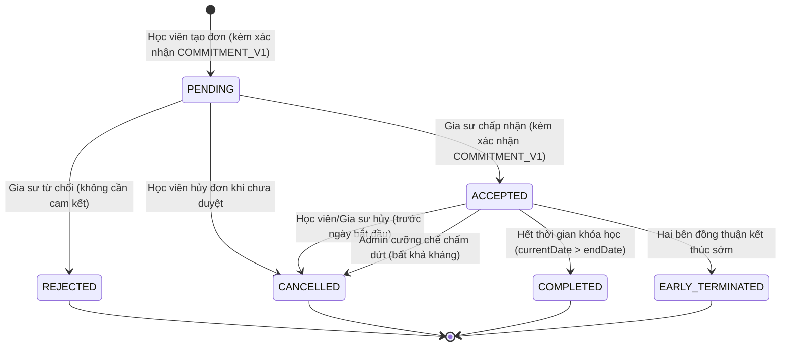

# TÀI LIỆU THIẾT KẾ KIẾN TRÚC & NGHIỆP VỤ: KHÓA HỌC NHIỀU BUỔI/TUẦN TRÊN SÀN KẾT NỐI TUTORMATCH
## Dự án TutorMatch | C++17 | Qt 6.11 | QML | Flat-File Persistence | Matching Platform Architecture

---

**Dự án:** TutorMatch  
**Không gian làm việc:** `C:/Users/DELL/.gemini/antigravity/scratch/TutorMatch`  
**Vai trò:** Principal Software Architect, Senior Domain Modeler & Data Integrity Reviewer  
**Thời điểm hoàn thiện:** 09/11/2026 (Bản thiết kế kỹ thuật chuẩn hóa — Đồng bộ 100% với Codebase thực thi)  
**Trạng thái tài liệu:** **APPROVED & FULLY IMPLEMENTED**  
**Tài liệu quyết định liên quan:**
- `docs/architecture/decisions/ADR-009_Multi_Session_Course_Booking_And_Session_Lifecycle.md`
- `docs/architecture/decisions/ADR-001` đến `ADR-008`

---

## 1. PHẠM VI SẢN PHẨM & TÔN CHỈ KIẾN TRÚC (PRODUCT SCOPE & ARCHITECTURAL PRINCIPLES)

### 1.1. Tôn chỉ cốt lõi: Sàn kết nối (Matching Platform), không phải LMS
TutorMatch được thiết kế với mục tiêu kết nối học viên với gia sư phù hợp và quản lý thỏa thuận lịch học định kỳ giữa hai bên:
- **TutorMatch là:** Nền tảng tìm kiếm gia sư thông minh (Smart Matching theo môn học, học phí, vị trí, đánh giá), quản lý thời khóa biểu trực quan (56 ca học chuẩn hóa), và thiết lập các khóa học định kỳ có cam kết trách nhiệm.
- **TutorMatch KHÔNG PHẢI là:** Hệ thống quản trị học tập (Learning Management System - LMS). Hệ thống không giám sát điểm danh từng buổi học ngoài đời thực, không có nghiệp vụ trọng tài tranh chấp buổi học, không giữ tiền ký quỹ và không thu hoa hồng nền tảng.
- **Đơn giản hóa có chủ đích (Intentional Simplicity):** Loại bỏ toàn bộ các khái niệm LMS phức tạp như thực thể `CourseSession`, báo cáo điểm danh hai bên (`Attendance Confirmation`), tranh chấp điểm danh (`SessionDispute`), phân xử hành chính (`Admin Arbitration`), và phân bổ giá trị tài chính per-session.

---

## 2. THỰC THỂ MIỀN DỮ LIỆU CHUẨN HÓA: `CourseBooking`

Mô hình duy nhất quản lý khóa học định kỳ là thực thể `CourseBooking` (`include/models/CourseBooking.h`), bao gồm 23 trường dữ liệu:

```
┌────────────────────────────────────────────────────────────────────────────────────────┐
│                                     CourseBooking                                      │
├────────────────────────────────────────────────────────────────────────────────────────┤
│ 1.  id                            : int            (Mã khóa học duy nhất, Primary Key) │
│ 2.  studentId                     : int            (Mã học viên đăng ký)               │
│ 3.  tutorId                       : int            (Mã gia sư đảm nhận)                │
│ 4.  studentName                   : std::string    (Họ tên học viên)                   │
│ 5.  tutorName                     : std::string    (Họ tên gia sư)                     │
│ 6.  subject                       : std::string    (Tên môn học)                       │
│ 7.  hourlyRate                    : double         (Học phí 1 ca học 90 phút)          │
│ 8.  dayOfWeek                     : int            (Thứ chính đầu tiên: 0=T2..6=CN)    │
│ 9.  slotIndex                     : int            (Ca chính đầu tiên: 0..7)           │
│ 10. startDate                     : std::string    (Ngày bắt đầu hiệu lực, YYYY-MM-DD) │
│ 11. weeksCount                    : int            (Thời lượng: 4, 8, hoặc 12 tuần)    │
│ 12. status                        : std::string    (PENDING/ACCEPTED/COMPLETED/...)    │
│ 13. createdAt                     : std::string    (Ngày tạo đơn, YYYY-MM-DD)          │
│ 14. weeklySchedule                : std::string    (Danh sách ca: "dow:slot;dow:slot") │
│ 15. earlyTerminationRequesterId   : int            (ID người yêu cầu kết thúc sớm)     │
│ 16. earlyTerminationStatus        : std::string    (NONE/PENDING/ACCEPTED/REJECTED)    │
│ 17. earlyTerminationReason        : std::string    (Lý do kết thúc sớm)                │
│ 18. actualEndDate                 : std::string    (Ngày kết thúc sớm thực tế)         │
│ 19. studentAcknowledged           : bool           (Học viên đã xác nhận cam kết)      │
│ 20. studentAckTimestamp           : std::string    (Thời điểm học viên xác nhận)       │
│ 21. tutorAcknowledged             : bool           (Gia sư đã xác nhận cam kết)        │
│ 22. tutorAckTimestamp             : std::string    (Thời điểm gia sư xác nhận)         │
│ 23. commitmentVersion             : std::string    (Phiên bản điều khoản cam kết)      │
└────────────────────────────────────────────────────────────────────────────────────────┘
```

### Phương thức tiện ích nghiệp vụ:
- `isMultiSlot()`: Trả về `true` nếu `weeklySchedule` chứa nhiều hơn 1 ca học hoặc khác với ca chính đơn.
- `getWeeklySlots()`: Trả về `std::vector<std::pair<int, int>>` danh sách các cặp `(dayOfWeek, slotIndex)`.
- `getTotalSessions()`: Bằng `getWeeklySlots().size() * weeksCount`.
- `getTotalCost()`: Bằng `getTotalSessions() * hourlyRate`.
- `isCommitmentFullyAcknowledged()`: Bằng `studentAcknowledged && tutorAcknowledged && (commitmentVersion == CURRENT_COMMITMENT_VERSION)`.

---

## 3. THUẬT TOÁN SINH LỊCH TẤT ĐỊNH (DETERMINISTIC SCHEDULE GENERATION)

### 3.1. Ý nghĩa của `startDate`, `weeksCount` và `endDate`
- **`startDate` (Ngày bắt đầu hiệu lực):** Là ngày dương lịch bắt đầu có hiệu lực của khóa học. **`startDate` không bắt buộc phải trùng với thứ trong tuần của bất kỳ ca học nào.**
- **`weeksCount` (Số tuần lặp lại):** Số lần lặp lại hàng tuần của mỗi ca học ($\text{weeksCount} \in \{4, 8, 12\}$).
- **`endDate` (Ngày kết thúc khóa học):** Là ngày dương lịch của buổi học cuối cùng sinh ra ($\max(\text{sessionDates})$).

### 3.2. Đặc tả Thuật toán
Cho tập hợp $k$ ca học trong tuần $P = \{(w_1, s_1), (w_2, s_2), \dots, (w_k, s_k)\}$:
1. Tổng số buổi học: $N = k \times \text{weeksCount}$.
2. Với mỗi ca $(w_j, s_j) \in P$:
   - Tính ngày đầu tiên có thứ $w_j$ kể từ `startDate`:
     $$\Delta = (w_j - \text{dayOfWeek}(\text{startDate}) + 7) \pmod 7$$
     $$d_0(w_j) = \text{addDays}(\text{startDate}, \Delta)$$
   - Sinh `weeksCount` ngày học cách nhau 7 ngày:
     $$d_i(w_j) = \text{addDays}(d_0(w_j), i \times 7) \quad (i = 0 \dots \text{weeksCount}-1)$$
3. Sắp xếp toàn bộ $N$ buổi học theo thứ tự thời gian tăng dần (`scheduledDate`, `slotIndex`).
4. Gán `endDate = sessionDates[N - 1]`.

```
                    Khóa học: T2 Ca 2 (0, 2) & T6 Ca 5 (4, 5) | 4 tuần | startDate = 2026-11-06 (Thứ 6)
                    ───────────────────────────────────────────────────────────────────────────────────
                    Buổi 1: 2026-11-06 (Thứ 6, Ca 5)   ← Thứ 6 đầu tiên kể từ startDate
                    Buổi 2: 2026-11-09 (Thứ 2, Ca 2)   ← Thứ 2 đầu tiên kể từ startDate (02/11 bị bỏ qua)
                    Buổi 3: 2026-11-13 (Thứ 6, Ca 5)
                    Buổi 4: 2026-11-16 (Thứ 2, Ca 2)
                    Buổi 5: 2026-11-20 (Thứ 6, Ca 5)
                    Buổi 6: 2026-11-23 (Thứ 2, Ca 2)
                    Buổi 7: 2026-11-27 (Thứ 6, Ca 5)
                    Buổi 8: 2026-11-30 (Thứ 2, Ca 2)   ← Buổi cuối cùng (endDate = 2026-11-30)
```

---

## 4. VÒNG ĐỜI TRẠNG THÁI & CƠ CHẾ GIỮ CHỖ (LIFECYCLE & RESERVATION MATRIX)



### 4.1. Ma trận Giữ chỗ & Xung đột Lịch (Reservation & Conflict Rules)
| Trạng thái CourseBooking | Giữ chỗ trên Thời khóa biểu? | Ảnh hưởng đến đơn đăng ký khác |
| :--- | :--- | :--- |
| **`PENDING`** | **KHÔNG** | Cho phép nhiều học viên gửi yêu cầu vào cùng ca. |
| **`ACCEPTED`** | **CÓ (KHÓA LỊCH)** | Ngăn chặn mọi đơn khác trùng bất kỳ ca & ngày học nào. |
| **`REJECTED`** | **KHÔNG** | Giải phóng ca học; các đơn khác có thể được chấp nhận. |
| **`CANCELLED`** | **KHÔNG** | Giải phóng ca học ngay lập tức. |
| **`EARLY_TERMINATED`**| **KHÔNG** | Giải phóng toàn bộ các ca học tương lai. |
| **`COMPLETED`** | **KHÔNG** | Đã kết thúc; không ảnh hưởng ca học tương lai. |

### 4.2. Bất biến Mặt nạ Nhị phân rảnh/bận (`scheduleBitmask`)
- `scheduleBitmask` (56 bits) biểu diễn khung giờ rảnh cố định của người dùng trong tuần.
- `scheduleBitmask` **TUYỆT ĐỐI KHÔNG BỊ TRỪ BIT** khi đơn chuyển sang `ACCEPTED`.
- Việc hiển thị ô màu xanh (rảnh), màu xám (bận cá nhân), hoặc màu cam/xanh đậm (đã được đặt bởi khóa học) được tính toán động tại thời điểm truy vấn thông qua `BookingService::getAcceptedSessionsForWeek()`.

---

## 5. CƠ CHẾ CAM KẾT KHÓA HỌC: `COMMITMENT_V1`

### 5.1. Nội dung điều khoản cam kết (`CourseBooking::COMMITMENT_POLICY_TEXT`)
1. Khóa học được lên lịch cố định theo các ca học đã thỏa thuận trong tuần.
2. Một bên có thể đề nghị kết thúc sớm khóa học bất kỳ lúc nào.
3. Khóa học chỉ kết thúc sớm khi bên còn lại đồng ý (đồng thuận hai bên).
4. Nếu bên còn lại từ chối, khóa học tiếp tục diễn ra theo lịch đã thỏa thuận.
5. Nếu cả hai bên đồng ý, khóa học chuyển sang trạng thái `EARLY_TERMINATED` và toàn bộ lịch học tương lai được giải phóng.
6. Việc kết thúc sớm không làm ảnh hưởng đến các khóa học khác của hai bên.
7. TutorMatch chỉ hỗ trợ kết nối và quản lý lịch học đã thỏa thuận, không xác nhận buổi học thực tế đã diễn ra ngoài đời thực.

### 5.2. Luồng thực thi & Bảo vệ Backend
1. **Học viên:** Trên `BookingModal.qml`, hiển thị hộp thông tin điều khoản và CheckBox cam kết. Nút bấm "Xác nhận gửi yêu cầu" bị khóa cho đến khi CheckBox được tích. Backend kiểm tra `studentAcknowledgeCommitment`: nếu `false`, lập tức từ chối và trả về lỗi.
2. **Gia sư:** Trên `TutorBookings.qml`, khi bấm "Chấp nhận", một hộp thoại xác nhận cam kết mở ra với CheckBox. Nút "Xác nhận chấp nhận" chỉ sáng khi đã tích. Khi gửi lên, backend kiểm tra cả hai điều kiện: gia sư đã xác nhận VÀ học viên đã xác nhận. Nếu thiếu bất kỳ bên nào, backend từ chối chuyển sang `ACCEPTED`.
3. **Từ chối không cần cam kết:** Nút "Từ chối" (`qmlRejectBooking`) trên giao diện gia sư luôn khả dụng trực tiếp mà không đòi hỏi cam kết.
4. **Chống giả mạo:** Timestamp được sinh độc quyền bởi backend theo chuẩn ISO 8601 (`DateUtils::getCurrentTimestampString()`). Client không thể tự truyền timestamp.

---

## 6. KẾT THÚC SỚM THEO CƠ CHẾ ĐỒNG THUẬN (CONSENSUAL EARLY TERMINATION)

### 6.1. Quy trình thực hiện
```
Học viên / Gia sư                    Hệ thống Backend                    Bên còn lại
       │                                     │                                │
       │─── 1. Gửi đề nghị kết thúc sớm ────>│                                │
       │       (kèm lý do)                   │─── 2. Hiển thị thông báo ─────>│
       │                                     │    (yêu cầu chờ phản hồi)      │
       │                                     │                                │
       │                                     │<── 3a. Đồng thuận (Agree) ─────│
       │                                     │        Chuyển EARLY_TERMINATED │
       │<── 4a. Thông báo khóa học kết thúc ─│        Giải phóng lịch tương lai│
       │                                     │                                │
       │                                     │<── 3b. Từ chối (Disagree) ─────│
       │                                     │        earlyTermination=REJECTED│
       │<── 4b. Thông báo tiếp tục học ──────│        Khóa học giữ ACCEPTED   │
```

- **Mỗi khóa học chỉ có tối đa 01 yêu cầu `PENDING` tại một thời điểm.**
- **Không có cơ chế đơn phương kết thúc:** Nếu bên nhận từ chối, khóa học bắt buộc tiếp tục diễn ra theo thỏa thuận ban đầu.

---

## 7. QUY TRÌNH XÁC THỰC QUYỀN ĐÁNH GIÁ (REVIEW ELIGIBILITY PIPELINE)

Quy trình đánh giá được thực hiện bởi `ReviewService::isEligibleForReview(int studentId, int bookingId, std::string& outReason)`:

```
[Bắt đầu kiểm tra quyền đánh giá]
               │
               ▼
   Khóa học có tồn tại không? ─────────(Không)───────> [TỪ CHỐI: "Không tìm thấy thông tin đơn!"]
               │ (Có)
               ▼
   studentId có phải học viên ─────────(Không)───────> [TỪ CHỐI: "Đơn đặt lịch không thuộc về bạn!"]
   của khóa học này không?
               │ (Có)
               ▼
   Trạng thái CourseBooking là gì?
        ├── PENDING ──────────────────────────────────> [TỪ CHỐI: "Khóa học đang chờ duyệt, chưa thể đánh giá!"]
        ├── ACCEPTED ─────────────────────────────────> [TỪ CHỐI: "Khóa học đang diễn ra, chỉ có thể đánh giá sau khi hoàn thành..."]
        ├── REJECTED ─────────────────────────────────> [TỪ CHỐI: "Khóa học đã bị từ chối, không thể đánh giá!"]
        ├── CANCELLED ────────────────────────────────> [TỪ CHỐI: "Khóa học đã bị hủy, không thể đánh giá!"]
        └── COMPLETED hoặc EARLY_TERMINATED
               │
               ▼
   Học viên đã từng đánh giá ───────────(Đã có)───────> [TỪ CHỐI: "Bạn đã gửi đánh giá cho khóa học này rồi!"]
   khóa học này trước đây chưa?
               │ (Chưa)
               ▼
   [HỢP LỆ (ELIGIBLE): Cho phép tạo Review (1..5 sao, nhận xét)]
```

---

## 8. LƯU TRỮ VÀ TƯƠNG THÍCH NGƯỢC (STORAGE & BACKWARD COMPATIBILITY)

### 8.1. Định dạng bản ghi 23 trường trong `data/course_bookings.dat`
```csv
id,studentId,tutorId,studentName,tutorName,subject,hourlyRate,dayOfWeek,slotIndex,startDate,weeksCount,status,createdAt,weeklySchedule,earlyTerminationRequesterId,earlyTerminationStatus,earlyTerminationReason,actualEndDate,studentAcknowledged,studentAckTimestamp,tutorAcknowledged,tutorAckTimestamp,commitmentVersion
```

### 8.2. Khả năng tương thích ngược của `CourseBookingSerializer`
- **13 trường (Legacy Single-Slot):** Tự động điền `weeklySchedule = "dow:slot"`, `earlyTerminationStatus = "NONE"`, `studentAcknowledged = false`, `tutorAcknowledged = false`.
- **18 trường (Multi-Slot sơ khai):** Tự động điền các trường cam kết với giá trị an toàn: `studentAcknowledged = false`, `tutorAcknowledged = false`, `commitmentVersion = ""`.
- **23 trường (Chuẩn hiện hành):** Đọc ghi đầy đủ và bảo toàn 100% dữ liệu.

---

## 9. KẾT QUẢ KIỂM THỬ & BẰNG CHỨNG THỰC NGHIỆM (TEST & VERIFICATION EVIDENCE)

Toàn bộ 24 Test Suites trong `TutorMatch_Tests` được thực thi và đạt **100% PASS**:
1. `run_test_ocp()` — Nguyên lý Open/Closed trong MatchingEngine.
2. `run_test_lsp()` — Nguyên lý Liskov Substitution trong phân cấp User.
3. `run_test_dip_isp_and_srp()` — Nguyên lý DIP, ISP, SRP giữa các Service.
4. `run_test_schedule_guard()` — Tính toán va chạm bitmask 56 ca học.
5. `run_test_sidebar_labels()` — Chuẩn hóa nhãn sidebar không tiền tố số.
6. `run_test_tutor_profile_editing()` — Chỉnh sửa và lưu hồ sơ gia sư.
7. `run_test_schedule_synchronization()` — Đồng bộ thời khóa biểu hai chiều.
8. `run_test_admin_user_data_contract()` — Hợp đồng dữ liệu người dùng phía Admin.
9. `run_test_admin_user_detail_modal_contract()` — Modal chi tiết người dùng Admin.
10. `run_test_admin_verification_and_lock_sync()` — Đồng bộ trạng thái duyệt và khóa tài khoản.
11. `run_test_admin_service_filters_and_search()` — Bộ lọc và tìm kiếm người dùng Admin.
12. `run_test_avl_tree_multi_value_and_deletion()` — Cây AVL đa giá trị và cân bằng khi xóa.
13. `run_test_schedule_guard_sanitization_and_56_bit_boundary()` — Lọc bit rác ngoài phạm vi 56 bit.
14. `run_test_mock_db_atomic_persistence_and_deduplication()` — Ghi tệp nguyên tử và chống trùng lặp.
15. `run_test_data_file_inspector()` — Kiểm tra dữ liệu an toàn Read-Only.
16. `run_test_booking_conflict_detection()` — Phát hiện xung đột lịch khóa học định kỳ.
17. `run_test_entity_serializers()` — Tuần tự hóa thực thể User, CourseBooking, Review.
18. `run_test_concrete_file_repositories()` — Kho lưu trữ tệp cụ thể và tự động nén dòng rác.
19. `run_test_phase3_end_to_end_scenarios()` — 10 kịch bản nghiệp vụ luồng người dùng E2E.
20. `run_test_recurring_course_booking()` — Vòng đời đăng ký khóa học định kỳ.
21. `run_test_timetable_recurring_course_integration()` — Tích hợp hiển thị thời khóa biểu tuần.
22. `run_test_data_audit_cleanup_and_migration()` — Kiểm tra tính bất biến của bộ dữ liệu sản xuất.
23. `run_test_multi_slot_course_and_consensual_termination()` — Đa ca học, đồng thuận kết thúc và tự động hoàn thành.
24. `run_test_commitment_acknowledgment_and_review_matrix()` — Ma trận kiểm thử toàn diện 17 kịch bản cam kết hai bên và điều kiện đánh giá khóa học.

Dữ liệu sản xuất được kiểm chứng bằng `TutorMatch_Inspector`:
- Tổng số bản ghi kiểm tra: 73 (50 Users, 0 Legacy Bookings, 15 Reviews, 8 CourseBookings).
- Số bản ghi hợp lệ: 73 (100% valid).
- Số bản ghi hỏng/lỗi: 0 (0% error).
- Tệp dữ liệu có bị chỉnh sửa không: **KHÔNG (100% Read-Only, toàn vẹn tuyệt đối)**.
